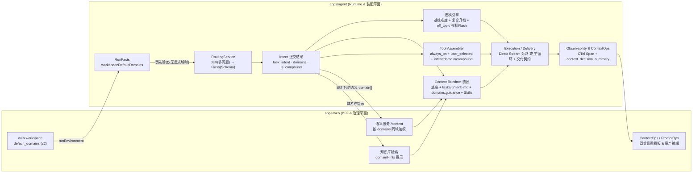
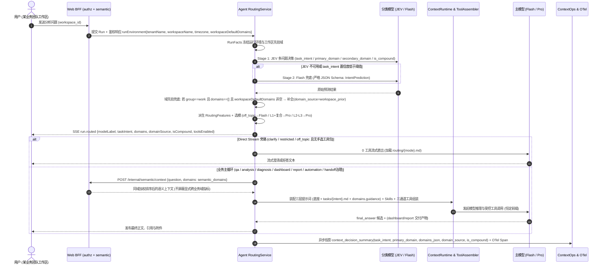

# 意图分类体系极简重构与全局动态装配 技术方案

> Feature：968（[返回 BRIEF](../BRIEF.md)） | 有效需求来源：[BRIEF.md](../BRIEF.md) 与 2026-11-27 架构评审会话（本次省略独立 PRD） | Profile：standard | 模板：[TECH_DESIGN.tmpl.md](../../_templates/TECH_DESIGN.tmpl.md) | 代码基线：`main @ 5180841`（含工作区在研的 L27 `tools/assembler.py` 工具动态组装基线） | 状态：待评审

> Compass 项目规则：[数据所有权与 SQL 迁移管理规范](../../../docs/database-migrations.md)。本方案涉及 `agent/main`（`0020 → 0021`）与 `web/main`（`0010_knowledge_library → 0011_workspace_default_domains`）两库变更，各自保持独立事务与版本账本。

---

## 需求依据与验收

本需求直接基于 [BRIEF.md](../BRIEF.md) 及 2026-11-27 会话确认的产品与架构约束，省略独立 PRD，以下需求范围与 AC 作为实施、评审与验收的唯一维护依据。

### 需求目标与边界

- **目标**：废除当前 10 分类 × 40 场景（`SC-01`–`SC-40`）的笛卡尔积扁平字典及 `scene_id` / `deliverable` 双轨冲突模型，建立**极简、正交、零空转**的三维度意图分类体系（`task_intent` 任务与交互意图 + `domains` 业务域列表 + `is_compound` 复合复杂度标志），并打通 PromptOps、Context Runtime、工具与 Skill 动态装配、Web 语义检索、知识库检索、公开契约及 ContextOps / OTel 可观测全链路。
- **核心原则**：“越少越好、先简单后复杂、有必要再新增”；意图分类环节保持纯粹，每个定义的意图和业务域都必须触发明确且可验证的下游机制，杜绝形同虚设的标签或字段。
- **团队先验与跨业务域授权分离**：用户所属工作区（团队）可配置默认业务域作为弱先验（问题未显式指定业务域时兜底），用户显式提问其他业务域时完全服从本轮问题；数据与工具访问权限继续由 Web RBAC、受限只读数据库连接、语义发布范围与 Context PEP 强制裁决。
- **零历史债边界**：当前系统尚未正式上线，**明确不做历史数据兼容**，不保留旧 `SC-01`–`SC-40` 映射表、旧 `scenes.json` 桥接逻辑或旧 `deliverable` 双轨补丁；数据库仍遵守 Compass 不可变迁移历史规范，通过新增正向迁移完成升级。
- **不做范围**：本期不新增独立策略引擎或规则可视化编排器；不调整底层模型并发、重试与预算结算内核；不新增业务域专属数据连接权限模型（沿用既有授权连接与语义授权）。

### 验收条件（AC）

| 编号 | 验收维度 | 可判定验收标准 |
| --- | --- | --- |
| **AC-01** | 正交分类体系 | 路由字典彻底移除 `SC-01`–`SC-40` 与 `scenes.json`，改为 `tasks.json`（10 个 `task_intent`：6 业务作业 + 4 边界守卫）与 `domains.json`（7 个业务域，与 Web 语义 `domain` 全覆盖映射），动态计算字典摘要，无冗余 `deliverable`、`required_capabilities` 或静态版本常量。 |
| **AC-02** | 两级分类纯粹化 | JEV（1 次多问题决策：`task_intent` + `primary_domain` + `secondary_domain` + `is_compound`）与 Flash（严格 JSON Schema 输出 `IntentPrediction`）输出完全一致的 `Intent` 对象；`service.py` 清除全部 `scene_id` / `deliverable` 冲突覆写补丁。 |
| **AC-03** | 工作区先验与跨域自由 | `web.workspace` 支持配置至多 2 个 `default_domains`，经 `runEnvironment.workspaceDefaultDomains` 透传给 Agent；当业务作业类问题未识别出显式域时回退工作区先验（`domain_source="workspace_prior"`），显式跨业务域提问时以分类器结果为准（`domain_source="classifier"`），访问权限完全由既有授权体系裁决。 |
| **AC-04** | 全意图 100% 触发真实机制 | 全部 10 个 `task_intent` 各自命中确定的选模档位、执行路径（主循环 vs Direct Stream 旁路）、专属任务/守卫提示词、默认工具通道增量与 Skill / 交付契约，无任何无差异的空转标签。 |
| **AC-05** | 业务域全局装配生效 | 全部 7 个业务域命中时同步触发三项真实动作：① 注入对应 `domains.json` 的精炼域口径指引（`guidance`）；② 将映射后的 Web 语义 `domain` 编码传给 Web 语义服务 `/context`，实现同域加权排序（同时保证显式点名的跨业务域指标不被过滤）；③ 驱动 `tools/assembler.py` 的 `domain_routed` 通道与域级 Skill 匹配。 |
| **AC-06** | 复合复杂度闭环 | `is_compound=true`（或命中 `>= 2` 个业务域）时，自动将 `L1` 任务升档至 `Pro` 模型、置 `requires_plan=true`，并在 `tools/assembler.py` 中自动解锁 `todo_write`、`sub_agent` 与 `long_task`（`goal`）工具包，彻底移除 `SC-40` 硬编码。 |
| **AC-07** | 动态工具装配去硬编码 | `tools/contracts.py` 与 `tools/assembler.py` 移除全部 `default_scenes` / `default_tasks` 与 5 组 `SC-*` 常量，统一使用 `default_intents`、`domains`、`compound_enabled` 声明工具治理元数据，所有 19 个内建/业务工具保持确定性前缀与权限前置不变量。 |
| **AC-08** | PromptOps 资产与在线校验 | 随包资产清理旧 `scenes.json` 及 `tasks/*/scenes/*`，重组为 `support/routing/tasks.json`、`support/routing/domains.json`、`tasks/{qa,analysis,diagnosis,dashboard,report,automation}.md` 及 `support/routing/instructions.json`；`promptops/structured.py` 强制保护代码控制字段，允许在线编辑 `description`、`examples`、`guidance` 与任务模板，且清理 `legacy_layout.json` 全部历史 `sc-*` 桥接。 |
| **AC-09** | 契约、前端与 ContextOps 全链路对齐 | `Intent`、`RunRoutedPayload`、ContextOps DTO 与 OpenAPI/TypeScript 生成产物同步更新并零漂移；ContextOps「意图」面板支持按**任务意图**与**业务域**双维下钻、展示复合任务率、域先验命中占比与分类耗时；工作区管理页支持配置默认业务域。 |
| **AC-10** | 可观测字段完整一致 | OTel / Langfuse Span 白名单与 `compass.route` / `context.assemble` 节点记录 `task_intent`、`primary_domain`、`domains`、`domain_source`、`is_compound`、`difficulty`，移除废弃 `category_id` / `scene_id`。 |
| **AC-11** | 数据库迁移与双库交付合规 | `agent/main` 交付 `0020 → 0021` Alembic 迁移与派生 SQL，`web/main` 交付 `0010_knowledge_library → 0011_workspace_default_domains` 原生 SQL 与派生 SQL；真实 PostgreSQL 17 通过空库安装、旧库升级、错误版本拒绝、SQL 再生成一致性、受限角色权限与备份恢复验收。 |
| **AC-12** | 端到端验证通过 | `pnpm contracts:check`、`pnpm db:sql:check -F agent`、`pnpm db:sql:check -F web`、`pnpm check`、`pnpm build` 全部通过；覆盖全部 10 个 `task_intent`、7 个 `domain_id`、工作区先验、跨业务域提问、复合任务升档与 PromptOps/ContextOps 端到端用例。 |

---

## 1. 方案概述

### 1.1 设计目标和设计原则

当前 Compass 的意图链路在多课演进中叠加了两套模型：第 12 课按“业务域 × 细粒度话题”建了 40 个 `SC-01`–`SC-40` 静态场景，第 21 课在 Context Runtime 引入了 4+2 个 `deliverable` 任务形态，第 27 课在 [assembler.py](../../../apps/agent/src/compass_agent/tools/assembler.py) 中不得不硬编码 5 组 `SC-*` 集合与超过 25 个 `default_scenes` 来弥补表达力不足；同时真正有装配价值的“业务域（`category_id`）”只在日志和统计面板里流转，未接入语义检索与工具/Skill 装配。

本次重构遵循五条硬性设计原则：

1. **正交拆解，消灭笛卡尔积**：将“做什么任务/守卫（`task_intent`）”、“涉及哪个业务域（`domains`）”和“是否复合多步（`is_compound`）”拆为三个独立维度。新增业务域无需复制任务模板，新增任务形态无需乘以业务域数量。
2. **极简优先，零空转标签**：任务与边界意图压缩至 **10 个**，业务域收敛至 **7 个**。每个标签在代码中都对应确定的执行、装配、检索或守卫行为，去除全部空字段（`required_capabilities`、`scene_hint`、重复的 40 段 `sop`）。
3. **先验引导，权限独立兜底**：工作区（团队）的默认业务域仅在问题未显式指向业务域时作为弱先验补全，绝不充当权限围栏；任何跨业务域提问只要通过既有 RBAC、受限数据库连接、语义可见范围和 Context PEP，均可正常装配与执行。
4. **代码权威边界与在线调优分离**：分类枚举 ID、路由难度基线、响应模式、交付契约与语义域映射由代码控制（不可在后台改坏执行契约）；分类描述（`description`）、识别示例（`examples`）、业务域口径指引（`guidance`）和任务方法论（`tasks/*.md`）交给 PromptOps 统一版本化管理与在线迭代。
5. **零历史债务，直接面向目标态**：不保留 `SC-01`–`SC-40` 兼容映射、双轨字段或旧版 `legacy_layout.json` 场景桥接，直接收敛单套干净的数据模型、契约和 Prompt 资产。

### 1.2 整体架构

重构后的全局意图识别与动态装配链路如下，贯穿 Web（工作区配置、语义服务、ContextOps 控制台）与 Agent（路由分类、PromptOps、Context Runtime、工具动态组装、可观测）两大应用：



**新增、修改与删除的边界划分**：
- **核心重构**：`routing/`（字典、分类器、选模）、`context_runtime/`（`profiles.py`、`assembly.json`、`classifier.py`、`model_step.py`、`pipeline.py`、`contracts.py`）、`tools/`（`contracts.py`、`assembler.py` 与各工具 `ToolGovernance`）、`promptops/`（`catalog.py`、`structured.py`、`reader.py`、`layout.py`、`sync.py`）、`context_ops/`（`entities.py`、`recorder.py`、`analytics.py`、`snapshots.py`、`mcp_server.py`）、`runtime/`（`service.py`、`context.py`、`turn.py`、`answer_turn.py`、`durable_service.py`）、`schemas.py`、`apps/web`（语义服务、组织工作区设置、ContextOps 看板、SSE 客户端）。
- **彻底清理**：`prompts/support/routing/scenes.json`、`prompts/tasks/*/scenes/`、`scripts/export_routing_dictionary.py`、`promptops/legacy_layout.json` 中的全部 `support/routing/scenes/sc-*.md` 条目与旧场景桥接逻辑。
- **保持复用**：`llm/` 适配器与预算并发控制、`harness/` 通用执行循环、`context_ops/compiler.py`（PEP 脱敏与拦截）和 `replay.py`、`tools/dispatcher.py` 与沙箱/MCP 后端、`goal/` 长任务账本。

### 1.3 关键决策与 Review 索引

| 决策 | 推荐及理由 | 代价与备选 | 待判断事项/确认状态 | 详情 |
| --- | --- | --- | --- | --- |
| **D1. `task_intent` 收敛为 10 项（6 作业 + 4 边界）并吸收 `deliverable`** | 彻底消除 `scene_id` 与 `deliverable` 双轨冲突；每项均对应独特执行路径、Prompt、工具包或交付契约，分类器由 `40+6` 降至 `10` 选 1。 | 备选：保留 8 作业（单列 `data_engineering`、`planning_advice`）。因 Compass 当前无独立 SQL/规划输出契约，并入 `qa`/`analysis` 更简洁，未来有专属契约时再扩。 | 已按“越少越好”原则收敛；待方案评审确认是否需微调名称 | [2.1.1](#211-正交分类体系与数据结构设计) |
| **D2. 业务域收敛为 7 项并与 Web 语义 11 域码 100% 映射** | 7 域与电商组织部门心智完全对齐，构成 Web 语义 11 个 `domain` 编码的无重叠划分，且支持单轮最多识别 2 个域应对跨部门问题。 | 备选：直接暴露 Web 11 个细分语义域（如拆分 `sales` 与 `channel`）。11 域在自然语言问句中边界过细，易降低分类准确率。 | 确认 7 域划分及与 Web 语义 11 域的映射表 | [2.1.1](#211-正交分类体系与数据结构设计) |
| **D3. 团队默认业务域落 `web.workspace.default_domains` 作为弱先验** | 复用既有“工作区=团队/业务线”模型，通过已有的 `runEnvironment` 透传，避免另建团队表；仅在未识别显式域时补全，绝不影响跨业务域授权。 | 代价：`web/main` 需追加 1 个轻量迁移 `0011_workspace_default_domains.sql`（1 列 + CHECK 约束）。备选：放 Agent 环境变量配置，但无法按工作区动态维护。 | 确认单工作区默认域上限为 2 个 | [2.1.1](#211-正交分类体系与数据结构设计)、[2.3.5](#235-web-语义检索知识库与工作区先验联动) |
| **D4. 业务域参与语义检索采用“同域加权”机制（不做硬过滤）** | 保证用户显式点名的跨业务域指标始终能精确命中，仅在候选排序与 8 项首屏填充时优先提升同域资产，兼顾召回精度与跨域自由。 | 备选：按 `domains` 做 SQL `WHERE domain = ANY(...)` 硬过滤，会导致分类器漏域或跨部门提问时指标不可见。 | 已明确采用加权策略 | [2.3.5](#235-web-语义检索知识库与工作区先验联动) |
| **D5. `is_compound` 独立为复杂度标志，替代 `SC-40` 与静态难度死绑** | 解耦“任务形态”和“多步复合度”，支持“简单查数走 Flash、跨多域复合查数自动升 Pro + 解锁 Plan/Goal/SubAgent”，不再把复合任务塞进笼统场景。 | 分类器增加 1 个布尔字段（JEV 增加 1 个 `noul` 问题，开销极小）。 | 确认升档规则：`is_compound` 或 `len(domains) >= 2` | [2.3.1](#231-路由字典与两级分类器routing) |
| **D6. 零历史债：直接替换列并重置 PromptOps 过时资产** | 系统尚未上线，直接移除 `scene_id` / `scenes.json` / `legacy_layout` 场景桥接，大幅降低理解与维护成本；迁移脚本对已有未上线库做确定性清洗/默认值处理，满足空库与旧库迁移校验。 | 不可直接原地降级回 `0020` 恢复旧 `SC-xx` 统计数据；需按 `docs/database-migrations.md` 依赖升级前 `pg_dump` 备份恢复。 | 用户已明确批准“不兼容历史数据、零历史债” | [2.1.1](#211-正交分类体系与数据结构设计)、[4](#4-兼容性与发布恢复考量) |

---

## 2. 详细设计方案

### 2.1 核心结构设计

#### 2.1.1 正交分类体系与数据结构设计

##### A. 维度 1：任务与交互意图（`TaskIntentId`，共 10 项）

所有 10 项集中声明在 [tasks.json](../../../apps/agent/src/compass_agent/prompts/support/routing/tasks.json)（拟新增）与代码字面量类型 `TaskIntentId` 中，**每一项均绑定确定的执行与装配机制**：

| `task_intent` | 名称 | 分组 (`group`) | 默认难度 | 响应模式 (`response_mode`) | 执行路径 | 专属提示词模板 | 除 `always_on` 外默认解锁工具 | 专属 Skill / 交付契约 |
| --- | --- | --- | --- | --- | --- | --- | --- | --- |
| `qa` | 经营问答与口径释义 | `work` | `L1` | `answer` | 主循环（轻量） | `tasks/qa.md` | 仅 `always_on`（11 个核心轻量只读工具，省去重工具声明） | `metric-check`；直接文本/循证答复 |
| `analysis` | 数据分析与对比拆解 | `work` | `L2` | `answer` | 主循环 | `tasks/analysis.md` | `+ todo_write`、`+ python_analysis` | `metric-check`；多维拆解与复算答复 |
| `diagnosis` | 异常诊断与故障归因 | `work` | `L3` | `answer` | 主循环（深度排查） | `tasks/diagnosis.md` | `+ todo_write`、`+ python_analysis`、`+ sub_agent` | `metric-check` + `agentic-search`；跨源假设证伪 |
| `dashboard` | 可视化与经营看板 | `work` | `L2` | `answer` | 主循环 + 看板交付 | `tasks/dashboard.md` | `+ todo_write`、`+ python_analysis` | `metric-check`；Dashboard JSON 产物契约与打开看板入口 |
| `report` | 经营报告与周期汇总 | `work` | `L3` | `answer` | 主循环 + 报告交付 | `tasks/report.md`（财务工作区叠 `tasks/report.finance.md`） | `+ todo_write`、`+ python_analysis`、`+ sub_agent` | `metric-check` + `report-outline`；Markdown 报告下载产物契约 |
| `automation` | 定时交付与工作流编排 | `work` | `L2` | `answer` | 主循环 + 编排能力 | `tasks/automation.md` | `+ todo_write`、`+ workflow_pack`（`create_workflow` + 至多 4 个用户 `workflow_*`） | `schedule-guidance.md` + `workflow.md` |
| `clarify` | 关键条件缺失需澄清 | `boundary` | `L1` | `clarify` | **Direct Stream 旁路** | `routing/clarify` | **0 工具**（若用户手动勾选工具包/活跃 Goal 则退回主循环） | 追问最小必要缺口，不虚构结论 |
| `handoff` | 平台管理与外部操作转交 | `boundary` | `L1` | `handoff` | 治理/转交分支 | `routing/handoff` | 语义维护者自动解锁 `semantic_govern`（3 个治理工具）；普通用户 0 写工具 | 说明边界并引导至对应管理/审批入口 |
| `restricted` | 明显越权与敏感拒答 | `boundary` | `L1` | `refuse` | **Direct Stream 旁路** | `routing/restricted` | **0 工具**（零数据访问，立即合规拒答） | 合规拒答并提示合法申请渠道 |
| `off_topic` | 业务范围外与闲聊 | `boundary` | 强制 Flash | `refuse` | **Direct Stream 旁路** | `routing/off-topic` | **0 工具**（关思考、上限 512 tokens，覆盖用户固定选模） | 温和婉拒并引导回电商经营分析 |

> **说明**：原 `SC-34`（多轮承接与指代）由分类器结合历史对话直接还原为真实 `task_intent`（如 `qa` / `analysis`）；原 `SC-35`（数据未到齐）在查数阶段由工具回执和答复协议如实报告，入口明显缺参则归 `clarify`；原 `SC-40`（复合任务）转为维度 3 的 `is_compound=true`。

##### B. 维度 2：业务域（`DomainId`，共 7 项，单轮 0–2 个）

集中声明在 [domains.json](../../../apps/agent/src/compass_agent/prompts/support/routing/domains.json)（拟新增）与前后端共享白名单中，与 Web 语义治理既有 11 个 `domain` 编码形成**全覆盖无重叠映射**：

| `domain_id` | 中文名称 | 映射 Web 语义 `domain` | 典型团队 / 工作区 | `guidance` 域级口径指引（随域按需注入系统提示词，每域 ≤ 250 字） |
| --- | --- | --- | --- | --- |
| `sales_channel` | 经营与渠道 | `["sales", "channel"]` | 经营分析 / 渠道运营 | 区分成交、实付、净额事件时钟与渠道归属；促销增量拆解须核对优惠承担方与分摊余差；固定漏斗须对齐去重键与窗口截断。 |
| `marketing_member` | 营销与会员 | `["marketing", "customer"]` | 营销投放 / CRM 会员 | 核对归因窗、新客去重单位与退款成熟日；仅比较同等观察时长的队列；投放/分群建议须交代边际成本、对照与停止标准。 |
| `product_supply` | 商品与库存 | `["product", "inventory"]` | 商品企划 / 供应链 | 先在 SKU 与持货地点粒度去重再上卷；区分现存、可用、在途与冻结快照时点；库龄起算、安全库存与补货提前期须明确口径。 |
| `trade_fulfillment` | 交易与履约 | `["trade", "fulfillment"]` | 交易结算 / 物流售后 | 对齐下单、支付、退款、出库、签收各自事件时钟与币种；退货率区分按单/件/金额与可退观察窗；跨期与一对多流水须追溯原单。 |
| `store_region` | 区域与门店 | `["organization"]` | 区域 / 门店运营 | 固定可比门店集合，明确同店、新开、闭店、迁店口径与营业天数差异；门店排名同时展示绝对差额与达成率，注明小基数影响。 |
| `finance_cost` | 财务与成本 | `["finance"]` | 财务经营分析 | 严格遵守收入确认、税率、折扣分摊与成本可见权限；成本权限不足时拒答受限口径，绝不按零成本试算。 |
| `platform_data` | 平台与数据 | `["quality"]` | 数据工程 / 平台运维 | 区分业务发生、入仓、修订与可见水位，分开报告数据迟到、真零与断流；性能/故障排查按分位延迟、错误率与变更基线给出可证伪假设。 |

##### C. 维度 3：复杂度与路由派生特征（`is_compound` + `RoutingFeatures`）

- `Intent` 对象（唯一核心结构，取代旧 `Intent(category_id, scene_id)` + `deliverable`）：
  - `task_intent: TaskIntentId`（10 选 1）
  - `domains: list[DomainId]`（长度 `0..2`，保序去重，`domains[0]` 为主业务域）
  - `domain_source: Literal["classifier", "workspace_prior", "none"]`
  - `is_compound: bool`（是否跨阶段、多子目标或“先深度分析再成稿”的复合任务）
- `RoutingFeatures`（由 `dictionary.features_for(intent)` 按 `task_intent` 与 `is_compound` / `domains` 确定性派生）：
  - `group: Literal["work", "boundary"]`
  - `base_difficulty: Literal["L1", "L2", "L3"]`
  - `effective_difficulty: Literal["L1", "L2", "L3"]`（升档规则见 2.3.1）
  - `response_mode: Literal["answer", "clarify", "refuse", "handoff"]`
  - `delivery_kind: Literal["qa", "analysis", "dashboard", "report", "none"]`
  - `semantic_domains: list[str]`（由 `domains` 展开映射得到的 Web 语义 `domain` 编码数组）
  - `requires_plan: bool`（`is_compound` 为真，或用户显式要求 `constraints.plan == "required"`）

##### D. 数据库变更登记（严格遵循 `docs/database-migrations.md`）

本次涉及 `agent/main` 与 `web/main` 两个独立数据库，各自按 owner 独立维护迁移源、版本账本与派生 SQL，**无跨库外键、无跨库 JOIN、无跨库事务假设**：

| 逻辑库 (`owner`) | 迁移工具与唯一源 | 版本区间 | 变更对象与约束 | 派生 SQL 交付路径 | 旧数据处理与恢复路径 |
| --- | --- | --- | --- | --- | --- |
| `agent/main`（PostgreSQL 17） | Alembic · `apps/agent/migrations/versions/0021_intent_taxonomy_refactor.py`（拟新增） | `0020 → 0021` | ① `context_decision_summary`：删 `scene_id`、`task` 及 `idx_ctx_summary_policy_scene`；增 `task_intent VARCHAR(32) NOT NULL`、`primary_domain VARCHAR(32) NULL`、`domains_json JSONB NOT NULL`、`domain_source VARCHAR(24) NOT NULL`、`is_compound BOOLEAN NOT NULL`、`ck_ctx_summary_domain_source`、索引 `idx_ctx_summary_policy_intent` 与 `idx_ctx_summary_domain`。② `context_badcase`：删 `scene_id`；增 `task_intent VARCHAR(32) NOT NULL`、`primary_domain VARCHAR(32) NULL`、`domains_json JSONB NOT NULL`。③ 重置 `agent_runtime_control.policy_sha256 = NULL`（`key='execution'`）并重置 `prompt_head` 与清空过期 `prompt_*` 旧资产行。 | `apps/agent/db/main/sql/bootstrap.sql`、`apps/agent/db/main/sql/upgrades/0020__0021.sql`、`apps/agent/db/main/sql/manifest.json`（均由 `pnpm db:sql -F agent` 生成；历史 `0001`–`0020` 增量保持不可变） | 零历史债：预发布库已有观测行按 `DEFAULT 'unclassified'` / `'[]'` / `'none'` / `FALSE` 平滑通过非空约束，旧 `prompt_*` 清理后由管理员/同步脚本导入并发布新版资产。恢复方式：`downgrade()` 显式报错禁止破坏性降级，通过升级前 `pg_dump` 备份还原到独立空库后切回旧构建。 |
| `web/main`（PostgreSQL 17） | node-pg-migrate 原生 SQL · `apps/web/db/main/migrations/0011_workspace_default_domains.sql`（拟新增） | `0010_knowledge_library → 0011_workspace_default_domains` | `web.workspace` 新增列 `default_domains text[] NOT NULL DEFAULT '{}'`，追加 `CHECK` 约束 `ck_workspace_default_domains`（一维、无 NULL、长度 ≤ 2、元素属于 7 个合法业务域白名单）。沿用 `compass_web_runtime` 现有 `SELECT/INSERT/UPDATE` 权限。 | `apps/web/db/main/sql/bootstrap.sql`、`apps/web/db/main/sql/upgrades/0010_knowledge_library__0011_workspace_default_domains.sql`、`apps/web/db/main/sql/manifest.json`（均由 `pnpm db:sql -F web` 生成） | 既有工作区默认 `{}`（无先验域，行为安全中性）。恢复方式：升级前 `pg_dump`（`--schema=web --schema=web_meta`）备份还原至新供应库并切换连接。 |

- **运行角色权限检查**：
  - `compass_agent_runtime` 对 `context_decision_summary` / `context_badcase` / `prompt_*` 的表级权限在 `0016` / `0020` 已授予（`SELECT / INSERT` 等），`ALTER TABLE` 列增删不改变表级授权，且新增索引与约束由 `compass_agent_owner` 持有。
  - `compass_web_runtime` 对 `web.workspace` 已拥有 `SELECT / INSERT / UPDATE` 权限，无需修改角色授权。
  - `runtime/deployment.py` 的 `REVISION` 同步升级为 `"0021"`，`/readyz` 核对目标版本 `0021`。

#### 2.1.2 数据流设计

以下时序图展示一次标准分析 Run 从 Web 受理到全局装配、执行交付及观测投影的完整数据流与失败/旁路路径：



**关键失败与安全边界路径**：
1. **分类阶段不可用或输出非法枚举**：JEV 失败或低于阈值（`prob < 0.5` 或 `margin < 0.1`）自动降级到 Flash；Flash 超时或输出非法枚举返回 `503`（`intent_unavailable` / `intent_invalid`），不静默猜测意图执行工具。
2. **次域不确定不触发整轮降级**：JEV 的 `secondary_domain` 若置信度不足，直接按 `None` 处理，不因为次域不确定而浪费一次 Flash 兜底调用。
3. **语义服务不可用**：保持既有降级策略（返回 `resolution.status = "unavailable"`），不影响数据库/知识库等其他获准工具继续工作。
4. **跨业务域权限校验**：工作区 `default_domains` 和分类器 `domains` 均为只读路由/排序提示，绝不写入权限上下文；工具访问、数据源连接、语义资产和知识库仍由既有授权与 Context PEP 在每次调用与恢复时实时核验。

#### 2.1.3 接口与契约设计

本方案修改 Agent 权威契约源 [schemas.py](../../../apps/agent/src/compass_agent/schemas.py) 后，执行 `pnpm contracts` 同步更新 `contracts/*.json` 与 `apps/web/src/generated/`，严禁手改生成产物。

1. **核心意图与路由契约（`apps/agent/src/compass_agent/schemas.py`）**
   - `TaskIntentId = Literal["qa", "analysis", "diagnosis", "dashboard", "report", "automation", "clarify", "handoff", "restricted", "off_topic"]`
   - `DomainId = Literal["sales_channel", "marketing_member", "product_supply", "trade_fulfillment", "store_region", "finance_cost", "platform_data"]`
   - `DomainSource = Literal["classifier", "workspace_prior", "none"]`
   - `Intent`：字段替换为 `task_intent: TaskIntentId`、`domains: list[DomainId]`（`max_length=2`）、`domain_source: DomainSource`、`is_compound: bool`。
   - `RoutingFeatures`：字段替换为 `group`、`base_difficulty`、`effective_difficulty`、`response_mode`、`delivery_kind`、`semantic_domains`、`requires_plan`。
   - `RunRoutedPayload`（SSE `run.routed` 事件载荷）：
     ```json
     {
       "providerId": "uuid",
       "modelLabel": "DeepSeek V4 Pro",
       "taskIntent": "diagnosis",
       "domains": ["sales_channel", "trade_fulfillment"],
       "domainSource": "classifier",
       "isCompound": true,
       "toolsEnabled": true
     }
     ```
     移除旧 `sceneId` 正则 `^SC-[0-9]{2}$`。

2. **Web → Agent 运行环境透传（内部鉴权接口）**
   - `apps/web/src/server/composition.ts` 返回的 `runEnvironment` 新增可选字段 `workspaceDefaultDomains: DomainId[]`（默认 `[]`，长度 `<= 2`）。
   - `apps/agent/src/compass_agent/runtime/durable_service.py` 校验 `workspaceDefaultDomains` 为合法 `DomainId` 列表后写入 `RunFacts`。

3. **Agent → Web 语义上下文接口（`POST /internal/semantic/context`）**
   - 请求载荷将废弃的 `scene_hint: string` 替换为 `domains: list[str]`（传映射后的 Web 语义 `domain` 编码，至多 6 项，每项长度 `<= 32`）。

4. **ContextOps REST & MCP 契约（`/v1/contextops/*` 与 `/v1/contextops/mcp`）**
   - 查询参数：`/runs`、`/intents`、`/badcases`、`contextops_list_runs`、`contextops_list_badcases` 将 `scene_id` 替换为 `task_intent` 与 `domain`（双筛选维度）。
   - `ContextRunView` / `ContextBadcaseView`：将 `scene_id`、`scene_name`、`category_name` 替换为 `task_intent`、`task_intent_name`、`domains`、`domain_names`、`domain_source`、`is_compound`。
   - `ContextIntents`（`/v1/contextops/intents`）：
     - `intent_breakdown: list[ContextIntentBreakdown]`（按 10 个 `task_intent` 聚合次数、JEV/Flash/Fallback 来源占比、复合任务占比、P50/P95 耗时）
     - `domain_breakdown: list[ContextDomainBreakdown]`（按 7 个 `domain_id` + `none` 聚合命中次数、分类器命中 vs 工作区先验命中拆分）
     - `sources`、`durations`、`recent` 同步切换新字段，删除 `excluded_historical_count` 历史兼容计数。

5. **Web 工作区 CRUD 接口（`/api/v1/workspaces`）**
   - `POST / PATCH` 工作区请求与返回模型增加 `defaultDomains: DomainId[]`（默认 `[]`，上限 2 项，前端和服务端共同校验白名单）。

---

### 2.2 配置变更

本次不新增环境变量，全部复用既有 `COMPASS_ROUTING_MODE`、`COMPASS_ROUTING_{JEV,FLASH,PRO}_PROVIDER_ID` 与 `POLICY` 阈值常量（`intent_probability = 0.5`、`intent_margin = 0.1`、超时 `8s / 20s / 30s`）。

| 配置项 / 常量 | 变更说明 | 默认值 / 行为 | 生效时机 |
| --- | --- | --- | --- |
| `routing/dictionary.py` 版本摘要 | 删除手写 `CATALOG_VERSION` 常量，改为启动时对随包 `tasks.json` + `domains.json` 的代码控制字段计算 SHA-256 前 16 位 | 自动确定性计算 | 进程启动（`lru_cache`） |
| `routing/config.py` `POLICY.version` | 由 `"lesson12-flow-1"` 升级为 `"intent-v2"` | `"intent-v2"` | 代码发版生效 |
| `context_runtime/profiles.py` `POLICY_VERSION` | 由 `"context-v1"` 升级为 `"context-v2"`，`POLICY_DIGEST` 纳入 `tasks.json` 与 `domains.json` 固定字段 | `"context-v2"` | 迁移 `0021` 清空旧指纹后自动登记 |

---

### 2.3 分模块详细设计

#### 2.3.1 路由字典与两级分类器（`routing/`）

- **文件定位**：`apps/agent/src/compass_agent/routing/{dictionary.py,intent.py,prompts.py,service.py,config.py,README.md}`
- **字典加载（`dictionary.py`）**：
  - `task_catalog()` 读取随包 `prompts/support/routing/tasks.json` 中除 `description`、`examples` 外的代码控制字段；`domain_catalog()` 读取随包 `prompts/support/routing/domains.json` 中除 `description`、`examples`、`guidance` 外的代码控制字段。
  - `task_descriptions()` 与 `domain_descriptions()` 从当前 Run 绑定的 PromptOps 版本（非受管回退随包）读取 `description` + `examples`，用于拼装分类器标签说明。
  - `domain_guidances(domains)` 从当前 Run 绑定的 `domains.json` 提取命中域的 `guidance` 文本，供 Context Runtime 装配。
  - `semantic_context_args(question, intent)` 展开 `intent.domains` 对应的全部 Web 语义 `semantic_domains` 去重列表，构造 `{"question": question[:2400], "domains": [...]}`。
- **分类请求构造（`intent.py`）**：
  - **JEV 决策输入（`decision_input`）**：单次 `DecisionInput` 包含 4 个正交问题：
    1. `task_intent`（`choice`，10 个任务/边界描述）
    2. `primary_domain`（`choice`，7 个业务域 + `none`）
    3. `secondary_domain`（`choice`，7 个业务域 + `none`）
    4. `is_compound`（`noul`，判断本轮是否需要跨多步拆解、多数据源交叉归因或先分析再成稿）
    - `state` 中传入 `messages` 及 `runOrganization`（含 `workspaceName`、`workspaceDefaultDomains` 提示）。
    - 解析规则：`task_intent` 必须满足置信度阈值，否则整轮降级 Flash；`primary_domain` 满足阈值时采纳，`secondary_domain` 满足阈值且不等于主域、不等于 `none` 时追加，不满足时静默忽略而不触发整轮降级；`is_compound` 取概率 `>= 0.6` 为 `True`，否则 `False`。
  - **Flash 兜底输入（`flash_input`）**：统一使用单一 `IntentPrediction` JSON Schema（`task_intent`、`domains` 最多 2 项、`is_compound`），移除原受管/非受管两套 Schema 分支。
- **先验补全与选模（`service.py`）**：
  - **工作区先验补全**：
    - `group == "boundary"` → 强制清空 `domains = []`，`domain_source = "none"`，`is_compound = False`。
    - `group == "work"` 且分类器返回 `domains` 非空 → `domain_source = "classifier"`。
    - `group == "work"` 且分类器返回 `domains == []` → 若 `facts.workspace_default_domains` 非空则取前 2 项并设 `domain_source = "workspace_prior"`，否则 `domain_source = "none"`。
  - **有效难度与选模规则**：
    - `task_intent == "off_topic"` → 固定 Flash（`reason="off_topic_flash"`），优先于用户固定选模。
    - `selection.mode == "fixed"` → 用户所选模型（`reason="user_fixed_main_model"`）。
    - `selection.mode == "auto"`：
      - `group == "boundary"` → Flash（`reason="boundary_flash"`）。
      - `base_difficulty == "L1"` 且 `(is_compound or len(domains) >= 2)` → `effective_difficulty = "L3"`，选 Pro（`reason="compound_upgrade"`）。
      - 其余按 `effective_difficulty`：`L1` 选 Flash，`L2` / `L3` 选 Pro（`reason=f"difficulty_{effective_difficulty}"`）。

#### 2.3.2 提示词资产与 PromptOps 治理（`prompts/` & `promptops/`）

- **资产结构重组**（彻底消除 40 份重复 SOP 与旧目录碎片）：
  - **新增**：
    - `prompts/support/routing/tasks.json`（10 个任务/边界意图的元数据 + 描述 + 示例）
    - `prompts/support/routing/domains.json`（7 个业务域的元数据 + 描述 + 示例 + `guidance`）
    - `prompts/tasks/{qa,analysis,diagnosis,dashboard,report,automation}.md`（6 份精炼通用作业模板，其中 `report.md` 声明 `{{audience}}`、`{{period}}`、`{{unit}}` 变量）
    - `prompts/tasks/report.finance.md`（财务工作区专用的报告视角覆写模板）
  - **修改**：
    - `prompts/support/routing/instructions.json`：精简为 `classify-jev`、`classify-flash`、`clarify`、`handoff`、`restricted`、`off-topic` 共 6 个键（移除旧 `classify-flash-managed`、`deliverable`、`business` 冗余键）。
    - `prompts/shared/execution.json`：更新 `stages.identify` 文案，与新 10 项 `task_intent` + 7 业务域对齐；`skills` 保留 `metric-check`、`report-outline`、`agentic-search`。
    - `prompts/support/starters/models/intent-routing.json`：更新平台模型决策测试页示例为新分类示范。
  - **删除**：
    - `prompts/support/routing/scenes.json`
    - `prompts/tasks/{business_qa,data_analysis,dashboard,business_report}/` 旧目录及全部 `scenes/*.md`
    - `apps/agent/scripts/export_routing_dictionary.py`
- **PromptOps 代码清理与校验增强**：
  - `promptops/structured.py`：移除 `support/routing/scenes.json` 校验分支，新增 `support/routing/tasks.json` 与 `support/routing/domains.json` 校验：
    - `tasks.json`：强制保留代码登记的全部 10 个 `task_intent` 及固定属性（`group`、`default_difficulty`、`response_mode`、`delivery_kind`），允许在线编辑 `description`（1–1000 字符）和 `examples`（0–10 条）。
    - `domains.json`：强制保留代码登记的全部 7 个 `domain_id` 及固定属性（`name`、`semantic_domains`），允许在线编辑 `description`、`examples` 和 `guidance`（1–1500 字符）。
  - `promptops/legacy_layout.json`、`layout.py`、`reader.py`、`sync.py`：清除所有 `support/routing/scenes/sc-*.md` 成员定义及旧 `scenes.json` 运行时兼容拼装代码。
  - `promptops/catalog.py`：登记 `support/routing/tasks.json`（使用位置：`任务意图分类`）与 `support/routing/domains.json`（使用位置：`业务域识别与装配`）。

#### 2.3.3 Context Runtime 全局装配引擎（`context_runtime/`）

- **文件定位**：`apps/agent/src/compass_agent/context_runtime/{profiles.py,assembly.json,contracts.py,classifier.py,model_step.py,pipeline.py,run_facts.py}`
- **`ContextRequest` 与 `assembly.json` 精简**：
  - `ContextRequest` 移除 `task` + `scene` 双字段，替换为 `task_intent: TaskIntentId`、`domains: tuple[DomainId, ...]`、`is_compound: bool`。
  - `assembly.json` 删除 `sceneTemplates`（4 个残缺映射）、`numericIntents` / `definitionIntents`（中文字符串硬编码）、`searchPacks.retail.excludedScenes`（旧 `SC-*` 列表），改为：
    - `scopeProfiles`（保留 `platform` / `operations` / `finance` 的 `audience` 与 `toolCeiling`）
    - `taskTemplates`：明确登记全部 6 个业务作业模板与可选 `scope` 覆写（如 `(report, finance) → tasks/report.finance.md`）
    - `searchPacks.retail`：仅保留零售搜索验证配置，生效条件统一为 `group == "work"`，不再维护 `excludedScenes`。
- **三层正交系统提示词装配（`pipeline.py`）**：
  1. **底座层**：`shared/fragments/base.md` + 按能力加载的 `semantics.md` / `answer-protocol.md` / 工具引导片段（按实际暴露工具动态拼入）+ `plan-required.md`（`requires_plan == True` 时）。
  2. **任务作业层**：按 `task_intent` 100% 加载对应 `tasks/{task_intent}.md`（或工作区覆写模板，如 `tasks/report.finance.md`）+ 命中的 Skill 片段（`SkillSpec` 改为按 `intents`、`domains` 与 `compound_only` 匹配：`metric-check` 覆盖 5 个查数/分析/看板/报告意图，`agentic-search` 覆盖 `diagnosis`/`report` 及 `is_compound`，`report-outline` 覆盖 `report`）。
  3. **业务域口径层**：按 `ctx.domains`（0–2 个）从本 Run 固定的 `support/routing/domains.json` 读取对应 `guidance`，以 `## 业务域口径指引（<域名>）` 区块追加到系统提示词，并把 `domains.json` 记入回执 `files`（使 PromptOps 改动可追踪、ContextOps 快照可复现）。
- **分类阶段上下文预算与审计（`classifier.py`）**：
  - 预取与绑定文件改为 `support/routing/tasks.json`、`support/routing/domains.json`、`support/routing/instructions.json`、`shared/fragments/base.md`、`shared/stages/identify.md`。
  - 回执中记录 `taskIntent`、`domains`、`domainSource`、`isCompound`，取代原 `scene` 与 `task`。

#### 2.3.4 动态工具全局装配重构（`tools/` 与 `runtime/`）

直接重构当前工作树中的 Lesson 27 动态工具组装器，彻底清除全部 `SC-*` 残留：

- **`ToolGovernance` 重构（`tools/contracts.py`）**：
  ```python
  LoadingChannel = Literal["always_on", "intent_routed", "domain_routed", "user_selected"]

  @dataclass(frozen=True, slots=True)
  class ToolGovernance:
      channel: LoadingChannel = "user_selected"
      pack: CapabilityPack = "user_extension"
      default_intents: frozenset[TaskIntentId] = frozenset()
      domains: frozenset[DomainId] = frozenset()       # 空集=全域通用；非空=命中域才装配
      compound_enabled: bool = False                    # is_compound=True 时自动解锁
      allowed_phases: frozenset[str] = frozenset({"work"})
      requires_semantic_maintainer: bool = False
      subagent_allowed: bool = False
      scheduler_allowed: bool = True
      summary: str = ""
  ```
- **`AssemblyInput` 与 `assemble_step` 重构（`tools/assembler.py`）**：
  - 删除 `L1_LIGHT_SCENES`、`DIRECT_STREAM_SCENES`、`MULTI_TURN_READ_SCENES`、`AUTOMATION_SCENES`、`ADMIN_CONFIG_SCENES` 五组硬编码常量。
  - `AssemblyInput` 将 `task` + `scene_id` 合并为 `task_intent: TaskIntentId`、`domains: frozenset[DomainId]`、`is_compound: bool`。
  - `should_direct_stream(ctx)` 简化为单条清晰不变量：
    `ctx.caller_role == "root" and ctx.task_intent in {"clarify", "restricted", "off_topic"} and not ctx.selected_packs and not ctx.selected_workflow_ids and not ctx.selected_mcp_server_ids and not ctx.has_active_goal`
  - **四通道确定性组装顺序**（硬权限前置不变量保持不变）：
    1. `always_on`（11 个核心轻量只读底座）
    2. `user_selected`（用户显式勾选的能力包与扩展工具，以及 `is_compound` 触发 `long_task`、`automation` 触发 `workflow_pack`、`handoff` + 维护者权限触发 `semantic_govern`）
    3. `intent_routed`（命中 `ctx.task_intent in gov.default_intents` 或 `ctx.is_compound and gov.compound_enabled`）
    4. `domain_routed`（当工具声明了非空 `gov.domains` 且 `bool(gov.domains & ctx.domains)` 时自动装配；若同时声明了 `default_intents` 则要求两者均满足，支持未来按域挂载的业务工具/插件零侵入接入）
  - **19 个静态工具的治理元数据清单更新**：
    - `python_analysis`：`channel="intent_routed"`, `default_intents={"analysis", "diagnosis", "dashboard", "report"}`（从 25 个 `SC-*` 精简为 4 项）
    - `sub_agent`：`channel="intent_routed"`, `default_intents={"diagnosis", "report"}`, `compound_enabled=True`（从 12 个 `SC-*` 精简为 2 项 + 复合开关）
    - `todo_write`：`channel="intent_routed"`, `default_intents={"analysis", "diagnosis", "dashboard", "report", "automation"}`, `compound_enabled=True`
    - `goal`：`channel="user_selected"`, `pack="long_task"`, `compound_enabled=True`
    - `create_workflow`：`channel="user_selected"`, `pack="workflow_pack"`, `default_intents={"automation"}`
    - `discover_semantic_candidates` / `review_semantic_change` / `submit_semantic_change`：`channel="user_selected"`, `pack="semantic_govern"`, `default_intents={"handoff"}`, `requires_semantic_maintainer=True`
    - 其余 11 个底座工具保持 `always_on`。
- **Runtime 执行与交付闭环（`runtime/service.py`、`runtime/context.py`、`runtime/turn.py`、`runtime/answer_turn.py`）**：
  - `RunRoute` 用 `task_intent`、`domains`、`domain_source`、`is_compound`、`delivery_kind` 替换 `scene_id`、`deliverable`、`task_type`。
  - `task_verifiers` 改为按 `task_intent` 注册（不再按 `scene_id`）；`answer_turn.py`、`delivery.py` 直接读取 `route.delivery_kind`（`qa` / `analysis` / `dashboard` / `report`）决定是否触发 Dashboard JSON 或 Markdown 报告交付契约。

#### 2.3.5 Web 语义检索、知识库与工作区先验联动（`apps/web/`）

- **工作区默认业务域（`apps/web/src/server/modules/access/` & `features/organization/pages.tsx`）**：
  - 数据库 `web.workspace.default_domains` 接入 `pg-access.ts` 读写、`workspace` DTO 与组织管理页面工作区新建/编辑弹窗（多选标签控件，最多 2 项，可留空，复用 Compass UI 设计变量与键盘可访问规范）。
  - `apps/web/src/server/composition.ts` 在 `runEnvironment` 中返回 `workspaceDefaultDomains: workspace.defaultDomains`。
- **语义上下文同域加权（`apps/web/src/server/modules/semantic/runtime.ts`）**：
  - `operation === "context"` 解析 `domains: z.array(z.string().max(32)).max(6).default([])`，彻底删除空转的 `scene_hint`。
  - **两阶段排序（加权但不屏蔽跨域）**：
    1. 精确点名优先：`requested`、`intent.metric`、`intent.options` 全量在授权目录内匹配（不按 `domains` 过滤），确保“供应链同事查销售额”直接命中。
    2. 候补与泛化检索加权：对词法/模糊匹配候选 `v` 计算 `domainBoost = domains.includes(v.domain) ? 1 : 0`，排序键为 `strength(v) DESC, domainBoost DESC, rank(v) DESC, asset_id ASC`；在未命中精确指标时，若 `domains` 非空且首屏未满 8 项，按同域优先从授权已发布指标补齐高频核心指标，显著提升泛化问题（如“帮我看看昨天库存整体情况”）的语义召回质量。
- **知识库检索联动（`apps/agent/src/compass_agent/documents/tool.py`）**：
  - 在 `search_documents` 缺省未指明特定文档关键词时，模型已从系统提示词获得当前 `domains` 域名称与域口径指引；`documents/client.py` 清除 `scenePack` 中对旧 `SC-*` 的排斥耦合。

#### 2.3.6 可观测与 ContextOps 控制台（`observability/`、`context_ops/` & `features/contextops/`）

- **OTel / Langfuse 字段白名单（`observability/privacy.py`、`routing/service.py`、`context_runtime/model_step.py`）**：
  - 白名单移除 `category_id`、`scene_id`、`task`，替换为 `task_intent`、`primary_domain`、`domains`（逗号拼接有限枚举串）、`domain_source`、`is_compound`、`difficulty`。
  - `compass.route` 与 `context.assemble` Span 同步写入上述属性，保持零正文泄露。
- **ContextOps 存储与聚合（`context_ops/{entities.py,recorder.py,analytics.py,snapshots.py,mcp_server.py}`）**：
  - `recorder.py` 从回执直接落库 `task_intent`、`primary_domain`、`domains_json`、`domain_source`、`is_compound`。
  - `analytics.py` 删除 `scene_meta()`，新增 `intent_meta(task_intent)` 与 `domain_meta(domain_id)`；`/v1/contextops/intents` 同时返回 **任务意图分布（`intent_breakdown`）** 与 **业务域分布（`domain_breakdown`，含分类器命中 vs 工作区先验命中拆分）**，以及按任务意图的分类耗时哑铃图（P50 → P95）。
  - `mcp_server.py` 的 `contextops_list_runs` 与 `contextops_list_badcases` 支持按 `task_intent` 和 `domain` 筛选。
- **ContextOps 前端页面（`apps/web/src/features/contextops/{panels.tsx,flow.tsx,page.tsx,client.ts}`）**：
  - `IntentPanel` 升级为清晰的**双维视图**：左列展示「任务意图分布（10 项 + JEV/Flash/Fallback 来源徽章 + 复合占比）」与「业务域分布（7 域 + 先验兜底占比）」，右列展示按任务意图的 P50 → P95 分类耗时哑铃图；下方分类记录表展示 `Run ID / 任务意图 / 业务域（含先验标识）/ 复合 / 判决来源 / 耗时 / 语义版本 / 时间`。
  - `flow.tsx` 轨迹首节点标题改为：`意图命中：<任务意图名> · <业务域名列表>（复合）`。

---

### 2.4 供评审的代码设计（for review check）

本次重构跨 Agent（路由、PromptOps、Context Runtime、工具组装、ContextOps、Alembic 迁移）与 Web（语义加权、工作区先验、ContextOps 控制台、SQL 迁移），为保持主文清晰可读，完整类型定义、核心算法骨架、工具治理矩阵、SQL 迁移脚手架与逐项 Review 检查点集中维护在同目录代码设计附录：

- **[代码设计附录 CODE_DESIGN.md](./CODE_DESIGN.md)**

重点审查清单索引：
1. **正交类型与字典契约**（`CODE_DESIGN.md §1`）：`TaskIntentId`、`DomainId`、`Intent`、`RoutingFeatures` 与动态摘要计算。
2. **JEV / Flash 双通道分类与工作区先验兜底**（`CODE_DESIGN.md §2`）：次域失败不降级、边界意图强制清域与选模升档逻辑。
3. **动态工具四通道组装器重构**（`CODE_DESIGN.md §3`）：`ToolGovernance`、`AssemblyInput`、`should_direct_stream`、`assemble_step` 与 19 工具声明矩阵。
4. **Context Runtime 三层提示词装配与 PromptOps 校验**（`CODE_DESIGN.md §4`）：`tasks.json` / `domains.json` 结构保护、域指引注入与 Skill 匹配。
5. **Web 语义同域加权与工作区先验透传**（`CODE_DESIGN.md §5`）：`semantic/runtime.ts` 加权排序（跨域精确点名保护）与 `composition.ts` 透传。
6. **双库迁移脚本与 ContextOps 聚合**（`CODE_DESIGN.md §6`）：`0021_intent_taxonomy_refactor.py` 与 `0011_workspace_default_domains.sql` 完整 DDL 与边界处理。

---

## 3. 风险评估

| 风险与触发条件 | 影响 | 缓解措施 | 验证方式 |
| --- | --- | --- | --- |
| **R1. JEV 多问题输出中次域不确定引发高频 Flash 兜底** | 分类延迟与成本上升，失去 JEV 提速收益。 | JEV 仅对 `task_intent` 实施严格降级门槛；`primary_domain` 低于阈值时可安全回退工作区先验，`secondary_domain` 低于阈值直接丢弃不触发 Flash 兜底。 | 单元测试覆盖 JEV 4 题部分不确定矩阵 + ContextOps 观察 Fallback 率。 |
| **R2. 工作区先验误导跨业务域问题** | 例如供应链用户问销售问题被错误塞入库存域指引，干扰语义排序。 | 先验仅在 `group == "work"` 且分类器明确返回 `domains == []` 时生效；显式跨业务域问句由分类器直接输出目标域；语义检索采用同域加权并保留全量授权检索。 | 专项集成用例：供应链工作区（先验 `product_supply`）问“昨天华东渠道实付额”命中 `sales_channel` 且不丢失指标。 |
| **R3. `0021` 迁移重置 PromptOps 资产后未及时重新发布导致新 Run 报 `baseline_unavailable` (503)** | 升级后短暂无法受理受管 Run。 | 发布顺序明确要求迁移完立即执行 `promptops.sync`（或管理页导入并整体发布首个新版代次），`/readyz` 与 smoke 验收核对 `prompt_head.generation IS NOT NULL`。 | 部署清单显式列步；集成测试验证迁移后运行同步入口立刻恢复就绪。 |
| **R4. `qa` 意图隐藏 `python_analysis` / `todo_write` 导致边界复杂查数工具不足** | 需多步脚本计算的复杂查数如果被判成简单 `qa`，缺少 Python 工具。 | 两条防线：① `is_compound=true` 自动升档并解锁 `todo_write`/`sub_agent`/`goal`；② 用户可在输入框手动勾选 `python_sandbox` 能力包，优先级高于意图默认裁剪；③ `tasks.json` 的 `qa` vs `analysis` 描述与示例明确界定“需多维拆解/脚本计算选 `analysis`”。 | Tool Eval 基准回归用例验证 10 意图 × 工具暴露集准确性。 |
| **R5. Web 与 Agent 契约及双库未同步升级** | `run.routed` 移除 `sceneId`、`semantic/context` 移除 `scene_hint` 后旧端解析报错。 | 本次为预上线统一发版；按明确停写→双库迁移→同步发版顺序执行，通过 `pnpm contracts:check` 在 CI 拦截契约漂移。 | `pnpm contracts:check` + E2E 浏览器联调验证。 |

---

## 4. 兼容性与发布恢复考量

### 4.1 端与协议变更矩阵（预上线统一切换，不保留历史债）

| 端与版本/协议组合 | 是否兼容及依据 | Breaking Change 说明 | 配套发版要求 |
| --- | --- | --- | --- |
| Web 前端 ↔ Agent SSE (`run.routed`) | **不兼容旧端**（显式清理历史债） | 移除 `sceneId`（`^SC-[0-9]{2}$`），替换为 `taskIntent`、`domains`、`domainSource`、`isCompound`。 | Agent 与 Web 必须同批部署，并同步执行 `pnpm contracts`。 |
| Agent → Web 内部语义接口 (`/context`) | **不兼容旧端** | 请求字段 `scene_hint` 替换为 `domains: string[]`。 | Web 与 Agent 同批部署。 |
| Web → Agent 鉴权环境 (`runEnvironment`) | **向后兼容默认值** | 新增 `workspaceDefaultDomains?: DomainId[]`，缺失时默认 `[]`。 | 先迁移 `web/main` 到 `0011` 再发 Web。 |
| ContextOps REST & MCP (`/v1/contextops/*`) | **不兼容旧前端/旧脚本** | `scene_id` 筛选与展示字段全面切换为 `task_intent` + `domain` / `domains`。 | Web 与 Agent 同批部署，更新 MCP 客户端调用文档。 |
| 已有预上线数据库数据 | **不保留旧语义，保证迁移不报错** | `context_decision_summary` / `context_badcase` 既有行置 `task_intent='unclassified'`；`prompt_*` 重置后导入发布新版资产；进行中的旧在途 Run 在升级前排空或取消。 | 升级前停止新 Run 并排空在途任务。 |

### 4.2 双库发布与恢复顺序（严格遵循 `docs/database-migrations.md`）

| 步骤 | Owner / 目标 | 起点 → 终点 | 执行入口与前置条件 | 失败处理 |
| --- | --- | --- | --- | --- |
| 1 | 停入口 & 备份 | 当前基线 | 暂停 Web/Agent/Scheduler 新 Run，排空或取消在途旧策略 Run；对 `web/main`、`agent/main` 执行 `pg_dump` 备份，保留密钥。 | 备份失败立即中止发布。 |
| 2 | `web/main` | `0010_knowledge_library → 0011_workspace_default_domains` | `pnpm db:migrate -F web`（或 `pnpm db:apply-sql -F web -- --from 0010_knowledge_library --to 0011_workspace_default_domains`）。 | 单库事务回滚，保留原版本，不进入下一步。 |
| 3 | `agent/main` | `0020 → 0021` | `pnpm db:migrate -F agent`（或 `pnpm db:apply-sql -F agent -- --from 0020 --to 0021`）。 | 单库事务回滚；若已过步 2，保留 `web/main`（新增可空语义默认列向后兼容），暂不开放新功能。 |
| 4 | 发布应用 & 同步提示词 | 新版 Agent + Web + Scheduler | 启动新版服务；核对 `agent/main` `/readyz` 通过版本 `0021`；执行新版 PromptOps 同步并整体发布首代资产（含 `tasks.json`、`domains.json`、`tasks/*.md`）。 | 同步或 `/readyz` 失败时保持流量隔离，排查资产校验错误。 |
| 5 | 验收与放量 | 端到端链路 | 执行 `pnpm smoke` 与 10 意图 / 7 业务域核心验收场景，核对 ContextOps 面板正常投影后开放入口。 | 任一关键回归阻塞则停服切回备份库。 |

**恢复路径**：两库均不通过破坏性 `downgrade` 恢复旧数据。需要回退旧版本应用时，停止新版服务，使用步骤 1 的 `pg_dump` 备份分别还原至新供应的 `web/main`（`0010_knowledge_library`）与 `agent/main`（`0020`）独立数据库（保留故障库与原加密密钥供核查），核验版本、凭据与 PromptOps 指针后再切换连接并启动旧版应用。

---

## 5. 任务分解

| 任务 | 关联模块 / 决策 | 变更文件（新增 `+` / 修改 `!` / 删除 `-`） | 前置依赖 | 交付物与验收条件 |
| --- | --- | --- | --- | --- |
| **T1. 新建极简意图与业务域提示词资产** | 资产层 · D1/D2 | `+ prompts/support/routing/tasks.json`<br>`+ prompts/support/routing/domains.json`<br>`+ prompts/tasks/{qa,analysis,diagnosis,dashboard,report,report.finance,automation}.md`<br>`! prompts/support/routing/instructions.json`<br>`! prompts/shared/execution.json`<br>`! prompts/support/starters/models/intent-routing.json`<br>`- prompts/support/routing/scenes.json`<br>`- prompts/tasks/{business_qa,data_analysis,dashboard,business_report}/`<br>`- apps/agent/scripts/export_routing_dictionary.py` | 无 | 10 意图与 7 业务域资产符合 [prompt-format.md](../../../docs/prompt-format.md)，`tasks.json` 与 `domains.json` 结构合法无冗余。 |
| **T2. 重构路由字典、分类器与选模服务** | `routing/` · D1/D2/D5 | `! apps/agent/src/compass_agent/schemas.py`（`Intent`、`RoutingFeatures`、`RunRoutedPayload`）<br>`! apps/agent/src/compass_agent/routing/{dictionary.py,intent.py,prompts.py,service.py,config.py,README.md}` | T1 | JEV 四问分类、Flash Schema 兜底、工作区先验回退、复合任务升档与 `off_topic` 强制 Flash 单元测试全通。 |
| **T3. 重构 PromptOps 结构校验与清理历史布局** | `promptops/` · D6 | `! apps/agent/src/compass_agent/promptops/{catalog.py,structured.py,layout.py,legacy_layout.json,reader.py,sync.py}` | T1, T2 | `tasks.json` / `domains.json` 在线编辑仅放行非固定字段，修改固定字段返回 400/422；清除全部旧 `sc-*` 桥接。 |
| **T4. 重构 Context Runtime 装配与工具动态组装器** | `context_runtime/`、`tools/`、`runtime/` · D1/D2/D5 | `! apps/agent/src/compass_agent/context_runtime/{profiles.py,assembly.json,contracts.py,classifier.py,model_step.py,pipeline.py,run_facts.py}`<br>`! apps/agent/src/compass_agent/tools/{contracts.py,assembler.py}`<br>`! apps/agent/src/compass_agent/tools/builtin/{python_analysis,sub_agent,todo_write,goal,create_workflow}/__init__.py`<br>`! apps/agent/src/compass_agent/tools/business/{discover_semantic_candidates,review_semantic_change,submit_semantic_change}/__init__.py`<br>`! apps/agent/src/compass_agent/runtime/{service.py,context.py,turn.py,answer_turn.py,durable_service.py,tool_bindings.py,deployment.py}`<br>`! apps/agent/src/compass_agent/documents/client.py` | T2, T3 | 零 `SC-*` 硬编码；10 个 `task_intent` 与 7 个 `domain_id` 均触发对应提示词、Skill、工具包与交付契约；通过 `test_tool_assembly.py` 与运行时集成测试。 |
| **T5. 交付双库迁移与派生 SQL** | DB (`agent/main` & `web/main`) · D3/D6 | `+ apps/agent/migrations/versions/0021_intent_taxonomy_refactor.py`<br>`! apps/agent/db/main/sql/{bootstrap.sql,manifest.json}` + `+ upgrades/0020__0021.sql`<br>`! apps/agent/db/main/README.md`<br>`+ apps/web/db/main/migrations/0011_workspace_default_domains.sql`<br>`! apps/web/db/main/sql/{bootstrap.sql,manifest.json}` + `+ upgrades/0010_knowledge_library__0011_workspace_default_domains.sql`<br>`! apps/web/db/main/README.md`<br>`! docs/database-migrations.md` | T4 | PostgreSQL 17 验证两库空库安装、旧库升级（`0020→0021` / `0010→0011`）、错版本拒绝、受限角色权限、`db:sql:check` 一致性与备份恢复演练通过。 |
| **T6. 打通 Web 语义同域加权与工作区先验配置** | `apps/web/` · D2/D3/D4 | `! apps/web/src/server/modules/access/infrastructure/pg-access.ts` 及工作区服务/路由<br>`! apps/web/src/server/composition.ts`（`runEnvironment.workspaceDefaultDomains`）<br>`! apps/web/src/server/modules/semantic/runtime.ts`（`domains` 同域加权）<br>`! apps/web/src/features/organization/pages.tsx`（工作区默认业务域编辑） | T5 | 语义 `/context` 同域指标排序前置且不屏蔽显式跨业务域指标；工作区默认域配置保存、键盘操作与窄屏显示通过检查。 |
| **T7. 升级可观测、ContextOps 控制台与生成契约** | `observability/`、`context_ops/`、`contracts/`、`apps/web/` | `! apps/agent/src/compass_agent/observability/privacy.py`<br>`! apps/agent/src/compass_agent/context_ops/{entities.py,recorder.py,analytics.py,snapshots.py,mcp_server.py}`<br>`! apps/agent/src/compass_agent/api/contextops.py`<br>`! apps/agent/src/compass_agent/schemas.py`（ContextOps DTO）<br>`! contracts/*.json` & `apps/web/src/generated/*`（由 `pnpm contracts` 生成）<br>`! apps/web/src/client/analysis-run.ts`<br>`! apps/web/src/server/http/contextops-handler.ts`<br>`! apps/web/src/features/contextops/{client.ts,page.tsx,panels.tsx,flow.tsx,contextops.css}` | T4, T5, T6 | `pnpm contracts:check` 通过；OTel Span 与 ContextOps 控制台正常展示任务意图 + 业务域双维分布、先验命中占比与耗时；无旧 `scene_id` 残留。 |
| **T8. 全面回归测试与文档同步** | 测试与文档 | `! apps/agent/tests/` 相关路由/工具组装/Context Runtime/ContextOps/PromptOps 用例<br>`! apps/web/tests/` E2E 与单元测试<br>`! apps/agent/README.md`、`apps/agent/src/compass_agent/tools/README.md` | T1–T7 | `pnpm check`、`pnpm build`、`pnpm test:integration -F agent`、`pnpm smoke` 及浏览器验收全部通过，覆盖全部 AC-01 至 AC-12。 |

### 业务测试缺口回传

本次重构彻底替换了意图分类契约（`SC-01..SC-40` → 10 `task_intent` + 7 `domain_id` + `is_compound`），既有端到端测试（如 `apps/web/tests/e2e/intent-routing.spec.ts` 中对 `SC-39` 的断言与 ContextOps 意图面板用例）将失效，且新增了工作区默认业务域配置、跨域语义加权、Direct Stream 旁路与复合任务升档等业务路径。建议在评审通过后调用 `my-create-test-plan` 补齐面向本 Feature 的业务验收场景矩阵（含桌面/390px 窄屏与键盘可访问性检查）。
