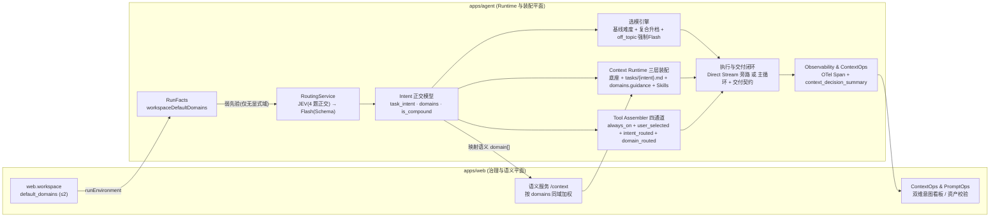
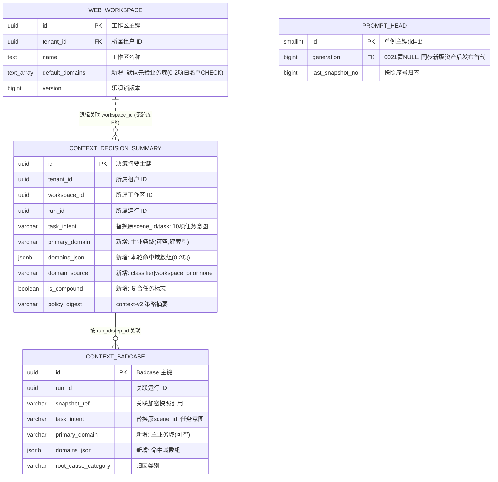
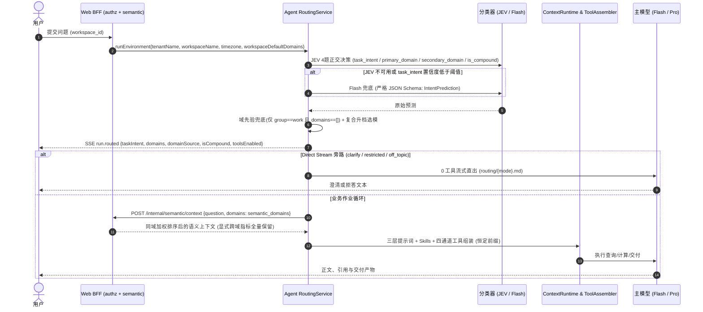

## 设计目标与正交原则

本方案面向 Compass 全局执行链路重构意图分类体系：废除 10 分类 × 40 场景（`SC-01`–`SC-40`）的笛卡尔积平铺字典与 `scene_id` / `deliverable` 双轨模型，建立 **任务与交互意图**（`task_intent`）、**业务域**（`domains`）与 **复合复杂度**（`is_compound`）三个正交维度，并打通路由选模、PromptOps、Context Runtime、动态工具组装、Web 语义检索与 ContextOps 观测全链路。

系统遵循五项设计原则：

- **正交拆解**：将“执行什么作业/守卫”、“关注哪些业务域”与“是否多步复合”彻底解耦，消除新增业务域或新作业形态时的乘法维护成本。
- **极简且零空转**：收敛为 **10 项任务/边界意图**与 **7 项业务域**；每个枚举值均对应确定的提示词、工具包、检索加权、交付契约或选模行为，清除 `required_capabilities`、`scene_hint` 与 40 份重复 `sop`。
- **先验与权限分离**：工作区（团队）默认业务域仅在问题无显式域时作为弱先验兜底；显式跨业务域提问完全服从本轮问题，数据与工具访问始终由既有 RBAC、受限连接、语义授权与 Context PEP 强制裁决。
- **权威代码与在线调优分离**：枚举 ID、难度基线、响应模式、交付契约与语义域映射由代码控制；分类描述、示例、业务域口径指引与任务方法论由 PromptOps 在线版本化管理。
- **预上线零历史债**：不保留旧 `SC-01`–`SC-40` 映射表或 `legacy_layout.json` 场景桥接，通过正向数据库迁移与契约同步一次切换至目标模型。

## 总体架构与全链路装配

单次分析请求贯穿 Web 治理平面与 Agent 执行平面：Web 在 Run 受理鉴权时透传工作区默认业务域，Agent 路由服务执行两级正交分类，随后同步驱动模型选档、三层提示词装配、四通道动态工具组装、Web 语义同域加权与 ContextOps 双维投影。



### 关键架构取舍

| 决策项 | 选定方案与依据 | 代价与处理方式 |
| --- | --- | --- |
| 任务意图收敛 | 10 项 `task_intent`（6 业务作业 + 4 边界守卫）彻底吸收 `deliverable` | 暂不单列 SQL/规划意图，归入 `qa`/`analysis`，待出现独立输出契约时再扩展 |
| 业务域收敛 | 7 个高内聚电商业务域，100% 无重叠映射 Web 语义 11 个 `domain` 编码 | 单轮允许识别 0–2 个域，覆盖跨部门分析且控制分类 Prompt 体积 |
| 团队归属先验 | 复用 `web.workspace` 增加 `default_domains` 列（上限 2 项） | `web/main` 追加轻量迁移 `0011`，绝不充当权限围栏 |
| 语义域联动 | Web `/context` 采用同域加权排序与首屏补齐，精确点名全量放行 | 避免分类器漏域或跨部门查数时屏蔽有效指标 |
| 零历史债迁移 | 直接替换 `scene_id`/`task` 列并清空预上线旧 PromptOps 场景资产 | 升级前强制 `pg_dump` 备份，迁移后立即同步并发布新版 PromptOps 首代资产 |

## 正交三维度分类模型

### 维度 1：任务与交互意图（10 项全机制映射）

全部 10 项声明于 `prompts/support/routing/tasks.json`，每项均对应可验证的选模、执行路径、模板、工具或交付差异：

| `task_intent` | 中文名称 | 分组 | 默认难度 | 响应模式 / 执行路径 | 专属模板 | 默认工具包增量（除 11 个 `always_on` 外） | Skill / 交付契约 |
| --- | --- | --- | --- | --- | --- | --- | --- |
| `qa` | 经营问答与口径释义 | `work` | `L1` | `answer` / 轻量主循环 | `tasks/qa.md` | 无增量（仅 11 个轻量底座，降低工具声明开销） | `metric-check`；直接文本/循证答复 |
| `analysis` | 数据分析与对比拆解 | `work` | `L2` | `answer` / 主循环 | `tasks/analysis.md` | `+ todo_write`、`+ python_analysis` | `metric-check`；多维拆解与复算答复 |
| `diagnosis` | 异常诊断与故障归因 | `work` | `L3` | `answer` / 深度排查 | `tasks/diagnosis.md` | `+ todo_write`、`+ python_analysis`、`+ sub_agent` | `metric-check` + `agentic-search`；跨源假设证伪 |
| `dashboard` | 可视化与经营看板 | `work` | `L2` | `answer` / 看板交付 | `tasks/dashboard.md` | `+ todo_write`、`+ python_analysis` | `metric-check`；Dashboard JSON 产物与看板入口 |
| `report` | 经营报告与周期汇总 | `work` | `L3` | `answer` / 报告交付 | `tasks/report.md`（财务叠 `.finance.md`） | `+ todo_write`、`+ python_analysis`、`+ sub_agent` | `metric-check` + `report-outline`；Markdown 下载报告 |
| `automation` | 定时交付与工作流编排 | `work` | `L2` | `answer` / 编排循环 | `tasks/automation.md` | `+ todo_write`、`+ workflow_pack`（`create_workflow` + `workflow_*`） | `schedule-guidance.md` + `workflow.md` |
| `clarify` | 关键条件缺失需澄清 | `boundary` | `L1` | `clarify` / **Direct Stream** | `routing/clarify` | 0 工具（手选工具包或活跃 Goal 时退回主循环） | 追问最小必要缺口 |
| `handoff` | 平台管理与外部转交 | `boundary` | `L1` | `handoff` / 治理分支 | `routing/handoff` | 语义维护者自动解锁 `semantic_govern`（3 工具） | 引导至对应 Web 管理/审批入口 |
| `restricted` | 明显越权与敏感拒答 | `boundary` | `L1` | `refuse` / **Direct Stream** | `routing/restricted` | 0 工具（零数据读取） | 明确边界与合规申请途径 |
| `off_topic` | 业务范围外与闲聊 | `boundary` | 强制 Flash | `refuse` / **Direct Stream** | `routing/off-topic` | 0 工具（关思考、上限 512 tokens，覆盖固定选模） | 温和婉拒并引导回经营分析 |

### 维度 2：业务域（7 域全覆盖映射 Web 语义编码）

全部 7 域声明于 `prompts/support/routing/domains.json`，每轮允许命中 0–2 域：

| `domain_id` | 中文名称 | 映射 Web 语义 `domain` | 典型团队 / 工作区 | 随域注入的核心口径指引（`guidance`） |
| --- | --- | --- | --- | --- |
| `sales_channel` | 经营与渠道 | `["sales", "channel"]` | 经营分析 / 渠道运营 | 成交/实付/净额事件时钟、渠道归属、促销优惠承担与漏斗去重键 |
| `marketing_member` | 营销与会员 | `["marketing", "customer"]` | 营销投放 / CRM 会员 | 归因窗、退款成熟日、新客去重单位与同观察窗队列对比 |
| `product_supply` | 商品与库存 | `["product", "inventory"]` | 商品企划 / 供应链 | SKU/仓粒度去重、现存/可用/在途/冻结快照时点与库龄起算规则 |
| `trade_fulfillment` | 交易与履约 | `["trade", "fulfillment"]` | 交易结算 / 物流售后 | 下单/支付/退款/签收多时钟对齐、原单关联与退货观察窗 |
| `store_region` | 区域与门店 | `["organization"]` | 区域 / 门店运营 | 同店/新开/闭店可比门店集合、营业天数对齐与小基数说明 |
| `finance_cost` | 财务与成本 | `["finance"]` | 财务经营分析 | 收入确认、折扣分摊与成本权限边界（权限不足拒答，绝不按零计算） |
| `platform_data` | 平台与数据 | `["quality"]` | 数据工程 / 平台运维 | 数据水位/迟到/真零/断流区分、分位延迟与错误率故障排查基线 |

### 维度 3：复合复杂度（`is_compound`）与契约模型

当 `is_compound=true` 或跨双域（`len(domains) >= 2`）时，`L1` 作业自动升档至 `L3 / Pro`（`reason="compound_upgrade"`），同时置 `requires_plan=true`，在工具组装器中解锁 `todo_write`、`sub_agent` 与 `long_task`（`goal`）工具包，并激活 `agentic-search` Skill。

{{code:schemas}}

字典加载与工作区弱先验兜底规则集中在 `routing/dictionary.py`，字典版本哈希按固定字段自动计算：

{{code:dictionary}}

## 持久化与双库迁移设计

本次变更涉及 `web/main`（`0010_knowledge_library → 0011_workspace_default_domains`）与 `agent/main`（`0020 → 0021`）两个独立数据库。两库通过逻辑 ID 与 HTTP 契约协作，无跨库外键或跨库事务。



- **权限与约束**：`web.workspace.default_domains` 附加 `ck_workspace_default_domains` 校验一维、无 NULL、长度 `<= 2` 且元素属于 7 个合法业务域白名单；`context_decision_summary` 附加 `ck_ctx_summary_domain_source` 及 `(tenant_id, task_intent, policy_digest, created_at)`、`(tenant_id, primary_domain, created_at)` 两个新索引；两库运行角色沿用既有表级授权。
- **发布顺序与恢复**：停入口排空在途 Run → 双库 `pg_dump` 备份 → 迁移 `web/main` 至 `0011` → 迁移 `agent/main` 至 `0021` → 启动新版服务并校验 `/readyz`（目标 `0021`）→ 导入发布 PromptOps 首代新版资产 → `pnpm smoke` 验收。回退依赖升级前备份还原至独立新库，禁用破坏性 `downgrade`。

{{code:agent_migration}}

## 核心链路与关键模块详解

### 1. 两级正交分类与端到端数据流



JEV 仅对 `task_intent` 施加严格降级门槛；`secondary_domain` 置信度不足时直接忽略，不浪费一次 Flash 兜底调用：

{{code:intent_classifier}}

### 2. 四通道动态工具组装器与三层提示词装配

重构工作树中的 `tools/assembler.py`，清除 5 组 `SC-*` 常量与 `default_scenes` / `default_tasks` 双字段，统一通过 `default_intents`、`domains` 与 `compound_enabled` 声明工具治理元数据，硬权限校验继续固化在 Step 1 前置执行：

{{code:tool_assembler}}

系统提示词采用三层正交装配（全部写入 ContextOps 回执，支持快照复现）：
1. **底座层**：`shared/fragments/base.md` + 语义/答复协议/按需工具指引 + `plan-required.md`（`requires_plan=true` 时）。
2. **任务作业层**：6 项作业意图 100% 命中 `prompts/tasks/{qa,analysis,diagnosis,dashboard,report,automation}.md`（财务工作区叠 `report.finance.md`）+ 匹配 `intents` / `domains` / `compound_also` 的 Skill；4 项边界意图命中 `support/routing/instructions.json`。
3. **业务域口径层**：按 `domains`（0–2 项）从本 Run 固定的 `support/routing/domains.json` 提取对应 `guidance` 区块注入。

### 3. Web 语义同域加权与 ContextOps 双维观测

- **Web 语义服务**（`apps/web/src/server/modules/semantic/runtime.ts`）：移除空转参数 `scene_hint`，改为接收 `domains: string[]`；精确点名在全量授权目录内匹配以保护跨业务域提问，模糊/词法候选和首屏补齐阶段叠加 `domainBoost` 优先召回同域指标：

{{code:semantic_boost}}

- **可观测与 ContextOps**：OTel 白名单与 `compass.route` / `context.assemble` Span 切换为 `task_intent`、`primary_domain`、`domains`、`domain_source`、`is_compound`、`difficulty`；ContextOps 控制台「意图」面板升级为**任务意图分布（10 项）** + **业务域分布（7 域，区分分类器命中与工作区先验）**双维视图，并更新 MCP 工具筛选参数。

## 变更文件清单

```diff 跨模块文件变更总览（+ 新增 / ! 修改 / - 删除）
apps/agent/
  + migrations/versions/0021_intent_taxonomy_refactor.py   # ContextOps 新列与 PromptOps 旧资产重置
  ! db/main/sql/{bootstrap.sql,manifest.json}               # 派生 SQL 与校验清单
  + db/main/sql/upgrades/0020__0021.sql                     # 0020 → 0021 增量 SQL
  ! db/main/README.md                                       # 登记 0021 迁移与发布恢复顺序
  - scripts/export_routing_dictionary.py                    # 删除旧 Excel 40 场景导出脚本
  src/compass_agent/
    ! schemas.py                                            # TaskIntentId/DomainId/Intent/RunRoutedPayload/ContextOps DTO
    routing/
      ! {dictionary.py,intent.py,prompts.py,service.py,config.py,README.md}
    prompts/
      + support/routing/{tasks.json,domains.json}           # 10 任务意图 + 7 业务域权威资产
      - support/routing/scenes.json                         # 废弃 40 场景大表
      ! support/routing/instructions.json                   # 精简为 6 条分类与边界指令
      ! shared/execution.json                               # 更新 identify 阶段说明
      + tasks/{qa,analysis,diagnosis,dashboard,report,report.finance,automation}.md
      - tasks/{business_qa,data_analysis,dashboard,business_report}/
    promptops/
      ! {catalog.py,structured.py,layout.py,legacy_layout.json,reader.py,sync.py}
    context_runtime/
      ! {profiles.py,assembly.json,contracts.py,classifier.py,model_step.py,pipeline.py,run_facts.py}
    tools/
      ! {contracts.py,assembler.py}                         # 清除全部 SC-* 硬编码，引入四通道组装
      ! builtin/{python_analysis,sub_agent,todo_write,goal,create_workflow}/__init__.py
      ! business/{discover_semantic_candidates,review_semantic_change,submit_semantic_change}/__init__.py
    runtime/
      ! {service.py,context.py,turn.py,answer_turn.py,durable_service.py,tool_bindings.py,deployment.py}
    observability/
      ! privacy.py                                          # OTel 白名单切换新字段
    context_ops/
      ! {entities.py,recorder.py,analytics.py,snapshots.py,mcp_server.py}
    api/
      ! contextops.py

apps/web/
  + db/main/migrations/0011_workspace_default_domains.sql   # web.workspace.default_domains 列与白名单约束
  ! db/main/sql/{bootstrap.sql,manifest.json}               # 派生 SQL 与清单
  + db/main/sql/upgrades/0010_knowledge_library__0011_workspace_default_domains.sql
  ! db/main/README.md
  src/
    ! server/composition.ts                                 # runEnvironment 透传 workspaceDefaultDomains
    ! server/modules/access/infrastructure/pg-access.ts     # 工作区默认业务域持久化
    ! server/modules/semantic/runtime.ts                    # domains 同域加权（替换空转 scene_hint）
    ! server/http/contextops-handler.ts                     # task_intent + domain 双维筛选
    ! client/analysis-run.ts                                # 解析新 run.routed 载荷
    ! features/organization/pages.tsx                       # 工作区默认业务域配置表单
    ! features/contextops/{client.ts,page.tsx,panels.tsx,flow.tsx,contextops.css}
    ! generated/*                                           # 由 pnpm contracts 自动重新生成

contracts/
  ! *.json                                                  # 由 pnpm contracts 自动重新生成
```

## 方案小结

本方案以 **10 项任务意图 × 7 项业务域 × 复合复杂度** 彻底取代 40 场景平铺字典与 `deliverable` 双轨体系：分类器回归纯粹职责，团队归属作为工作区弱先验与权限边界完全解耦，三层提示词、四通道工具组装、Web 语义同域加权与 ContextOps 双维观测全部形成可验证闭环，并在预上线阶段一次性清零历史场景债务。
