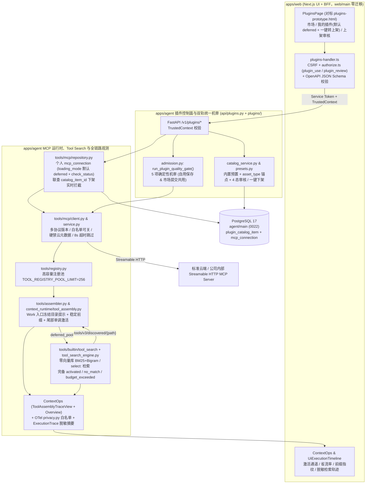
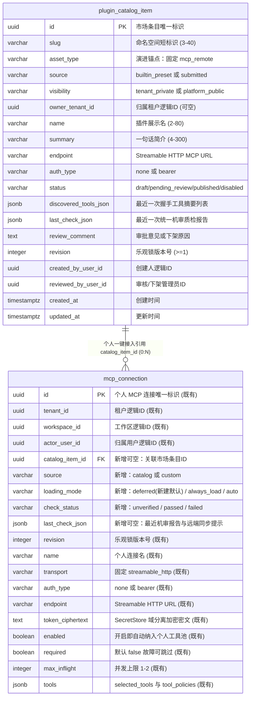

# 第 28 课｜轻量插件市场、云端 MCP 接入与 Tool Search 技术方案

> Feature：969 | 有效需求来源：[PRD](../spec/PRD.md)（2026-11-28 定稿，已吸纳第 2 轮评审结论与全链路观测） | Profile：standard | 模板：`mai-specs/_templates/TECH_DESIGN.tmpl.md` | 代码基线：`main @ 5180841` + 第 27 课工作区基线（含 `tools/assembler.py`、`tools/errors.py`、`0021_shared_sandbox.py`；`agent/main` 当前版本 `0021`） | 状态：定稿

[返回需求简报](../BRIEF.md) · [高保真原型 HTML](../spec/plugins-prototype.html) · [Claude Code Tool Search 参考](../context/claudecode_toolsearch.md) · [数据所有权与 SQL 迁移管理规范](../../../docs/database-migrations.md) · [设计评审报告](../review/design_review.md) · [代码设计附录](CODE_DESIGN.md)

## 需求依据与验收

本方案以定稿后的 [PRD](../spec/PRD.md) 为唯一需求与验收维护源，完整吸纳 [design_review.md](../review/design_review.md) 第 1–2 轮评审结论、衔接工作区既有 `0021_shared_sandbox.py` 迁移并补齐 Tool Search 全链路观测：

- **功能范围**：`FR-01` ～ `FR-14`（内置预置与已上架市场目录、个人接入默认 `deferred` 走 Tool Search、自用与市场共享统一自动化机审质检门禁 `run_plugin_quality_gate()`、改 Endpoint 强制重检与自用一键转上架、4 态审核与一键下架、开启自动纳入工具池且保护 `SC-39` 闲聊直出、零向量库 BM25+Bigram / `select:` 检索与前缀冻结单调激活、ContextOps / OTel / `UiExecutionTimeline` 全链路观测、点亮 Web「插件 → 全部插件」、Web BFF `/api/web/v1/plugins/*` 及独立演示包 `examples/showcases/lesson-28-mcp-plugins/`）。
- **规则与验收**：`BR-01` ～ `BR-08`、`NFR-01` ～ `NFR-04`、`UI-01`（对标 [plugins-prototype.html](../spec/plugins-prototype.html)）、`AC-01` ～ `AC-06`。

## 1. 方案概述

### 1.1 设计目标和设计原则

围绕第 28 课核心目标落地三条工程闭环：**① 单一 Streamable HTTP MCP 轻量市场与双轨统一机审**（标准云端 MCP 内置一键接入 + 公司内部 MCP 自定义接入，自用过机审立即可用、市场共享叠加管理员审批与一键下架）；**② 默认 `deferred` 的 Claude Code 风格 Tool Search 按需发现引擎**（解耦注册、发现、加载、执行，单轮严守 `<= 32` / `<= 64 KiB` 并冻结前缀保护 Prompt Prefix Cache）；**③ ContextOps、OTel 与执行时间线端到端可观测**。

1. **最大化复用既有底座，无缝衔接第 27 课代码基线**：
   - 复用 `apps/agent/src/compass_agent/tools/mcp/`（`McpSession`、`EndpointPolicy`、`PinnedTransport`、`McpRepository`、`SecretStore`、`McpRun`、`ToolApprovalProposal`）；
   - 衔接第 27 课 `0021_shared_sandbox.py` 顺延迁移至 `0022_plugin_marketplace_lite.py`，直接激活 `tools/assembler.py` 预留的 `deferred_pool` 与 `context_runtime/tool_assembly.py` 私有状态（`read_private` / `save_private`）；
   - 复用 `ContextOpsRecorder`、`Analytics`、`Observer`（`privacy.py` 白名单）与 `ExecutionTrace` 完成全链路脱敏观测。
2. **自定义与市场接入默认走 Tool Search，兼顾跨模型兼容与 Prefix Cache**：
   - 新接入 `mcp_connection.loading_mode` 默认设为 **`'deferred'`**（保留 `'always_load'` 常驻逃生开关与 `'auto'` 阈值兼容），使 2 个工具的轻量内部 MCP 与 26+ 工具的大型 MCP 默认均通过 `tool_search` 动态发现；
   - 在 `freeze_work_entry()` 一次性冻结 `deferred_catalog_hint` 并幂等注入系统提示尾部，激活工具按首次发现顺序单调追加至 `ordered_plan` 最末尾（渠道标记 `"tool_search_activated"`），保证 DeepSeek/OpenAI/Anthropic 全模型兼容与前序前缀 100% 字节恒定。
3. **双轨统一自动化机审质检与资产包演进锚点**：
   - 抽出 `run_plugin_quality_gate()` 同时守卫个人自用保存（落库 `check_status` / `last_check_json`，改 `endpoint`/`auth_type` 强制重跑）与市场提交准入；
   - 在 `plugin_catalog_item` 增加 `asset_type = 'mcp_remote'` 锚点并明确插件规范治理契约，将 ZIP/manifest 与 Skill 包留至第 29–30 课，重型 ABAC、防 Rug Pull 指纹锁与安全审计网关留至第 31 课。

### 1.2 整体架构

### 1.3 关键决策与 Review 索引

| 决策 | 推荐及理由 | 评审闭环对应 | 详情 |
| --- | --- | --- | --- |
| D-01 单一协议复用 `tools/mcp/` + `asset_type` 锚点 | 一期仅支持远程 Streamable HTTP MCP，复用 `McpSession`/`McpRun`/`SecretStore`；在 `plugin_catalog_item` 增加 `asset_type='mcp_remote'` 演进锚点，承接后续 Skill/资产包扩展而零破坏性改表。 | R1-P0-1, R2-P1-1 | [§1.4](#14-插件规范治理契约与资产包演进边界)、[§2.1.1](#211-数据结构设计) |
| D-02 `0021 → 0022` 迁移（1 新表 + `mcp_connection` 扩 5 列） | 衔接工作区已有 `0021_shared_sandbox.py` 顺延为 `0022_plugin_marketplace_lite.py`；新增 `plugin_catalog_item`，`mcp_connection` 扩 `catalog_item_id`、`source`、`loading_mode`、`check_status`、`last_check_json`；`web/main` 零迁移。 | R1-P1-1, R2-P0-2 | [§2.1.1](#211-数据结构设计) |
| D-03 默认 `deferred` 走 Tool Search + 保护闲聊直出 | 新接入 `loading_mode` 默认 `'deferred'`（保留 `'always_load'` 与 `'auto'`）；后台默认开启的 MCP 仅存 `journal.default_mcp_server_ids`，不写 `journal.tool_selection`，确保 `stream_answer_turn.py` 与 `should_direct_stream()` 双入口保护 `SC-39` 纯闲聊直出。 | R2-P0-1, R2-P1-2 | [§2.3.4](#234-开启即自动纳入工具池与闲聊直出保护)、[§2.3.5](#235-tool-search-延迟加载前缀冻结与按需发现引擎) |
| D-04 双轨统一自动化机审门禁 + 一键转上架 | 抽取 `run_plugin_quality_gate()` 固化 5 项确定性规则，个人自用首次接入或改 `endpoint`/`auth_type` 强制过检方可启用，支持一键带入提交市场上架；市场共享走同一机审 + 管理员人工审批与一键下架。 | R2-P0-2, R2-P1-3 | [§2.3.2](#232-双轨统一自动化机审质检门禁) |
| D-05 Work 入口前缀冻结 + 本地 BM25/`select:` + 边界自愈 | 在 `freeze_work_entry()` 一次性冻结 `deferred_catalog_hint`；本地检索 < 5 ms，覆盖 `activated`、`no_match`（返 `availableServers` 且记 `empty`）与 `budget_exceeded`；尾部单调追加保证前序工具字节 100% 恒定。 | R2-P1-2 | [§2.3.5](#235-tool-search-延迟加载前缀冻结与按需发现引擎) |
| D-06 ContextOps、OTel 与 Timeline 全链路脱敏观测 | 扩展 `ToolAssemblyTraceView`（激活通道、省流率、前缀指纹）、`ContextOverview`（运行数、调用数、命中率、省流率）、OTel `privacy.py` 白名单与 `ExecutionTrace` 脱敏摘要，杜绝黑盒运行。 | 用户补充要求, R2-P2-1 | [§2.3.7](#237-tool-search-与关键环节全链路观测设计) |

### 1.4 插件规范治理契约与资产包演进边界

| 维度 | 第 28 课强制契约 | 后续演进边界（第 29–31 课） |
| --- | --- | --- |
| 目录资产模型 | `plugin_catalog_item.asset_type` CHECK 限定 `'mcp_remote'`；`slug` 限定 `^[a-z][a-z0-9_]{2,39}$`（公共全局唯一、租户内唯一）。 | 第 29–30 课扩展 `'skill_pack'` / `'workflow_template'` 与 ZIP + `manifest.json` 规范，共用同一目录状态机与权限入口。 |
| 命名空间与契约边界 | 运行时工具名统一隔离为 `mcp_<conn_hex>_<sha256_24>`，单工具 JSON Schema ≤ 32 KiB，描述 ≤ 2,000 字符，单连接工具数 ≤ 64，禁止系统指令覆盖提示词。 | 第 31 课通过 `AdmissionHook` 插入远端 Schema 指纹锁（防 Rug Pull）与深度语义防投毒。 |
| 自用 vs 市场双轨治理 | **自用轨道**：`run_plugin_quality_gate()` 无 `error` 硬错 → `check_status='passed'` 即个人可用（改 `endpoint`/`auth_type` 必重跑）；**市场轨道**：同一机审通过 → `pending_review` → 管理员审批 `published` / 一键 `disabled`。 | 第 31 课叠加企业级 ABAC、集中凭据代理与独立安全审计台。 |

## 2. 详细设计方案

### 2.1 核心结构设计

#### 2.1.1 数据结构设计

**数据库变更登记（遵循 [数据库规范](../../../docs/database-migrations.md)）**：

| 维度 | 登记内容 |
| --- | --- |
| Owner App / Database Key | `agent/main`（PostgreSQL 17）；`web/main` **零表变更、零迁移** |
| 唯一迁移源与受管入口 | Alembic `apps/agent/migrations/versions/`；受管脚本 `apps/agent/scripts/database.py` |
| 起止 Revision | `0021`（`0021_shared_sandbox.py`，第 27 课共享 Sandbox）→ `0022`（`0022_plugin_marketplace_lite.py`） |
| 交付 SQL 清单 | `apps/agent/migrations/versions/0022_plugin_marketplace_lite.py`、`apps/agent/db/main/sql/bootstrap.sql`、`apps/agent/db/main/sql/upgrades/0001__0022.sql` .. `0021__0022.sql`、`apps/agent/db/main/sql/manifest.json`、`apps/agent/db/main/README.md` |
| 运行账号权限矩阵 | `compass_agent_runtime`：对 `plugin_catalog_item` 授予 `SELECT, INSERT, UPDATE`（禁 `DELETE`）；对 `mcp_connection` 维持 `SELECT, INSERT, UPDATE, DELETE`。`compass_agent_scheduler` 无新增表权限。 |
| 存量回填与兼容 | `mcp_connection` 存量行回填 `source = 'custom'`、`catalog_item_id = NULL`、`loading_mode = 'auto'`、`check_status = 'passed'`、`last_check_json = NULL`，随后将列默认值设为新建口径（`loading_mode DEFAULT 'deferred'`、`check_status DEFAULT 'unverified'`），100% 保留存量密文与老 `/v1/mcp/connections` 契约兼容。 |

#### 2.1.2 接口设计

Agent 内部契约统一定义在 `apps/agent/src/compass_agent/schemas.py` 并注册在 `apps/agent/src/compass_agent/api/plugins.py`，经 `pnpm contracts` 生成 `contracts/*.json` 与 `apps/web/src/generated/`；Web BFF 位于 `apps/web/src/server/http/plugins-handler.ts`。

| Web BFF 路径 (`/api/web/v1/plugins/...`) | Agent 路径 (`/v1/plugins/...`) | 方法 | 鉴权 Purpose | 核心契约与行为 |
| --- | --- | --- | --- | --- |
| `marketplace` | `/v1/plugins/marketplace` | GET | `plugin_use` | 返回 `PluginMarketplaceResponse`（`builtin_preset` + 可见 `published` 条目，附当前个人接入连接状态） |
| `connections` | `/v1/plugins/connections` | GET / POST | `plugin_use` | GET 返回个人连接列表（含 `loadingMode`、`checkStatus`、`lastCheck`、`lastSyncWarning` 及个人 Tool Search 负载估算）；POST 支持市场接入或自定义接入（默认 `loadingMode='deferred'`），自动执行 `run_plugin_quality_gate()` 并加密保存个人 Token |
| `connections/{id}` | `/v1/plugins/connections/{id}` | PATCH / DELETE | `plugin_use` | PATCH 支持启停 `enabled`、切换 `loadingMode`、更新名称/Token/工具策略（带 `revision`）；**若变更 `endpoint` 或 `authType` 强制重跑 `run_plugin_quality_gate()`**，未通过禁止开启；DELETE 删除个人连接 |
| `connections/probe` | `/v1/plugins/connections/probe` | POST | `plugin_use` | 对已保存 `connectionId`（同步刷新 `check_status` 与 `lastSyncWarning`）或草稿 `{endpoint, authType, token}` 执行真实握手与 5 项机审质检，临时 Token 不落库 |
| `catalog` | `/v1/plugins/catalog` | GET / POST | `plugin_use` | GET 返回本人草稿及管理员可见待审/已上架/已下架条目；POST 新建市场草稿（支持从已过检自定义连接一键带入） |
| `catalog/{id}` | `/v1/plugins/catalog/{id}` | PATCH | `plugin_use` | 编辑 `draft` 草稿（带 `revision`），编辑连接要素后重置检查状态 |
| `catalog/{id}/check` | `/v1/plugins/catalog/{id}/check` | POST | `plugin_use` | 执行 `run_plugin_quality_gate(allow_deferred_auth=True)` 并持久化 `last_check_json` 与 `discovered_tools_json` |
| `catalog/{id}/submit` | `/v1/plugins/catalog/{id}/submit` | POST | `plugin_use` | 校验 `last_check_json.passed == True` 后流转为 `pending_review` |
| `catalog/{id}/review` | `/v1/plugins/catalog/{id}/review` | POST | `plugin_review` | 管理员批准（`published`）、驳回（`draft`）或恢复上架，平台公共条目强制要求 `scope` 操作者为平台管理员 |
| `catalog/{id}/disable` | `/v1/plugins/catalog/{id}/disable` | POST | `plugin_review` | 管理员一键下架（`disabled`），新 Run 与在途 `revalidate` 实时拦断 |

### 2.2 配置变更

集中在 `apps/agent/src/compass_agent/settings.py`，全部纳入 `runtime/deployment.py` 的 `policy_fingerprint()`：

| 配置项 | 默认值 | 说明 |
| --- | --- | --- |
| `COMPASS_MCP_ENFORCE_ALLOWLIST` | `False` | 是否启用 `COMPASS_MCP_ALLOWED_ORIGINS` 白名单强制拦截 |
| `COMPASS_MCP_ALLOW_PRIVATE_NETWORK` | `True` | 是否允许公司内网/本地地址 MCP；云元数据 `169.254.169.254`、链路本地、组播、未指定地址与公网明文 HTTP 始终阻断 |
| `COMPASS_TOOL_SEARCH_MODE` | `"auto"` | Tool Search 全局模式：`auto` / `always` / `off`（配合连接默认 `loading_mode='deferred'`，新接入默认走延迟按需发现） |
| `COMPASS_TOOL_SEARCH_EAGER_LIMIT` | `6` | 连接设为 `auto` 时允许外部 MCP 直接 Eager 暴露的工具数上限（`0..16`） |
| `COMPASS_TOOL_SEARCH_EAGER_BYTES` | `16384` | 连接设为 `auto` 时允许外部 MCP 直接 Eager 暴露的声明总字节上限（`2048..49152`） |

### 2.3 分模块详细设计

#### 2.3.1 市场目录、内置预置与 4 态生命周期（`plugins/entities.py`, `catalog_service.py`, `presets.py`）
- 维护 `draft → pending_review → published → disabled`（及驳回 `draft`、管理员恢复 `published`）状态流转与乐观锁 `revision`；
- `sync_builtin_presets(engine, presets)` 由显式种子脚本幂等写入 `source='builtin_preset', asset_type='mcp_remote', status='published'` 条目，不在模块导入时隐式写库。

#### 2.3.2 双轨统一自动化机审质检门禁（`plugins/admission.py`）
- `run_plugin_quality_gate()` 统一执行 5 项确定性检查：① `EndpointPolicy.validate()` + `resolve()` 安全底线；② Streamable HTTP `initialize` + `tools/list` 握手（≤ 8 s）；③ `validate_schema`（Draft 2020-12，≤ 32 KiB）；④ 描述 ≤ 2,000 字符、工具数 ≤ 64；⑤ 内建重名 `warning` 提示 + 高危系统指令覆盖提示注入正则 `error` 拦截 + `AdmissionHook` 扩展位。
- 自用连接保存时 `allow_deferred_auth=False`（若 `auth_type='bearer'` 必须凭有效个人 Token 实测通过方可置 `passed` 并开启）；市场草稿检查时 `allow_deferred_auth=True`（无公共测试密钥时记录 `auth_probe_skipped` 警告，待每位用户个人接入时强制实测）。

#### 2.3.3 `tools/mcp/` 实用化适配与远端漂移提示（`tools/mcp/{client,entities,repository,service}.py`）
- `EndpointPolicy` 支持 `enforce_allowlist` 与 `allow_private_network` 开关，死守云元数据、公网 HTTPS 与 `PinnedTransport` 禁 3xx 底线；`McpSession` 兼容 `{"2025-03-26", "2025-06-18", "2025-11-25"}`；
- `McpRepository` 单用户连接上限放宽至 `8`；`load()`、`load_enabled_modes()` 与 `current()` 均 `OUTER JOIN plugin_catalog_item` 过滤 `status == 'disabled'` 及 `check_status == 'failed'`；探测发现已选工具与远端 `tools/list` 漂移时在 `last_check_json` 标注 `lastSyncWarning` 供前端温和提醒；
- `McpRun` 发现墙钟上限收紧至 8 s，`required=False` 不可达自动计入 `skipped` 跳过；`ExecutionOrigin` 注入 `kind="mcp", serverId=str(config.id), serverName=config.name, toolName=remote.name`。

#### 2.3.4 开启即自动纳入工具池与闲聊直出保护（`runtime/service.py`, `stream_answer_turn.py`）
- 在 `RunService._discover_tools()`（`answerProtocol >= 3` 且 `grants.plugins is True`）中：未显式传 `mcpServerIds` 时自动读取 `repo.load_enabled_modes(owner)` 存入 `journal.default_mcp_server_ids` 与 `journal.mcp_loading_modes`，**绝不写入 `journal.tool_selection`**；
- `stream_answer_turn.py:47-52`（检查 `journal.tool_selection`）与 `assembler.should_direct_stream()`（仅检查 `ctx.explicit_mcp_server_ids`）双处口径严格一致，`SC-33` / `SC-37` / `SC-39` 纯闲聊直出完全不受后台已开启 MCP 影响。

#### 2.3.5 Tool Search 延迟加载、前缀冻结与按需发现引擎（`tools/tool_search_engine.py`, `tools/builtin/tool_search/`, `tools/assembler.py`, `context_runtime/{tool_assembly,pipeline}.py`）
1. **容量解耦**：`TOOL_REGISTRY_POOL_LIMIT = 256`，单轮模型暴露维持 `TOOL_CATALOG_LIMIT = 32` 与 `TOOL_DECLARATION_BYTES_LIMIT = 64 KiB`。
2. **分层与 Work 入口前缀冻结**：
   - `partition_mcp_tools()` 将 `loading_mode == 'deferred'`（新连接默认）或 `mode == 'always'` 或 `auto` 超阈值连接放入 `deferred_universe`；
   - `freeze_work_entry()` 在首次进入工作阶段时，基于初始 `deferred_universe` 按服务名排序生成 `deferred_catalog_hint` 并冻结在 `tools/v3/work-entry/{path}`；`prepare_input()` 在构建无 `continuation_token` 的系统提示时幂等追加至 `messages[0]` 尾部，后续轮次无论激活多少工具均保持系统提示与前序工具序列字节级 100% 不变；
   - `deferred_universe` 非空时 `tool_search` 恒定驻留 `always_on`；为空时以 `"no_deferred_tools"` 排除。
3. **检索引擎与三类边界返回**：
   - `search_deferred_pool()` 支持 `select:工具1,工具2`（匹配规范名、远端短名、`<server>/<remote>`）与加权 BM25（蛇形/驼峰分词 + 中文 2-gram，耗时 < 5 ms）；
   - `tool_search` 执行器精确处理三类结果：
     - **`activated`**：计算当前单步剩余槽位与字节预算，将可容纳的命中工具按首次发现顺序单调追加至 `tools/v3/discovered/{path}`，返回规范 `toolName`（供模型下一轮 Function Calling 调用）、`remoteName`、`serverName`、`summary` 与 `status="activated"`；
     - **`budget_exceeded`**：当剩余槽位为 0 或单工具超出剩余 64 KiB 预算时，返回 `status="budget_exceeded"`、`remainingSlots`、`remainingBytes` 及复用已激活工具或委派 `sub_agent` 的 `nextAction`；
     - **`no_match`**：0 命中时返回 `ExecutionReceipt(status="empty")` 及 `availableServers`（当前延迟池各服务名与示例工具短名）与换词/`select:` 引导。

#### 2.3.6 Web BFF、高保真前端与零售 MCP 演示包
- **Web BFF（`plugins-handler.ts` + `authorize.ts`）**：新增 `plugin_use` 与 `plugin_review`，全量校验 CSRF、同源与生成的 OpenAPI Schema。
- **Web 前端（`apps/web/src/features/plugins/`）**：对标 [plugins-prototype.html](../spec/plugins-prototype.html)，实现市场网格、「我的插件」（含 Tool Search 实时负载条、检索试测抽屉、默认 `deferred` 切换、机审状态徽章、自用已过检「提交上架」快捷入口）与管理员「上架审核」（批准/驳回/一键下架/恢复上架）。
- **独立演示包（`examples/showcases/lesson-28-mcp-plugins/`）**：提供 `mock_internal_mcp_server.py`（默认 2 个零售内部工具验证默认 `deferred` 经 `tool_search` 发现调通，`--scale-demo` 暴露 26 个工具验证 ≥ 70% Token 压缩与 256 容量池）与 `seed_presets.py`。

#### 2.3.7 Tool Search 与关键环节全链路观测设计

| 观测平面 | 采集/投影位置 | 核心观测指标与脱敏保障 |
| --- | --- | --- |
| **ContextOps 轨迹节点** | `assembler.py` → `tool_assembly.py` → `ContextOpsRecorder` → `ContextFlowNode.toolAssembly` → `flow.tsx` | 记录并展示 `tool_search_active`、`tool_search_mode`、`deferred_universe_count`、`activated_deferred_count`、`full_declaration_tokens`、`saved_declaration_tokens`、`token_saving_ratio`、`prefix_digest`（验证跨步前缀恒定）、`tool_search_activated` 暴露渠道及脱敏 `<serverName>/<remoteName>` 标签。 |
| **ContextOps 工作区总览** | `context_ops/analytics.py` → `ContextOverview` → `contextops/page.tsx` | 聚合窗口内 `tool_search_run_count`、`tool_search_call_count`、`tool_search_hit_rate`（命中 vs `empty` 空检索）与 `tool_search_saving_rate`（平均工具声明节省率），同时将 `tool_search` 纳入 `search_turns` 与异常空结果统计。 |
| **OTel / Langfuse Tracing** | `observability/privacy.py`、`context_spans.py`、`model_step.py`、`runtime/observation.py` | 在 `TOOL_LABELS` 与 `FIELDS` 白名单登记 `"tool_search"`、`tool_operation`（`"bm25"` / `"exact_select"`）、`deferred_count`、`activated_deferred_count`、`saved_declaration_tokens`、`token_saving_ratio`；严禁导出原始查询词、内网 Endpoint 或个人密钥。 |
| **对话执行时间线 (`UiExecutionTimeline`)** | `runtime/execution_trace.py`、`tools/mcp/service.py`、`execution-timeline.tsx` | `tool_search` 节点标题为「检索按需工具」，摘要展示脱敏 `query`、`matchKind`（BM25 / 精确选择）、命中的 `<serverName>/<remoteName>` 与 `elapsedMs`；MCP 调用节点展示 `MCP · <serverName>` 与远端短名，不裸露内部 `mcp_<hex>_<hash>`。 |
| **插件控制面结构化日志** | `plugins/admission.py`、`api/plugins.py` | 输出无敏感内容的闭集事件日志（`plugins.quality_gate`、`plugins.catalog.transition`、`plugins.connection.mutation`），仅含 UUID、`check_status`、`probe_status`、`tool_count` 与 `elapsed_ms`。 |

## 3. 风险评估与兼容性

- **云元数据与 SSRF 风险**：`EndpointPolicy.resolve()` 无条件阻断 `169.254.169.254` / 链路本地 / 组播 / 未指定地址与公网 HTTP，`PinnedTransport` 禁 3xx 重定向并固定已解析 IP 拨号。
- **单点外部 MCP 故障隔离**：默认 `required=False` 且并发发现墙钟 ≤ 8 s，宕机连接自动跳过计入 `skipped`，主对话正常推进。
- **存量数据与历史 Run 兼容**：`0022` 平滑保留 `0021` 全部结构并回填存量 `mcp_connection`（`check_status='passed', loading_mode='auto'`）；历史 Run 快照无 `tools/v3/discovered/{path}` 时视为空列表；`/api/mcp/connections` 保持原契约不变。

## 4. 数据库发布、恢复与 6 项验证矩阵

1. **发布顺序**：备份 `agent/main`（`0021`）与 `COMPASS_MODEL_ENCRYPTION_KEY` → 停止旧 Agent / Scheduler → 执行 `pnpm db:migrate -F agent`（`0021 → 0022`）与 `pnpm db:sql:check -F agent` → 启动新版 Agent 核验 `/readyz`（校验 `0022` 与 `PluginCatalogItem`）→ 部署新版 Web → 按需运行 `seed_presets.py`。
2. **恢复策略**：使用 `pg_restore --no-owner --role=compass_agent_owner` 将 `0021` 备份恢复到新供应隔离库并沿用原主密钥切回，不执行破坏性 `downgrade`。
3. **PostgreSQL 17 6 项强制验证矩阵**：空库安装（Alembic vs `bootstrap.sql` 一致达 `0022`）、旧库升级（`0021` 含存量 `mcp_connection` 密文升级保留并正确回填）、执行控制（幂等与非法起点拒绝）、权限边界（`compass_agent_runtime` 禁 `DELETE plugin_catalog_item`）、生成一致性（`pnpm db:sql:check -F agent` 零漂移）、恢复演练（`pg_dump`/`pg_restore` 后密文正常解密）。

## 5. 任务分解

| 任务 | 变更模块 | 交付与验收 |
| --- | --- | --- |
| T-01 | `0022_plugin_marketplace_lite.py`、`plugins/entities.py`、`tools/mcp/entities.py`、`scripts/database.py`、派生 SQL | `0021 → 0022` 迁移与 6 项 PostgreSQL 验证矩阵通过（AC-04, AC-05）。 |
| T-02 | `settings.py`、`runtime/deployment.py`、`tools/mcp/{client,repository,service}.py`、`runtime/service.py` | 多协议版本、出站安全底线、默认自动发现与 `SC-39` 闲聊保护就绪（AC-01, AC-02, AC-05）。 |
| T-03 | `tools/tool_search_engine.py`、`tools/builtin/tool_search/`、`prompts/tools/tool_search.json`、`tools/{catalog,assembler}.py`、`context_runtime/{tool_assembly,pipeline}.py` | 默认 `deferred` 分层、前缀冻结、BM25/`select:` 引擎、三类边界返回与持久恢复就绪（AC-01, AC-03）。 |
| T-04 | `schemas.py`、`context_ops/analytics.py`、`observability/{privacy,context_spans}.py`、`runtime/execution_trace.py`、`features/contextops/{flow,page}.tsx`、`execution-timeline.tsx` | ContextOps 轨迹/总览、OTel 白名单 Span 与 `UiExecutionTimeline` 脱敏观测就绪（AC-06）。 |
| T-05 | `plugins/{admission,catalog_service,presets}.py`、`api/plugins.py`、`main.py`、`contracts/*`、`authorize.ts`、`plugins-handler.ts` | 双轨统一机审、4 态目录 API、OpenAPI 契约零漂移与 Web BFF 鉴权代理就绪（AC-04, AC-05）。 |
| T-06 | `apps/web/src/features/plugins/*`、`page-catalog.ts`、`product-content.tsx`、`examples/showcases/lesson-28-mcp-plugins/*`、全套单测/集成/Playwright E2E | 点亮「全部插件」、完成双 MCP + `--scale-demo` Tool Search + ContextOps 端到端实测与 `pnpm check` / `pnpm build`（AC-01 ～ AC-06）。 |
