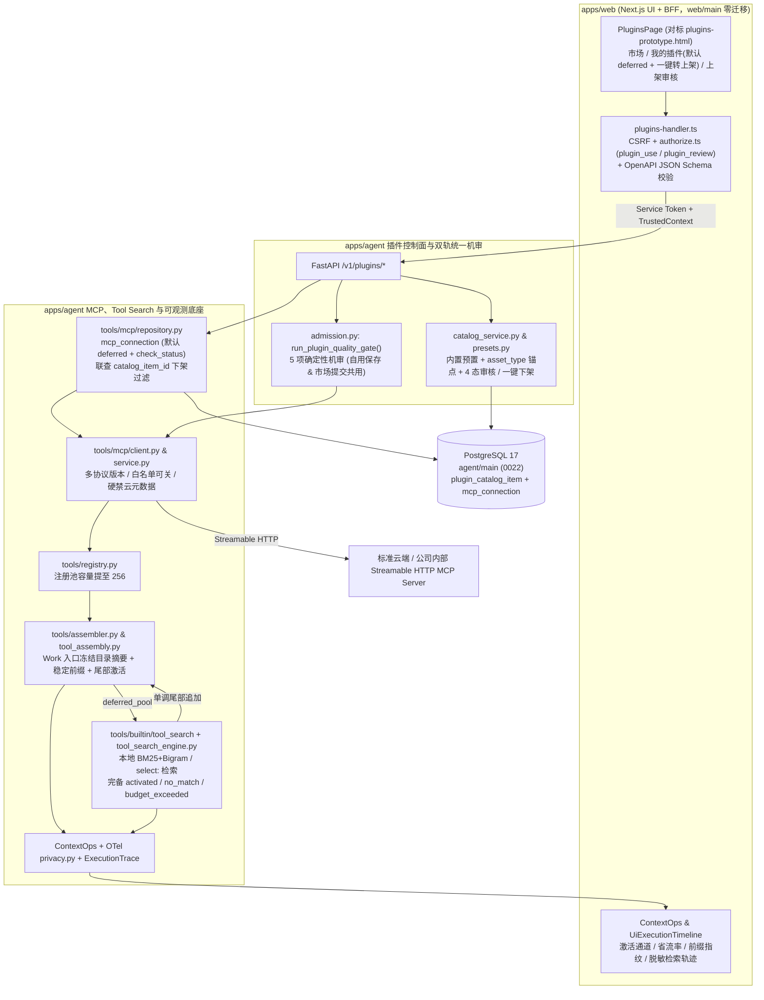
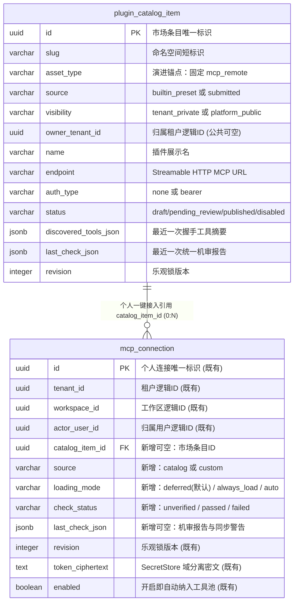
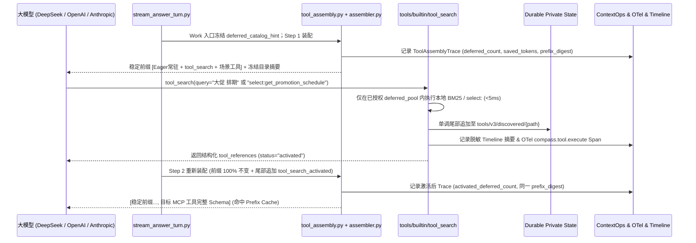

## 设计目标

点亮 Compass Web「插件 → 全部插件」（视觉与交互对标独立离线静态高保真原型 `spec/plugins-prototype.html`），完整吸纳第 2 轮架构评审结论并衔接第 27 课 `0021_shared_sandbox` 基线，交付三条工程闭环：**① 单一远程 Streamable HTTP MCP 轻量市场与双轨统一机审**（标准云端 MCP 内置一键接入 + 公司内部 MCP 自定义接入，自用过机审即用、改地址强制重检并支持一键转上架，市场共享叠加管理员审批与一键下架）；**② 默认 `deferred` 的 Claude Code 风格 Tool Search 按需发现引擎**（解耦注册、发现、加载、执行，冻结前缀保护 Prompt Prefix Cache）；**③ ContextOps、OTel 与执行时间线端到端可观测**。

| 维度 | 设计目标 | 约束口径 |
| --- | --- | --- |
| 协议与演进锚点 | 单一支持远程 Streamable HTTP MCP；目录预留 `asset_type='mcp_remote'` | 复用既有 `tools/mcp/`；ZIP/manifest 与 Skill 包留至第 29–30 课 |
| 数据库增量 | `agent/main` `0021 → 0022`：新增 1 表 + 扩 5 列；`web/main` 零迁移 | 新增 `plugin_catalog_item`，微扩 `mcp_connection`（含默认 `deferred` 与 `check_status`） |
| 默认 Tool Search | 开启即纳入个人池（上限 256，不污染闲聊直出）；新接入默认进入延迟池经 `tool_search` 动态发现 | 单轮暴露恒定 `<= 32` / `<= 64 KiB`；初始声明 Token 压缩 ≥ 70%，Work 入口冻结前缀 |
| 双轨统一机审 | 自用保存与市场提交共用 `run_plugin_quality_gate()` 5 项确定性检查 | 自用过检即个人可用，改 `endpoint`/`auth_type` 强制重检；预留 `AdmissionHook` 给第 31 课 |
| 全链路可观测 | ContextOps 轨迹/总览 + OTel 脱敏 Span + `UiExecutionTimeline` 命中详情 | 实时量化声明省流率、前缀指纹与检索命中率，零明文凭据与内网敏感信息泄露 |

## 总体方案

方案最大化复用 Compass 既有基础设施：`apps/web`（`web/main`）继续独占身份、租户、工作区与 RBAC；`apps/agent`（`agent/main`）在既有 `tools/mcp/` 与第 27 课 `tools/assembler.py` 之上叠加薄市场控制面、双轨统一自动化机审、默认 `deferred` 的 Tool Search 引擎以及 ContextOps 全链路观测。



## 数据模型与插件规范契约

全部数据归属 `agent/main`（PostgreSQL 17，衔接 `0021_shared_sandbox.py` 升级至 `0022_plugin_marketplace_lite.py`）；`web/main` 零新增表与零迁移。存量 `mcp_connection` 记录自动回填 `source='custom'`、`loading_mode='auto'`、`check_status='passed'` 保兼容，新建连接默认 `loading_mode='deferred'`。

| 表名 | 状态 | 职责 | 运行账号权限 |
| --- | --- | --- | --- |
| `plugin_catalog_item` | 新增 | 存放后台预置（`builtin_preset`）与提交上架（`submitted`）的市场 MCP 模板（含 `asset_type='mcp_remote'` 演进锚点）、机审报告与 4 态审核状态 | `compass_agent_runtime` 仅 `SELECT, INSERT, UPDATE`（无 `DELETE`） |
| `mcp_connection` | 微扩 5 列 | 个人维度 MCP 连接与加密 Token；新增 `catalog_item_id`、`source`、`loading_mode`（新建默认 `'deferred'`）、`check_status` 与 `last_check_json` | 维持既有个人 `SELECT, INSERT, UPDATE, DELETE` |



{{code:entities}}

## 上层应用与 BFF 授权

Web BFF（`apps/web/src/server/http/plugins-handler.ts`）仅扩展 `authorize.ts` 中的 2 个可信 `purpose`（`plugin_use`、`plugin_review`），统一代理全部插件市场与个人接入接口并执行 OpenAPI JSON Schema 校验；既有 `/api/mcp/connections` 保持向后兼容。

{{code:bff_auth}}

## 核心模块详解

### 1. 默认 `deferred` 的 Claude Code 风格 Tool Search 引擎

新接入的自定义与市场 MCP 连接默认采用 `loading_mode='deferred'` 进入 `deferred_pool`（保留 `always_load` 常驻直出与 `auto` 阈值模式）：

1. **容量解耦**：注册池 `TOOL_REGISTRY_POOL_LIMIT` 提至 256，单轮发给模型的完整工具声明严守 `<= 32` 槽位与 `<= 64 KiB`。
2. **Work 入口前缀冻结**：`freeze_work_entry()` 一次性冻结 `deferred_catalog_hint` 注入系统提示尾部，`tool_search` 恒定保留在 `always_on` 前缀中，确保多步推理期间前序消息与工具列表字节级 100% 不变。
3. **零向量库本地检索与完备边界反馈**：纯 Python 加权 BM25（蛇形/驼峰分词 + 中文 2-gram）与 `select:<name>` 精确选择（< 5 ms）；完备覆盖 `activated`（尾部单调追加至 `tools/v3/discovered/{path}`）、`no_match`（返回 `availableServers` 且标记 `empty`）与 `budget_exceeded`（返回剩余槽位提示）。



{{code:tool_search_engine}}

{{code:tool_search_spec}}

{{code:tool_search_partition}}

### 2. 开启即自动纳入工具池与 `SC-39` 纯闲聊直出保护

未显式传 `mcpServerIds` 时，`RunService._discover_tools()` 自动读取当前用户全部 `enabled=True`、`check_status != 'failed'` 且未下架的个人 MCP 连接记入 `journal.default_mcp_server_ids`（严禁污染 `journal.tool_selection`），使 `stream_answer_turn.py` 与 `should_direct_stream()` 双入口均保持 `SC-39` 纯闲聊零工具直出。

{{code:auto_load_repo}}

{{code:auto_load_service}}

### 3. 出站安全底线与双轨统一自动化机审质检

`EndpointPolicy` 默认放行标准云端 HTTPS 与公司内网 MCP，同时无条件硬阻断云元数据（`169.254.169.254`）、公网明文 HTTP 与 3xx 重定向；`run_plugin_quality_gate()` 统一服务个人自用保存（通过即 `passed` 允许启用，改地址强制重检，支持一键转提交上架）与市场提交准入（叠加管理员 4 态审批与一键下架）。

{{code:endpoint_policy}}

{{code:admission}}

### 4. ContextOps、OTel 与执行时间线全链路观测

在 ContextOps 节点详情（`ToolAssemblyTraceView`）与总览面板（`ContextOverview`）直接呈现 `tool_search_activated` 渠道、声明节省 Token 比例、跨步恒定 `prefix_digest` 以及窗口内 Tool Search 运行数与命中率；在 OTel `privacy.py` 白名单与 `UiExecutionTimeline` 输出严格脱敏的检索指标与可读 `<serverName>/<remoteName>` 摘要。

{{code:observability_trace}}

## 实现参考

### 变更文件树

```text 变更文件清单
apps/agent/
├── migrations/versions/0022_plugin_marketplace_lite.py       # [新增] 衔接 0021，新增 plugin_catalog_item + 扩 mcp_connection 5 列
├── db/main/sql/{bootstrap.sql,manifest.json,upgrades/*0022*} # [生成] 0022 完整与增量派生 SQL
└── src/compass_agent/
    ├── api/plugins.py                                        # [新增] /v1/plugins/* 路由（双轨机审 + 市场 + 个人连接）
    ├── plugins/
    │   ├── entities.py                                       # [新增] PluginCatalogItem (含 asset_type)
    │   ├── admission.py                                      # [新增] run_plugin_quality_gate 统一 5 项机审 + AdmissionHook
    │   ├── catalog_service.py                                # [新增] 市场查询、一键转上架、4 态审核与一键下架
    │   └── presets.py                                        # [新增] 内置预置 MCP 幂等初始化
    ├── prompts/tools/tool_search.json                        # [新增] tool_search 元工具 PromptOps 声明资产
    ├── tools/
    │   ├── tool_search_engine.py                             # [新增] 零向量库 BM25+Bigram / select: 检索
    │   ├── builtin/tool_search/{__init__,model_schema}.py    # [新增] tool_search 内建元工具与边界自愈返回
    │   ├── {catalog,catalog_contracts,assembler}.py          # [修改] 注册 tool_search、默认 deferred 分层、尾部激活与前缀指纹
    │   └── mcp/{client,entities,repository,service}.py       # [修改] 多协议版本、白名单开关、check_status 与下架联查
    ├── context_runtime/{tool_assembly,pipeline}.py           # [修改] Work 入口冻结目录提示、读写 discovered_tools
    ├── context_ops/analytics.py                              # [修改] ContextOps 总览与轨迹聚合 Tool Search 观测指标
    ├── observability/{privacy,context_spans}.py              # [修改] OTel 白名单注册 tool_search 与编译省流指标
    ├── runtime/{deployment,service,execution_trace}.py       # [修改] REVISION=0022、自动发现、闲聊保护与 Timeline 脱敏摘要
    └── {schemas,settings,main}.py                            # [修改] POOL_LIMIT=256、插件与观测 DTO、5 项配置与路由挂载

contracts/ & apps/web/src/generated/                          # [生成] pnpm contracts 派生契约与 TS 类型

apps/web/src/
├── lib/page-catalog.ts & components/product-content.tsx      # [修改] 点亮 plugins-all 挂载 PluginsPage
├── server/modules/models/application/authorize.ts            # [修改] 新增 plugin_use / plugin_review
├── server/http/{handler.ts,plugins-handler.ts}               # [修改/新增] /api/web/v1/plugins/* BFF 代理
├── features/plugins/                                         # [新增] 市场 / 我的插件(默认 deferred + 一键转上架) / 上架审核
└── features/contextops/{flow.tsx,page.tsx}                   # [修改] 展示 Tool Search 激活通道、省流率、前缀指纹与总览卡片

examples/showcases/lesson-28-mcp-plugins/                     # [新增] 模拟公司内部零售 MCP Server (含 --scale-demo) 与预置脚本
```

### 发布与恢复要点

- **发布顺序**：备份 `agent/main`（`0021`）与主加密密钥 → 停旧 Worker/Scheduler → 执行 `pnpm db:migrate -F agent`（`0021 → 0022`）与 `pnpm db:sql:check -F agent` → 部署新版 Agent 核验 `/readyz` → 部署新版 Web（`web/main` 零迁移）→ 按需运行预置初始化脚本。
- **恢复策略**：使用 PostgreSQL 17 `pg_restore` 将 `0021` 备份还原到新供应隔离库并沿用原主密钥切回连接，保留升级库供核对。
