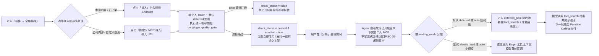
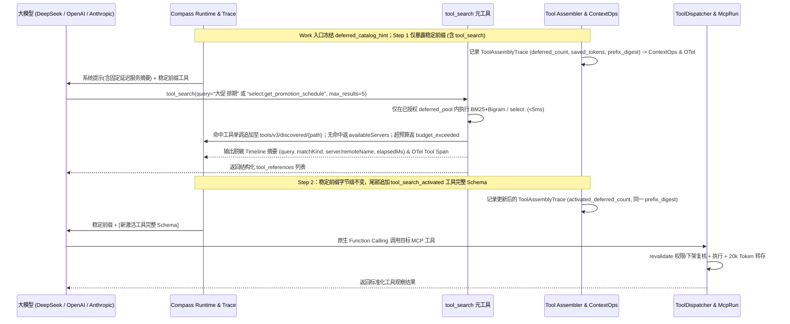

# PRD：第 28 课｜轻量插件市场、云端 MCP 接入与 Tool Search

> 状态：定稿（已吸纳第 2 轮评审与全链路观测增补） | 负责人：andy | Profile：standard | 模板：`mai-specs/_templates/PRD.tmpl.md` | 有效需求来源：[BRIEF.md](../BRIEF.md)、[design_review.md](../review/design_review.md)、[claudecode_toolsearch.md](../context/claudecode_toolsearch.md) 及 2026-11-28 需求负责人确认口径

[返回需求简报](../BRIEF.md) · [插件市场静态高保真原型 HTML](plugins-prototype.html)

## 1. 背景与目标（Why）

- **背景与痛点**：
  - 第 27 课已在 `apps/agent/src/compass_agent/tools/` 落地 19 个内建工具的三层治理元数据（`ToolGovernance`）、共享 Sandbox（`0021_shared_sandbox`）与确定性三通道动态组装（`assembler.py`），并显式预留了 `deferred_pool` 扩展位供第 28 课实现 Tool Search；但外部工具扩展入口「插件 → 全部插件」仍处于占位状态。
  - Compass 早在第 18 课已具备 Streamable HTTP MCP 执行底座（`tools/mcp/` 与 `mcp_connection` 表），但在第 27 课 `answerProtocol >= 3` 下需要单次对话显式传 `mcpServerIds` 才会加载，且缺少插件市场界面、内置预置入口、自用/共享统一的自动化机审质检与上架骨架。
  - 一旦允许用户自由接入外部 MCP Server，外部工具数量与质量将不再受控：一方面企业内部 ERP/CRM/零售 MCP 往往包含十几个乃至数十个工具，全量注入会击穿 32 工具槽位与 64 KiB 限制并导致上下文 Token 暴涨；另一方面缺少统一机审会导致不可达端点、超限 Schema 或提示注入描述混入运行时，且缺少 ContextOps 与执行链路观测会让延迟加载与检索命中变成黑盒。
- **目标**：
  - 点亮 Compass Web 一级导航「插件 → 全部插件」（`/t/<tenant>/w/<workspace>/plugins`），交付面向远程 **Streamable HTTP MCP** 的轻量插件市场与个人接入管理界面（附可交互静态高保真原型 [plugins-prototype.html](plugins-prototype.html)）。
  - 确保两类代表性外部能力零改码接入并稳定调通：① 市场默认内置的标准云端 MCP 工具；② 公司内部自建的业务 Streamable HTTP MCP 工具（用户用个人凭据自定义接入）。
  - 打通“**个人接入 → 自动化机审质检通过即启用 → 自动纳入个人工具池 → 默认经 `tool_search` 动态发现并尾部激活**”的完整闭环：
    - 新接入插件**默认采用 `deferred`（延迟按需搜索）策略**进入第 27 课预留的 `deferred_pool`，参考 Claude Code 由 **`tool_search` 元工具（本地零向量库关键词 BM25+Bigram / `select:` 精确选择）** 按需发现并单调尾部追加完整 Schema；保留 `always_load`（高频常驻直出逃生开关）与 `auto`（阈值兼容策略）供显式切换。
  - 建立“**自用接入过自动化机审质检即个人可用；市场共享走同一机审 + 管理员人工审批上架/一键下架**”的双轨轻量治理闭环，明确插件规范治理契约并预留 `asset_type = 'mcp_remote'` 演进锚点，将重型 ABAC、防 Rug Pull 指纹锁与安全审计网关留至第 31 课收口。
  - 补齐 **Tool Search 与插件关键环节的全链路观测**：覆盖 ContextOps 轨迹节点（激活通道、Token 压缩率、前缀稳定指纹、脱敏工具标签）与工作区总览指标、Langfuse/OTel 脱敏 Span 以及 `UiExecutionTimeline` 检索命中可视化。
- **成功指标**：
  - **两类 MCP 零改码调通**：无需改码或重启 Agent，完成 1 个标准云端 MCP（市场预置一键接入）与 1 个公司内部 MCP（自定义接入）的自动化质检、开启与对话经 `tool_search` 发现调通。
  - **Tool Search 默认生效、控膨胀与高召回**：接入默认延迟 MCP 或 26+ 工具 `--scale-demo` MCP 时，注册池容量支持至 256 且不触发 `tool_catalog_limit` 崩溃；初始模型上下文仅暴露常驻核心工具 + `tool_search` 元工具（挂载 40+ 外部工具时初始工具声明 Token 较全量注入下降 ≥ 70%），模型可通过关键词或 `select:<tool_name>` 在 10 ms 内精准检索并尾部单调激活目标工具，随即完成原生 Function Calling。
  - **个人凭据严格隔离与双轨质检闭环**：工作区内不同成员独立维护个人 MCP 连接与 Bearer Token（只写不回显）；自用首次保存或改 `endpoint`/`auth_type` 强制过机审质检，已过机审的自定义连接可一键带入提交市场上架；管理员一键下架后关联连接在新建与在途 Run 中实时拦断。
  - **全链路观测透明可核验**：在 ContextOps 控制台、OTel 导出 Span 与分析对话 `UiExecutionTimeline` 中均可准确观测到延迟工具数、已激活工具、声明节省 Token 比例、前缀稳定性及每次 `tool_search` 的脱敏检索详情。

## 2. 用户与场景（Who / When）

| 用户故事 ID | 目标用户 | 触发场景 | 用户故事：作为…我希望…以便… | 关联需求 |
| --- | --- | --- | --- | --- |
| US-01 | 业务分析师 / 普通成员（持有 `module.plugins`） | 在插件市场启用内置或已上架的标准云端 MCP 工具 | 作为分析师，我希望在「插件 → 全部插件」一键接入市场插件并配置个人凭据，通过连通与质检开启后在对话中默认由 Tool Search 按需发现可用，无需每次分析手工勾选。 | FR-01, FR-02, FR-06, FR-07 |
| US-02 | 业务研发 / 分析师（持有 `module.plugins`） | 接入公司内部自建的业务 Streamable HTTP MCP（2 个至数十个工具） | 作为开发者，我希望通过「自定义 MCP 接入」连接公司内部 MCP，保存时自动完成最小机审质检并默认设为 `deferred` 按需搜索（也可切 `always_load` 常驻），既不拖垮上下文，又能将调通的连接一键转提交市场上架。 | FR-02, FR-03, FR-04, FR-06, FR-07, FR-08 |
| US-03 | 插件贡献者（持有 `module.plugins`） | 把已验证的云端/内部 MCP 提交到插件市场供同事复用 | 作为贡献者，我希望从「我的插件」一键带入或直接新建市场草稿，通过统一的自动化机审质检后提交管理员审核，上架后同事只需填各自凭据即可接入。 | FR-04, FR-05 |
| US-04 | 平台/租户管理员 & ContextOps 观察者 | 审核待上架插件、紧急下架异常插件，或在 ContextOps 排查 Tool Search 装配与省流效果 | 作为管理员或研发观察者，我希望在「上架审核」审阅机审报告批准/下架，并在 ContextOps 与对话时间线直观核对每轮延迟工具池、Token 节省比例、前缀缓存稳定性与 `tool_search` 命中情况。 | FR-04, FR-05, FR-09, FR-14 |

## 3. 总体业务流程

### BF-01：双轨接入质检（自用即用 / 市场共享）与默认 Tool Search 分层装载

### BF-02：Claude Code 风格两阶段 Tool Search 执行与全链路观测流程

### BF-03：市场提交、统一机审、管理员审批上架与一键下架

## 4. 插件规范治理契约与资产包演进边界（Governance Contract）

为保障企业级工具生态可控并平滑衔接第 29–31 课，统一确立以下最小治理契约：

| 治理维度 | 本期强制规范（第 28 课落地） | 演进锚点与后续课次边界 |
| --- | --- | --- |
| 资产类型与打包形态 | `plugin_catalog_item.asset_type` 固定为 `'mcp_remote'`（CHECK 约束）；采用结构化表单元信息 + 远端 Streamable HTTP 实时工具发现。 | 预留 `asset_type` 列作为未来扩展 `skill_pack` / `prompt_pack` / `workflow_template` 的统一目录锚点；ZIP / `manifest.json` 离线包上传解压规范留至第 29–30 课定义，本期严禁提前建设文件包存储。 |
| 命名与运行时隔离 | 市场 `slug` 遵循 `^[a-z][a-z0-9_]{2,39}$`（按公共全局或租户私有唯一）；远端工具进入运行时一律重写为确定性 `mcp_<conn_hex>_<sha256_24>`，天然杜绝覆盖 20 个内建工具，同时在 Timeline 与 ContextOps 映射回 `<serverName>/<remoteName>` 可读标签。 | 第 31 课在此基础上叠加远端 Schema 哈希锁（防 Rug Pull）。 |
| 双轨准入与质检门禁 | **个人自用接入**与**市场上架共享**共用同一套 `run_plugin_quality_gate()` 5 项确定性机审：① URL/协议与禁云元数据（`169.254.169.254`）/禁公网 HTTP/禁 3xx；② Streamable HTTP `initialize` + `tools/list` 真实握手（≤ 8 s）；③ JSON Schema Draft 2020-12 合法且单工具 ≤ 32 KiB；④ 描述 ≤ 2,000 字符、单连接工具数 ≤ 64；⑤ 内建重名告警 + 高危提示注入指令（如覆盖系统指令模式）静态硬阻断。自用过机审即 `check_status='passed'` 允许启用，修改 `endpoint`/`auth_type` 强制重检；市场共享额外要求管理员审批（`plugin_review`）。 | 预留 `AdmissionHook` 协议接口，第 31 课直接挂载深度 Tool Poisoning 检测、企业级 ABAC 与集中安全审计网关。 |

## 5. 功能需求（What）

### 5.1 新增需求

| 需求编号 | 触发条件 | 输入 | 预期行为 | 输出/结果 | 关联需求编号 |
| --- | --- | --- | --- | --- | --- |
| FR-01 | 用户打开「插件 → 全部插件」的「插件市场」视图 | 当前租户与工作区范围、搜索词与来源筛选 | 展示受控预置的内置 MCP 模板（`source='builtin_preset'`）及已上架公共/本租户私有 MCP 模板（`status='published'`，`asset_type='mcp_remote'`），包含来源徽章、认证方式、工具数预览及当前个人接入状态。 | 返回市场可用 MCP 列表及个人接入状态；他租户私有条目严格不可见。 | FR-02, FR-04, FR-10 |
| FR-02 | 用户在市场点「接入」，或在「我的插件」新增/编辑个人 MCP 连接 | 名称、Endpoint、认证类型（`none`/`bearer`）、个人 Token（可选）、加载模式 `loading_mode`（`deferred` / `always_load` / `auto`，**新建默认 `deferred`**）、勾选启用工具、执行策略与 `enabled` | 个人维度保存至 `mcp_connection`（含 `catalog_item_id`、`source`、`loading_mode`、`check_status`、`last_check_json`），Token 经 `SecretStore` 域分离加密只写不回显。**首次创建自定义连接，或编辑修改 `endpoint` / `auth_type` 时，服务端强制执行 `run_plugin_quality_gate()`**：通过置 `check_status='passed'` 并允许开启 `enabled=True`；存在 `error` 硬错置 `check_status='failed'`、禁止启用并返回逐项质检报告。在「我的插件」对 `source='custom'` 且 `check_status='passed'` 的连接提供「提交上架」快捷入口，自动带入信息打开提交抽屉；当探测发现远端工具清单漂移时展示 `lastSyncWarning` 提示重新探测复核。 | 个人连接安全落库、双轨质检一致且自用转共享免重复录入。 | FR-01, FR-03, FR-04, FR-06, FR-07 |
| FR-03 | 用户点击「测试连通并质检」 | 已保存连接 ID 或草稿 `{endpoint, authType, token}` | 复用 `McpSession`（兼容协议 `2025-03-26`、`2025-06-18`、`2025-11-25`）与 `run_plugin_quality_gate()` 执行真实握手与 5 项质检，返回发现的工具列表、耗时与质检明细；临时 Token 阅后即焚不落库。 | 展示连通与质检结论及可勾选工具清单；失败返回脱敏中文原因。 | FR-02, FR-05 |
| FR-04 | 贡献者维护市场条目草稿或管理员在「上架审核」执行审批/下架 | 条目元信息（`slug`、名称、简介、`visibility`、Endpoint、`auth_type`）与操作（`submit` / `approve` / `reject` / `disable` / `restore`、乐观锁 `revision`、意见） | 在 `agent/main` 的 `plugin_catalog_item` 维护 4 态流转：`draft` → `pending_review` → `published` → `disabled`（驳回回 `draft`，管理员可恢复）。公共条目仅平台管理员可审，租户私有条目由租户管理员或平台管理员审核，全程乐观锁校验。 | 批准后即时出现在市场；下架后禁止新接入并同步阻断关联连接。 | FR-01, FR-05, FR-09 |
| FR-05 | 市场草稿提交审核前点击「运行准入质检」 | 市场条目 ID 与可选临时测试 Token | 调用同一 `run_plugin_quality_gate()` 写入 `last_check_json` 与 `discovered_tools_json`（需个人 Bearer 且未传临时测试 Token 时允许记录 `auth_probe_skipped` 警告，待个人接入验密时强制实测）。存在 `error` 硬错阻断提交审核。 | 持久化准入报告供管理员审阅，与个人自用共享同一质检标准。 | FR-03, FR-04 |
| FR-06 | 已开启个人 MCP 的用户在「分析」发起新对话 | 自然语言提问、`TrustedContext`、`grants.plugins` | 新 Run 受理时自动拉取当前用户在该工作区所有 `enabled=True`、`check_status != 'failed'` 且未因市场下架失效的 `mcp_connection`（最多 8 条），通过 `McpRun` 并发发现（超时 ≤ 8 s、`required=False` 宕机自动跳过）进入容量提升至 **256** 的总工具注册池。默认加载连接仅记入 `journal.default_mcp_server_ids`（严禁回写 `journal.tool_selection`），确保纯闲聊（`SC-39` 等）直出不受影响。 | 外部工具无需手选自动进入个人 Run 工具池；单点故障跳过不阻塞；闲聊直出不回归。 | FR-02, FR-07, FR-09, FR-12 |
| FR-07 | Run 进入工作阶段执行工具装配（对接 `assembler.py` 与 `tool_assembly.py`） | 已授权工具池、`COMPASS_TOOL_SEARCH_MODE`（默认 `auto`）、各连接 `loading_mode`（默认 `deferred`）与 `COMPASS_TOOL_SEARCH_EAGER_LIMIT`（默认 6 工具 / `16 KiB`） | 实现 **Eager / Deferred 分层与前缀冻结**：① 连接默认 `deferred`（或 `always` 模式 / `auto` 超阈值）的 MCP 工具进入 `deferred_universe`；显式设为 `always_load`（或 `auto` 未超阈值）的进入 Eager 扩展；② 只要 `deferred_universe` 非空，在 `always_on` 恒定保留 **`tool_search` 元工具**，并在 `freeze_work_entry()` 一次性生成冻结 `deferred_catalog_hint` 幂等追加至系统提示固定尾部（后续激活工具绝不改写该提示，100% 保护 Prompt Prefix Cache）；③ `deferred_universe` 为空时以 `"no_deferred_tools"` 排除 `tool_search`。 | 新接入自定义工具默认走 `tool_search` 动态发现；大规模挂载初始声明 Token 压缩 ≥ 70%，单步暴露恒守 `<= 32` / `<= 64 KiB`。 | FR-06, FR-08, FR-12, FR-14 |
| FR-08 | 模型调用内建元工具 `tool_search` 检索并激活延迟工具 | `query: string`（关键词/自然语言，或 `select:工具1,工具2` 精确选择）、`max_results?: int`（1–10，默认 5） | ① 仅在当前 Run 已授权且未下架的剩余 `deferred_pool`（或含已激活幂等重查提示）中检索；② `select:` 支持规范名、远端短名与 `<server>/<remote>`；关键词采用纯本地零向量库 **BM25 + 蛇形/驼峰分词 + 中文 2-gram**（< 5 ms）；③ 覆盖三类确定性返回：**正常命中**（单调尾部追加持久化至 `tools/v3/discovered/{path}`，下一轮尾部暴露完整 Schema）、**`no_match` 零命中**（返回 `status="empty"` 及当前 `availableServers` 列表与 `select:` 引导，防止盲目死循环）、**`budget_exceeded` 槽位/字节触顶**（返回剩余槽位预算提示与改用已激活工具/`sub_agent` 建议）。 | 打通跨模型两阶段发现闭环，中断恢复一致且具备完备边界自愈语义。 | FR-07, FR-12, FR-14 |
| FR-09 | 管理员触发「一键下架」 | 市场条目 ID、下架原因、乐观锁 `revision` | 原子置 `plugin_catalog_item.status = 'disabled'`。新 Run 发现阶段自动剔除（不入 Eager 也不入 `deferred_pool`）；在途 Run（含已通过 `tool_search` 激活该工具的 Run）下一步装配过滤且执行前经 `revalidate` 与 `watch_revision` 实时拦断。 | 一键下架全链路实时生效。 | FR-04, FR-06, FR-08 |
| FR-10 | 课堂演示或本地联调第 28 课 | `examples/showcases/lesson-28-mcp-plugins/` | 提供严格隔离的本地演练包：① 模拟公司内部零售 Streamable HTTP MCP Server（默认暴露 `get_promotion_schedule` 与 `get_competitor_prices` 演示默认 `deferred` 经 `tool_search` 检索调通，支持 `--scale-demo` 暴露 26 个工具演示大规模 Token 压缩 ≥ 70%）；② 内置预置标准 MCP 种子脚本与操作说明。不进入生产 wheel。 | 支撑双 MCP 调通、默认 Tool Search 发现与大规模压缩实测。 | FR-01, FR-06, FR-07, FR-08 |
| FR-14 | 观察者在对话过程、ContextOps 控制台或 Langfuse 查看 Tool Search 与插件运行状态 | 分析会话流式事件、ContextOps API 与 OTel Span | 补齐 4 层可观测能力：① **ContextOps 轨迹节点（`ToolAssemblyTraceView`）**：记录 `tool_search_active`、`deferred_universe_count`、`activated_deferred_count`、`saved_declaration_tokens`、`token_saving_ratio`、`prefix_digest`、`tool_search_activated` 渠道标签与脱敏 `<server>/<tool>` 名称并在 `flow.tsx` 展示；② **ContextOps 总览（`ContextOverview`）**：统计窗口内 `tool_search_run_count`、`tool_search_call_count`、`tool_search_hit_rate` 与平均声明节省比例并在总览页展示；③ **OTel / Langfuse**：在 `privacy.py` 白名单注册 `tool_search` 及编译/执行脱敏指标，零明文查询与密钥泄露；④ **`UiExecutionTimeline`**：脱敏展示 `tool_search` 的 `query`、`matchKind`、命中 `<serverName>/<remoteName>` 与 `elapsedMs`，不裸露内部哈希名与内网地址。 | 让延迟池分层、Token 节省收益、Prefix Cache 稳定性与每次检索命中全透明可验证。 | FR-07, FR-08, FR-12 |

### 5.2 变更需求

| 需求编号 | 触发条件 | 输入 | 预期行为 | 输出/结果 | 关联需求编号 |
| --- | --- | --- | --- | --- | --- |
| FR-11 | 持有 `module.plugins` 的用户访问「插件 → 全部插件」 | `/t/<tenant>/w/<workspace>/plugins` | `apps/web/src/lib/page-catalog.ts` 中 `plugins-all` 升级为 `implemented` 并在 `ProductContent` 挂载 `PluginsPage`（对标 [plugins-prototype.html](plugins-prototype.html)）。 | 正式点亮「插件 → 全部插件」。 | FR-01, FR-02, FR-04 |
| FR-12 | 分析 Run 注册工具池、装配单步工具声明与执行 MCP 工具 | `TrustedContext`、`journal`、`mcp_connection`、`plugin_catalog_item` | ① `TOOL_REGISTRY_POOL_LIMIT` 从 `128` 提至 `256`，单步暴露维持 `<= 32` / `<= 64 KiB`；② 未显式传 `mcpServerIds` 时自动加载已开启、质检未失败且未下架的个人 MCP（存入 `default_mcp_server_ids`）；③ 默认关闭白名单（保留开关）、允许公司内网与多协议版本并硬禁云元数据；④ 接通 `deferred_pool` + `tool_search` + 单调尾部激活 + ContextOps/OTel 观测。 | 打通端到端动态扩展与按需加载架构。 | FR-06 ～ FR-09, FR-14 |
| FR-13 | 浏览器请求 `/api/web/v1/plugins/*` | Cookie、CSRF Token、工作区与请求体 | 在 `apps/web/src/server/http/handler.ts` 接入 `/api/web/v1/plugins/*`（`plugins-handler.ts`），在 `authorize.ts` 新增 `plugin_use` 与 `plugin_review`（`web/main` 零迁移），执行 OpenAPI JSON Schema 校验并保持 `/api/mcp/connections` 向后兼容。 | Web BFF 统一收口插件市场与个人接入接口。 | FR-01 ～ FR-05 |

## 6. UI 视觉与交互（按需）

遵循 [Compass UI 样式规范](../../../docs/ui-style-guide.md) 与可交互静态高保真原型 **[plugins-prototype.html](plugins-prototype.html)**：

| 页面区域/控件 | 新增/变更 | 对照原型与规范的功能及交互说明 | 关联需求 |
| --- | --- | --- | --- |
| 页头 `UiPageHeading` & 3 视图 Tab | 新增 | 左侧「全部插件」标题与说明，右侧「提交插件上架」与「+ 自定义 MCP 接入」；Tab 支持键盘左右键切换「插件市场」「我的插件」「上架审核（管理员可见）」。 | FR-01, FR-02, FR-04, FR-11 |
| 插件市场卡片网格 | 新增 | 筛选栏 + 3 列响应式卡片（390 px 1 列），展示来源徽章、认证类型、工具数、个人接入状态与「查看工具」「接入 / 管理接入」。 | FR-01, FR-02 |
| 「我的插件」Tool Search 负载条 + 管理表 | 新增 | 顶部实时展示已开启插件数、外部工具总数、Tool Search 按需加载生效状态与预估节省 Token 比例（含「试测 Tool Search 检索」抽屉）；表格展示连接名（含机审状态徽章与远端工具漂移提示）、来源、Endpoint、加载模式下拉（**默认 `延迟搜索 (deferred)`** / `始终常驻` / `自动`）、启用工具数、凭据状态、启停开关与操作（测试 / 编辑 / 自用已过检项「提交上架」 / 删除）。 | FR-02, FR-03, FR-07, FR-08 |
| 接入抽屉 / 提交上架抽屉 / 确认弹窗 | 新增 | 右侧 `Modal` 抽屉支持个人 Token 密码框（只写不回显）、默认 `deferred` 加载策略、「测试连通并质检」、工具复选与策略配置；保存时自动执行机审质检；下架/驳回/删除使用确认弹窗并默认聚焦取消、关闭归还焦点。 | FR-02 ～ FR-05, FR-09 |
| ContextOps & `UiExecutionTimeline` 观测 | 增强 | ContextOps 轨迹节点「工具装配」面板新增 Tool Search 状态徽章、声明节省 Token 比例、已激活/延迟池计数、前缀指纹与 `Tool Search 激活` 渠道标识，总览页展示 Tool Search 运行与命中统计；对话 `UiExecutionTimeline` 展示脱敏的 `检索按需工具` 节点摘要。 | FR-08, FR-14 |

## 7. 业务规则与约束（Rules）

| 规则 ID | 业务规则、状态流转、权限或数据约束 | 关联需求 |
| --- | --- | --- |
| BR-01 | **数据所有权与迁移衔接**：`plugin_catalog_item` 与 `mcp_connection` 均归 `agent/main` 独占，衔接现有 `0021_shared_sandbox` 升级为 `0022_plugin_marketplace_lite`；`web/main` 零迁移。 | FR-01, FR-02, FR-13 |
| BR-02 | **个人凭据隔离与双轨统一机审**：个人 Token 按 `(tenant_id, workspace_id, actor_user_id, id)` 域分离加密，永不回显明文；个人自用首次接入或变更 `endpoint`/`auth_type` 必须通过 `run_plugin_quality_gate()` 方可置 `check_status='passed'` 并启用；市场共享走同一机审 + 管理员审批。 | FR-02 ～ FR-05 |
| BR-03 | **默认 `deferred` 按需发现与单点故障跳过**：新接入默认 `loading_mode='deferred'` 进入 `deferred_pool` 由 `tool_search` 动态发现；开启（`enabled=True`）且未下架连接自动纳入新 Run 发现（超时 ≤ 8 s，`required=False` 宕机自动跳过）。 | FR-02, FR-06, FR-07 |
| BR-04 | **Tool Search 权限前置、前缀稳定与边界自愈**：注册池上限 256，单轮暴露严守 `<= 32` / `<= 64 KiB`；`tool_search` 仅检索已授权未下架 `deferred_pool`，支持 `no_match`（返 `availableServers`）与 `budget_exceeded` 结构化反馈；`deferred_catalog_hint` 在 Work 入口一次性冻结，命中工具单调尾部追加并持久化于 `tools/v3/discovered/{path}`。 | FR-07, FR-08, FR-12 |
| BR-05 | **纯闲聊直出不回归**：后台默认开启的 MCP 仅存 `journal.default_mcp_server_ids`，不写 `journal.tool_selection`，保证 `stream_answer_turn.py` 与 `should_direct_stream()` 在 `SC-39` 等闲聊场景直接流式回答。 | FR-06, FR-07, FR-12 |
| BR-06 | **插件规范契约与第 29–31 课边界**：`plugin_catalog_item.asset_type` 一期固定 `'mcp_remote'`，不做 ZIP/Skill 包上传（留第 29–30 课）；预留 `AdmissionHook`，重型 ABAC、防 Rug Pull 指纹锁与安全审计台留第 31 课。 | FR-04, FR-05, FR-09 |
| BR-07 | **出站白名单默认关闭且死守云元数据底线**：`COMPASS_MCP_ENFORCE_ALLOWLIST=False`、`COMPASS_MCP_ALLOW_PRIVATE_NETWORK=True`，同时无条件阻断 `169.254.169.254`、链路本地、组播、未指定地址、公网明文 HTTP 与 3xx 重定向。 | FR-03, FR-12 |
| BR-08 | **存量兼容、观测脱敏与演示隔离**：存量 `mcp_connection` 升级自动回填 `source='custom', check_status='passed', loading_mode='auto'` 保兼容（新建默认 `'deferred'`）；ContextOps、OTel 与 Timeline 严禁泄露 Token、内网 URL 或未授权工具；演示 MCP 隔离在 `examples/showcases/lesson-28-mcp-plugins/`。 | FR-10, FR-12, FR-14 |

| 非功能 ID | 性能、可靠性、安全或可访问性要求 | 适用条件与验证口径 |
| --- | --- | --- |
| NFR-01 | `tool_search` 单次本地检索耗时 ≤ 10 ms（200 个延迟工具池规模，P95），零外网与 Embedding 依赖。 | Agent 基准单元测试计时验证。 |
| NFR-02 | 开启 26–40+ 个外部 MCP 工具处于延迟模式时，初始推理请求的工具声明 Token 较全量注入下降 ≥ 70%，单轮暴露 ≤ 32 项 / ≤ 64 KiB，多步激活前序工具前缀字节 100% 一致。 | Agent 装配单测与 ContextOps `ToolAssemblyTrace` 断言。 |
| NFR-03 | 静态机审 ≤ 300 ms，MCP 握手受 8 s 超时保护；零明文凭据泄露，100% 阻断 `169.254.169.254` 与 3xx 重定向。 | 安全单测与故障注入集成测试。 |
| NFR-04 | Web 页面与静态原型满足 WCAG 4.5:1 对比度、全键盘可操作及 390 px 窄屏无整页横向溢出。 | Playwright 桌面与 390 px 视口验收。 |

## 8. 范围与边界（Scope）

- **包含**：Web「插件 → 全部插件」3 视图 + 抽屉与静态原型；远程 Streamable HTTP MCP 实用化适配；双轨统一自动化机审质检 `run_plugin_quality_gate()`、4 态审核上架与一键下架；默认 `deferred` 的 Claude Code 风格 Tool Search 引擎、元工具与前缀稳定尾部激活；ContextOps / OTel / Timeline 全链路可观测；`agent/main` `0021 → 0022` 迁移、Web BFF `/api/web/v1/plugins/*` 及独立演示包 `examples/showcases/lesson-28-mcp-plugins/`。
- **不包含**：OpenAPI/HTTP 声明式编译与 Response Shaping；ZIP/manifest 离线包与 Skill 导入（留第 29–30 课）；在线 Embedding 撞车与 LLM 14 题回放；SemVer 多版本仓库；企业级 ABAC、Rug Pull 指纹锁与安全审计台（留第 31 课）。

## 9. 研发资源与最终文案

### 最终文案

| 文案 ID | 位置/触发状态 | 最终文字 |
| --- | --- | --- |
| CP-01 | 列表加载中 | 正在加载插件列表… |
| CP-02 | 插件市场空态 | 暂无已上架的插件。你可以点击「自定义 MCP 接入」直接连接 Streamable HTTP MCP 服务。 |
| CP-03 | 我的插件空态 | 你尚未接入任何插件。前往「插件市场」一键接入内置插件，或添加自定义 MCP。 |
| CP-04 | 上架审核空态 | 当前没有待审核的插件条目。 |
| CP-05 | 列表加载失败 | 插件列表暂时无法加载，请稍后重试。 |
| CP-06 | 凭据输入框占位（已配置时） | 已加密保存，留空保持当前凭据不变 |
| CP-07 | 连通与机审成功 | 连通与机审质检通过，共发现 {toolCount} 个可用工具（耗时 {elapsedMs} ms）。 |
| CP-08 | 连通或机审失败 | 未通过连接与自动化机审质检：{reason}。请修正后重试。 |
| CP-09 | Tool Search 生效提示 | 当前已开启 {enabledCount} 个插件（共 {toolCount} 个外部工具），默认启用 Tool Search 按需动态发现，预计节省约 {savedPct}% 初始工具声明 Token。 |
| CP-10 | 一键下架确认说明 | 下架「{pluginName}」后，市场将停止展示且禁止新接入；已接入该条目的个人连接将在下次分析任务中自动停用。 |
| CP-11 | 并发版本冲突 | 插件状态已被更新，请刷新最新列表后重试。 |
| CP-12 | 远端工具漂移提示 | 远端工具清单已变更，请点击编辑重新探测并复核机审。 |

### 业务枚举

| 枚举/字段 | 值 | 默认与规则 |
| --- | --- | --- |
| `plugin_catalog_item.asset_type` | `mcp_remote` | 默认 `mcp_remote`（演进锚点） |
| `plugin_catalog_item.source` | `builtin_preset` / `submitted` | 内置预置由受控初始化脚本幂等写入 |
| `plugin_catalog_item.status` | `draft` / `pending_review` / `published` / `disabled` | 新建提交默认 `draft`；内置预置默认 `published` |
| `mcp_connection.source` | `catalog` / `custom` | 历史存量默认 `custom` |
| `mcp_connection.loading_mode` | `deferred` / `always_load` / `auto` | **新建连接默认 `deferred`**（按需搜索）；历史存量迁移回填 `auto` 保兼容 |
| `mcp_connection.check_status` | `unverified` / `passed` / `failed` | 新建经机审通过置 `passed`；硬错置 `failed` 禁启用；历史存量回填 `passed` |

## 10. 验收标准（Acceptance Criteria）

### AC-01：标准云端 MCP（市场内置）与公司内部 MCP（自定义）双场景零改码 + 默认 Tool Search 调通
- **Given**：Agent 与 Web 运行中未重启；市场预置标准 MCP 条目，同时运行本地模拟公司内部零售 MCP Server（含 `get_promotion_schedule` 与 `get_competitor_prices`）。
- **When**：用户在「插件 → 全部插件」一键接入内置 MCP 并自定义接入公司内部零售 MCP（均自动完成机审质检并保持默认 `loading_mode='deferred'` 开启），随后在「分析」直接提问（不手选 `mcpServerIds`）。
- **Then**：新 Run 自动将外部 MCP 放入 `deferred_pool`，模型先调用 `tool_search` 动态发现并尾部激活目标工具，下一轮通过原生 Function Calling 成功调通并与内建分析协同交付。

### AC-02：开启自动纳入工具池、关闭/撤权即停用且 `SC-39` 纯闲聊直出不回归
- **Given**：用户已开启个人 MCP 连接。
- **When**：① 发起常规经营分析；② 发起纯闲聊提问（`SC-39`）；③ 关闭开关或撤销 `module.plugins` 后再次提问。
- **Then**：① 分析 Run 自动纳入该 MCP；② 纯闲聊在 `stream_answer_turn.py` 与 `should_direct_stream()` 双入口均保持直出流，不进入工具循环；③ 关闭或撤权后新 Run 彻底不暴露该 MCP。

### AC-03：Tool Search 256 容量、大规模 Token 压缩 ≥ 70%、前缀缓存字节一致、边界反馈与持久恢复
- **Given**：开启 `--scale-demo`（26+ 外部工具，总工具 > 45 超出 32 上限）。
- **When**：① 初始工作步装配；② 分别执行关键词检索、`select:` 精确选择、无匹配检索（`no_match`）与槽位预算触顶检索（`budget_exceeded`）；③ 激活后模拟 Checkpoint 中断恢复。
- **Then**：① 注册池不报错，初始工具声明 Token 较全量注入下降 ≥ 70%；② 检索耗时 ≤ 10 ms，激活后前序工具列表与冻结 `deferred_catalog_hint` 字节级 100% 不变；`no_match` 返回 `availableServers` 且标记 `empty`，`budget_exceeded` 返回剩余槽位指引；③ 恢复后已激活工具集合完全一致。

### AC-04：个人凭据隔离、只写不回显与双轨统一机审闭环（含改 Endpoint 重检与一键转上架）
- **Given**：同工作区用户 A 与用户 B；1 个可达合规 MCP 与 1 个非法/含注入或不可达端点。
- **When**：用户 A 自定义接入配置 Token（测试非法端点被机审置 `failed` 禁开启，合规端点置 `passed` 开启）；用户 A 修改已开启连接的 `endpoint` 为不可达地址；用户 A 点击已过检自定义连接的「提交上架」；用户 B 尝试查看或直调用户 A 的连接。
- **Then**：用户 B 不可见且直调返 404/403，Token 只写不回显、留空保留密文；非法端点或改坏 `endpoint` 强制重跑机审拦截启用；「提交上架」自动带入元信息，经管理员批准后上架，一键下架后新 Run 与在途 `revalidate` 实时拦断。

### AC-05：默认宽松出站与云元数据死线、单点故障跳过及 `0021 → 0022` 数据库矩阵
- **Given**：默认 `COMPASS_MCP_ENFORCE_ALLOWLIST=false`、`COMPASS_MCP_ALLOW_PRIVATE_NETWORK=true`；开启 1 个健康 MCP 与 1 个宕机 MCP；PostgreSQL 17 含 `0021` 旧库与存量 `mcp_connection`。
- **When**：测试内网/云端地址、`169.254.169.254` 与 302 端点；发起分析 Run；执行 `0021 → 0022` 空库、旧库、权限、`db:sql:check` 与恢复演练。
- **Then**：`169.254.169.254`、公网明文 HTTP 与 302 100% 阻断；宕机 MCP 自动跳过不阻塞主 Run；`0022` 6 项 PostgreSQL 验收矩阵全部通过。

### AC-06：ContextOps、OTel 与 `UiExecutionTimeline` 全链路观测及桌面/390 px 键盘验收
- **Given**：完成一次触发 `tool_search` 检索激活并调用外部 MCP 工具的真实 Run。
- **When**：查询 ContextOps `/overview` 与 `/runs/{id}/flow`、检查 OTel 内存导出 Span、查看前端 ContextOps 轨迹详情、`UiExecutionTimeline` 及「全部插件」桌面与 390 px 窄屏键盘交互。
- **Then**：ContextOps 节点准确展示 `tool_search_active`、声明节省 Token 比例、前缀指纹与 `tool_search_activated` 工具，总览准确聚合 `tool_search` 运行数与命中率；OTel Span 通过隐私白名单无敏感泄露；Timeline 脱敏展示检索词、匹配模式、`<server>/<tool>` 与耗时；桌面与 390 px 零横向溢出且全键盘可达。

## 变更记录

| 日期 | 变更及依据 | 影响的编号/范围 |
| --- | --- | --- |
| 2026-11-26 | 初版标准 PRD 草案。 | 初版全文 |
| 2026-11-27 | 重构为单一远程 Streamable HTTP MCP 轻量市场并增补 Claude Code 风格 Tool Search 与静态高保真原型。 | FR-01 ～ FR-13, AC-01 ～ AC-06 |
| 2026-11-28 | 吸纳第 2 轮设计评审全部结论（默认 `deferred` 走 `tool_search`、自用与上架统一自动化机审质检门禁、改 Endpoint 强制重检、自用一键转上架、插件规范治理契约与 `asset_type` 锚点、前缀冻结与边界反馈）、衔接 `0021_shared_sandbox` 顺延迁移至 `0022`，并补齐 ContextOps / OTel / Timeline 全链路观测（FR-14, AC-06）。 | 全文定稿同步 |
