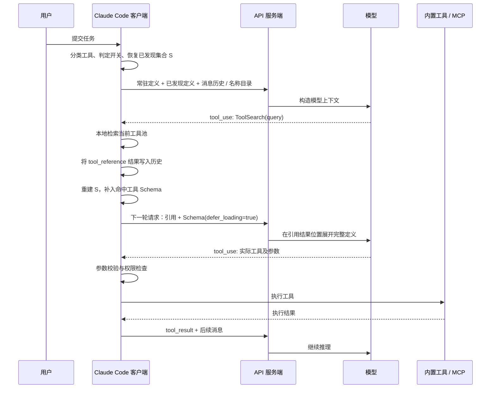
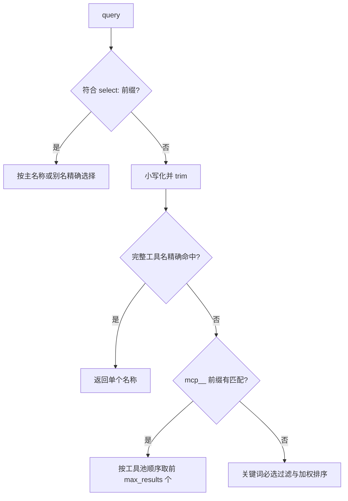

# Claude Code ToolSearch 实现机制

本文分析当前 `extracted-src` 源码中的 ToolSearch 实现，覆盖工具分类、启用判定、检索算法、API 协议、调用执行、会话状态、缓存与异常恢复。环境变量默认值和实验开关均按这份源码描述。

## 1. 核心设计

ToolSearch 将工具的完整定义按需加入模型上下文。

客户端保存完整可用工具池。模型最初看到常驻工具的完整定义，以及延迟工具的名称目录；需要某个延迟工具时，模型调用 `ToolSearch`，客户端返回工具引用。下一次 API 请求携带命中工具的完整 Schema，服务端在引用结果的位置展开定义，模型随后生成实际工具调用。

整个机制由三个层面共同完成：

| 层面 | 保存或处理的内容 | 主要职责 |
| --- | --- | --- |
| 客户端工具池 | 工具名称、描述、Schema、执行器、权限信息 | 检索、生成 API 定义、执行调用 |
| API 请求 | 当前需要发送的工具定义，以及带工具引用的消息历史 | 将引用与对应定义一同提交给服务端 |
| 模型上下文 | 常驻定义、延迟工具名称目录、搜索结果位置展开的定义 | 选择工具、理解参数、生成调用 |

ToolSearch 在本地使用字符串匹配和正则评分。搜索阶段读取描述用于计算相关性，未命中工具的完整描述和参数无需进入模型上下文。

### 1.1 集合模型

定义：

- `T`：当前可用工具池。
- `D`：`T` 中满足 `isDeferredTool()` 的工具。
- `A = T − D`：常驻工具，其中包括可用的 ToolSearch。
- `S`：从消息历史及压缩边界恢复的已发现工具名称集合。

启用 ToolSearch 时，请求中的工具集合为：

```text
RequestTools = A ∪ { t ∈ D | t.name ∈ S }
```

第一次请求通常 `S = ∅`，因此未发现的延迟工具 Schema 不会发送。

ToolSearch 关闭时，发送当前工具池中除 ToolSearch 外的工具定义。

### 1.2 完整时序



## 2. 模块分工

| 模块 | 关键职责 |
| --- | --- |
| `src/Tool.ts` | 工具属性、名称与别名匹配 |
| `src/tools.ts` | 将 ToolSearch 注册到候选工具池 |
| `src/tools/ToolSearchTool/prompt.ts` | 延迟分类、名称目录格式、模型使用说明 |
| `src/tools/ToolSearchTool/ToolSearchTool.ts` | 输入输出结构、本地检索、结果到协议块的映射 |
| `src/utils/toolSearch.ts` | 模式判定、模型支持、自动阈值、发现状态恢复、目录增量 |
| `src/services/api/claude.ts` | 请求级启用判定、过滤工具、组装 Schema、消息适配 |
| `src/utils/api.ts` | 生成并缓存基础 Schema，叠加每轮属性 |
| `src/utils/messages.ts` | 工具引用清理、消息归一化、增量附件转消息 |
| `src/utils/attachments.ts` | 生成延迟工具目录的增量附件 |
| `src/services/mcp/client.ts` | 将 MCP 工具与元数据转换为内部 Tool |
| `src/services/tools/toolExecution.ts` | 参数校验、权限执行、未加载 Schema 的错误提示 |
| `src/services/compact/compact.ts` | 压缩时保存已发现工具集合 |
| `src/utils/betas.ts` | 选择 provider 对应的 beta header |

## 3. 工具注册与延迟分类

### 3.1 相关属性

```ts
interface ToolSearchRelatedFields {
  name: string
  aliases?: string[]
  isMcp?: boolean
  isLsp?: boolean
  shouldDefer?: boolean
  alwaysLoad?: boolean
  searchHint?: string
}
```

| 属性 | 含义 |
| --- | --- |
| `isMcp` | MCP 工具，默认进入延迟集合 |
| `shouldDefer` | 内置工具主动声明延迟加载 |
| `alwaysLoad` | 优先退出延迟分类，完整定义在首轮可见 |
| `searchHint` | 一行能力描述，参与关键词匹配 |
| `aliases` | 精确选取时可以使用的别名 |
| `isLsp` | 参与 LSP 初始化状态相关的额外延迟标记 |

### 3.2 分类优先级

`isDeferredTool()` 的判断顺序为：

1. `alwaysLoad === true`：常驻。
2. `isMcp === true`：延迟。
3. 名称为 ToolSearch：常驻。
4. 应用构建或运行模式下的特定例外：常驻。
5. 返回 `shouldDefer === true`。

特定例外包括启用 fork-subagent 模式时的 Agent、特定构建中的 Brief，以及满足桥接条件的 SendUserFile。实际工具是否存在，还取决于构建开关及自身启用条件。

当前源码中显式声明延迟加载的内置工具包括 WebSearch、WebFetch、LSP、NotebookEdit、计划模式、工作树、任务、团队及部分调度工具。

### 3.3 MCP 元数据

MCP 客户端转换工具时读取：

```json
{
  "_meta": {
    "anthropic/alwaysLoad": true,
    "anthropic/searchHint": "search messages and channels"
  }
}
```

转换规则：

- `anthropic/alwaysLoad` 必须严格等于布尔值 `true` 才生效。
- `anthropic/searchHint` 必须是字符串；连续空白被合并，首尾空白被删除。
- `searchHint` 参与检索，不加入默认的延迟工具名称目录。
- MCP 工具通常使用 `mcp__server__tool` 名称；SDK 特定模式可保留原始工具名。

## 4. 启用机制

启用分为候选注册与实际请求判定两个阶段。

### 4.1 候选注册：乐观判定

`isToolSearchEnabledOptimistic()` 用于工具注册等同步路径。它检查模式和代理条件，暂不计算模型支持或自动阈值。

当其返回 `true` 时，基础工具集合加入 ToolSearch。随后，请求构造阶段再决定本轮是否真正启用。

ToolSearch 若被工具配置排除，后续发现机制也会关闭。

### 4.2 环境变量模式

`getToolSearchMode()` 返回三个内部模式：

| `ENABLE_TOOL_SEARCH` | 内部模式 | 行为 |
| --- | --- | --- |
| 未设置 | `tst` | 默认开启延迟发现 |
| `true` | `tst` | 开启 |
| `auto:0` | `tst` | 开启 |
| `auto` | `tst-auto` | 达到默认 10% 阈值后开启 |
| `auto:N`，N 为 1–99 | `tst-auto` | 达到指定百分比后开启 |
| `false` | `standard` | 关闭 |
| `auto:100` | `standard` | 关闭 |

补充规则：

- `CLAUDE_CODE_DISABLE_EXPERIMENTAL_BETAS` 为真时，优先返回 `standard`。
- `auto:N` 用 `parseInt()` 解析，再限制到 0–100。
- 无效的 `auto:` 数值在自动模式阈值读取时回落到默认 10%。
- 环境变量布尔值按项目的 `isEnvTruthy` / `isEnvDefinedFalsy` 处理。

### 4.3 代理条件

当以下条件同时成立时，乐观判定关闭 ToolSearch：

```text
ENABLE_TOOL_SEARCH 未设置或为空
且 provider == firstParty
且 ANTHROPIC_BASE_URL 指向第三方地址
```

显式设置非空的 `true`、`auto` 或 `auto:N` 可以越过这层代理启发式。实验 beta 总开关、模型支持等后续条件仍然适用。

Vertex、Bedrock、Foundry 不走这条 firstParty 代理检查。

### 4.4 请求级判定

`isToolSearchEnabled()` 按以下逻辑决定：

1. 模型是否支持 `tool_reference`。
2. 当前工具集合中是否存在 ToolSearch。
3. 模式是否为 `standard`、`tst` 或 `tst-auto`。
4. 自动模式下计算工具定义大小与阈值。

模型采用不支持名单匹配：名称转小写后，检查是否包含名单中的模式。源码默认名单为 `haiku`，可通过远程特性配置调整。

请求构造层还会检查：

```text
D 为空，并且没有正在连接的 MCP 服务器
→ 本轮关闭 ToolSearch
```

有 pending MCP 时保留 ToolSearch，使连接完成后仍有工具发现入口。

### 4.5 自动阈值

自动模式统计所有可延迟工具的定义大小，覆盖名称、描述与输入 Schema。

```text
thresholdTokens = floor(contextWindow(model, betas) × percentage / 100)
enabled = deferredToolTokens >= thresholdTokens
```

优先调用工具定义 token 计数能力，并扣除固定计数开销。计数不可用或失败时回退到字符估算：

```text
thresholdChars = floor(thresholdTokens × 2.5)
enabled = deferredToolDefinitionChars >= thresholdChars
```

计数结果以延迟工具名称组成的键进行 memoize。该键没有独立包含模型、描述内容或 Schema 内容；同名工具内容更新时，缓存失效需要由相应外围流程处理。

## 5. 名称目录与发现状态

目录告诉模型有哪些工具；发现状态决定哪些定义进入请求。两者分别维护。

### 5.1 普通名称目录

未启用目录增量模式时，请求组装层生成：

```xml
<available-deferred-tools>
NotebookEdit
WebSearch
mcp__slack__search_messages
mcp__slack__send_message
</available-deferred-tools>
```

它以元消息形式插入请求消息序列前面。

工具名按字典顺序排序。`formatDeferredToolLine()` 只返回名称，完整描述、Schema 和 `searchHint` 均不在目录中。

### 5.2 增量目录

`isDeferredToolsDeltaEnabled()` 通过内部用户条件或 `tengu_glacier_2xr` 特性开关启用增量模式。

客户端扫描历史 `deferred_tools_delta` 附件，重建已公告名称集合，再计算：

```ts
interface DeferredToolsDelta {
  addedNames: string[]
  addedLines: string[]
  removedNames: string[]
}
```

规则如下：

- 当前延迟集合中新出现的工具，加入 `addedNames`。
- 先前公告的工具已离开整个工具池，加入 `removedNames`。
- 工具从延迟变为常驻、但仍在工具池中时，不公告移除。
- 没有变化时，不新增附件。

附件随后转成 `<system-reminder>` 消息。这样可以在消息尾部公告变化，避免不断改写前面的完整目录。

附件入口会检查乐观开关、模型支持和 ToolSearch 可用性，但不重复执行异步自动阈值计算。因此自动模式未达阈值时，少数情况下仍可能出现目录公告；这时相关工具直接以完整定义可用。

### 5.3 已发现集合 S

`extractDiscoveredToolNames(messages)` 扫描：

1. 用户消息中 `tool_result.content` 数组里的 `tool_reference`。
2. `compact_boundary` 系统消息中的 `preCompactDiscoveredTools`。

得到工具名称集合，用于下一次请求过滤。

```text
公告过名称 ≠ 已发现
搜索命中并写入引用 → 已发现
实际执行过工具 → 另一个独立事件
```

工具是否已发现，主要依据历史引用与压缩元数据。仅仅出现一次实际 `tool_use`，不会被这个函数计入发现集合。

## 6. ToolSearch 输入、输出与查询路径

### 6.1 输入结构

```ts
{
  query: string
  max_results?: number // 默认 5
}
```

当前 Zod 定义为 `max_results` 声明了数字类型与默认值，没有额外声明整数或正数范围。

### 6.2 内部输出

```ts
{
  matches: string[]
  query: string
  total_deferred_tools: number
  pending_mcp_servers?: string[]
}
```

内部输出用于结果映射。成功时，模型侧工具结果主要是 `tool_reference` 块；这些统计字段不会原样全部展示给模型。

### 6.3 查询顺序



### 6.4 `select:` 精确选择

示例：

```json
{
  "query": "select:WebSearch,mcp__slack__send_message"
}
```

具体行为：

- 前缀匹配使用 `/^select:(.+)$/i`，前缀大小写不敏感。
- 前缀匹配前未统一 `trim()`，前导空格会影响这条路径。
- 逗号分隔后，逐项去掉首尾空白并忽略空项。
- 先查延迟集合，再查完整工具池。
- 使用 `findToolByName()`，支持主名称和别名，比较区分大小写。
- 返回规范主名称，并按请求顺序去重。
- 不受 `max_results` 截断。
- 部分名称命中时返回已找到项，缺失名称写入调试日志。

允许选择常驻工具，使模型重复加载一个已经可用的工具时仍可继续执行。

### 6.5 裸工具名精确匹配

普通查询入口先转小写并去掉首尾空白，再匹配工具主名称。

这条路径忽略大小写，优先延迟集合，再回退完整工具池。它不使用别名匹配，且精确命中后立即返回单个工具。

### 6.6 MCP 前缀匹配

查询以 `mcp__` 开头且长度大于 5 时，尝试对延迟工具名称执行 `startsWith()`。

有结果则按现有工具池顺序截取前 `max_results` 个，不执行关键词评分。没有前缀结果时，继续进入关键词路径。

## 7. 关键词检索算法

### 7.1 工具名称拆分

MCP 名称：

```text
mcp__slack__search_messages
→ 去掉 mcp__
→ 小写化
→ 按 __ 和 _ 拆分
→ [slack, search, messages]
```

普通名称：

```text
NotebookEdit
→ 在小写字母与后续大写字母之间插入空格
→ 下划线替换为空格
→ 小写化并拆词
→ [notebook, edit]
```

关键词评分中的 MCP 判断使用名称是否以 `mcp__` 开头。某个 MCP 工具在 SDK 模式下保留原始名称时，名称解析与权重可能走普通工具分支。

### 7.2 查询拆分

查询小写化后按空白拆词。

- `+slack`：必选词，参与预过滤，也参与评分。
- `send`：普通评分词。
- 单独的 `+` 不满足必选词格式，按普通词处理。

所有必选词都必须满足以下任意一种命中方式：

- 名称片段完全相等。
- 名称片段包含该词。
- 描述中正则单词边界匹配。
- `searchHint` 中正则单词边界匹配。

工具提示中把 `+slack` 概括为要求名称包含 slack；实际执行代码的匹配范围还包括描述和 `searchHint`。

### 7.3 评分规则

对每个候选工具，遍历所有评分词并累加：

| 命中方式 | MCP 名称 | 普通名称 |
| --- | ---: | ---: |
| 名称片段完全相等 | +12 | +10 |
| 名称片段包含查询词 | +6 | +5 |
| 规整后的完整名称包含查询词，且当时累计分为 0 | +3 | +3 |
| `searchHint` 单词边界匹配 | +4 | +4 |
| 描述单词边界匹配 | +2 | +2 |

名称精确与名称包含分支互斥；提示和描述可以继续叠加。

完整名称兜底检查的是当前工具的累计 `score === 0`。这个细节使其与查询词遍历顺序有关。

描述与提示使用转义后的 `\bterm\b` 正则，避免把查询词当作任意正则表达式执行。每次搜索预编译查询词对应的正则，并复用到各工具。

### 7.4 排序与截取

```ts
scored
  .filter(item => item.score > 0)
  .sort((a, b) => b.score - a.score)
  .slice(0, maxResults)
  .map(item => item.name)
```

普通词无需全部命中。实现没有额外的分数门槛、频率统计、向量索引或语义模型调用。

同分项没有显式的二级排序条件。稳定排序下保留候选工具的原始次序。

空关键词最终返回空匹配。负数或小数 `max_results` 会落到 JavaScript `slice()` 的实际行为中；调用方应传入合理的正整数。

### 7.5 一个评分示例

假设存在：

```text
名称：mcp__slack__send_message
searchHint：send channel messages
描述：Send a message to a channel
查询：+slack send
```

评分为：

```text
slack：名称精确 +12
send：名称精确 +12，searchHint +4，描述 +2
合计：30
```

该例中的描述与提示用于演示规则。实际分数取决于运行时工具元数据。

### 7.6 描述缓存

`getToolDescriptionMemoized()` 根据工具名称缓存 `tool.prompt()` 返回的描述。

搜索使用一个默认权限上下文和空 agents 列表读取描述。工具描述需要根据上下文生成时，检索文本可能与实际 API 请求时生成的描述存在差异。

每次搜索前，把延迟工具名排序后拼成缓存键；名称集合变化时清空描述缓存。另有 `clearToolSearchDescriptionCache()` 供外部显式清空。

同名工具只改变描述时，这个名称集合比较不会自行发现变化。

## 8. 工具引用与 API Schema 加载

### 8.1 成功结果的协议形态

例如模型调用：

```json
{
  "type": "tool_use",
  "id": "search_1",
  "name": "ToolSearch",
  "input": {
    "query": "select:mcp__slack__send_message"
  }
}
```

客户端映射为：

```json
{
  "type": "tool_result",
  "tool_use_id": "search_1",
  "content": [
    {
      "type": "tool_reference",
      "tool_name": "mcp__slack__send_message"
    }
  ]
}
```

### 8.2 下一次请求补入 Schema

历史引用使工具加入 `S`。请求层通过工具过滤后，为它生成：

```json
{
  "name": "mcp__slack__send_message",
  "description": "Send a message to a channel",
  "input_schema": {
    "type": "object",
    "properties": {
      "channel": { "type": "string" },
      "text": { "type": "string" }
    },
    "required": ["channel", "text"]
  },
  "defer_loading": true
}
```

这里的 Slack 参数仅用于说明协议结构。

完整定义与引用在同一次后续 API 请求中提交。服务端根据引用解析定义，在结果位置渲染 `<functions>` 内容。

模型使用说明把展开后的内容描述为：

```xml
<functions>
<function>{"description":"...","name":"...","parameters":{...}}</function>
</functions>
```

请求里的参数定义字段是 `input_schema`；模型侧渲染说明使用 `parameters`。

### 8.3 `defer_loading` 的作用

已发现工具仍然保留 `defer_loading: true`。API 不将它放入顶部常驻工具清单，而是在引用位置展开。

后续请求会继续携带当前可用、且属于 `S` 的延迟工具定义，供历史引用解析。

### 8.4 Schema 生成

`toolToAPISchema()`：

1. 优先使用工具提供的 `inputJSONSchema`。
2. 否则把 Zod 输入 Schema 转为 JSON Schema。
3. 结合 `tool.prompt()` 生成描述。
4. 按相关特性开关处理 strict、流式输入等属性。
5. 缓存基础定义。
6. 每轮复制基础字段，叠加 `defer_loading` 与 `cache_control`。

每轮叠加避免修改缓存中的基础对象。

生成 Schema 时传入完整工具池作为上下文；过滤仅决定哪些定义发送给 API。

### 8.5 LSP 的额外条件

请求中的 `willDefer()` 还检查 LSP 初始化状态：

```text
useToolSearch
且（属于 D 或 isLsp 且初始化 pending / not-started）
→ defer_loading = true
```

工具集合过滤由 `D` 和 `S` 决定，LSP 条件用于最终 Schema 的标记。

### 8.6 Provider beta

| Provider | beta 标识 |
| --- | --- |
| Claude API / Foundry | `advanced-tool-use-2025-11-20` |
| Vertex / Bedrock | `tool-search-tool-2025-10-19` |

Bedrock 的该标识通过请求额外 body 参数传递，其他路径按相应 beta 参数处理。

这些是当前客户端的协议选择。运行时仍依赖所接入服务对相关协议块的支持。

## 9. 实际执行与权限

ToolSearch 自身声明：

```text
isReadOnly() = true
isConcurrencySafe() = true
maxResultSizeChars = 100000
```

工具被发现后，实际调用进入常规执行管线：

```text
定位工具 → Zod 输入校验 → 权限检查 → 执行 → 回传结果
```

发现状态负责上下文加载，执行权限仍由现有工具权限机制处理。

### 9.1 未加载定义的恢复提示

`buildSchemaNotSentHint()` 用于参数校验已经失败的路径。

当以下条件成立时，为原始校验错误追加提示：

- 乐观判定 ToolSearch 可启用。
- 当前工具集合包含 ToolSearch。
- 目标是延迟工具。
- 目标名称不在 `S` 中。

提示模型先调用：

```text
ToolSearch(query="select:<tool_name>")
```

然后重试原调用。

这一检查没有完整重算模型与自动阈值门控，源码允许在少量回退场景中出现额外搜索提示。执行路径也没有把“未在 S 中”作为单独的全局拒绝条件；加载约束主要通过模型提示、请求 Schema 可见性和失败恢复共同实现。

## 10. 无结果与 MCP 动态连接

### 10.1 无匹配

无结果时返回文本：

```text
No matching deferred tools found
```

如果当前存在 pending MCP 连接，结果还会列出服务器名称，提示连接完成后重试。

ToolSearch 读取当前工具池与连接状态，不在本次调用内等待服务器连接完成。

### 10.2 部分选取成功

`select:A,B,C` 只找到 A、C 时：

- 结果返回 A、C 的引用。
- B 的缺失写入调试日志。
- 不因为部分缺失而拒绝所有结果。

### 10.3 断开或移除工具

消息归一化根据本轮可用工具名清理无效 `tool_reference`。

全部引用被清除时，补入一个文本占位结果，保持工具调用与结果的消息结构有效。

`S` 可能仍包含历史名称，但请求过滤始终以当前工具池为基础。已离开工具池的工具不会凭借历史状态重新出现。

## 11. 会话压缩与历史维护

### 11.1 历史是发现状态的来源

发现状态通过历史扫描重建，避免只依赖进程内的一个易失集合。

在常规会话中，ToolSearch 成功结果进入历史；后续轮次持续识别这些引用，并发送相应定义。

### 11.2 Compact

压缩会用摘要替换历史消息，原来的结构化引用可能随之消失。因此压缩流程在边界消息中保存：

```ts
boundaryMarker.compactMetadata.preCompactDiscoveredTools = [
  ...extractDiscoveredToolNames(messages)
].sort()
```

压缩后的 `extractDiscoveredToolNames()` 读取这份字段，继续把已发现工具纳入请求。

该处理出现在完整 / 部分压缩及会话记忆压缩相关路径中。保存的字段承担请求端工具集合恢复；压缩后实际传给模型的文本还由摘要及附件重建流程共同决定。

工具目录的“已公告集合”和工具定义的“已发现集合”分别维护，压缩时需分别恢复。

### 11.3 Snip

发现状态模块的设计说明约定：Snip 保护携带 `tool_reference` 的消息，避免通过局部裁剪丢失加载状态。本次可见源码中的具体实现分析以已读取的 Compact 路径为主。

### 11.4 模型切换

如果后续模型或当前模式不支持 ToolSearch，请求层会：

- 移除 ToolSearch 本身。
- 发送其余工具的完整定义。
- 清理历史结果中的 `tool_reference`。
- 清理工具调用的 `caller` 字段。

这使前一轮的实验协议内容不会直接进入不兼容的请求。

## 12. 消息归一化的协议约束

工具引用会改变服务端渲染方式，因此消息归一化还处理以下细节：

1. 清理已经不可用工具的引用。
2. 关闭 ToolSearch 时清理全部工具引用。
3. 处理工具调用与结果配对。
4. 调整携带引用的结果消息与普通文本的组合。

`tool_reference` 所在结果块有专门的结构约束。源码避免在同一个 `tool_result.content` 中混入用于提示的普通文本。

在相关实验门控下，`relocateToolReferenceSiblings()` 会把引用消息旁边的文本块移动到后续不含引用的工具结果消息；没有可用目标时保留原处。另一条门控路径在合适位置添加同级提示文本。

这些处理服务于模型回合边界与停止序列行为，不改变本地检索评分。

## 13. 缓存与上下文成本

### 13.1 四种缓存相关机制

| 机制 | 目的 | 关键边界 |
| --- | --- | --- |
| 描述 memoize | 避免每次搜索重新生成描述 | 名称集合变化或显式清理触发失效 |
| 自动阈值计数 memoize | 避免重复统计工具定义大小 | 当前键以工具名集合为主 |
| 基础 Schema 缓存 | 避免反复转换 Schema 与生成基础定义 | 每轮延迟、缓存属性独立叠加 |
| 增量名称公告 | 减少前缀目录变化对提示缓存的影响 | 由特性开关控制 |

启用提示缓存变更检测时，`defer_loading: true` 的定义不计入工具 Schema 检测哈希，因为它们不会进入顶部常驻工具区。

这项排除针对客户端的缓存变更检测。被引用展开的定义仍然属于模型实际使用的内容。

### 13.2 成本构成

可以用以下近似关系理解：

```text
工具相关上下文
≈ 常驻工具定义
 + 延迟工具名称目录
 + 搜索调用及结果记录
 + 已发现工具展开的定义
 + 实际工具调用和执行结果
```

主要节省来自尚未选中工具的描述与参数 Schema。

额外成本包括：

- 模型发起搜索所需的一次工具往返。
- 名称目录本身。
- 搜索结果及加载后的定义。
- 会话中后续累积的实际工具结果。

该路径没有按闲置时间自动卸载工具定义的机制。已发现工具增多时，相关上下文也会增长。

### 13.3 上下文统计的口径

当前 MCP 上下文分析路径会用历史中的实际 `tool_use` 标记部分工具的 loaded 状态；请求构造则使用 `tool_reference` 和压缩元数据计算发现集合。

因此，“已搜索但尚未实际调用”的工具，在分析展示与请求构造中的分类口径可能不同。排查工具加载时，应直接检查本轮过滤后的工具集合和引用消息。

## 14. 三个阶段的完整例子

设：

```text
A = {Read, Bash, ToolSearch}
D = {WebSearch, mcp__slack__send_message}
S = ∅
```

### 阶段一：初始请求

```text
请求 tools：Read、Bash、ToolSearch
名称目录：WebSearch、mcp__slack__send_message
```

模型可以直接调用 Read、Bash；需要 Slack 工具时，先获取定义。

### 阶段二：搜索命中

```text
模型：ToolSearch(query="select:mcp__slack__send_message")
客户端结果：tool_reference("mcp__slack__send_message")
```

历史更新后：

```text
S = {mcp__slack__send_message}
```

下一次请求：

```text
请求 tools：
  Read
  Bash
  ToolSearch
  mcp__slack__send_message，defer_loading=true

消息历史：
  原任务
  ToolSearch 调用
  含 tool_reference 的结果
```

服务端在搜索结果位置展开 Slack 工具定义。WebSearch 的 Schema 继续省略。

### 阶段三：实际调用及后续复用

模型根据已加载的 Schema 生成参数，客户端校验并检查权限后执行。

后续轮次从历史恢复 Slack 工具的发现状态，继续发送其定义。再次需要相同工具时，可以直接调用；需要其他延迟工具时，再执行 ToolSearch。

## 15. 实现边界与排查入口

| 现象 | 主要检查项 |
| --- | --- |
| ToolSearch 完全未出现 | 乐观判定、代理地址、实验 beta 开关、工具禁用配置 |
| 出现候选后实际请求又移除 | 模型支持、自动阈值、D 是否为空及 pending MCP |
| 查询完整名称有结果，`select:` 没结果 | 名称大小写、别名、`select:` 前导空白 |
| `+词` 命中不含该词的工具名 | 描述或 searchHint 是否包含必选词 |
| 搜索命中后缺少定义 | 引用是否写入历史、名称是否一致、过滤集合和 Schema 生成 |
| 参数被生成为字符串并校验失败 | 本轮 Schema 是否发送、是否先加载了工具 |
| 服务器工具刚连接时搜不到 | 搜索时的工具池快照、pending 状态、连接完成后的目录更新 |
| 压缩后工具状态异常 | compact boundary 中的 `preCompactDiscoveredTools` |
| 同名工具内容更新后搜索仍使用旧描述 | 描述缓存是否显式失效 |
| 切换模型后协议请求失败 | 引用与 caller 清理、beta 参数、provider 支持 |

实现中还会记录模式决策、搜索结果和 Schema 未发送等诊断事件，包括 `tengu_tool_search_mode_decision`、`tengu_tool_search_outcome`、`tengu_deferred_tool_schema_not_sent`。日志可用于串联启用、检索与执行三个阶段。

## 16. 精简实现伪代码

以下伪代码展示主干逻辑，省略 provider、实验门控和消息修复细节。

```ts
async function prepareRequest(tools, messages, options) {
  let enabled = await isToolSearchEnabled(
    options.model, tools, options.permissions, options.agents
  )

  const deferred = enabled ? tools.filter(isDeferredTool) : []
  if (enabled && deferred.length === 0 && !options.hasPendingMcpServers) {
    enabled = false
  }

  if (!enabled) {
    return {
      tools: await buildSchemas(withoutToolSearch(tools)),
      messages: stripToolSearchProtocolFields(messages)
    }
  }

  const discovered = extractDiscoveredToolNames(messages)
  const selected = tools.filter(tool =>
    !isDeferredTool(tool) || discovered.has(tool.name)
  )

  return {
    tools: await buildSchemas(selected, tool => ({
      defer_loading: isDeferredTool(tool) || shouldDeferLspTool(tool)
    })),
    messages: normalizeAndAnnounceNames(messages, tools)
  }
}

async function executeToolSearch(input, tools, appState) {
  const deferred = tools.filter(isDeferredTool)
  invalidateDescriptionCacheIfNamesChanged(deferred)

  const names = isSelectQuery(input.query)
    ? selectByNameOrAlias(input.query, deferred, tools)
    : await searchExactPrefixOrKeywords(
        input.query, deferred, tools, input.max_results ?? 5
      )

  if (names.length === 0) {
    return noMatchTextWithPendingServers(appState)
  }

  return names.map(name => ({
    type: "tool_reference",
    tool_name: name
  }))
}
```

这条主干把完整工具池、名称可见性、定义发现状态和执行权限分别管理，再通过消息历史与 API 协议将它们连接起来。
