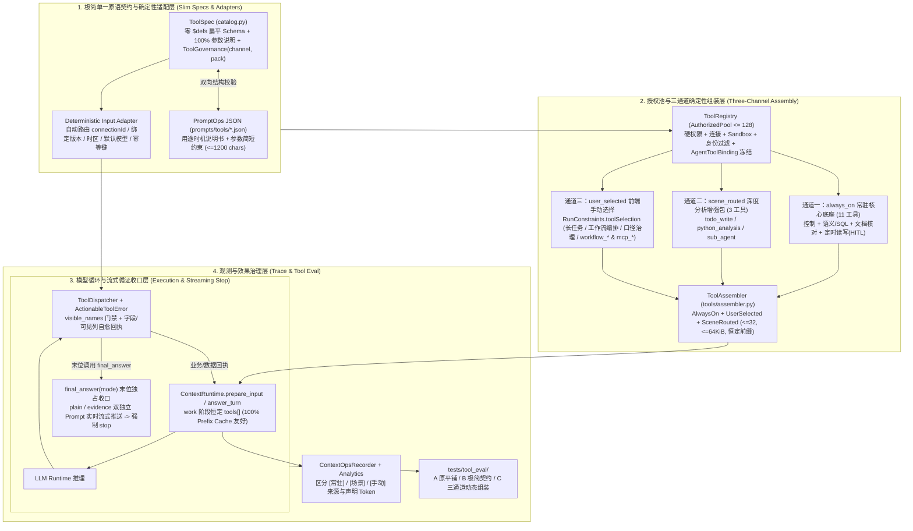
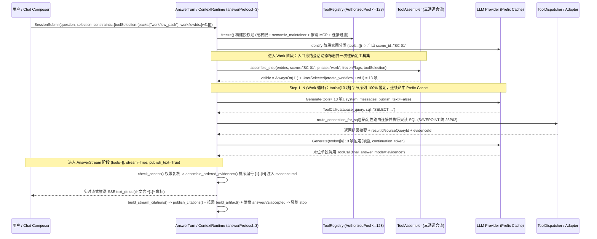
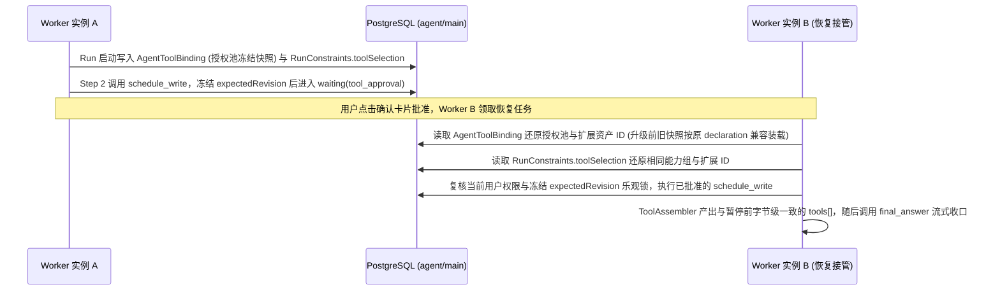
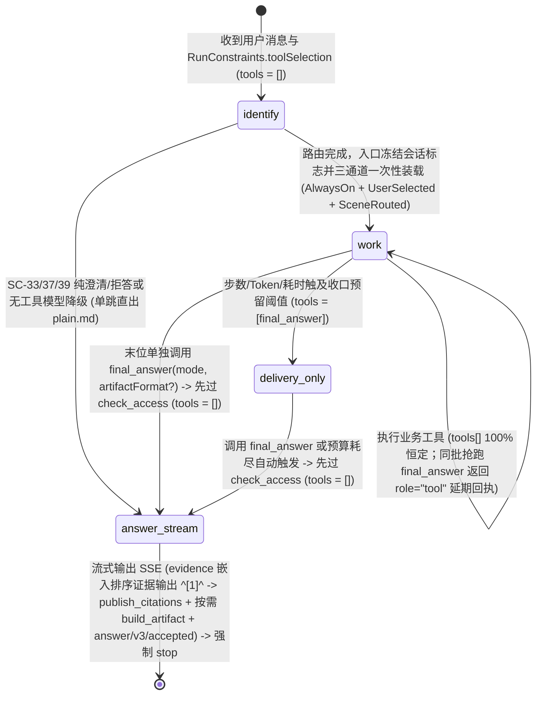

# 第 27 课｜内建工具体系诊断与场景化动态组装 技术方案

> Feature：`970-lesson-27-tool-diagnosis-dynamic-assembly` | 有效需求来源：[spec/PRD.md](../spec/PRD.md) | Profile：`standard` | 模板：`mai-specs/_templates/TECH_DESIGN.tmpl.md` | 代码基线：`main@d0aa488` | 状态：草案

[返回需求简报](../BRIEF.md)

2026-11-27 追加授权：[共享 Sandbox 实施补充](SHARED_SANDBOX.md) 登记复用、并行、回收及 agent/main 0020→0021 迁移。下文无 DDL 约束适用于原工具组装范围。

> Compass 项目规则：[数据所有权与 SQL 迁移管理规范](../../../docs/database-migrations.md)。本方案**不涉及数据库表结构或受管 SQL 迁移变更**（`agent/main` 保持 `0020_context_ops`，`web/main` 保持 `0008_semantic_asset_grants`）；运行期授权工具池复用 `agent_tool_binding` 表，用户手动工具选择随 `RunConstraints` / `context_binding` JSONB 传递与恢复，工具组装 Trace 复用 `context_snapshot` 与 `context_decision_summary` 既有 JSONB 载荷，并通过 `pnpm contracts` 同步 Agent → Web HTTP 契约。

## 需求依据与验收

本方案以 [`spec/PRD.md`](../spec/PRD.md) 为唯一有效需求与验收维护源，完整覆盖 `FR-01`～`FR-12`、`BR-01`～`BR-10`、`NFR-01`～`NFR-05` 及验收标准 `AC-01`～`AC-12`：

| 验收组 | 关联 PRD 编号 | 技术落地锚点 |
| --- | --- | --- |
| 三层 `ToolSpec` 与低 Token 极简契约 | `FR-06`, `BR-08`, `AC-01` | `tools/catalog_contracts.py` 新增三通道 `ToolGovernance` 与“外简内全” `normalize_input`；新增 `tools/schema_compact.py` 清零 `47` 个 `$defs` 与全部机械参数，参数说明覆盖率提升至 `100%`，19 个静态工具总声明从 `42,719 B` 压缩至 `14,980 B (−65%)` |
| 20 工具去复合化、外简内全适配与流式循证收口 | `FR-03`, `FR-07`～`FR-10`, `BR-02`～`BR-03`, `AC-02`, `AC-03`, `AC-09` | `database_query` 收敛为唯一必填 `sql` 参数（多连接元数据聚合 + `kind="metadata"` + `SAVEPOINT` 防 `25P02` + `resultId`/`sourceQueryId` 双写）；`todo_write`/`goal`/`report_to_parent`/`discover_semantic_candidates`/`schedule_write`/`workflows/engine.py` 经外简内全适配层无损对接既有后端状态机；新建 `answerProtocol == 3` 由 `final_answer(mode, artifactFormat?)` 触发双独立流式 Answer Prompt（流前 `check_access`、工程注入排序证据、`^[1]^`/`[1]` 双格式兼容 `<CitedAnswer>`、按需复用 `build_artifact`、抢跑返回延期回执、末位强制 `stop`）；新增 `ActionableToolError` |
| 三通道确定性组装与 48+ 容量池解耦 | `FR-01`, `FR-02`, `FR-11`, `FR-12`, `BR-01`, `BR-04`～`BR-06`, `NFR-01`～`NFR-03`, `AC-04`～`AC-07` | 新增 `tools/assembler.py` 实现 `always_on + user_selected + scene_routed` 三通道一次性合流（11 工具 DataAgent 核心底座常驻、入口冻结会话标志、`SC-34` 补挂 `python_analysis`、`SC-33/37/39` 直通流式快路径）；补齐 Web authz → `CurrentAccess.capabilities()` 的 `semantic_maintainer` 权限位；Chat 输入框新增 `RunConstraints.toolSelection` 手动选择器并自然继承至长任务多轮；解耦 `ToolRegistry` 池上限（`128`，未勾选 MCP 跳过启动期探测）与单步可见上限（`32` / `64 KiB`） |
| 持久恢复兼容与观测、评测闭环 | `FR-04`, `FR-05`, `FR-11`, `BR-07`, `BR-09`～`BR-10`, `NFR-05`, `AC-08`, `AC-10`～`AC-12` | `AgentToolBinding` 与 `RunConstraints.tool_selection` 保障跨进程恢复前后可见集一致（升级前存量 Run 按冻结快照 declaration 回退装载并隔离保留 `answerProtocol == 2`）；扩展 `ContextFlowNode.toolAssembly` 与 Web ContextOps / PromptOps 展示；构建 `apps/agent/tests/tool_eval/` A/B/C 消融套件 |

## 1. 方案概述

### 1.1 设计目标和设计原则

1. **硬权限先于一切通道装载（Permission First）**：租户/工作区功能开关、成员角色权限（补齐 Web 内部鉴权端点向 Agent `CurrentAccess.capabilities()` 透传的 `semantic_maintainer` 能力位）、数据连接可用性、Sandbox 状态以及主 Agent / `SubAgent` / 定时 Run 身份过滤在构建 `AuthorizedPool` 时最先执行。前端随 `RunConstraints.toolSelection` 传入的选择项必须与服务端 `AuthorizedPool` 取硬交集（`UserSelected ∩ AuthorizedPool`），从根源杜绝前端传参越权解锁工具。
2. **单一通用原语 + 外简内全无损适配 + 自由流式循证收口（Simple Single-Purpose ACI）**：严格对齐 [`TOOL_DIAGNOSIS_REPORT.md`](./TOOL_DIAGNOSIS_REPORT.md) 五条工程标尺，并坚守**“外简内全、不伤既有状态机”**的兼容原则——① 去复合化回归通用原语（`database_query` 仅保留唯一 `sql` 参数，`todo_write` 仅保留幂等数组 `todos`，`goal` 拍平为 6 参数含 `acceptanceIndexes`，`report_to_parent` 拍平为 4 参数，`discover_semantic_candidates` 保留极简 `mode`）；② 凡可由代码确定性路由或绑定的参数（`connectionId`、`request_key`、`baseVersion`、`expectedRevision`、`MainModelSelection`、`timezone`、`scope_filter`、`as_of`）一律从模型 Schema 清零，由服务端适配层无损翻译回既有 `ExecutionPlan`、`GoalController`/`gate.py`、`ChildReturn`/`Ledger`、`semantic/tool.py`、`ScheduleWrite` 乐观锁与 `workflows/engine.py`；③ 保持 **`final_answer` 自由回答流式收口范式**（仅必填 `mode` + 可选 `artifactFormat`），彻底打破工具 JSON 输出对回答形态的束缚，由工程层提供可靠的排序证据上下文注入 `evidence.md` Prompt，同时在 `answerProtocol == 3` 协议下闭环兼容权限复核、`publish_citations` / `<CitedAnswer>` 引用弹窗与附件下载。
3. **三通道职责正交与单次 Run 100% 恒定前缀（Three-Channel Deterministic Assembly）**：
   - **通道一 `always_on`（内建默认常驻核心底座）**：将 DataAgent 高频查口径、查指标、查库、核制度与定时任务共 11 个核心工具全部纳入默认常驻底座（主任务 `core_base` 2 工具 + `data_base` 5 工具 + `doc_base` 2 工具 + `schedule_base` 2 工具，合计仅 `7,938 B / ~1,985 tok`，相对基线直降 `−81%`；其中 `schedule_write` 强制 HITL 确认卡并在 Step 1 对子 Agent 与无人值守定时 Run 永久剔除；子任务替换为 `report_to_parent` + 只读核心工具；纯澄清/越权/范围外 `SC-33/37/39` 允许单跳直通 `answer_stream`）。
   - **通道二 `scene_routed`（场景分流自动触发）**：聚焦重型深度分析增强包（`deep_analysis_pack`：`todo_write`、`python_analysis`、`sub_agent`，共 3 工具 `2,187 B`），联动第 21 课 `SC-01..40` 路由在 `identify -> work` 入口按复杂度自动配齐（`SC-34` 多轮承接自动补挂 `python_analysis`），避免简单快查过度规划或滥用子任务。
   - **通道三 `user_selected`（前端用户手动选择装载）**：将跨轮长任务状态机、工作流脚本编排、语义口径治理写操作及数量无上限的扩展资产（`goal` 长任务模式、`create_workflow` 工作流编排、仅维护者可见的语义口径治理三工具，以及个人 `workflow_*` 和外部 `mcp_*` 连接；同时提供 `python_sandbox` 手动加挂开关）交由 Chat 输入框「工具与扩展」浮层显式勾选装载并写入 `RunConstraints.toolSelection`（辅以 `SC-29/30/36/38/40` 及入口已存在活动状态自动兜底；未勾选的外部 MCP 在普通查数启动期跳过实时探测以保障 TTFT）。
   - **恒定前缀优势**：在 `identify -> work` 入口一次性冻结会话动态标志并确定 `tools[]`，单次 Run 在 `work` 阶段内从第 1 步到最后一步 **100% 恒定不变**，全程无需重置 `continuation_token`，上游模型 Prefix Cache 100% 连续命中。
4. **面向第 28 课 `ToolSearch` 的零重构演进边界**：`ToolAssembler` 在产出本轮 `definitions` 的同时，自动计算出 `deferred_pool = AuthorizedPool - MountedTools`（当前已获授权但本轮未装载的工具集合）。当第 28 课引入海量自定义插件与 `ToolSearch` 时，只需在 `deferred_pool` 上挂载搜索工具即可无缝扩展，无需推翻三通道底座。
5. **减法检查结论（不做与延后项）**：
   - 本课不做 `ToolSearch`（`search_tools` 与 `<available-deferred-tools>` 提示块明确划归第 28 课），因此也无需在 `agent_run_private` 维护运行中途动态追加激活列表。
   - 不新增 PostgreSQL 业务表或 Alembic 迁移，直接复用 `agent_tool_binding`、`RunConstraints` 与 `context_decision_summary` JSONB。
   - 不新建独立顶层「工具治理中心」Web 页面或在线 EvalOps CRUD 平台；手动选择融入既有 `analysis-composer.tsx`，Trace 融入既有 ContextOps 面板，Tool Eval 以代码内确定性套件交付。

### 1.2 整体架构



**边界守卫说明**：严格遵守 `test_showcase_isolation.py` 与 `test_tool_catalog.py` 架构约束——`runtime/`、`harness/` 与 `tools/builtin/` 不导入 `compass_agent.tools.business` 或 `examples.*`。所有业务工具的装载通道、能力包、默认场景集与身份属性均声明在各自 `ToolSpec.governance` 上，由 `tools/assembler.py` 面向通用 `ToolGovernance` 数据结构消费。

### 1.3 关键决策与 Review 索引

| 决策 | 推荐及理由 | 代价与备选 | 待判断事项/确认状态 | 详情 |
| --- | --- | --- | --- | --- |
| **DEC-01：Run 授权池（`128`）与单步模型可见集（`32` / `64 KiB`）解耦，并实行未选 MCP 按需探测** | `ToolRegistry` 承载当前 Run 授权工具池（上限 `128`）并固化入 `AgentToolBinding`；`ToolAssembler` 对三通道合流后的模型可见 `tools[]` 强制校验 `<= 32` 且 `<= 64 KiB`。未勾选的外部 MCP 在普通查数启动阶段跳过实时远端探测，仅在用户勾选 `mcpServerIds` 或恢复已有绑定时拉取，既容纳 48+ 扩展池又避免坏 MCP 拖慢 TTFT。 | **备选**：每次 Run 启动全量探测并写入所有 MCP 工具。会导致单个慢 MCP 拖慢每次普通查数且迅速膨胀 `agent_tool_binding` 表。 | 已结合代码核实 | §2.1.1, §2.3.3, [`CODE_DESIGN.md` §1](./CODE_DESIGN.md#1-三层-toolspec-契约与容量解耦注册表) |
| **DEC-02：本课采用“常驻 + 场景分流 + 前端手动选择”三通道确定性组装，`ToolSearch` 留至第 28 课** | 瘦身后的 19 个静态工具总声明仅 `14.98 KB`，`SC-01` / `SC-21` 常规问答仅装载 11 个常驻核心工具（`7.94 KB`，`−81%`），彻底避免分类误判缺工具。通过前端 `RunConstraints.toolSelection` 显式控制长任务/工作流编排/语义口径治理及自定义 `workflow_*`/`mcp_*`，配合 `SC-01..40` 自动挂载深度分析增强包（`todo_write`/`python_analysis`/`sub_agent`；`SC-34` 多轮承接自动补挂 `python_analysis`），同时预留 `deferred_pool` 给第 28 课接入 `ToolSearch`。 | **备选**：第 27 课同步引入 `search_tools` 中途动态追加。会打断单次 Run 内的恒定工具前缀（触发 `continuation_token` 重置），且在自定义插件市场（第 28 课）落地前收益有限。 | 已按架构决策锁定 | §2.1.2, §2.3.3, [`CODE_DESIGN.md` §2-§3](./CODE_DESIGN.md#2-三通道确定性组装器-toolassembler) |
| **DEC-03：单次 Run `work` 阶段入口冻结状态标志，工具序列 100% 静态恒定** | 在 `identify -> work` 切换时一次性冻结 `has_active_goal`/`has_active_plan`/`has_semantic_draft` 等会话标志并确定 `[AlwaysOn] + [UserSelected] + [SceneRouted]` 列表，不在同轮 `work` 步骤间因中途建草稿/建计划动态增删工具；`SC-33/37/39` 允许单跳直通 `answer_stream`，`delivery_only` 收口仅留 `[final_answer]`。 | **备选**：每步动态重算会话标志或按子阶段卸载工具。会击穿 LLM Prefix Cache 并触发 `pipeline.py` 的 `continuation_token` 复用冲突。 | 已结合代码核实 | §2.1.2, §2.3.4 |
| **DEC-04：单一通用原语去复合化 + 外简内全无损适配 + 按需 `ActionableToolError`** | 对外向模型暴露零 `$defs`、100% 参数说明的极简扁平 Schema；对内通过“外简内全”确定性适配层无损翻译回既有后端状态机——保留 `ExecutionPlan`/`AnalysisTodoPanel`、`GoalController`/`gate.py`（补 `acceptanceIndexes`）、`ChildReturn`/`Ledger`（补 `status`）、`semantic/tool.py` 确认卡（补 `mode`）、`workflows/engine.py`（双兼容 `{tasks}`/`{prompt}`）、`schedule_write` 审批版乐观锁、`database_query` 多连接元数据聚合 + `kind="metadata"` + `SAVEPOINT` 防 `25P02` + `resultId`/`sourceQueryId` 双写。 | **备选**：直接删改后端状态机与前端面板。会导致第 18–25 课已调通的进度环、长任务完成门禁、工作流试跑与附件导出大面积回归。 | 已按评审决策锁定 | §2.1.1, §2.3.2, [`CODE_DESIGN.md` §4](./CODE_DESIGN.md#4-极简输入适配流式循证收口与结构化可自愈错误) |
| **DEC-05：`answerProtocol == 3` 隔离落地 `final_answer(mode, artifactFormat?)` 自由流式循证收口** | 保持 `final_answer` 自由灵活的流式回答范式（`801 B`，唯一必填 `mode` + 可选 `artifactFormat`），彻底解除工具 JSON 输出对回答形态的束缚；新建 Run 使用显式 `answerProtocol == 3`（存量 `answerProtocol == 2` 完整隔离兼容）；流式前先执行 `check_access` 权限复核，由工程层将排序过滤后的可靠证据注入 `{{ordered_evidences}}` 驱动 `plain.md`/`evidence.md` 实时 SSE 推送（开启 `stream=True` / `publish_text=True`），流式完毕后工程层解析 `^[1]^` 精确偏移复用 `publish_citations` / `<CitedAnswer>`（双格式兼容 `^[1]^` 与存量 `[1]`）、按 `artifactFormat` 复用 `build_artifact` 落盘 `answer/v3/accepted` 并强制 `stop`；同批抢跑返回 `role="tool"` 延期回执。 | **备选**：复用 `answerProtocol == 2` 直接覆盖原结构化 Verify 流程。会导致 `store.py` 抛 `409 delivery_conflict`、前端 `<CitedAnswer>` 失效且历史待恢复 Run 崩溃。 | 已按评审决策锁定 | §2.1.2, §2.3.2, [`CODE_DESIGN.md` §4](./CODE_DESIGN.md#4-极简输入适配流式循证收口与结构化可自愈错误) |
| **DEC-06：零数据库 DDL 迁移，统一 `RunConstraints.toolSelection` 并兼容跨版本冻结快照恢复** | 手动选择项统一挂在 `RunConstraints.tool_selection`（复用既有 `SessionSubmit.constraints`，长任务自动续跑天然继承），Step 级三通道组装摘要写入 `ContextSnapshot` 与 `ContextDecisionSummary` JSONB；升级前冻结的旧 `AgentToolBinding` Run 恢复时按快照 declaration 回退装载并由外简内全适配层兼容旧参数。 | **备选**：在 `SessionSubmit` 顶层另建平行字段或强行拿新 Schema 比对旧 `AgentToolBinding`。会导致长任务第 2 轮丢选择且旧 Run 恢复触发 `tool_catalog_changed`。 | 已结合代码核实 | §2.1.1, §2.1.3, §2.3.4 |
| **DEC-07：Tool Eval 放入 `apps/agent/tests/tool_eval/` 隔离运行** | 评测题集、A/B/C 三组装配切换桩与六维指标计算器置于 `tests/tool_eval/`，走真实 `ToolAssembler` 与契约校验路径，不打入生产 wheel 包。 | **备选**：在生产 API 增加 `evalGroup` 字段。违反 `test_showcase_isolation.py` 对公开请求契约的保护。 | 已结合门禁核实 | §2.3.6, [`CODE_DESIGN.md` §6](./CODE_DESIGN.md#6-tool-eval-六维指标评估器与-web-组装轨迹组件) |

## 2. 详细设计方案

### 2.1 核心结构设计

#### 2.1.1 数据结构设计

**（1）数据库变更说明：不涉及数据库变更**

- `agent/main`（当前迁移版本 `0020_context_ops`）与 `web/main`（当前迁移版本 `0008_semantic_asset_grants`）均无需新增或修改表、列、索引或受管 SQL。
- 持久化复用映射：
  - **Run 级全量授权池快照**：继续使用 `agent_tool_binding` 表（`AgentToolBinding`），保存 `ToolRegistry` 内全部授权工具（`<= 128`）的 `declaration`、`binding`、`policy` 与 `catalogOrdinal`。
  - **Run 级用户手动选择快照**：在 `RunConstraints`（既有 JSON 序列化运行约束模型）新增可选字段 `tool_selection: ToolSelection = ToolSelection()`，随 `AnalysisRunInput` 写入运行上下文，跨进程恢复时原样还原。
  - **Step 级三通道组装决策记录**：写入 `prepare_input` 产出的 `receipt["toolAssembly"]`，随既有 `ContextOpsRecorder` 存入 `context_snapshot.ciphertext` 与 `context_decision_summary.decisions_json`。

**（2）三层标准化 `ToolSpec` 与三通道 `ToolGovernance` 模型（`apps/agent/src/compass_agent/tools/catalog_contracts.py`）**

```python
LoadingChannel = Literal["always_on", "scene_routed", "user_selected"]
CapabilityPack = Literal[
    "core_base",          # 通道一：final_answer, read_tool_result
    "subagent_base",      # 通道一（子任务）：report_to_parent
    "data_base",          # 通道一：search_semantics, get_metric_definition, resolve_semantics, query_metric, database_query
    "doc_base",           # 通道一：search_documents, read_document
    "schedule_base",      # 通道一：schedule_read, schedule_write（HITL + 定时/子任务剔除）
    "deep_analysis_pack", # 通道二：todo_write, python_analysis, sub_agent
    "long_task",          # 通道三：goal
    "workflow_pack",      # 通道三：create_workflow
    "semantic_govern",    # 通道三：discover_semantic_candidates, review_semantic_change, submit_semantic_change
    "user_extension",     # 通道三：workflow_*, mcp_*
]
AssemblyPhase = Literal["work", "delivery_only"]


@dataclass(frozen=True, slots=True)
class ToolGovernance:
    """Layer 3: Three-channel loading & governance metadata (server-owned, read-only in PromptOps)."""

    channel: LoadingChannel
    pack: CapabilityPack
    # For scene_routed: scenes that auto-mount this tool; for user_selected: explicit admin/automation fallback scenes.
    default_scenes: frozenset[str] = frozenset()
    default_tasks: frozenset[str] = frozenset()
    allowed_phases: frozenset[AssemblyPhase] = frozenset({"work"})
    requires_semantic_maintainer: bool = False
    subagent_allowed: bool = False
    scheduler_allowed: bool = True
    summary: str = ""  # Concise 1-line summary (also ready for Lesson 28 ToolSearch)
```

- **第 1 层（模型可见极简语义层）**：`ToolDefinition`（函数名、只写用途时机与最佳实践的精炼顶层 `description`、零 `$defs` 零 `if/else` 且 `100%` 带参数简短约束说明的扁平 JSON Schema）。
- **第 2 层（Runtime 确定性适配与执行层）**：`normalize_input`（自动路由 `connectionId`、绑定版本/时区/默认模型/幂等键）、`ToolPolicy(effect, approval)`、`parallel_safe`、`orchestrates`、`local_effect`、`completion`、`evidence_adapter`，仅由 `ToolRegistry` 与 `ToolDispatcher` 消费。
- **第 3 层（三通道治理与路由标签层）**：`ToolGovernance`，挂在 `ToolSpec.governance` 与 `RegisteredTool.governance` 上（个人 `workflow_*` 与远端 `mcp_*` 注册时统一赋予 `channel="user_selected", pack="user_extension"`，同时记录所属 `workflow_id` 或 `mcp_server_id` 供 `ToolSelection` 精准匹配）。

**（3）前端手动选择契约 `ToolSelection` 与结构化错误契约 `ActionableToolError`**

```python
SelectablePack = Literal["long_task", "workflow_pack", "semantic_govern", "python_sandbox"]


class ToolSelection(APIModel):
    """User-selected capability packs and personal/MCP extensions from Chat Composer."""

    packs: list[SelectablePack] = Field(default_factory=list, max_length=4)
    workflow_ids: list[UUID] = Field(default_factory=list, alias="workflowIds", max_length=12)
    mcp_server_ids: list[UUID] = Field(default_factory=list, alias="mcpServerIds", max_length=8)
```

**（4）全量 20 个工具（19 个静态工具 + 子任务 `report_to_parent`）三通道归类与极简重构总表**

> 诊断根因详见 [`TOOL_DIAGNOSIS_REPORT.md`](./TOOL_DIAGNOSIS_REPORT.md)；每个工具改造前后的完整 JSON Schema 逐行对照见 [`TOOL_CONTRACTS.md`](./TOOL_CONTRACTS.md)（离线左右深色代码块 Diff 已合入 [`TECH_DESIGN.html`](./TECH_DESIGN.html) 与 [`TOOL_CONTRACTS.html`](./TOOL_CONTRACTS.html)）。

| 序号 | 工具名 | 装载通道 / 能力包 | 紧凑字节变化 | 按五条诊断标尺与外简内全原则的重构及装载要点 |
| --- | --- | --- | --- | --- |
| 01 | `final_answer` | `always_on` / `core_base` | `4,953 B → 801 B (−84%)` | 主任务常驻底座；38 属性压为唯一必填 `mode`（`"plain" \| "evidence"`）+ 可选 `artifactFormat`（`"markdown" \| "csv" \| "dashboard"`），在 `answerProtocol == 3` 下先过 `check_access` 再触发双独立 Answer Prompt 实时流式推送 SSE，`evidence` 由工程层注入排序证据变量并输出 `^[1]^` 角标（双格式兼容 `<CitedAnswer>`），按需复用 `build_artifact`，抢跑返回延期回执，末位流式结束后强制 `stop`。 |
| 02 | `read_tool_result` | `always_on` / `core_base` | `1,278 B → 645 B (−50%)` | 主/子任务常驻底座；剥离 `anyOf null` 与返回字段冗长解释，补齐 4 参数说明，服务端赋予非空 `cursor` 确定性优先权。 |
| 03 | `report_to_parent` | `always_on` / `subagent_base` | `3,111 B → 939 B (−70%)` | 子任务常驻底座（替代 `final_answer`）；砍掉 `progress` 心跳分支、4 个 `$defs` 与正则，保留扁平 `summary`/`evidenceIds`/`gaps`/`status` 并经外简内全适配层构造 `ChildReturn.findings` 对接长任务 `Ledger`。 |
| 04 | `search_semantics` | `always_on` / `data_base` | `1,005 B → 636 B (−37%)` | 启用语义层时默认常驻；删除 `scope_filter` 与冗余 `domain`，置顶预注入禁调规则。 |
| 05 | `get_metric_definition` | `always_on` / `data_base` | `488 B → 378 B (−23%)` | 启用语义层时默认常驻（口径解释主力）；删除 `version_id`，仅留唯一必填 `asset_id`。 |
| 06 | `resolve_semantics` | `always_on` / `data_base` | `2,310 B → 1,034 B (−55%)` | 启用语义层时默认常驻（`SC-21` 纯口径问答由 SOP 约束免多余取数）；删除 `$defs`、确定性 `as_of` 与重复 `dimensions`，拍平为 6 参数。 |
| 07 | `query_metric` | `always_on` / `data_base` | `2,507 B → 811 B (−68%)` | 启用语义层时默认常驻，正式指标取数首选；砍掉 `operation` 枚举与公式长文，收敛为 `query_ref`/`compare_to`/`drilldown_from` 3 参数。 |
| 08 | `database_query` | `always_on` / `data_base` | `2,391 B → 648 B (−73%)` | 有授权数据库连接时全部工作阶段默认常驻；砍掉 4 个 `op` 子命令与 `connectionId`，**仅留唯一必填 `sql`**；多连接并行聚合 `information_schema` 并标记 `kind="metadata"` 防误判 `transient`，单表 SQL 确定性路由连接，错列经 `SAVEPOINT` 防 `25P02` 再查可见列，回执双写 `resultId`/`sourceQueryId` 并更新 `fingerprint()`。 |
| 09 | `search_documents` | `always_on` / `doc_base` | `1,219 B → 824 B (−32%)` | 启用文档检索时默认常驻，随时支持制度与历史复盘核对；删除 `historical` 开关与 `entity`，保留 3 参数。 |
| 10 | `read_document` | `always_on` / `doc_base` | `589 B → 539 B (−8%)` | 与 `search_documents` 成对默认常驻；清空内幕说明，补齐 `ref` 与 `offset` 说明。 |
| 11 | `schedule_read` | `always_on` / `schedule_base` | `1,779 B → 575 B (−68%)` | 启用定时服务时默认常驻；取消 3 子分支，2 个可选筛选参数一次返回完整计划与记录。 |
| 12 | `schedule_write` | `always_on` / `schedule_base` | `4,821 B → 1,047 B (−78%)` | 主任务交互会话默认常驻（强制 HITL 确认卡；定时触发 Run 与子 Agent 由 Step 1 永久剔除）；清零模型路由、时区与版本参数，合并为 5 参数；审批提案阶段冻结 `expectedRevision` 保留并发乐观锁。 |
| 13 | `todo_write` | `scene_routed` / `deep_analysis_pack` | `2,837 B → 702 B (−75%)` | L2/L3 多步分析或 `plan=required` 挂载（L1 快查不挂）；模型侧仅留幂等 `todos` 数组，外简内全适配层无损映射回 `ExecutionPlan` 与 `RunAutonomyAction`（兼容前端进度环与旧检查点）。 |
| 14 | `python_analysis` | `scene_routed` / `deep_analysis_pack` | `491 B → 533 B (+9%)` | 归因/预测/清洗/绘图/报告与 `SC-34` 自动挂载（亦支持前端手动加挂）；补齐 2 个空白参数说明，锁定 `data` 行列格式与 `<=128KiB` 限制。 |
| 15 | `sub_agent` | `scene_routed` / `deep_analysis_pack` | `3,291 B → 952 B (−71%)` | L3 多源诊断/报告/复合场景挂载；仅留 `tasks: [{name, objective, inputRefs}]`，服务端按 `evidence→ledger→artifact` 三源反查无 `kind` ID 并兼容旧 `prompt`。 |
| 16 | `goal` | `user_selected` / `long_task` | `6,044 B → 1,280 B (−79%)` | 前端勾选「长任务目标」装载（已有活动 Goal 或 `SC-40` 兜底）；拍平为 6 参数（新增轻量 `acceptanceIndexes`），外简内全适配层无损对接 `GoalController`/`Ledger`/`gate.py` 完成门禁。 |
| 17 | `create_workflow` | `user_selected` / `workflow_pack` | `1,638 B → 1,084 B (−34%)` | 前端勾选「工作流编排」装载（或 `SC-29/30` 兜底）；对齐最新子任务 `{tasks:[...]}` 协议并**同步升级 `workflows/engine.py`** 双向兼容 `{tasks}` 与存量 `{prompt}`。 |
| 18 | `discover_semantic_candidates` | `user_selected` / `semantic_govern` | `3,931 B → 1,473 B (−63%)` | 仅维护者勾选「指标口径治理」装载（或 `SC-36/38` 兜底）；清零组织范围/时区，收敛为 4 个扁平参数（保留 `mode: suggest\|save_draft\|revise` 无损对接非阻塞推荐与 HITL 确认卡）。 |
| 19 | `review_semantic_change` | `user_selected` / `semantic_govern` | `396 B → 331 B (−16%)` | 随「指标口径治理」或已有语义草稿装载；补齐 `version_id` 说明并明确输出 `digest`。 |
| 20 | `submit_semantic_change` | `user_selected` / `semantic_govern` | `751 B → 687 B (−9%)` | 随「指标口径治理」装载；删除 `request_key` 与 `binding_id`，仅留 3 个必填业务参数。 |

#### 2.1.2 数据流设计

**（1）三通道确定性组装、恒定前缀推理与流式收口时序**



**（2）持久检查点跨进程恢复（Resume）时序**



**（3）执行阶段收敛与 `final_answer(mode, artifactFormat?)` 末位流式终止状态机**



#### 2.1.3 接口设计

**（1）Chat 提交请求契约增量（`apps/agent/src/compass_agent/schemas.py`）**

严格对齐现有 `SessionSubmit` / `AnalysisRunInput` 结构，在既有 `RunConstraints` 模型新增可选字段 `tool_selection: ToolSelection | None = Field(default=None, alias="toolSelection")`（长任务 `GoalController.process()` 续跑时随 `constraints` 自动继承）：

```json
{
  "requestId": "9f1d5c22-8c4a-4e21-9b2d-0123456789ab",
  "sessionId": "5a3b1f10-12d4-4c88-8b10-abcdef123456",
  "question": "分析华东大区上周净销售额变化，并按我的周报工作流生成每周一定时计划",
  "selection": { "mode": "auto" },
  "constraints": {
    "plan": null,
    "toolSelection": {
      "packs": ["workflow_pack"],
      "workflowIds": ["8f2a9c10-41d2-4e7b-9b1c-0123456789ab"],
      "mcpServerIds": []
    }
  }
}
```

**（2）ContextOps 与 PromptOps Agent → Web HTTP 契约增量（`schemas.py`）**

修改 `schemas.py` 后运行 `pnpm contracts` 自动同步 `contracts/*.json` 与 `apps/web/src/generated/`：

- 在 `ContextFlowNode` 增加可选字段 `tool_assembly: ToolAssemblyTraceView | None = Field(default=None, alias="toolAssembly")`：
  - `authorized_count: int`：当前 Run 授权工具池总数。
  - `exposed_count: int`：本步装载工具数。
  - `deferred_count: int`：已获授权但未在本步装载的工具数（`deferred_pool` 计数）。
  - `excluded_count: int`：因阶段、场景或身份规则裁剪的工具数。
  - `permission_filtered_count: int`：因权限/连接/维护者资格硬过滤隐藏的数量（仅计数，不暴露名称）。
  - `declaration_bytes: int`、`declaration_tokens: int`：本步 `tools[]` 紧凑 JSON 字节与估算 Token。
  - `exposed: list[ToolAssemblyItemView]`：每项含 `name`、`label`、`channel: Literal["always_on", "scene_routed", "user_selected"]`、`pack`。
  - `deferred: list[str]`：未挂载获准工具显示名列表（最多前 20 项）。
  - `excluded: list[ToolExcludedItemView]`：非权限原因（`scene` / `stage` / `role` / `budget`）的排除工具与原因代码。
- 在 PromptOps 工具资产读取视图增加可选只读字段 `governance: ToolGovernanceView | None = None`（含 `channel`、`pack`、`effect`、`approval`）。

### 2.2 配置变更

本方案不新增环境变量或外部密钥配置，仅在 `compass_agent/schemas.py`、`tools/registry.py` 与 `tools/assembler.py` 维护受控代码常量：

| 常量名 | 位置 | 值与语义 | 兼容行为 |
| --- | --- | --- | --- |
| `TOOL_REGISTRY_POOL_LIMIT` | `compass_agent/schemas.py` | `128`：单次 Run `ToolRegistry` 最大授权工具注册数 | 超过 128 时保留全部静态工具与用户手动勾选项，按更新时间截断超限扩展并记录 `skipped` |
| `TOOL_CATALOG_LIMIT` | `compass_agent/schemas.py` | 保持 `32`：单次模型调用 `GenerateInput.tools` 最大工具数 | 由 `ToolAssembler` 与 `validate_visible_catalog` 在组装出口强校验 |
| `TOOL_DECLARATION_BYTES_LIMIT` | `compass_agent/tools/registry.py` | 保持 `65536`（`64 KiB`）：单次模型调用 `tools[]` UTF-8 JSON 最大字节数 | 超出预算的低优先级项留置在 `deferred_pool` 并记为 `budget` 裁剪 |
| `USER_SELECTED_EXTENSION_LIMIT` | `compass_agent/tools/assembler.py` | `12`：单次请求允许手动装载的最大动态扩展工具数（`workflow_*` + `mcp_*`） | 前后端双重校验，保障常驻底座与场景核心工具槽位充裕 |
| `TOOL_ERROR_MAX_BYTES` | `compass_agent/tools/errors.py` | `4096`（`4 KiB`）：结构化错误回执单条 JSON 最大字节数，候选列表上限 `8` 项 | 超长自动截断候选并保留主错误码与修复动作 |

### 2.3 分模块详细设计

#### 2.3.1 三层 `ToolSpec` 契约与 PromptOps 双向校验

- **定位文件**：`tools/catalog_contracts.py`、`tools/catalog.py`、`promptops/{catalog.py,structured.py}`、`context_runtime/profiles.py`、`prompts/tools/*.json`（19 个静态工具文件）、`prompts/answer/{plain.md,evidence.md}` 与 `prompts/support/subagent/report-to-parent.json`。
- **设计要点**：
  1. 在 `ToolSpec` 与 `RegisteredTool` 增加 `governance: ToolGovernance` 字段；各工具按 §2.1.1 总表声明准确的 `channel`、`pack`、`default_scenes` 与身份标志。
  2. 在 `promptops/catalog.py`（`member_usages`）与 `context_runtime/profiles.py`（`enumerate_usages`）正式登记新增模板 `prompts/answer/plain.md` 与 `prompts/answer/evidence.md` 及允许模板变量 `{"ordered_evidences"}`，确保模板校验与 PromptOps 后台可见。
  3. 在 `promptops/structured.py` 的 `validate_tool()` 中对**新保存与新发布资产**强校验扁平 Schema 一致性、**100% 参数 `description` 非空**、`examples` 上限 `0..3` 条及 `len(model_description(document)) <= 1200`；读取升级前历史已冻结 `PromptGeneration` 时保留旧上限（`<= 2000` 字符、`<= 10` 条示例）与历史结构兼容，不阻断存量 Run 恢复。
  4. 更新 `POLICY_DIGEST` 并保留 `LEGACY_POLICY_DIGESTS` 白名单，确保升级前已冻结代次的存量持久 Run 恢复不报错。

#### 2.3.2 20 个工具外简内全 ACI 重构、确定性下沉与 `answerProtocol == 3` 流式收口

- **定位文件**：新增 `tools/{errors.py,schema_compact.py}`、`prompts/answer/{plain.md,evidence.md}`；修改 `tools/dispatcher.py`、`tools/builtin/*`、`tools/business/*`、`workflows/engine.py`、`goal/handoff.py`、`semantic/tool.py`、`context_runtime/{citations.py,model_step.py}`、`runtime/{answer_turn.py,store.py}`、`apps/web/src/components/cited-answer.tsx`。
- **设计要点**：
  1. **通用参数校验自愈化（`dispatcher.py` + `errors.py`）**：捕获首个最具区分度的 Schema 校验失败路径（缺必填字段、枚举越界、类型不符），返回有界 `ActionableToolError` JSON。
  2. **`database_query(sql)` 单一原语化、多连接元数据与可靠性补强**：
     - 移除 `op` 枚举与 `connectionId`，仅暴露唯一必填参数 `sql`（内部适配层保留对旧 `op` 检查点回放的兼容）；放开受权限过滤的 `information_schema.tables` 与 `information_schema.columns`。
     - **多连接元数据聚合与 `kind="metadata"` 标记**：多连接工作区执行 `information_schema` 查询时，在全部授权只读连接上并行聚合结果并附加 `connection_name` 列；单表业务查询由 `route_connection_for_sql()` 按 `schema.table` 确定性路由（多连接同名 `public` 冲突时返回带 `candidates` 的结构化引导）。纯元数据 SQL 显式标注 `source_ref = {"kind": "metadata", ...}`，避免落入 `transient` 触发 `store.py` 禁止保存附件。
     - **PostgreSQL `SAVEPOINT` 防 `25P02`**：在只读事务执行业务 SQL 前建立 `SAVEPOINT dq_exec`；捕获 `42703`（列名不存在）时先 `ROLLBACK TO SAVEPOINT dq_exec` 恢复事务态，再查询当前 `session_user` 具备 `SELECT` 权限的至多 8 个相近列名填入 `candidates`；`42P01/42501` 统一返回 `sql_relation_unavailable`。
     - **句柄双写与缓存兼容**：成功回执同时返回 `resultId`（保住 `context.sources`、`evidence.py` 血缘与 `semantic/evidence.py`）和同值别名 `sourceQueryId`（直通 `python_analysis`）；同步更新 `database_query.fingerprint()` 兼容单参数 `sql`，保持长任务 `Ledger.reuse` 有效。
  3. **外简内全无损适配层（不伤既有后端状态机）**：
     - **`todo_write`**：模型提交幂等 `todos: [{step, status}]`，服务端适配层无损翻译回既有 `ExecutionPlan`（自动分配稳定 ID `t1..tn`、`done→verified`、首个 `in_progress→selectedTodoId`、自动递增版本并发送 `RunAutonomyAction`），完整兼容前端 `AnalysisTodoPanel` 进度环及旧 `op` 检查点回放。
     - **`goal`**：模型提交 6 个扁平参数（含轻量 `acceptanceIndexes: list[int]`）；适配层为 `propose` 自动编号 `a1..aN` 并补齐默认预算/版本，将 `record` 的 `acceptanceIndexes` 映射为 `LedgerItem.acceptanceIds` 与合法 `key`，`complete` 自动填入当前 `goal.revision` 对接 `gate.py` 完成门禁，`tool_bindings.py` 同步兼容读取 `action` 与旧 `op`。
     - **`sub_agent`、`report_to_parent` 与 `create_workflow`**：`sub_agent` 服务端对无 `kind` `inputRefs` 按 `parent_evidence → ledger → artifact` 顺序确定性反查组装标准 `InputRef`；`report_to_parent` 保留扁平 `summary`/`evidenceIds`/`gaps`/`status` 并由 `subagent.py` 适配为标准 `ChildReturn(findings=...)` 兼容 `goal/handoff.py` 证据校验与长任务 `Ledger` 归并；**同步升级 `workflows/engine.py`** 双向兼容 `{tasks:[...]}` 与存量工作流脚本的 `{prompt:"..."}` 调用。
     - **`schedule_read` / `schedule_write` / `discover_semantic_candidates` / `submit_semantic_change`**：`schedule_read` 一次返回完整计划与记录；`schedule_write` 在 `prepare_approval` 阶段确定性继承时区/模型并将本轮已读（或当前快照）`expectedRevision` 冻结入 `PreparedApproval`，执行时严格校验乐观锁防并发覆盖；`discover_semantic_candidates` 保留极简 `mode`（`suggest`/`save_draft`/`revise`）无损映射至 `semantic/tool.py` 免弹窗推荐与 HITL 确认卡；`submit_semantic_change` 由服务端用 `uuid5(NAMESPACE_URL, f"{run_id}:{version_id}:{expected_digest}")` 生成确定性幂等键。
  4. **`answerProtocol == 3` 自由流式循证收口闭环（`runtime/answer_turn.py`、`store.py`、`citations.py`、`cited-answer.tsx`）**：
     - **协议隔离与降级兼容**：新建 Run 在 `store.py` 写入 `answerProtocol = 3`；升级前存量 `answerProtocol == 2`（及 `1`）继续沿用原链路零冲突。无工具能力模型降级路径与纯澄清/拒答场景（`SC-33/37/39`）直通 `answer_stream`（`plain.md`）单跳流式输出。
     - **抢跑调用延期回执（严禁静默丢弃）**：批调度前调用 `partition_terminal_final_answer(tool_calls)`——同批同时包含工作工具与抢跑 `final_answer` 时，工作工具照常派发执行，并为抢跑的 `final_answer` 合成一条标准 `role="tool"` 延期回执（保持 `tool_call_id` 一一对应，不触发模型 API 400 报错）；仅当本批唯有 `final_answer` 时进入流式收口。
     - **流式前权限复核 + 工程证据注入 + 双格式引用落盘**：进入 `answer_stream` 前先执行 `check_access(journal, trusted)`；`model_step.py` 对 `answerProtocol == 3` 的 `answer_stream` 阶段开启 `stream=True` 与 `publish_text=True`（`work` 阶段仍保持 `publish_text=False`）。`mode="plain"` 装载 `prompts/answer/plain.md`；`mode="evidence"` 由工程层调用 `assemble_ordered_evidences()` 将本轮已验证检索/查询结果去重、排序过滤编号为 `[1]..[N]` 作为 `{{ordered_evidences}}` 嵌入 `prompts/answer/evidence.md`，自由生成并实时推送 SSE `text_delta`（正文输出 `^[1]^` 角标）。
     - **落盘、附件与强制 `stop`**：流式结束后，服务端调用 `build_stream_citations(run_id, body, index_map)` 计算精确字符区间与完整 `sources[]`，经既有 `publish_citations` 落盘（同步扩展 `citations.py` 与前端 `cited-answer.tsx` 双格式匹配 `^[ordinal]^` 与存量 `[ordinal]`）；若模型传入可选 `artifactFormat`（且无 `transient` 来源污染），确定性调用既有 `build_artifact()` 生成 `report.md`/`analysis.csv`/`dashboard.json`；最后原子写入 `answer/v3/accepted/{stepId}`，经 `store.finish()` 校验通过并强制 `stop` 退出主循环。

#### 2.3.3 三通道确定性组装器（`ToolAssembler`）

- **定位文件**：新增 `apps/agent/src/compass_agent/tools/assembler.py`；修改 `tools/registry.py`、`runtime/{tool_bindings.py,durable_service.py}`、`context_runtime/{profiles.py,pipeline.py}`、`runtime/subagent.py`、`apps/web/src/server/http/`（内部鉴权端点）。
- **设计要点**：
  1. **`ToolRegistry` 容量解耦与按需 MCP 探测**：`ToolRegistry` 允许注册至多 `128` 个已授权工具，单步出口调用 `validate_visible_catalog()` 守卫 `<= 32` 个且 `<= 64 KiB`。常规查数若用户未勾选任何 `mcpServerIds` 且非恢复历史绑定 Run，跳过启动期对外部 MCP Server 的实时远端探测，仅加载静态工具与用户工作流元数据，避免故障 MCP 拖慢 TTFT。
  2. **补齐 `semantic_maintainer` 权限位**：Web 内部 authz 接口新增返回 `capabilityGrants.semantic_maintainer: boolean`，Agent `CurrentAccess.capabilities()` 透传该字段（旧接口缺省回退 `False`），作为 Step 1 硬过滤权威依据。
  3. **`ToolAssembler.assemble_step()` 四步确定性流水线**：
     - **Step 1（硬权限、维护者资格与身份裁剪 -> `AuthorizedPool`）**：剔除无定义工具；若 `!plugins_permitted` 剔除 `mcp_*`/`workflow_*`；若 `!is_semantic_maintainer` 剔除 `requires_semantic_maintainer=True` 工具；应用 `scope_ceiling`；若 `caller_role == "subagent"` 仅保留 `report_to_parent`、`read_tool_result` 及满足只读无审批非编排条件的工具；若 `caller_role == "scheduler"` 剔除 `scheduler_allowed == False`（如 `schedule_write`）。未通过本步的工具仅累计 `permission_filtered_count` 或 `role` 裁剪，绝不进入后续任何通道或 `deferred_pool`。
     - **Step 2（阶段收敛门禁）**：`phase in {"identify", "answer_stream"}` 或 `turn_purpose == "verify"` 返回 `[]`；`delivery_only == True` 仅返回 `[final_answer]`。
     - **Step 3（三通道候选求取与固定保序合流）**：
       - **入口冻结标志**：`has_active_goal`、`has_active_plan`、`has_semantic_draft` 在 `identify -> work` 入口一次性采样冻结，防止同一次 Run 的 Step 1→Step 2 标志翻转击穿 Prefix Cache。
       - **通道一 `always_on_list`**：选取 `AuthorizedPool` 中 `channel == "always_on"` 工具（主任务为 `core_base` + `data_base` + `doc_base` + `schedule_base` 共 11 工具；子任务自动替换为 `subagent_base` + 只读核心工具并剔除 `schedule_write`；定时 Run 在 Step 1 永久剔除 `schedule_write`）。
       - **通道三 `user_selected_list`**：仅在 `caller_role != "subagent"` 时解析 `RunConstraints.tool_selection`（与 `AuthorizedPool` 取硬交集）及显式场景/入口冻结状态兜底：
         - 勾选 `"long_task"` 或冻结 `has_active_goal` 或 `scene_id == "SC-40"` → 装入 `pack == "long_task"`（`goal`）；
         - 勾选 `"workflow_pack"` 或 `scene_id in {"SC-29", "SC-30"}` → 装入 `pack == "workflow_pack"`（`create_workflow`）；
         - 勾选 `"semantic_govern"` 或 `scene_id in {"SC-36", "SC-38"}` 或冻结 `has_semantic_draft` → 装入 `pack == "semantic_govern"`；
         - 勾选 `"python_sandbox"` → 装入 `python_analysis`；
         - 勾选 `workflow_ids` / `mcp_server_ids` → 装入匹配对应资产 ID 的 `workflow_*` / `mcp_*` 工具（至多 `USER_SELECTED_EXTENSION_LIMIT = 12` 项；若在 `SC-29/30` 且用户未手选工作流，最多自动预挂载 4 个近期工作流）。
       - **通道二 `scene_routed_list`**：对尚未进入通道一/三的 `channel == "scene_routed"` 工具（即 `deep_analysis_pack`：`todo_write`、`python_analysis`、`sub_agent`），按 `scene_id` 与冻结条件自动匹配（`SC-34` 多轮承接自动补挂 `python_analysis`；`todo_write` 仅在非 L1 场景、`requires_plan` 或冻结 `has_active_plan` 时装入）。
       - **固定合流顺序**：`[always_on_list（按目录序号）] + [user_selected_list（静态按目录序号，扩展按名称字典序）] + [scene_routed_list（按目录序号）]`；将 `AuthorizedPool` 剩余未挂载工具记入 `deferred_pool`。
     - **Step 4（32 槽位与 64 KiB 预算守卫）**：顺序扫描装入 `selected_defs`，保证总数 `<= 32` 且总 JSON 字节 `<= 64 KiB`，产出 `ToolAssemblyResult(definitions, authorized_pool, deferred_pool, trace)`。

#### 2.3.4 持久恢复、跨版本升级与 100% Prefix Cache 保序细节

- **定位文件**：`runtime/{tool_bindings.py,journal.py,answer_turn.py,store.py}`、`context_runtime/pipeline.py`
- **设计要点**：
  1. `RunToolBindings` 初始化时将静态工具、个人工作流与按需探测的已选 MCP 工具装入 `ToolRegistry`（上限 `128`），并统一规范扩展来源 ID（MCP 从 `McpBinding.connection_id` / `AgentToolBinding.binding["connection_id"]` 提取 `mcp_server_id`，个人工作流从 `workflow_<hex>` 提取 `workflow_id`），由 `journal.freeze_catalog()` 写入 `AgentToolBinding`。
  2. 因为同一 Run 的 `scene_id`、冻结会话标志与 `RunConstraints.tool_selection` 在进入 `work` 后保持不变，`ToolAssembler` 在 `work` 的每一个 Step 产出的 `tools[]` 字节级 100% 相同，`continuation_token` 无需中途失效，实现稳定前缀缓存。
  3. **跨版本存量 Run 恢复守卫**：当 Worker 恢复的 Run 已存在历史 `AgentToolBinding` 记录时，若检测到 `answerProtocol < 3` 或冻结快照 `schema_sha256` 属于升级前旧代次，Runtime **直接按冻结快照还原历史 `ToolDefinition`**（跳过与新版扁平 Schema 的 `enrich_definition` 及 `tool_catalog_changed` 强比对），工具执行由外简内全适配层兼容解析旧参数，确保升级期间 `waiting`/`paused` 存量 Run 平稳续跑。
  4. `after_tool_batch`、`before_delivery`、`check_access` 始终查询 `runtime.registry`（完整授权池），确保历史步骤回执与证据核验零中断。

#### 2.3.5 Chat 手动选择器与 ContextOps / PromptOps 展示

- **定位文件**：
  - 后端：`schemas.py`、`context_runtime/{pipeline.py,model_step.py}`、`context_ops/{recorder.py,analytics.py}`、`promptops/service.py`
  - 前端：`apps/web/src/components/analysis-composer.tsx`、`apps/web/src/features/contextops/{flow.tsx,panels.tsx}`、`apps/web/src/features/promptops/tool-fields.tsx`
- **设计要点**：
  1. `analysis-composer.tsx` 新增受控组件 `ToolSelectionPopover`，复用会话已加载的工作流列表与外部 MCP 连接摘要，维护本地 `toolSelection` 状态并在发送时随 `onSubmit` 提交；非语义维护者隐藏 `semantic_govern` 勾选项，超过 12 个扩展工具时禁用未勾选项并提示 `COPY-06`。
  2. `pipeline.py` 将 `ToolAssemblyTrace` 写入 `receipt["toolAssembly"]`（权限过滤仅记录 `permission_filtered_count` 整数）；`context_ops/analytics.py` 映射为 `ContextFlowNode.toolAssembly`。
  3. `panels.tsx` 渲染可键盘操作的 `<Disclosure>` 三通道组装明细（徽标文案区分 `[常驻]`、`[场景]`、`[手动]`），旧记录回退展示 `COPY-03`；`tool-fields.tsx` 顶部渲染只读装载通道与能力包标签（`COPY-07`）。

#### 2.3.6 Tool Eval 诊断评测套件与 A/B/C 消融实验

- **定位文件**：`apps/agent/tests/tool_eval/`（`dataset.json`、`harness.py`、`metrics.py`、`runner.py`、`test_tool_eval.py`）
- **设计要点**：
  1. **题集设计（`dataset.json`，共 28 题，覆盖 8 大诊断维度）**：近义工具辨析（4 题）、语义预注入短路（3 题）、单参数 SQL 元数据与明细探查（4 题）、参数缺省与错列名报错自愈（5 题）、读写混合防诱导（3 题）、口径歧义澄清（3 题）、权限拒绝与防前端越权传参（3 题）、48+ 工具池下前端手动勾选扩展与三通道隔离（3 题）。
  2. **A/B/C 三组受控对照**：
     - **Group A（Baseline）**：改造前平铺策略 + `42,719 B` 原始复合 Schema 与裸错误码。
     - **Group B（Simple ACI Only）**：重构后极简单一原语契约（19 工具 `14,980 B`、100% 参数说明、外简内全适配与 `answerProtocol == 3` 流式 `final_answer`）+ `ActionableToolError`，强制全平铺暴露。
     - **Group C（Full Lesson 27：Simple ACI + Three-Channel Assembly）**：完整启用 `always_on + scene_routed + user_selected` 三通道组装。

### 2.4 供评审的代码设计（for review check）

完整类型签名、三通道组装算法、前端手动选择契约、确定性适配与流式收口逻辑集中维护于同目录代码附录：

- **代码设计附录**：[`CODE_DESIGN.md`](./CODE_DESIGN.md)（标记为**设计示意**，尚未写入生产源码）

| 模块序号 | 附录章节 | 对应生产/测试目标路径 | 核心 Review 检查问题 |
| --- | --- | --- | --- |
| M1 | [`CODE_DESIGN.md` §1](./CODE_DESIGN.md#1-三层-toolspec-契约与容量解耦注册表) | `tools/catalog_contracts.py`, `tools/registry.py` | 三通道 `ToolGovernance` 是否完全正交且零业务硬编码导入？注册池 `128` 与单步可见 `32`/`64 KiB` 拆分是否严密？ |
| M2 | [`CODE_DESIGN.md` §2](./CODE_DESIGN.md#2-三通道确定性组装器-toolassembler) | `tools/assembler.py` | 权限硬过滤是否严格位于三通道求取之前？`UserSelected` 是否严格受 `AuthorizedPool` 交集约束且保持 `work` 全程恒定前缀？ |
| M3 | [`CODE_DESIGN.md` §3](./CODE_DESIGN.md#3-前端工具与扩展手动选择器契约与组件骨架) | `schemas.py`, `apps/web/src/components/analysis-composer.tsx` | `ToolSelection` 前后端契约、维护者可见性控制与 `12` 项扩展上限守卫是否清晰无越权漏洞？ |
| M4 | [`CODE_DESIGN.md` §4](./CODE_DESIGN.md#4-极简输入适配流式循证收口与结构化可自愈错误) | `tools/schema_compact.py`, `tools/errors.py`, `database_query/__init__.py`, `workflows/engine.py` | `route_connection_for_sql`、`partition_terminal_final_answer` 延期回执、`build_stream_citations`、外简内全适配与 `SAVEPOINT` 可见列候选是否安全可靠？ |
| M5 | [`CODE_DESIGN.md` §5](./CODE_DESIGN.md#5-运行工具绑定与跨进程断点恢复衔接) | `runtime/tool_bindings.py`, `promptops/structured.py` | 48+ 扩展资产绑定元数据与跨进程 Resume 还原 `toolSelection` 是否向后兼容旧版存量 Run？ |
| M6 | [`CODE_DESIGN.md` §6](./CODE_DESIGN.md#6-tool-eval-六维指标评估器与-web-组装轨迹组件) | `tests/tool_eval/metrics.py`, `apps/web/src/features/contextops/panels.tsx` | 六项核心指标分母边界计算是否严谨？ContextOps `[常驻]`/`[场景]`/`[手动]` 面板是否脱敏未授权工具名？ |

## 3. 风险评估

| 风险与触发条件 | 影响 | 缓解措施 | 验证方式 |
| --- | --- | --- | --- |
| **R-01：用户在自然语言中直接请求“把刚才的分析沉淀为可复用工作流”或“修订指标口径草稿”，但发送前未点开输入框勾选「工作流编排」或「指标口径治理」** | 若纯靠手动勾选，模型将缺少 `create_workflow` 或语义治理工具无法一次完成 | 定时读写已默认常驻（受 HITL 确认卡保护）；同时在 `ToolAssembler` 通道三设置确定性意图与状态兜底：当第 21 课路由明确命中自动化编排/口径治理/长任务场景（`SC-29/30/36/38/40`）或当前会话已持有活动 Goal / 未提交语义草稿时，在用户权限范围内自动补齐对应能力组，同时所有写操作继续强制走 HITL 确认卡。 | 场景矩阵测试覆盖“未手点开关但命中 `SC-29` / `SC-36`”直达用例。 |
| **R-02：客户端构造恶意请求传参 `toolSelection={packs:["semantic_govern"], mcpServerIds:[他人ID]}` 企图越权挂载工具** | 权限绕过风险 | `ToolAssembler` Step 1 先依据服务端会话身份构建 `AuthorizedPool`（非维护者直接剔除 `semantic_govern`，非本人/未授权连接不在 `ToolRegistry` 内），Step 3 仅在 `AuthorizedPool` 内解析 `toolSelection`，无效或越权 ID 静默忽略并计入脱敏审计。 | `AC-06` 越权传参渗透测试。 |
| **R-03：数据库错误候选提示不慎暴露用户无 `SELECT` 权限的表名或敏感列名** | 越权元数据泄露，违反 `BR-02` | ① 未通过 `_ALLOWED_RELATIONS` 的表统一返回 `sql_relation_unavailable`；② 仅对已通过表级权限核验的表，用含 `pg_catalog.has_column_privilege(..., 'SELECT')` 的查询提取至多 8 个可见列候选。 | 受限零售只读角色越权表/列查询测试。 |
| **R-04：模型在同一 Step 并发发出 `database_query` 与抢跑的 `final_answer`** | 若直接触发收口会跳过取数，若静默删除 `tool_call` 会违反模型 API `tool_call_id` 一一对应协议报 400 | `partition_terminal_final_answer()` 在批调度入口将同批工作工具照常派发执行，并为抢跑的 `final_answer` 合成标准 `role="tool"` 延期回执；待工作工具返回后再单独调用 `final_answer` 流式收口。 | 同批混调延期回执与消息协议校验测试。 |
| **R-05：升级部署期间存量 `waiting`/`paused` 持久 Run 仍绑定旧 `PromptGeneration` 与旧 `AgentToolBinding`** | 若拿新版扁平 Schema 比对旧快照，会触发 `tool_catalog_changed` 或 `tool_contract_readonly` 导致旧 Run 恢复受阻 | ① 新建 Run 使用显式 `answerProtocol == 3`，隔离存量 `answerProtocol == 2`；② 恢复已有 `AgentToolBinding` 的旧代次 Run 时按冻结快照 declaration 回退装载并由外简内全适配层兼容旧参数；③ `PromptOps` 读取历史冻结代次保持旧上限兼容，ContextOps 对 `toolAssembly == null` 展示 `COPY-03`。 | 模拟升级前冻结快照的跨版本 Resume 回归测试。 |
| **R-06：PostgreSQL 错列查询触发 `25P02` 事务中止，或 `information_schema` 查询误判 `transient` 阻塞附件保存** | 错列后查不到候选列名，或查完表结构后无法导出 CSV/报告附件 | ① 业务 SQL 执行前建立 `SAVEPOINT dq_exec`，报错先回滚至保存点再查可见列；② 纯 `information_schema` 查询显式打标 `source_ref.kind="metadata"`，多连接工作区并行聚合元数据。 | PostgreSQL 错列自愈测试 + 先查元数据后导 CSV 集成测试。 |
| **R-07：流式 `answer_stream` 推送中途发生权限变更或断线中断** | 未经权限复核的内容提前外泄，或重连后文本重复 | ① 进入 `answer_stream` 前强制先执行 `check_access(journal, trusted)`；② 中断重连时由最终落盘的 `message.upsert` 全量正文覆盖临时增量流缓存。 | 流式权限拦截与中断恢复集成测试。 |

## 4. 兼容性考量

| 端与版本/协议组合 | 是否兼容及依据 | breaking change / 旧端行为 | 是否需配套发版与上线顺序 |
| --- | --- | --- | --- |
| **存量持久 Run（`answerProtocol == 1 / 2` 或升级前冻结的 `AgentToolBinding`）** | **向后兼容（协议隔离 + 快照回退）**：新建流式收口 Run 启用 `answerProtocol == 3`；存量旧 Run 恢复时按已冻结 `AgentToolBinding` declaration 装载（跳过新旧 Schema 比对）、由外简内全适配层兼容旧参数，`RunConstraints.tool_selection` 缺省为空 | 无破坏性变更；旧 Run 继续沿用 `[1]` 引用与原交付流程，在 ContextOps 展示 `COPY-03` | 发版时执行 `promptops.sync` 同步新增 `prompts/answer/*.md` 与新工具声明，无需清库 |
| **已保存动态工作流脚本与历史 `sub_agent(prompt=...)` / `todo_write(op=...)` / `database_query(op=...)` 调用** | **向后兼容**：`workflows/engine.py` 双向兼容 `{tasks}` 与 `{prompt}`；各工具外简内全适配层继续兼容旧协议入参，回执双写 `resultId`/`sourceQueryId` | 存量个人工作流资产与长任务检查点无需改写即可照常运行 | 无需迁移既有工作流或长任务资产 |
| **引用锚点与前端 `<CitedAnswer>`（`^[1]^` 与 `[1]`）** | **向前/向后兼容**：后端 `citations.py` 与前端 `cited-answer.tsx` 扩展为双格式匹配（`^[ordinal]^` 与 `[ordinal]`），继续复用既有 `publish_citations` 与 `CitationDetail` 弹窗契约 | 旧版浏览器对新 `^[1]^` 会回退纯文本 | 先发布包含双格式 `<CitedAnswer>`、新可选 Schema 与 `semantic_maintainer` 鉴权字段的 Web，再发布 Agent |
| **Agent OpenAPI 契约、Web authz 与 BFF 运行时 JSON Schema 校验** | **向前/向后兼容**：`RunConstraints.toolSelection`、`ContextFlowNode.toolAssembly`、PromptOps `governance` 与 authz `semantic_maintainer` 均为可选/缺省安全字段 | BFF 对上游响应执行严格生成 Schema 校验；修改 `schemas.py` 后必须运行 `pnpm contracts` 同步生成文件 | Agent 与 Web 同步构建发布（分步上线时先发 Web，再发 Agent） |

## 5. 任务分解

按“评测基线先行 → 三层契约与错误协议 → 20 工具外简内全 ACI 与流式收口重构 → 三通道组装器与权限透传 → 持久恢复与跨版本兼容 → 前端选择器与观测/引用 UI → 消融验收”拆分为 7 个可独立验证的任务切片：

| 任务 | 关联模块/决策 | 变更文件（新增/修改/删除） | 前置依赖 | 交付物与验收条件 |
| --- | --- | --- | --- | --- |
| **T-01：构建 Tool Eval 诊断题集与基线运行框架** | §2.3.6 / `DEC-07` | **新增**：`apps/agent/tests/tool_eval/{__init__.py,dataset.json,metrics.py,harness.py,runner.py,test_tool_eval.py}` | 无 | 交付覆盖 8 类维度的 28 道诊断题集、六维核心指标 + 四项护栏指标计算器及 Group A 基线采集能力；`test_showcase_isolation.py` 验证 wheel 不含评测目录（支撑 `AC-11`, `AC-12`）。 |
| **T-02：升级三层 `ToolSpec`、三通道 `ToolGovernance`、注册池解耦与错误基础设施** | §2.1.1, §2.3.1, §2.3.2 / `DEC-01`, `DEC-04` | **新增**：`apps/agent/src/compass_agent/tools/{errors.py,schema_compact.py}`<br>**修改**：`apps/agent/src/compass_agent/schemas.py`、`tools/catalog_contracts.py`、`tools/contracts.py`、`tools/registry.py`、`tools/dispatcher.py`、`promptops/{catalog.py,structured.py}` | T-01 | 完成三通道 `ToolGovernance`、`RunConstraints.toolSelection`、`compact_json_schema`、新/旧代次分治校验、`ActionableToolError`、`prompts/answer/*.md` 资产登记及 `TOOL_REGISTRY_POOL_LIMIT=128` 解耦（支撑 `AC-01`, `AC-03`）。 |
| **T-03：全部 20 个工具外简内全 ACI 重构与 `answerProtocol == 3` 流式收口** | §2.3.2 / `DEC-04`, `DEC-05` | **新增**：`apps/agent/src/compass_agent/prompts/answer/{plain.md,evidence.md}`<br>**修改**：`tools/builtin/{database_query,python_analysis,read_tool_result,todo_write,goal,sub_agent,schedule_read,schedule_write,create_workflow,final_answer}/__init__.py`、`tools/business/*/__init__.py`、`workflows/engine.py`、`goal/handoff.py`、`semantic/tool.py`、`context_runtime/{citations.py,model_step.py}`、`runtime/{answer_turn.py,subagent.py,store.py}`、`prompts/tools/*.json`、`prompts/support/subagent/report-to-parent.json` | T-02 | 19 个静态工具总声明压降至 `14,980 B (−65%)`、零 `$defs`、100% 参数说明；完成多连接 `database_query`（`kind="metadata"` + `SAVEPOINT` + 双句柄）、各工具外简内全适配（不伤 `ExecutionPlan`/`GoalController`/`gate.py`/`workflows/engine.py`/`semantic/tool.py`）及 `answerProtocol == 3` 自由流式循证收口、延期回执、`publish_citations` 与 `build_artifact` 闭环（支撑 `AC-01`～`AC-03`, `AC-09`）。 |
| **T-04：实现 `ToolAssembler` 三通道确定性组装、权限透传与预留 `deferred_pool`** | §2.3.3 / `DEC-02`, `DEC-03` | **新增**：`apps/agent/src/compass_agent/tools/assembler.py`<br>**修改**：`tools/catalog.py`、`context_runtime/{profiles.py,pipeline.py}`、`runtime/durable_service.py`、`apps/web/src/server/http/`（authz 端点）、`apps/agent/tests/{test_tool_catalog.py,test_showcase_isolation.py}` | T-02, T-03 | 完成 `semantic_maintainer` 权限位透传、硬权限优先过滤、`work` 入口标志冻结、11 工具常驻底座、`SC-34` 自动补挂 `python_analysis`、`SC-33/37/39` 直通流式、`always_on + user_selected + scene_routed` 合流、49 工具池压测与子 Agent / 定时 Run 隔离；单步组装 `< 2 ms`（支撑 `AC-04`～`AC-07`, `AC-11`）。 |
| **T-05：打通跨版本持久恢复兼容、按需 MCP 绑定与 100% 恒定前缀保护** | §2.3.4 / `DEC-01`, `DEC-03`, `DEC-06` | **修改**：`apps/agent/src/compass_agent/runtime/{tool_bindings.py,turn.py,journal.py}`、`promptops/layout.py`、`apps/agent/tests/{test_tool_runtime_integration.py,test_context_runtime_integration.py}` | T-04 | 验证按需 MCP 探测、扩展资产 ID 还原、连续 `work` 步工具哈希 100% 恒定、长任务跨轮继承 `RunConstraints.toolSelection`，以及真实 PostgreSQL 下新旧代次中断/审批恢复与历史回执核验 100% 通过（支撑 `AC-07`, `AC-08`）。 |
| **T-06：落地 Chat 手动选择器、双格式 `<CitedAnswer>` 与 ContextOps / PromptOps 观测 UI** | §2.1.3, §2.3.5 / `DEC-05`, `DEC-06` | **修改**：`apps/agent/src/compass_agent/{schemas.py,context_ops/recorder.py,context_ops/analytics.py,promptops/service.py}`、`apps/web/src/components/{analysis-composer.tsx,cited-answer.tsx}`、`apps/web/src/features/contextops/{flow.tsx,panels.tsx}`、`apps/web/src/features/promptops/tool-fields.tsx`；执行 `pnpm contracts` | T-04, T-05 | `pnpm contracts:check`、`pnpm check`、`pnpm build` 通过；验证 Chat 手动选择、维护者可见性门禁、12 项扩展上限、`^[1]^` 与 `[1]` 双格式引用弹窗、ContextOps `[常驻]`/`[场景]`/`[手动]` 明细及 `390 px` 窄屏与键盘可访问性（支撑 `AC-10`）。 |
| **T-07：运行 A/B/C 三组消融对照评测与全链路回归验收** | §2.3.6 / `DEC-07` | **修改/产出**：`apps/agent/tests/tool_eval/` 完善 A/B/C 对照断言；输出运行报告至 `work/tool-eval/` 并在实施记录归档实测结论 | T-01～T-06 | 完成 A/B/C 三组完整对照实验（含轻度场景误分类鲁棒性用例），核验六维主指标与四项护栏指标真实数据，通过全仓检查与真实 PostgreSQL 集成测试（支撑 `AC-11`, `AC-12`）。 |
