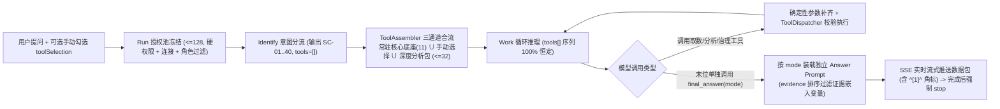
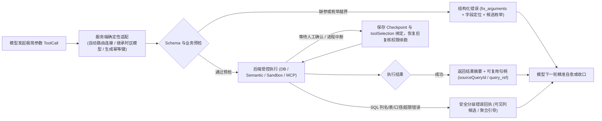
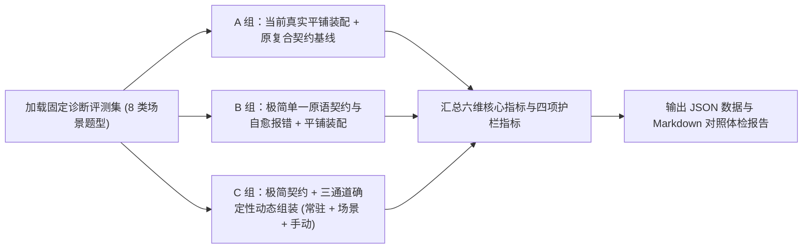

# PRD：第 27 课｜内建工具体系诊断与场景化动态组装

> 状态：draft | 负责人：andy | Profile：standard | 模板：`mai-specs/_templates/PRD.tmpl.md`

[返回需求简报](../BRIEF.md)

## 1. 背景与目标（Why）

- **背景/痛点**：
  1. **工具供给平铺失控且缺乏分层装载机制（代码已核实）**：Compass 在 [`apps/agent/src/compass_agent/tools/catalog.py`](../../../apps/agent/src/compass_agent/tools/catalog.py) 中登记了 19 个静态工具（10 个通用工具、9 个经营语义与资料工具），外加子任务专用 `report_to_parent`、个人动态工作流（`workflow_*`）及用户远端 MCP 工具（`mcp_*`）。当前新答案协议（`answerProtocol == 2`）在 [`context_runtime/profiles.py`](../../../apps/agent/src/compass_agent/context_runtime/profiles.py) 中将 `stage_tools` 与 `ceiling` 置空，导致工作阶段默认向模型平铺暴露当前 Run 注册表内的全部已启用工具：一次普通经营快查（`SC-01`）同时挂载语义治理写操作（`discover_semantic_candidates`、`review_semantic_change`、`submit_semantic_change`）、定时写操作（`schedule_write`）及全部已启用的个人工作流与 MCP 工具；同时 [`tools/registry.py`](../../../apps/agent/src/compass_agent/tools/registry.py) 对全量注册条目硬卡 `TOOL_CATALOG_LIMIT = 32`，缺乏“哪些默认常驻、哪些按场景自动触发、哪些由用户在前端手动勾选装载”的清晰边界。
  2. **面向模型的工具契约（ACI）复合臃肿、泄漏机械参数且缺少参数说明（代码已核实）**：现有 20 个工具声明直接导出后端 Pydantic 模型，累计携带 `47` 个 `$defs`（19 个静态工具占 `43` 个）、`262` 处 `"title"`、`81` 处 6 行式 `anyOf null`，19 个静态工具紧凑传输 JSON 达 `42,719 B`（约 `10,680` Token），`227` 个静态工具属性中 `218` 个（`96.0%`）完全没有参数级 `description`。同时存在严重的复合子命令包袱（`database_query` 拆出 4 个 `op` 子分支、`todo_write` 设 4 个子命令加 DAG 状态机）与确定性参数泄漏（要求模型手填 `connectionId`、`request_key`、`baseVersion`、`expectedRevision`、`MainModelSelection`、`timezone`、`coveredGoalIds` 等本可由代码确定性提供的字段）；`final_answer` 更要求把整篇回答塞进 `4,953 B` Schema 的工具 JSON 参数中等生成完才一次性吐给前端。
  3. **多工具边界重叠与报错不可自愈（代码已核实，误选幅度待评测核验）**：`query_metric`（受控语义指标查询）与 `database_query`（受限只读 SQL）缺少排他与降级说明；语义链路未在工具入口置顶预注入上下文短路规则；`database_query` 将多种 PostgreSQL 异常折叠为裸 `database_query_failed`，通用参数校验仅返回无字段定位的 `invalid_parameters`。课程规划中提到的“多工具平铺导致频繁误选与多轮空转加剧”属于待通过本课基线评测（Group A）量化的工程假设，在运行评测前不预设虚构基线数值。
- **目标**：
  1. 以**单一通用原语去复合化、确定性机械参数代码下沉、零 `$defs`/零 `if-else` 扁平结构、100% 参数级简短说明与流式循证收口**五大准则，配合**“外简内全”无损服务端适配层（只瘦身模型可见 Schema，不伤既有后端状态机）**，完成全部 20 个工具（19 个静态工具 + 子任务 `report_to_parent`）的极简 ACI 契约重构与可行动结构化错误（Actionable Error）改造，将 19 个静态工具总声明压降至 `14,980 B (−65%)`。
  2. 建立三层标准化 `ToolSpec` 契约（模型可见极简语义层、Runtime 确定性适配与执行层、三通道治理路由标签层 `ToolGovernance`），与 PromptOps 在线工具资产保持服务端强校验同步，并保留历史冻结代次的平滑恢复兼容。
  3. 在不引入模型中途动态搜工具（`ToolSearch` 划归第 28 课）的前提下，建立**“通道一：内建默认常驻（`always_on` · DataAgent 核心底座 11 工具，含控制、语义/SQL、文档核对与定时读写）+ 通道二：场景分流触发（`scene_routed` · 深度分析增强包 3 工具）+ 通道三：前端用户手动选择（`user_selected` · 长任务/工作流编排/口径治理与扩展）”三通道确定性工具组装机制**，使常规快查与口径问答（`SC-01` / `SC-21`）仅装载 11 个常驻核心工具（`7,938 B`，`−81%`），消除分类误判缺工具风险、隔离高风险口径治理写工具与重型规划/扩展工具，同时保证单次 Run 工作阶段内工具前缀 **100% 恒定不变**（零缓存击穿），并预留未挂载延迟池（`deferred_pool`）无缝衔接第 28 课。
  4. 在 Chat 输入框落地「工具与扩展」手动选择器（随 `RunConstraints.toolSelection` 提交并跨长任务多轮自动继承），在 ContextOps 完整记录每步三通道装载明细与声明 Token 开销，并交付可复现的 Tool Eval 基准套件及 A/B/C 三组消融对照报告。
- **成功指标**：
  - **结构与安全硬指标**：前端手动传参越权泄露数为 `0`（`UserSelected ∩ AuthorizedPool` 硬交集）；在 `48+` 授权工具池压测下，单 Step 暴露给模型的工具数恒 `<= 32` 且声明 JSON 体积 `<= 64 KiB`；同一 Run 工作阶段（`work`）连续 Step 的工具列表字节序列保持 `100%` 恒定；持久 Run 跨进程恢复后历史已执行工具回执核验通过率 `100%`。
  - **Tool Eval 六维核心指标**（固定模型、样本、零售测试集、权限与预算，对比 A 组“当前平铺基线”、B 组“极简 ACI 契约与错误自愈重构 + 平铺装载”、C 组“契约重构 + 三通道确定性动态组装”）：
    1. **工具选择准确率（Tool Selection Accuracy）**：C 组及 B 组优于 A 组（具体基线值与提升幅度由实测报告锁定，不在规格阶段虚构数值）。
    2. **参数合法率（Argument Validity Rate）**：B 组与 C 组相对 A 组提升，Schema 分支冲突与缺参率下降。
    3. **首轮调用成功率（First-Turn Call Success Rate）**：B 组与 C 组相对 A 组提升。
    4. **冗余调用率（Redundant Call Rate）**：语义链路重复检索及 `database_query` 多跳元数据探查占比在 B/C 组显著下降。
    5. **错误自愈率（Error Recovery Rate）**：缺参、SQL 列名偏差、口径未解析或超限场景下，模型在 1–2 轮内依据结构化错误修正成功的比例在 B/C 组显著高于 A 组。
    6. **工具声明 Token 占比（Tool Declaration Token Share）**：常规经营问答与查数场景下，C 组单轮工具声明 UTF-8 字节 / 估算 Token 开销相对 A/B 组显著下降（`SC-01` / `SC-21` 静态理论值降幅达 `−81%`）。
  - **同步观测护栏指标**：任务完成率不低于基线，统计并报告平均用户澄清次数、端到端总耗时（含流式首字响应改善）与单任务模型调用成本变化。

## 2. 用户与场景（Who / When）

| 用户故事 ID | 目标用户 | 触发场景 | 用户故事：作为…我希望…以便… | 关联需求 |
| --- | --- | --- | --- | --- |
| US-01 | 经营分析用户 / 业务负责人 | 日常经营指标快查、同环比拆解与口径解释（如 `SC-01`、`SC-02`、`SC-21`） | 作为经营分析用户，我希望提问日常经营问题时无需手动配置专业工具开关，系统默认常驻核心语义取数、只读查库、制度检索与定时任务工具，物理隔离口径治理送审与重型编排工具（定时变更仍由人工确认卡兜底），并以流式方式附带 `^[1]^` 证据角标快速输出回答，以便获得低延迟、口径一致且安全的结论。 | FR-02, FR-06, FR-07, FR-10, FR-12 |
| US-02 | 经营分析师 | 异常归因、多源交叉分析、Python 计算绘图与个人工作流/MCP 调用（如 `SC-03`、`SC-04`、`SC-14`） | 作为经营分析师，我希望复杂归因场景在常驻查数与文档底座上自动配齐计划清单、Python 计算绘图与子任务工具，同时当我需要运行特定个人工作流、特定外部 MCP 连接或在普通快查中强制使用长任务/Python 绘图时，可在输入框工具栏直接勾选装载，且工具报错时给出精确字段与可见列修复提示，以便高效掌控扩展工具并减少试错空转。 | FR-01, FR-02, FR-03, FR-08, FR-09, FR-11 |
| US-03 | 语义资产维护者 / 定时计划所有者 | 指标草稿提报修订、动态工作流沉淀与定时周报配置（如 `SC-29`、`SC-30`、`SC-36`、`SC-38`） | 作为具备相应权限的维护者或计划所有者，我希望随时可直接查询或发起定时计划配置，并可通过输入框「工具与扩展」显式开启“工作流编排”或“指标口径治理”能力组（或在明确自动化/配置场景自动兜底挂载），由服务端自动补齐时区、默认模型、版本号与幂等键并保留人工确认卡片，以便安全、零负担地完成治理与自动化配置。 | FR-01, FR-02, FR-10, FR-11 |
| US-04 | AI 架构师 / PromptOps 维护者 / 课程学员 | 在线调优工具描述示例、排查三通道装载轨迹、执行课程改造验收 | 作为 AI 架构师与课程学员，我希望在 PromptOps 安全维护带极简 Schema 校验的工具说明与可选示例，在 ContextOps 清晰查看每步工具的 `[常驻]` / `[场景]` / `[手动]` 装载来源与隐藏原因，并通过一键复现的 Tool Eval 实验量化契约治理与三通道组装收益，以便客观闭环工具治理。 | FR-04, FR-05, FR-06 |

## 3. 总体业务流程

### BF-01：三通道确定性工具组装与末位流式循证收口

**参与者与起止**：用户在 Chat 输入框提交问题与可选 `toolSelection` → 意图分类识别 `scene_id` / `task`（`identify` 阶段零工具）→ `ToolAssembler` 执行硬权限过滤与三通道合流（`always_on` + `user_selected` + `scene_routed`）→ `work` 阶段恒定前缀循环执行工具 → 末位单独调用 `final_answer(mode)` 实时流式输出并强制 `stop`。



**流程说明**：
1. Run 启动时，系统按租户/工作区开关、当前用户权限（含 Web 鉴权透传给 Agent `CurrentAccess.capabilities()` 的 `semantic_maintainer` 能力位）、已授权数据库连接、Sandbox 状态及运行身份（主 Agent / `SubAgent` / 定时触发 Run）构建授权工具池（上限 `128` 个，未勾选的外部 MCP 连接在常规查数启动期跳过实时探测以避免拖慢 TTFT）并固化到 `AgentToolBinding`（关联 `FR-11`、`BR-01`、`BR-04`）。
2. 完成 `identify` 路由后，纯澄清/越权/范围外场景（`SC-33/37/39`）允许直接进入 `answer_stream`（`plain.md`）单跳流式输出；其余场景进入 `work` 入口一次性冻结会话动态标志，`ToolAssembler` 求取三通道并集：`通道一（always_on 内建常驻 DataAgent 核心底座 11 工具） + 通道三（user_selected 前端手动选择与状态兜底，需与授权池取交集） + 通道二（scene_routed 场景分流深度分析增强包，SC-34 多轮承接自动补挂 python_analysis）`，生成固定顺序的 `tools[]`（`<= 32` 且 `<= 64 KiB`）；未挂载的获准工具计入 `deferred_pool`（为第 28 课 `ToolSearch` 预留只读接口）。整个 `work` 阶段内工具序列保持 **100% 恒定**，全面命中上游 Prefix Cache（关联 `FR-01`、`FR-02`、`FR-12`、`BR-06`）。
3. `ToolDispatcher` 执行前校验 `visible_names`、扁平 Schema 与业务授权，并由“外简内全”确定性适配层自动路由 `database_query` 连接、无损翻译 `todo_write`/`goal`/`report_to_parent`/`discover_semantic_candidates` 入参并填充版本/时区/幂等键；若同批调用同时包含业务工具与抢跑的 `final_answer`，工程层照常执行业务工具并为抢跑项返回标准 `role="tool"` 延期回执（保持消息协议 `tool_call_id` 一一对应，关联 `FR-07`～`FR-10`）。
4. 当模型在末位单独调用 `final_answer(mode, artifactFormat?)` 时（新建 Run 启用显式 `answerProtocol == 3`，与存量 `answerProtocol == 2` 协议隔离），服务端先执行 `check_access` 权限复核，再切换至独立 Answer Prompt（`evidence` 模式由工程层将已验证检索/查询结果按优先级排序过滤编号为 `[1]..[N]` 作为 `{{ordered_evidences}}` 变量嵌入），向前端实时流式推送数据包并在正文输出 `^[1]^` 角标；流式完毕后工程层解析精确锚点写入既有 `publish_citations` 兼容 `<CitedAnswer>` 弹窗、按 `artifactFormat` 复用 `build_artifact` 生成下载附件、落盘 `answer/v3/accepted` 并立即强制 `stop` 结束 Run（关联 `FR-10`、`FR-12`、`BR-05`）。

### BF-02：确定性参数适配、结构化错误自愈与持久断点恢复

**参与者与起止**：模型发出极简参数工具调用（或持久 Run 从审批等待恢复）→ 确定性输入适配与 `ToolDispatcher` 执行 → 返回带引用句柄的结果或结构化可自愈错误 → 模型修正参数、切换工具或向用户澄清。



**流程说明**：
1. 凡能由服务端上下文确定性决定的字段（数据库连接 `connectionId`、语义送审幂等键 `request_key`、计划版本号 `baseVersion`、定时任务时区与默认模型等）全部由服务端适配层注入，模型只需提交纯业务意图参数（关联 `FR-06`～`FR-10`）。
2. 参数校验或 SQL/沙箱执行异常统一投影为有界（`<= 4 KiB`）的 `ActionableToolError`，明确错误码、分类、问题字段、当前账号可见列候选及推荐下一步动作（关联 `FR-03`、`FR-07`、`FR-08`、`BR-02`）。
3. 当持久 Run 因等待人工确认（如 `schedule_write`、`submit_semantic_change`）跨进程恢复时，系统从 `AgentToolBinding` 与运行绑定还原相同的授权池与 `toolSelection`，保证恢复前后可见工具列表与历史回执核验 100% 一致（关联 `FR-11`、`BR-07`）。

### BF-03：Tool Eval 诊断评测与 A/B/C 三组消融对照

**参与者与起止**：研发/学员在测试环境启动 Tool Eval 命令 → 加载固定诊断题集与受控数据源快照 → 依次运行 A/B/C 三组配置 → 产出量化对比报告与逐题轨迹明细。



**流程说明**：评测套件固定模型参数、测试样本、零售数据快照、角色权限与步数预算，分别隔离度量“单点工具极简 ACI 与去复合化收益（B vs A）”以及“三通道确定性动态组装收益（C vs B、C vs A）”，所有结论基于真实运行回执计算（关联 `FR-05`）。

## 4. 功能需求（What）

### 4.1 新增需求

| 需求编号 | 触发条件 | 输入 | 预期行为 | 输出/结果 | 关联需求编号 |
| --- | --- | --- | --- | --- | --- |
| FR-01 | 用户在 Chat 输入框准备发送消息，需要显式启用高阶/治理能力组或特定个人工作流、外部 MCP 连接 | `RunConstraints.toolSelection`（挂载于既有 `SessionSubmit.constraints`，含能力组 `packs`：`long_task` / `workflow_pack` / `semantic_govern` / `python_sandbox`；个人工作流 `workflowIds`；外部连接 `mcpServerIds`） | 在 Chat 输入框底部工具栏新增「工具与扩展」手动选择器（复用 `analysis-composer.tsx` 工具条），支持用户按需勾选高阶/治理能力组及已启用的个人工作流、MCP 连接，提交时随 `RunConstraints.toolSelection` 传入后端（并随 `constraints` 自动继承至长任务后续轮次）；后端将用户所选项与当前用户 `AuthorizedPool` 取硬交集后归入 `user_selected` 通道装载（单次手动勾选扩展工具上限 `12` 个，保障总可见工具 `<= 32`）。 | 输入框展示已激活工具组/扩展徽标（可一键移除）；后端安全挂载用户显式选中的获准工具，未勾选项默认不进入常规会话前缀。 | US-02, US-03, UI-02, BR-01, BR-05, BR-06 |
| FR-02 | 每次逻辑模型请求编译（`prepare_input` / `answer_turn`）需要确定本步模型可见 `tools[]` | 当前 `TrustedContext`、角色权限、运行身份（主 Agent / `SubAgent` / 定时 Run）、`scope_profile`、`task`、`scene_id`、`phase`、`toolSelection` 及会话活动状态（活动 Goal / 未提交语义草稿） | 新增 `ToolAssembler` 三通道确定性组装器，按“Step 1 硬权限与身份过滤生成 `AuthorizedPool` → Step 2 阶段收敛门禁（`identify`/`verify`/`answer_stream` 为空，`delivery_only` 仅留 `final_answer`）→ Step 3 `AlwaysOn（内建常驻 DataAgent 核心底座 11 工具） + UserSelected（前端手动选择与状态兜底） + SceneRouted（场景分流深度分析增强包 3 工具）` 合流去重与固定排序 → Step 4 `<= 32` 槽位与 `<= 64 KiB` 预算守卫”生成 `tools[]`，并将剩余未挂载获准工具记录为 `deferred_pool`（预留衔接第 28 课）。 | 输出在单次 Run `work` 阶段内 100% 顺序恒定的 `list[ToolDefinition]` 与结构化三通道组装决策摘要（含授权池、三通道暴露来源、未挂载延迟池、规则排除原因及声明字节/Token）。 | US-01, US-02, US-03, BR-01, BR-03..BR-06, NFR-01..NFR-03 |
| FR-03 | 工具参数解析失败、枚举越界、SQL/语义校验拒绝、输入超限或后端执行报错 | 原始异常或业务拒绝码、工具名、输入参数及当前授权上下文 | 建立统一的面向模型可自愈错误回执协议（Actionable Error Contract），按 `fix_arguments`（修参重试）、`switch_tool`（切换主备工具）、`clarify_with_user`（向用户追问缺失口径/条件）、`retry_transient`（瞬态有限重试）、`permission_denied`（权限/策略终止）五类动作结构化封装错误，附带具体问题字段、脱敏原因、已授权范围内的合法候选或推荐下一步动作。 | 工具回执 JSON 包含 `status`、`code`、`category`、`retryable`、`field`（可选）、`message`、`candidates`（可选）与 `nextAction`，单条 `<= 4 KiB`。 | US-02, BR-02, NFR-04 |
| FR-04 | 用户或管理员在 ContextOps 控制台查看运行轨迹节点详情 | `run_id`、`step_id` 及对应 Context 决策摘要 / 运行节点数据 | 在 ContextOps 运行流节点副标题与步骤详情面板中记录并展示本步三通道工具组装详情：授权候选池总数、本步暴露工具（标注 `常驻` / `场景` / `手动` 三类通道徽标）、未挂载池计数、被排除工具及原因（`permission` 仅显示脱敏计数，其余区分 `scene` / `stage` / `role` / `budget`）、工具声明字节与估算 Token 占比。 | ContextOps 步骤详情面板可展开查看三通道组装明细，历史无该字段的旧 Run 显示兼容空态提示 `COPY-03`。 | US-04, UI-01, BR-01 |
| FR-05 | 研发人员或学员执行工具体系诊断与消融评测命令 | 评测组别参数（`A` / `B` / `C` / `all`）、诊断评测题集、模型接口或确定性回放桩 | 构建覆盖近义工具边界、单参数 SQL 探查、缺参/错列名报错自愈、读写隔离防诱导、口径歧义、数据截断分页、权限与子任务边界、手动扩展装载与 48+ 授权池容量控制八类场景的诊断评测集（不少于 24 道结构化评测用例），支持运行 A/B/C 三组对照并自动统计六维主指标与四项护栏指标。 | 生成结构化 JSON 结果与可读的 Markdown 诊断对照报告，明确记录测试条件、样本规模、各项指标及单题轨迹归因。 | US-04, BR-09, BR-10 |

### 4.2 变更需求

| 需求编号 | 触发条件 | 输入 | 预期行为 | 输出/结果 | 关联需求编号 |
| --- | --- | --- | --- | --- | --- |
| FR-06 | 注册静态工具、导出工具契约或在 PromptOps 在线校验/预览工具资产 | `catalog_contracts.py` 中的 `ToolSpec`、`prompts/tools/*.json` | **原行为**：`ToolSpec` 缺少统一装载通道标签，直接暴露 Pydantic `$defs`（43 个）、`title` 与 `anyOf null`，96% 参数缺少说明，19 工具紧凑 JSON 高达 `42,719 B`。→ **本次行为**：升级 `ToolSpec` 为三层契约（**极简无分支模型可见语义层**、Runtime “外简内全”确定性输入适配层 `normalize_input`、三通道治理标签层 `ToolGovernance(channel, pack, ...)`）；清零全部 `$defs`、`title`、`anyOf null` 与 `if/else/not` 逻辑，实现 **100% 参数级简短约束说明**，将 19 个静态工具总声明压降至 `14,980 B (−65%)`；PromptOps 在线支持精炼描述与可选示例（`0..3` 条，总长 `<= 1200` 字符，读取存量历史冻结代次保持旧上限兼容）编辑并只读展示装载通道标签。 | 全部 20 个工具具备单一职责扁平契约与完整三通道 `ToolGovernance` 标签，`promptops.sync` 与服务端强校验对齐。 | US-01, US-04, UI-02, BR-08 |
| FR-07 | 模型在经营问答或分析中调用语义指标工具链或 `database_query` | 用户经营问题、预注入的 `publishedSemanticRegistry`、工具调用参数 | **原行为**：`database_query` 封禁 `information_schema` 后拆出 4 个复合 `op` 子分支并暴露 `connectionId`，将各类 SQL 异常合并为裸 `database_query_failed`；语义链路未置顶预注入短路规则。→ **本次行为**：① `database_query` 去复合化收敛为**唯一必填参数 `sql`**（放开受当前账号 `SELECT` 权限过滤的只读 `information_schema.tables`/`columns` 查询并在多连接工作区并行聚合元数据，纯元数据查询标记 `source_ref.kind="metadata"` 防误判 `transient` 阻断附件保存；业务 SQL 按 `schema.table` 确定性路由连接，回执双写 `resultId` 与 `sourceQueryId` 并更新 `fingerprint()`）；② `query_metric` 收敛为 `query_ref`/`compare_to`/`drilldown_from` 3 参数，`resolve_semantics` 拍平为 6 参数并删除确定性 `as_of`；置顶预注入短路与主备优先级规则；③ 细分 PostgreSQL `sqlstate`，通过 `SAVEPOINT` 防 `25P02` 事务中止后安全提取可见列名候选。 | 消除多跳元数据子命令开销，单条 SQL 完成探查与查询，多连接可见且报错可自愈。 | US-01, US-02, FR-03, BR-02, BR-03 |
| FR-08 | 模型读取大查询结果分页、检索业务文档或送入 `python_analysis` 计算绘图 | `database_query` / `query_metric` 输出结果、`read_tool_result`、`search_documents`、`python_analysis` 参数 | **原行为**：`python_analysis` 2 个参数零说明且未交代 `data` 结构与 `128 KiB` 上限；`read_tool_result` 参数无说明；`search_documents` 同时暴露 `historical` 与 `businessDate` 制造隐式耦合报错。→ **本次行为**：① 数据工具回执同时提供 `resultId` 与 `sourceQueryId`（同值兼容句柄）、行列数与 `truncated`；② `python_analysis` 用高密度参数说明锁定上游结果 ID、`data={"columns":[],"rows":[[]]}`、`result`、`/workspace/chart.png` 与 `<=128KiB` 限制，超限时返回 `COPY-08` 聚合引导；③ `read_tool_result` 补齐 4 参数说明并在服务端赋予非空 `cursor` 确定性优先权；`search_documents` 删除 `historical` 开关（传 `businessDate` 即按该日生效历史版本检索）。 | 模型零歧义组装 `python_analysis`、`read_tool_result` 与 `search_documents` 参数，保持 `evidence.py` 与沙箱血缘完整兼容。 | US-02, FR-03 |
| FR-09 | 模型维护分析步骤清单、长任务目标或委派并行子任务 | `todo_write`、`goal`、`sub_agent`、`report_to_parent` 调用参数 | **原行为**：`todo_write` 设 4 个子命令与 DAG 状态机并强制手填 `baseVersion`；`goal` 设双层复合结构并暴露 `costMicrousd`；`sub_agent` 暴露 `connectionIds`、`tools` 与旧 `prompt`；`report_to_parent` 混入消耗步数的 `progress` 心跳分支。→ **本次行为**：通过**“外简内全”无损适配层**改造模型接口并保持既有后端状态机完整工作：① `todo_write` 收敛为唯一全量幂等数组 `todos: [{step, status}]`，服务端无损映射回 `ExecutionPlan` 与 `RunAutonomyAction`（兼容前端进度环与旧检查点）；② `goal` 拍平为 6 参数（保留轻量整型数组 `acceptanceIndexes` 对接 `gate.py` 完成门禁，自动绑定版本与预算）；③ `sub_agent` 仅保留 `tasks: [{name, objective, inputRefs}]`（服务端按 `evidence→ledger→artifact` 反查无 `kind` ID 并兼容旧 `prompt`）；④ `report_to_parent` 移除 `progress` 分支，收敛为 `summary`/`evidenceIds`/`gaps`/`status` 并无损构造 `ChildReturn.findings` 对接长任务 `Ledger`。 | 四个规划编排工具彻底消除状态机冲突与连接 UUID 搬运负担，体积压降 `70%–79%`，且第 25 课长任务与进度面板零回归。 | US-02, FR-03, BR-04, BR-07 |
| FR-10 | 模型执行定时计划读写、动态工作流编排、语义治理送审或最终回答流式收口 | `schedule_read`、`schedule_write`、`create_workflow`、语义治理三工具、`final_answer` 参数 | **原行为**：`schedule_read` 在 `list` 中删去 `question` 逼二次 `get`；`schedule_write` 强制填模型路由、时区与 Cron；`submit_semantic_change` 强制手填 UUID `request_key`；`final_answer` 把整篇回答塞进 `4,953 B` Schema 的工具 JSON 等结束才返回前端。→ **本次行为**：① `schedule_read` / `schedule_write` 归入 `always_on` 定时底座（`schedule_write` 强制 HITL 确认卡，在审批提案阶段冻结 `expectedRevision` 保留并发乐观锁，并对定时触发 Run 与子 Agent 由 Step 1 永久剔除）；`create_workflow`（工作流编排）与语义治理三工具归入 `user_selected` 通道，`create_workflow` 同步升级 `workflows/engine.py` 双向兼容 `{tasks}` 与存量 `{prompt}`，`discover_semantic_candidates` 保留极简 `mode`（`suggest`/`save_draft`/`revise`）区分免弹窗推荐与 HITL 确认卡，`submit_semantic_change` 删除 `request_key` 与 `binding_id`；② `final_answer` 仅保留**唯一必填参数 `mode`（`"plain" \| "evidence"`）+ 可选 `artifactFormat`（`"markdown" \| "csv" \| "dashboard"`）**，在新建 `answerProtocol == 3` 下先执行 `check_access` 权限复核再路由至两套独立 Answer Prompt 实时流式推送 SSE（`evidence` 模式由工程层将验证证据排序过滤编号 `[1]..[N]` 注入 `{{ordered_evidences}}` 模板变量，正文自由组织并输出 `^[1]^` 角标）；流式完毕后工程层解析精确偏移复用 `publish_citations` / `<CitedAnswer>` 与 `build_artifact` 落盘 `answer/v3/accepted` 并直接强制 `stop`；同批混调其他工具时为抢跑项返回 `role="tool"` 延期回执。 | 彻底解放最终回答形态与流式首字体验，`final_answer` 声明直降 `84%`，兼容既有引用弹窗与附件下载，高副作用口径治理写工具物理隔离，定时写入全程受人工确认卡与身份门禁保护。 | US-01, US-02, US-03, FR-03 |
| FR-11 | Run 初始化装载工具注册表，或持久 Run 从等待/中断状态跨进程恢复 | 静态工具、个人动态工作流、远端 MCP 工具、`RunConstraints.toolSelection` 及 `AgentToolBinding` | **原行为**：`ToolRegistry` 对全量注册条目硬卡 `<= 32` 个且 `<= 64 KiB`，超过即抛 `tool_catalog_limit`。→ **本次行为**：① 解耦“Run 授权工具池上限”（`128` 个，冻结入 `AgentToolBinding`）与“单 Step 模型可见目录上限”（`<= 32` 个且 `<= 64 KiB`）；未勾选的外部 MCP 在常规查数启动时跳过实时探测，仅在勾选或恢复需要时装载绑定，避免拖慢 TTFT；② `RunConstraints.toolSelection` 随运行约束持久化并自然继承至长任务多轮；跨进程恢复（Resume）时从 `AgentToolBinding` 还原资产 ID（`connection_id` / `workflow_<hex>`），对升级前冻结的旧代次 Run 按快照 declaration 回退装载并由外简内全适配层兼容旧参数，不触发 `tool_catalog_changed`。 | 支持 48+ 授权工具池平稳运行，普通查数免受故障 MCP 拖累，新旧版本持久 Run 中断恢复均零异常。 | US-02, US-03, BR-06, BR-07, NFR-01 |
| FR-12 | `answerProtocol == 3`（及兼容的存量 `answerProtocol == 2`）回合在各执行阶段切换 | 当前回合 `phase`（`identify` / `work` / `delivery_only` / `answer_stream`）及预算状态 | **原行为**：`answerProtocol == 2` 在 `profiles.py` 中放开了除 `identify` 外的全部工具限制导致全量暴露，且收口走非流式候选 JSON。→ **本次行为**：新建 Run 启用显式协议代次 `answerProtocol == 3`（存量 `answerProtocol == 2` 保持隔离兼容）：`identify` 阶段暴露 `0` 个工具；纯澄清/拒答场景（`SC-33/37/39`）与无工具模型降级路径直通 `answer_stream`（`plain.md`）单跳流式输出；其余场景进入 `work` 入口一次性冻结会话标志并按三通道组装工具列表（全程 **100% 恒定**）；`delivery_only` 预算收口仅留 `[final_answer]`；末位调用 `final_answer` 后进入 `answer_stream`（`tools=[]`、`stream=True`、`publish_text=True`），流式落盘完毕立即强制 `stop`。 | 阶段边界清晰，工作循环 Prefix Cache 100% 稳定命中，纯文本短问答免额外往返，存量协议零冲突。 | US-01, US-02, BR-05, BR-06 |

## 5. UI 视觉与交互

### UI-01：ContextOps 运行轨迹与步骤详情中的「三通道工具组装」面板

**设计依据**：沿用 [`docs/ui-style-guide.md`](../../../docs/ui-style-guide.md) 观测卡片规范、[`apps/web/src/features/contextops/flow.tsx`](../../../apps/web/src/features/contextops/flow.tsx) 与 [`panels.tsx`](../../../apps/web/src/features/contextops/panels.tsx) 既有 ContextOps 布局，并参考需求上下文架构与诊断图（[`compass-tools.png`](../context/compass-tools.png)、[`compass-tools-diagnosis.png`](../context/compass-tools-diagnosis.png)）。本次在既有 ContextOps 步骤详情面板内增量扩展折叠区块，不新建独立一级菜单页面。

```text
┌─ 上下文安全与编译 · Step #2 (SC-01 经营指标快查 · query) ──────────────────────┐
│ [上下文漏斗]  [来源 Token 构成]                                                │
│ ▾ 工具组装决策 · 授权池 24 → 本步装载 11 · 未挂载池 10 · 规则裁剪 3 · 1,985 tok│
│ ┌────────────────────────────────────────────────────────────────────────────┐ │
│ │ 本步装载 (11)                                                              │ │
│ │  [常驻] final_answer  [常驻] read_tool_result                              │ │
│ │  [常驻] search_semantics  [常驻] get_metric_definition                     │ │
│ │  [常驻] resolve_semantics [常驻] query_metric  [常驻] database_query       │ │
│ │  [常驻] search_documents  [常驻] read_document                             │ │
│ │  [常驻] schedule_read     [常驻] schedule_write                            │ │
│ │ 未挂载获准池 (10)：goal, create_workflow, submit_semantic_change, wf ...   │ │
│ │ 规则裁剪 (3)：todo_write (场景未命中), python_analysis, sub_agent          │ │
│ └────────────────────────────────────────────────────────────────────────────┘ │
└────────────────────────────────────────────────────────────────────────────────┘
```

| 页面区域/控件 | 新增/变更 | 对照设计的功能与交互说明 | 关联需求 |
| --- | --- | --- | --- |
| ContextOps 运行流节点副标题（`flow.tsx`） | 变更 | **原行为**：仅展示候选消息条数 → 入窗条数及安全拦截数。→ **本次行为**：当节点包含 `toolAssembly` 摘要时，在副标题追加展示 `工具 装载数/授权池数` 简短指标（如 `工具 11/24`），窄屏自动换行不截断主标题。 | FR-04 |
| ContextOps 步骤详情「工具组装决策」折叠区（`panels.tsx`） | 新增 | 位于选中编译节点的详情面板内，使用可键盘聚焦的折叠标题（默认收起，点击或按 `Enter`/`Space` 展开）。展示四组信息：① 汇总指标条（授权池总数、本步装载数、未挂载池数、规则裁剪数、声明估算 Token）；② 本步装载工具列表及三通道徽标（`常驻` / `场景` / `手动`）；③ 未挂载获准池工具名摘要；④ 裁剪原因说明（权限过滤不展示未授权工具名称，仅汇总 `权限与连接过滤：N 项`）。 | FR-04, BR-01 |

**状态与反馈**：
- **默认态**：有 `toolAssembly` 记录的步骤显示汇总行，折叠区默认收起。
- **空态 / 零工具阶段**：如 `identify` 或 `answer_stream` 阶段暴露工具数为 `0`，显示文案 `本阶段不暴露工具（阶段策略：{phase_label}）`（见 `COPY-02`）。
- **历史兼容态**：第 27 课升级前产生的历史 Run 缺少 `toolAssembly` 明细时，仅展示原有的已选工具名列表，并标注 `COPY-03`。
- **权限与安全态**：因权限不足被硬过滤的工具，所有角色均不显示具体受限工具名或他人私有连接详情，仅显示汇总项 `COPY-04`。
- **响应式与键盘**：`390 px` 宽度下徽标流式换行，长工具名在容器内自动折行；折叠开关满足标准键盘焦点环与无障碍要求。

### UI-02：Chat 输入框「工具与扩展」手动选择器与 PromptOps 治理标签栏

**设计依据**：复用 [`apps/web/src/components/analysis-composer.tsx`](../../../apps/web/src/components/analysis-composer.tsx) 底部工具栏（与现有模型选择、附件与发送控件对齐）以及 [`apps/web/src/features/promptops/tool-fields.tsx`](../../../apps/web/src/features/promptops/tool-fields.tsx)。

```text
┌─ Chat 输入框 (analysis-composer.tsx) ──────────────────────────────────────────┐
│ 请帮我分析华东大区上周净销售额变化，并按我的周报工作流生成定时推送计划          │
│ [× 工作流编排] [× 工作流: 华东经营周报]                                        │
│ ────────────────────────────────────────────────────────────────────────────── │
│ [Auto ▾]  [🛠 工具与扩展 (2) ▾]                                  [📎]  [↑ 发送]│
└────────────────────────────────────────────────────────────────────────────────┘
  └─ 展开「工具与扩展」浮层：
     ├─ 能力增强组： [ ] 长任务目标 (goal)   [✓] 工作流编排   [ ] Python 计算绘图
     │              [ ] 指标口径治理 (仅语义维护者可见)
     ├─ 个人工作流： [✓] 华东经营周报 (workflow_8f2a)   [ ] 门店异常巡检
     └─ 外部 MCP：   [ ] 企业飞书文档连接 (3 工具)       (已选扩展 2/12)
```

| 页面区域/控件 | 新增/变更 | 对照设计的功能与交互说明 | 关联需求 |
| --- | --- | --- | --- |
| Chat 输入框「工具与扩展」按钮与浮层（`analysis-composer.tsx`） | 新增 | 位于输入框底部控制栏，点击或键盘触发弹出分层选择浮层：① **能力增强组**（长任务目标、工作流编排、Python 计算绘图；具备语义维护权限的用户额外可见「指标口径治理」）；② **个人已启用工作流**（读取当前用户启用态 `workflow_*` 列表）；③ **已启用外部 MCP 连接**（按连接勾选启用对应获准工具）。勾选后在输入框上方展示可点击 `×` 移除的轻量徽标，并在按钮显示已选计数。 | FR-01, BR-01, BR-05 |
| PromptOps 工具编辑页治理元数据只读栏（`tool-fields.tsx`） | 新增 | 在「工具名称」下方、「工具描述」上方新增一行只读元数据标签栏，展示代码 `ToolSpec.governance` 定义的 `装载通道（常驻 / 场景分流 / 手动选择）`、`所属能力包`、`副作用与审批` 标签，辅助维护者编写不越界的工具说明与可选示例。 | FR-06 |

**状态与反馈**：
- **默认零负担态**：未勾选任何手动项时按钮显示 `工具与扩展`（无数字角标），系统完全依靠 `always_on + scene_routed` 自动完成日常查数与归因。
- **槽位上限保护态**：当用户在浮层累计勾选的扩展工具数达到 `12` 个上限时，其余未勾选扩展项置灰并提示 `COPY-06`（`单次最多手动装载 12 个扩展工具，请取消部分已选项后再选`）。
- **无扩展空态**：若用户尚未创建个人工作流或配置 MCP 连接，对应分组显示简要引导文案 `暂无已启用的个人工作流 / 外部连接`。

## 6. 业务规则与约束（Rules）

| 规则 ID | 业务规则、状态流转、权限或数据约束 | 关联需求 |
| --- | --- | --- |
| BR-01 | **权限硬过滤优先不变量**：租户/工作区功能开关、当前用户业务权限（含 Web 内部鉴权透传给 Agent `CurrentAccess.capabilities()` 的 `semantic_maintainer` 标志）、数据连接可用性、Sandbox 启用状态及运行身份过滤必须在三通道组装之前执行；前端提交的 `RunConstraints.toolSelection` 必须与服务端 `AuthorizedPool` 取交集（`UserSelected ∩ AuthorizedPool`），严禁通过前端构造请求参数越权挂载无权限工具。 | FR-01, FR-02, FR-04 |
| BR-02 | **错误回执脱敏与安全边界**：结构化错误回执（尤其是 `database_query` 与语义工具）仅可引用当前用户 `session_user` 及授权 Schema 下具备 `SELECT` 权限的表名、列名和已发布指标标识；禁止回传底层数据库物理连接串、未授权私有表名、系统路径或堆栈信息；成本权限不足时保持明确拒绝。 | FR-03, FR-07 |
| BR-03 | **`query_metric` 与 `database_query` 正交及单参数 SQL 规则**：① 命中已发布指标且存在可用执行绑定时，必须优先使用 `resolve_semantics` 与 `query_metric`；预注入上下文 `publishedSemanticRegistry` 已含 `authorized_resolution.query_ref` 时直接调 `query_metric`，跳过 `search_semantics` 与 `get_metric_definition`；② 无发布绑定、查原始流水或自定义口径时降级使用 `database_query(sql)`，表名/列结构统一通过受权限过滤的只读 `information_schema` SQL 查询，数据库连接由后端代码确定性路由。 | FR-06, FR-07 |
| BR-04 | **运行身份隔离规则**：① 主 Agent（`root`）按三通道规则挂载读写工具；② 子 Agent（`SubAgent`）仅装载专用底座（`report_to_parent` + `read_tool_result`）及父级可见集中的只读、无审批、非编排工具（严禁继承 `goal`、`todo_write`、`sub_agent`、`create_workflow`、`schedule_write`、语义治理写工具或 `final_answer`）；③ 定时触发 Run（Scheduler 发起）永久排除 `schedule_write` 等需在线交互审批的写入工具。 | FR-02, FR-09 |
| BR-05 | **三通道协同、兜底与阶段收敛规则**：① **通道一（`always_on`）**在主任务 `work` 阶段固定挂载 11 个 DataAgent 核心底座工具（受 Step 1 硬权限与能力开关过滤）：控制底座（`final_answer`、`read_tool_result`）、语义与查库底座（`search_semantics`、`get_metric_definition`、`resolve_semantics`、`query_metric`、`database_query`）、资料核对底座（`search_documents`、`read_document`）及定时任务底座（`schedule_read`、`schedule_write`，后者强制 HITL 确认并对定时 Run 与子 Agent 永久剔除）；② **通道二（`scene_routed`）**按 `SC-01..40` 意图场景自动挂载深度分析增强包（`todo_write`、`python_analysis`、`sub_agent`；`SC-34` 多轮承接自动补挂 `python_analysis`）；③ **通道三（`user_selected`）**默认不挂载于常规分析会话，由用户在前端「工具与扩展」显式勾选装载（`goal`、`create_workflow`、语义口径治理 3 工具及个人 `workflow_*` / `mcp_*`），同时保留两类确定性兜底——若路由明确命中自动化/配置/复合长任务场景（`SC-29`、`SC-30`、`SC-36`、`SC-38`、`SC-40`），或进入 `work` 前已存在未完结的活动 Goal / 未提交语义草稿，系统自动补齐对应获准能力组，所有写操作继续受 HITL 人工确认卡保护；④ `identify` 与 `answer_stream` 阶段工具列表为空，`SC-33/37/39` 允许直通 `answer_stream` 单跳输出，`delivery_only` 阶段仅保留 `[final_answer]`。 | FR-01, FR-02, FR-12 |
| BR-06 | **单次 Run 恒定前缀与排序不变量**：本课不引入中途动态改写 `tools[]` 的工具搜索，单次 Run 在 `identify -> work` 入口一次性冻结会话标志（`has_active_goal`、`has_active_plan`、`has_semantic_draft`）并按 `[通道一 AlwaysOn（按目录固定序号）] + [通道三 UserSelected（静态工具按固定序号，动态扩展按名称字典序）] + [通道二 SceneRouted（去重后按目录固定序号）]` 确定工具列表，在整个 `work` 循环的所有 Step 中字节级 **100% 恒定不变**，最大化上游模型 Prefix Cache 命中率。 | FR-01, FR-02, FR-11, FR-12 |
| BR-07 | **持久恢复、协议隔离与历史回执兼容规则**：新建流式收口 Run 使用显式协议代次 `answerProtocol == 3`，存量 `answerProtocol == 2`（及 `1`）Run 保持隔离兼容；`AgentToolBinding` 在 Run 启动时冻结授权工具池（`<= 128`），`RunConstraints.toolSelection` 随运行约束持久化并自然继承至长任务后续轮次。跨进程恢复（Resume）时从 `AgentToolBinding` 还原动态扩展资产 ID，对升级前冻结的存量 Run 按冻结快照 declaration 回退装载并由外简内全适配层兼容旧参数，确保不触发 `tool_catalog_changed` 或 `unknown_tool`。 | FR-09, FR-11, FR-12 |
| BR-08 | **单一权威极简契约与 PromptOps 兼容规则**：模型可见工具名称、零 `$defs` 扁平参数 Schema、100% 参数说明、服务端确定性输入适配器与 `ToolGovernance` 标签以代码 `ToolSpec` 为唯一权威源；静态资产默认保持 `examples: []`，PromptOps 在线允许编辑精炼描述、参数 `description` 及可选 `examples`（`0..3` 条），且 `model_description` 总长度 `<= 1200` 字符。 | FR-06 |
| BR-09 | **Showcase 与生产代码隔离规则**：严格遵守 Compass 工程规范，生产 Runtime、Harness、默认工具目录和 `ToolAssembler` 禁止硬编码课程案例 ID、特定日期、评测题关键词分支或预定调用序列；`runtime/` 与 `harness/` 禁止直接导入 `compass_agent.tools.business`；评测套件不打入生产 wheel 包。 | FR-02, FR-05, FR-06 |
| BR-10 | **评测真实性与反虚构约束**：Tool Eval 报告与课程文档中的所有准确率、合法率、自愈率与 Token 降幅必须来自可复现脚本的实际运行记录，明确标注所用模型版本、温度、评测集版本与样本量；未跑实测前标记为“待验证”，严禁填写虚构百分比。 | FR-05 |

| 非功能 ID | 性能、可靠性、安全或可访问性要求 | 适用条件与验证口径 |
| --- | --- | --- |
| NFR-01 | **授权工具池容量与单步预算上限**：Run 授权工具池支持至多 `128` 个并发注册工具（覆盖静态工具 + 个人工作流 + 多连接 MCP 工具），单 Step 模型可见工具数量严格 `<= 32` 个，且序列化工具声明 JSON 字节数 `<= 64 KiB`（`65,536` bytes）。 | 注入 19 个静态工具 + 30 个模拟工作流/MCP 工具（共 49 个）执行集成测试，验证初始化不抛 `tool_catalog_limit` 且三通道组装严格受控于 `<= 32` 与 `<= 64 KiB`。 |
| NFR-02 | **零远程调用的微秒级确定性组装**：`ToolAssembler` 三通道组装纯内存集合计算完成，不发起额外大模型推理或远端向量检索；50 工具池规模下单次组装耗时 P95 `< 2 ms`。 | 单元基准测试计时验证。 |
| NFR-03 | **同输入前缀 100% 确定性**：相同 `(catalog_id, scope_profile, task, scene_id, phase, tool_selection)` 输入下，`ToolAssembler` 多次调用或跨进程恢复产出的 `tools[]` 序列化 SHA-256 摘要 `100%` 一致。 | 确定性重放与跨进程恢复一致性测试。 |
| NFR-04 | **错误回执体积有界性**：单次结构化错误回执 JSON 体积 `<= 4 KiB`，候选列表最多返回前 `8` 项已授权合法名称，防止异常信息挤占上下文窗口。 | 参数校验与数据库错误单元测试断言字节上限与候选截断。 |
| NFR-05 | **界面可访问性与窄屏适配**：Chat「工具与扩展」选择器、ContextOps 工具组装折叠区与 PromptOps 标签栏满足正文对比度 `>= 4.5:1`，支持纯键盘 `Tab` / `Enter` / `Space` / `Esc` 操作，在桌面 `1280 px` 与移动端 `390 px` 宽度下无水平页面溢出。 | 浏览器窄屏检查与键盘走通测试。 |

## 7. 范围与边界（Scope）

- **包含**：
  - Compass 全部 20 个现有工具（19 个静态工具 + 子任务 `report_to_parent`）的去复合单一原语重构、机械确定性参数清零、100% 参数级简短说明、`final_answer(mode)` 双独立 Prompt 实时流式收口与结构化错误自愈改造（`FR-03`、`FR-06`～`FR-10`）。
  - Chat 输入框工具栏「工具与扩展」前端手动选择装载能力（`RunConstraints.toolSelection`，挂载于 `SessionSubmit.constraints` 并跨长任务自动继承，覆盖高阶/写能力组、个人 `workflow_*` 与外部 `mcp_*` 连接，`FR-01`、`UI-02`）。
  - 三层 `ToolSpec` 与三通道 `ToolGovernance` 元数据升级及 PromptOps 双向校验（`FR-06`）。
  - 融合 `always_on`（常驻底座）+ `scene_routed`（场景分流）+ `user_selected`（前端手动选择）的 `ToolAssembler` 确定性组装、128 容量池解耦、单次 Run 恒定前缀保护与持久恢复兼容（`FR-02`、`FR-11`、`FR-12`）。
  - ContextOps 步骤详情中的三通道工具组装 Trace 展示（`FR-04`、`UI-01`）。
  - Tool Eval 诊断评测套件构建及 A/B/C 三组消融实验能力（`FR-05`）。
- **不包含**：
  - **第 28 课范围（明确延后）**：模型运行中途主动检索激活未挂载工具的 `ToolSearch`（`search_tools` + `<available-deferred-tools>` 延迟工具目录注入）机制，以及面向租户/个人的自定义插件市场与第三方 HTTP/OpenAPI 工具注册生命周期管理（本课在 `ToolAssembler` 中已预留 `deferred_pool` 未挂载获准工具集合，第 28 课可直接零重构接入）。
  - **第 29–30 课范围**：完整领域 Skill 包的渐进式正文加载、Skill 自动推荐解锁工具集与线上轨迹自进化沉淀（本课仅在 `AssemblyInput` 预留 `skill_recommended` 扩展入参边界）。
  - **第 31 课范围**：企业级集中式 MCP 工具网关、跨租户凭证代理与远端工具安全审计中心。
  - **外部重型路由组件与在线 EvalOps 平台**：本期不引入小模型工具路由器、独立向量检索服务或新建 Web 端评测任务 CRUD 页面。
- **依赖**：
  - 第 18 课统一 `ToolDispatcher`、OpenSandbox 隔离 Python 执行后端与 `read_tool_result` 大结果原件存储已就绪。
  - 第 19–20 课 `AgentRun` / `AgentStep` / `AgentToolBinding` 持久运行与跨副本恢复链路已就绪。
  - 第 21 课意图场景路由（`SC-01`～`SC-40`）、`Context Profile` 与 PromptOps 工具 JSON 资产管线已就绪。
  - 第 22–23 课经营语义服务（Web 语义资产 API 与 Agent `RegistryTools`）及资料检索工具已就绪。
  - 第 26 课 ContextOps 决策摘要录制（`ContextOpsRecorder`）与 Web ContextOps 控制台已就绪。

## 8. 研发资源

| 资源 ID | 类型 | 实际链接/路径或本文位置 | 用途/关联需求 | 确认与核验状态 |
| --- | --- | --- | --- | --- |
| RES-01 | 课程规划 | [`context/lesson_outline.md`](../context/lesson_outline.md)、[`context/lesson_outline_by_page.md`](../context/lesson_outline_by_page.md) | 第 27 课教学目标、三层契约、分层供给与验收维度依据 | 已读取（`review` 草案，效果幅度待实测核验） |
| RES-02 | 问题诊断报告 | [`design/TOOL_DIAGNOSIS_REPORT.md`](../design/TOOL_DIAGNOSIS_REPORT.md)、[`context/DIAGNOSIS_AND_SCOPE.md`](../context/DIAGNOSIS_AND_SCOPE.md) | 全部 20 个工具七大病灶量化诊断与五条极简重构标尺 | 已核验（与当前 `main` 代码一致） |
| RES-03 | 视觉参考图 | [`context/compass-tools.png`](../context/compass-tools.png)、[`context/compass-tools-diagnosis.png`](../context/compass-tools-diagnosis.png) | 当前工具全景与问题诊断参考图 | 已核验 |
| RES-04 | 静态工具与声明源 | [`apps/agent/src/compass_agent/tools/`](../../../apps/agent/src/compass_agent/tools/)、[`prompts/tools/`](../../../apps/agent/src/compass_agent/prompts/tools/) | 19 个静态工具与子任务 `report_to_parent` 定义源 | 已核验 |
| RES-05 | 场景路由字典 | [`apps/agent/src/compass_agent/prompts/support/routing/scenes.json`](../../../apps/agent/src/compass_agent/prompts/support/routing/scenes.json) | `SC-01`～`SC-40` 场景 ID、`task_type` 与复杂度分层映射源 | 已核验 |
| RES-06 | UI 规范与目标组件 | [`docs/ui-style-guide.md`](../../../docs/ui-style-guide.md)、[`apps/web/src/components/analysis-composer.tsx`](../../../apps/web/src/components/analysis-composer.tsx)、[`apps/web/src/features/contextops/`](../../../apps/web/src/features/contextops/)、[`apps/web/src/features/promptops/tool-fields.tsx`](../../../apps/web/src/features/promptops/tool-fields.tsx) | Chat 工具与扩展手动选择器、ContextOps 三通道组装面板与 PromptOps 治理标签栏 | 已核验 |

### 最终文案

| 文案 ID | 位置/触发状态 | 最终文字 | 变量与格式规则 |
| --- | --- | --- | --- |
| COPY-01 | ContextOps 步骤详情折叠标题（有组装记录时） | `工具组装决策 · 授权池 {authorized} → 本步装载 {exposed} · 未挂载池 {deferred} · 规则裁剪 {excluded} · {tokens} tok` | 所有计数为非负整数；`{tokens}` 使用千分位整数格式化（沿用 `num(tokens, 0)`）。 |
| COPY-02 | ContextOps 步骤详情折叠内容（本步暴露工具数为 0） | `本阶段不暴露工具（阶段策略：{phase_label}）` | `{phase_label}` 取既有 `phaseShort` 中文名（如 `意图识别`、`流式生成`）。 |
| COPY-03 | ContextOps 步骤详情折叠内容（旧版历史 Run 无分层字段） | `历史运行未记录三通道组装明细，仅展示实际暴露工具列表。` | 纯静态文案，无变量。 |
| COPY-04 | ContextOps 排除列表权限汇总项 | `权限与连接过滤：{count} 项（不展示未授权能力名称）` | 仅当 `permission` 类排除数 `count > 0` 时展示。 |
| COPY-05 | Chat 输入框工具栏手动选择按钮文案 | `工具与扩展`（已选 > 0 时显示 `工具与扩展 ({count})`） | `{count}` 为当前已勾选的能力组与扩展项总数。 |
| COPY-06 | Chat「工具与扩展」浮层达到 12 项扩展上限提示 | `单次最多手动装载 12 个扩展工具，请取消部分已选项后再选。` | 纯静态文案，保证三通道合流总工具数 `<= 32`。 |
| COPY-07 | PromptOps 工具编辑页只读治理标签栏说明 | `装载与治理标签随代码 ToolSpec 发布（只读）：装载通道 {channel_label} · 能力包 {pack_label} · 副作用 {effect_label}` | 非静态注册工具缺省隐藏该栏。 |
| COPY-08 | `python_analysis` 输入超限结构化错误 `message` | `查询结果体积（{actual_bytes} 字节）超过 Python 沙箱单次输入上限（131072 字节）。请先通过 database_query 或 query_metric 按分析维度聚合、过滤或限制返回列后再传入新的 source_query_id。` | `{actual_bytes}` 为当前 `source.data` 的实际 UTF-8 JSON 字节数。 |

### 业务枚举与预置数据：全量工具三通道装载分类基线

下表定义全部 20 个工具声明（19 个静态工具 + 子任务 `report_to_parent`）及动态扩展资产的三通道装载规则（运行时始终先执行 `BR-01` 硬权限过滤）：

| 工具名称 | 装载通道 (`channel`) | 所属能力包 (`pack`) | 副作用 / 审批 | 触发与挂载规则 | 子 Agent 可继承 |
| --- | --- | --- | --- | --- | --- |
| `final_answer` | `always_on`（内建常驻） | `core_base` | `read_only` / `none` | 主 Agent 所有 `work` 与 `delivery_only` 阶段无条件常驻；末位独占流式输出后强制 `stop` | 否（子级用 `report_to_parent`） |
| `read_tool_result` | `always_on`（内建常驻） | `core_base` | `read_only` / `none` | 所有主任务与子任务 `work` 阶段常驻，支撑任意超长回执按需翻页 | 是 |
| `report_to_parent` | `always_on`（子任务常驻） | `subagent_base` | `read_only` / `none` | 仅子 Agent `work` 阶段常驻（替代 `final_answer`），提交结构化发现并结束子任务 | 子任务专属 |
| `search_semantics` | `always_on`（内建常驻） | `data_base` | `read_only` / `none` | 启用语义 Registry 时在全部 `work` 阶段默认常驻（上下文预注入命中时禁调） | 是 |
| `get_metric_definition` | `always_on`（内建常驻） | `data_base` | `read_only` / `none` | 启用语义 Registry 时默认常驻（口径解释与例外核对主力） | 是 |
| `resolve_semantics` | `always_on`（内建常驻） | `data_base` | `read_only` / 按需澄清 | 启用语义 Registry 时默认常驻（`SC-21` 纯定义问答由 SOP 约束免多余取数） | 是（无交互澄清时） |
| `query_metric` | `always_on`（内建常驻） | `data_base` | `read_only` / `none` | 启用语义 Registry 时默认常驻，作为已发布指标取数首选工具 | 是 |
| `database_query` | `always_on`（内建常驻） | `data_base` | `read_only` / `none` | 存在授权数据库连接时在全部 `work` 阶段默认常驻，随时支持只读 SQL 与元数据探查 | 是 |
| `search_documents` | `always_on`（内建常驻） | `doc_base` | `read_only` / `none` | 启用文档检索时在全部 `work` 阶段默认常驻，随时支持制度与历史复盘核对 | 是 |
| `read_document` | `always_on`（内建常驻） | `doc_base` | `read_only` / `none` | 与 `search_documents` 成对默认常驻 | 是 |
| `schedule_read` | `always_on`（内建常驻） | `schedule_base` | `read_only` / `none` | 启用定时服务时默认常驻，随时查询定时计划与近期记录 | 是 |
| `schedule_write` | `always_on`（内建常驻） | `schedule_base` | `external_write` / `required` | 启用定时服务时主任务交互会话默认常驻；强制 HITL 确认卡，定时触发 Run 与子 Agent 由 Step 1 永久剔除 | 否 |
| `todo_write` | `scene_routed`（场景分流） | `deep_analysis_pack` | `read_only` / `none` | 在 L2/L3 多步归因、规划、报告场景，或用户选择 `plan=required` / 已有活动计划时自动挂载；L1 单步快查不挂载 | 否 |
| `python_analysis` | `scene_routed`（场景分流） | `deep_analysis_pack` | `local_artifact` / `none` | Sandbox 可用时，在归因诊断、预测、实验评估、清洗、可视化、报告与 `SC-34` 场景自动挂载；亦支持前端勾选「Python 计算绘图」手动加挂 | 否（`local_artifact`） |
| `sub_agent` | `scene_routed`（场景分流） | `deep_analysis_pack` | `read_only` / `none` | 启用 `workflow` 能力时，在 L3 多源诊断、经营报告与复合长任务（`SC-03, 04, 09, 19, 20, 26, 40`）自动挂载 | 否 |
| `goal` | `user_selected`（手动选择） | `long_task` | `read_only` / `propose` 需确认 | 用户在输入框勾选「长任务目标」显式装载；若会话已存在活动 Goal 或命中 `SC-40` 自动兜底挂载 | 否 |
| `create_workflow` | `user_selected`（手动选择） | `workflow_pack` | `read_only` / 保存需确认 | 用户勾选「工作流编排」显式装载；命中自动化编排场景（`SC-29, 30`）自动兜底挂载 | 否 |
| `discover_semantic_candidates` | `user_selected`（手动选择） | `semantic_govern` | `local_effect` / 按需确认 | **仅语义维护者可见可选**：勾选「指标口径治理」显式装载（或 `SC-36, 38` 兜底） | 否 |
| `review_semantic_change` | `user_selected`（手动选择） | `semantic_govern` | `read_only` / `none` | 与「指标口径治理」同组装载；会话已持有未提交语义草稿版本时自动兜底挂载 | 否 |
| `submit_semantic_change` | `user_selected`（手动选择） | `semantic_govern` | `local_effect` / `required` | 与「指标口径治理」同组装载（或草稿校验通过后兜底）；强制维护者确认送审 | 否 |
| `workflow_*` / `mcp_*` | `user_selected`（手动选择） | `user_extension` | 依资产策略 | 默认驻留 `AuthorizedPool.deferred_pool` 不占常规对话槽位，用户在「工具与扩展」勾选具体工作流或 MCP 连接后装载（`SC-29/30` 未手选时最多预挂载 4 个近期工作流） | 仅只读无审批项可继承 |

## 9. 验收标准（Acceptance Criteria）

### AC-01：三层 `ToolSpec` 极简契约完整性与 PromptOps 双向校验

**关联**：FR-06, BR-08

- **Given**：Compass `catalog.py` 已登记全部 19 个静态工具（及子任务 `report_to_parent`），且 `prompts/tools/*.json` 存有各工具在线声明资产。
- **When**：运行目录一致性测试、`promptops.sync` 检查以及在 PromptOps 后台提交合法与非法的工具描述/示例变更。
- **Then**：
  1. 全部 20 个工具均声明完整的三层契约（零 `$defs`、零 `title`/`anyOf null`、零 `if/else/not` 的扁平模型参数定义，100% 参数级简短 `description`，Runtime “外简内全”确定性输入适配策略，三通道 `ToolGovernance(channel, pack, ...)` 标签），19 个静态工具总紧凑字节压缩至约 `15.0 KB (−65%)`，单工具 `model_description` 长度 `<= 1200` 字符（读取历史冻结代次保持旧上限兼容）。
  2. 在 PromptOps 修改参数结构、删除必填项、填入不符合扁平 Schema 的示例或超长描述时，服务端返回 `tool_contract_readonly` 拒绝保存；仅修改精炼描述与可选合规示例（`0..3` 条）时保存成功，且编辑界面只读展示装载通道与治理标签。
- **验证方式**：自动化单元测试（`test_tool_catalog.py`、`test_promptops_*.py`）+ PromptOps 页面交互检查。

### AC-02：`query_metric` 与单参数 `database_query(sql)` 正交边界及语义链路收敛

**关联**：FR-07, BR-03

- **Given**：工作区已启用语义 Registry 与多套授权数据库连接，某经营指标存在已发布执行绑定，另一长尾明细字段无已发布指标绑定。
- **When**：分别提交标准经营指标快查/同环比请求，以及需要探索底层未建模表结构与明细字段的请求。
- **Then**：
  1. 标准指标请求优先走语义解析与 `query_metric`；当预注入上下文已含 `authorized_resolution.query_ref` 时直接调用 `query_metric`，不重复调用 `search_semantics` 与 `get_metric_definition`。
  2. 无发布指标绑定或需排查底层明细时，模型通过单参数 `database_query(sql)` 查询只读 `information_schema` 或业务表，服务端按 `schema.table` 确定性路由到对应数据库连接执行，无需模型传 `connectionId` 或调用多跳元数据子命令。
- **验证方式**：集成测试与诊断评测集中“近义工具辨析与单参数 SQL 探查题”轨迹断言。

### AC-03：结构化可自愈错误回执驱动模型修正重试

**关联**：FR-03, FR-07, FR-08, FR-09, FR-10, BR-02, NFR-04

- **Given**：模型在工具调用中触发缺必填项、枚举值越界、SQL 列名拼写错误、Python 输入数据超过 `128 KiB` 或 `create_workflow` 试跑参数不匹配。
- **When**：`ToolDispatcher` 或对应工具适配器拦截错误并返回工具观察结果。
- **Then**：
  1. 返回的 JSON 回执包含标准化的 `code`、`category`（如 `fix_arguments`）、问题定位 `field`、脱敏说明 `message`、有界的已授权候选信息（如目标表下具备 `SELECT` 权限的可见列名）及 `nextAction` 建议，单条错误 JSON `<= 4 KiB`，零未授权表列泄露。
  2. 在多轮集成测试与评测集中，模型能够依据该错误回执在下一轮精准修正参数或改为聚合 SQL 完成调用。
- **验证方式**：各工具错误契约单元测试 + 错误自愈多轮回放集成测试。

### AC-04：三通道（常驻 + 场景分流 + 前端手动选择）精准装载验收

**关联**：FR-01, FR-02, FR-12, BR-05

- **Given**：同一具备语义维护与定时计划权限、并配置了个人工作流与外部 MCP 连接的用户，分别发起：① 默认不手选扩展的 `SC-01` 经营指标快查；② 默认不手选扩展的 `SC-03` 销售下降深度诊断；③ 在 Chat 输入框手动勾选「工作流编排」+ 某个个人工作流 `workflow_8f2a` 的分析请求。
- **When**：系统完成路由分类并在 `work` 阶段编译模型请求 `tools[]`。
- **Then**：
  1. `SC-01` 仅装载 11 个常驻核心底座工具（`7,938 B`，`−81%`），物理隔离 `goal`、`create_workflow`、语义口径治理 3 工具、`todo_write`、`python_analysis`、`sub_agent` 及未勾选的个人 `workflow_*` / `mcp_*`（`schedule_write` 仍受 HITL 确认卡与身份门禁保护）。
  2. `SC-03` 在 11 个常驻核心底座基础上自动加挂 `deep_analysis_pack`（`todo_write`、`python_analysis`、`sub_agent`，共 14 工具 `10,125 B`），仍隔离 `goal`、`create_workflow` 与语义口径治理工具。
  3. 手动勾选请求在常驻与场景工具基础上精准装载 `create_workflow` 及 `workflow_8f2a`，未勾选的其他个人工作流与 MCP 连接保持未挂载状态。
- **验证方式**：`ToolAssembler` 三通道矩阵单元测试 + API 集成断言。

### AC-05：48+ 授权工具总池容量控制与前端手动选择槽位守卫

**关联**：FR-01, FR-02, FR-11, NFR-01, NFR-02

- **Given**：当前用户在工作区内拥有 19 个静态工具、10 个个人工作流（`workflow_*`）与 20 个远端 MCP 工具（`mcp_*`），合计 49 个授权工具。
- **When**：发起常规分析 Run，或手动勾选多个 MCP 连接与能力组提交请求。
- **Then**：
  1. Run 初始化成功将全部 49 个授权工具冻结至 `ToolRegistry` 与 `AgentToolBinding`，不触发 `tool_catalog_limit` 失败；未勾选项安全驻留在 `deferred_pool`。
  2. 单次组装耗时 `< 2 ms`，暴露给模型的 `tools[]` 数量恒 `<= 32` 且字节体积 `<= 64 KiB`；前端浮层对超出 `12` 个扩展工具上限的勾选执行拦截并展示 `COPY-06`。
- **验证方式**：49 工具池容量压测 + 前端选择器交互测试。

### AC-06：权限硬过滤、防前端越权传参与子 Agent / 定时 Run 安全边界

**关联**：FR-01, FR-02, BR-01, BR-04

- **Given**：① 普通只读成员无语义维护权限且无权访问他人私有 MCP 连接，但恶意构造 HTTP 请求 `toolSelection={packs:["semantic_govern"], mcpServerIds:[...]}`；② 主 Agent 委派子 Agent 执行分析子任务；③ Scheduler 触发无人值守定时 Run。
- **When**：在各上下文中执行 `ToolAssembler` 组装或尝试直接构造未挂载工具的 `ToolCall`。
- **Then**：
  1. 普通只读成员伪造的 `toolSelection` 被服务端 `AuthorizedPool` 硬交集全部过滤，语义治理写工具与他人连接泄露数为 `0`，直接调用返回拒绝。
  2. 子 Agent 仅装载 `report_to_parent`、`read_tool_result` 及父级可见只读无审批工具，严禁挂载或调用任何写入、审批、编排或 `final_answer` 工具。
  3. 定时触发 Run 即使关联会话曾配置自动化组，也永久剔除 `schedule_write`。
- **验证方式**：越权请求安全测试 + 子 Agent / 定时身份隔离测试。

### AC-07：阶段状态收敛与单次 Run 工作阶段 100% 恒定前缀

**关联**：FR-02, FR-12, BR-05, BR-06, NFR-03

- **Given**：一次多步复杂分析 Run 依次经历 `identify` → `work`（Step 1 规划与取数 → Step 2 SQL 探查 → Step 3 Python 计算）→ `delivery_only`（预算收口）→ `answer_stream`（流式输出）。
- **When**：检查各步骤实际发送给模型的 `request.tools` 序列与 `continuation_token` 复用情况。
- **Then**：
  1. `identify` 与 `answer_stream` 阶段 `tools` 为空列表，`delivery_only` 阶段仅含 `[final_answer]`。
  2. `work` 阶段的 Step 1、Step 2、Step 3 工具列表序列化 SHA-256 摘要 **100% 完全相同**，中途零工具卸载或重排，保障上游 Prefix Cache 连续命中。
- **验证方式**：多步运行状态机与前缀哈希一致性单元测试。

### AC-08：持久检查点恢复（Resume）与历史已执行工具核验兼容

**关联**：FR-11, BR-07

- **Given**：用户在一次手动勾选了「工作流编排」及个人工作流的持久 Run 中执行取数并触发 `schedule_write` 人工确认暂停（或模拟 Worker 进程中断），随后由新进程实例接管恢复并进入最终交付核验。
- **When**：新 Worker 恢复该 Run 并完成后续执行与收口校验。
- **Then**：
  1. 恢复后的 `ToolRegistry` 完整还原初始冻结的授权工具池与 `toolSelection` 绑定，不抛 `tool_catalog_changed` 或 `unknown_tool`。
  2. 恢复后的 `work` 可见工具集与暂停前字节级完全一致，历史已执行工具产生的证据在收口复核中 100% 校验通过。
- **验证方式**：真实 PostgreSQL 持久运行中断恢复与审批续跑集成测试。

### AC-09：`schedule_write`、`submit_semantic_change` 与 `final_answer(mode)` 极简流式收口验证

**关联**：FR-10

- **Given**：用户在会话中请求创建每周定时周报、提交语义草稿送审，以及完成多条证据支持的经营分析回答。
- **When**：模型调用更新后的 `schedule_write`、`submit_semantic_change` 与 `final_answer`。
- **Then**：
  1. `schedule_write` 在审批提案阶段自动继承工作区时区、当前会话模型并冻结 `expectedRevision` 保持并发乐观锁，支持 `'daily 09:00'` / `'weekly MON 09:00'` 与五段 Cron；`submit_semantic_change` 无需模型传 `request_key` 即由服务端生成确定性幂等键并弹出确认卡。
  2. `final_answer` 仅接收唯一必填参数 `mode` 及可选 `artifactFormat`：同批混有其他工具调用时工程层照常执行工作工具并为抢跑项返回标准 `role="tool"` 延期回执（保持消息协议完整）；末位调用 `mode="plain"` 或 `mode="evidence"` 时先过 `check_access` 再路由独立 Answer Prompt 实时流式推送 SSE，`evidence` 模式由工程层将排序过滤证据注入 `{{ordered_evidences}}` 并在正文输出 `^[1]^` 角标，流式结束后落盘 `publish_citations`（兼容前端 `<CitedAnswer>` 弹窗）、按需生成下载附件并强制 `stop` 终止运行；`SC-33/37/39` 支持单跳直出流式文本。
- **验证方式**：对应工具的单元与流式集成行为测试。

### AC-10：Chat 手动选择器、ContextOps 三通道 Trace 与 PromptOps 标签展示验收

**关联**：FR-01, FR-04, UI-01, UI-02, COPY-01..07, NFR-05

- **Given**：完成至少一次带前端手动选择扩展工具的分析运行，同时保留一条旧版历史运行记录。
- **When**：打开 Chat 输入框「工具与扩展」浮层、ContextOps 运行轨迹详情及 PromptOps 工具编辑页，分别在桌面 `1280 px` 与窄屏 `390 px` 下通过鼠标和键盘操作。
- **Then**：
  1. Chat 输入框可正常勾选/移除能力组与个人扩展并随消息提交；非语义维护者不展示「指标口径治理」组。
  2. ContextOps 步骤详情正确展示授权池、本步装载列表（区分 `常驻` / `场景` / `手动`）、未挂载池、裁剪原因与声明 Token 开销，未授权工具名称被安全隐藏；历史旧记录展示兼容提示 `COPY-03`；PromptOps 编辑页只读展示装载通道标签 `COPY-07`。
  3. 桌面与 `390 px` 窄屏无横向溢出，键盘焦点操作正常。
- **验证方式**：API 契约检查（`pnpm contracts:check`）+ Web 组件测试 / 浏览器桌面与窄屏走查。

### AC-11：Showcase 隔离与架构边界守卫通过

**关联**：BR-09

- **Given**：完成全部工具契约、`ToolAssembler`、前端选择器与评测套件代码变更。
- **When**：执行 `pnpm check`、`pnpm build`、`test_tool_catalog.py` 与 `test_showcase_isolation.py`。
- **Then**：`runtime/`、`harness/` 与 `tools/builtin/` 零违规导入 `compass_agent.tools.business` 或 `examples.*`，生产 wheel 包不包含测试评测集或临时演示代码，前后端类型、Lint 与契约漂移检查全部零错误通过。
- **验证方式**：自动化静态检查、打包隔离测试与全仓门禁检查。

### AC-12：Tool Eval 诊断评测集与 A/B/C 三组消融对照报告交付

**关联**：FR-05, BR-10

- **Given**：已构建包含不少于 24 道结构化诊断题的评测套件，并配置统一评测环境。
- **When**：运行 Tool Eval 工具依次执行 A 组（原平铺基线）、B 组（极简契约与自愈重构 + 平铺）、C 组（极简契约 + 三通道确定性组装）。
- **Then**：
  1. 完整产出六维核心指标（工具选择准确率、参数合法率、首轮调用成功率、冗余调用率、错误自愈率、工具声明 Token 占比）及四项护栏指标对比表。
  2. B 组在参数合法率、冗余调用率与错误自愈率上优于 A 组；C 组在保持任务完成率的同时，常规查数场景单轮工具声明 Token 占比相对 A/B 组大幅下降，口径治理写工具物理隔离且非请求写操作误触发率为 `0`。
- **验证方式**：执行评测命令核对生成的 JSON 原始回执与 Markdown 体检对照报告。

## 待确认事项

| 问题/假设 | 来源 | 影响的编号/范围 | 是否阻塞 | 决策人/状态 |
| --- | --- | --- | --- | --- |
| **假设 1（量化阈值锁定时机）**：在运行真实模型 A 组基线实验前，不在 PRD 中预设固定数值百分比门槛，待 Tool Eval 跑出真实 A 组基线后在验收记录中锁定具体对比结论。 | [`DIAGNOSIS_AND_SCOPE.md`](../context/DIAGNOSIS_AND_SCOPE.md) §评测与验收方向 | 成功指标, AC-12 | 否（符合反虚构硬约束） | andy / 默认采纳 |
| **假设 2（`ToolSearch` 与第 28 课衔接边界）**：第 27 课采用 `always_on` + `scene_routed` + `user_selected` 三通道确定性组装，未挂载工具存入 `ToolAssemblyResult.deferred_pool`；模型运行中途主动搜索延迟池的 `ToolSearch` 留至第 28 课随自定义插件市场一并实现。 | 用户架构范围决策 | §7, FR-01, FR-02 | 否（已确认切分） | andy / 已确认 |
| **假设 3（手动选择与显式管理场景兜底协同）**：当用户直接在对话中说出明确命中 `SC-29/30`（工作流编排）、`SC-36/38`（口径治理/配置）或 `SC-40`（复合长任务）的指令时，即使未提前点开输入框勾选，系统也在权限允许下自动兜底挂载对应能力组（所有写操作继续受人工确认卡保护；定时读写已默认常驻随时直达），兼顾手动可控与自然语言直达体验。 | 交互可用性设计 | FR-01, FR-02, BR-05 | 否（待评审一并确认） | andy / 待技术评审确认 |

## 变更记录（维护时）

| 日期 | 变更及依据 | 影响的编号/范围 |
| --- | --- | --- |
| 2026-11-26 | 基于第 27 课课程规划、`970` 初始化诊断上下文与 `main@d0aa488` 代码基线创建首版标准 PRD。 | 全文（US-01..04, FR-01..12, BR-01..10, NFR-01..05, AC-01..12） |
| 2026-11-26 | 按工具诊断报告五条极简标尺重构全部 20 个工具契约：去复合单一原语、清零 `connectionId`/`request_key` 等确定性机械参数、100% 参数说明、`final_answer(mode)` 双独立 Prompt 流式收口与末位强制 `stop`。 | §1, FR-06..FR-10, BR-03, AC-01..AC-03, AC-09 |
| 2026-11-27 | 依最新架构决策将 `ToolSearch` 划归第 28 课，确立第 27 课“内建默认常驻（`always_on`）+ 场景分流触发（`scene_routed`）+ 前端用户手动选择（`user_selected`）”三通道确定性工具装载机制及 Chat 输入框扩展选择器交互。 | §1..§9 全文同步（FR-01, FR-02, FR-04, FR-11, FR-12, UI-01, UI-02, BR-05, BR-06, AC-04..AC-10） |
| 2026-11-27 | 依可靠性与向前兼容 Review 结论加固方案：保留 `final_answer` 自由流式循证范式并补齐 `answerProtocol == 3` 协议隔离、流前 `check_access`、`^[1]^`/`[1]` 双格式引用兼容、可选 `artifactFormat`、抢跑延期回执与 `SC-33/37/39` 直通快路径；引入外简内全无损服务端适配层保住既有后端状态机；统一 `RunConstraints.toolSelection`、补齐 `semantic_maintainer` 权限位、按需 MCP 探测与跨版本冻结快照恢复。 | BF-01, FR-01, FR-06..FR-12, BR-01, BR-05..BR-07, AC-01, AC-08, AC-09 |
| 2026-11-27 | 依 DataAgent 核心体验调整三通道归属：将语义检索/指标查询 4 工具、`database_query`、文档检索/阅读 2 工具及 `schedule_read`/`schedule_write` 共 9 个核心高频工具升级为 `always_on`（常驻底座合计 11 工具 `7,938 B / −81%`，`schedule_write` 继续由 HITL 确认卡与定时/子任务 Step 1 硬过滤保护）；`scene_routed` 聚焦深度分析增强包（`todo_write`、`python_analysis`、`sub_agent`），`user_selected` 聚焦 `goal`、`create_workflow`、语义口径治理与个人扩展。 | §1, US-01..03, BF-01, FR-01, FR-02, FR-06, FR-10, UI-01, UI-02, BR-05, 预置数据表, AC-04, AC-08, AC-12 |
