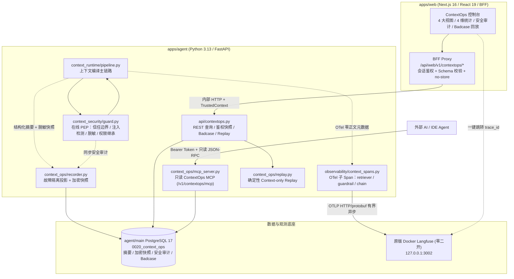

# 第 26 课｜ContextOps 与上下文安全体系 技术方案

> Feature：971 | 有效需求来源：[PRD](../spec/PRD.md) | Profile：standard | 模板：[TECH_DESIGN.tmpl.md](../../_templates/TECH_DESIGN.tmpl.md) | 代码基线：`main @ 588ee4f` + 工作区 `0019_goal_ledger.py` | 状态：待评审

> Compass 项目规则：[数据所有权与 SQL 迁移管理规范](../../../docs/database-migrations.md)。本期数据库变更全部归属 `agent/main`（Alembic `0019 → 0020`），`web/main` 无需新增迁移。

[返回需求简报](../BRIEF.md)

## 需求依据与验收

本方案对应 [PRD](../spec/PRD.md) 中的 `FR-01` 至 `FR-08`、`FR-C01` 至 `FR-C02`、`BR-01` 至 `BR-06`、`NFR-01` 至 `NFR-04`，以及全部 8 项验收标准 `AC-971-01` 至 `AC-971-08`。

## 1. 方案概述

### 1.1 设计目标和设计原则

1. **零二开复用第 14 课观测底座**：保留原版 Docker Langfuse 与既有 `observability/` 模块（独立 OTel `TracerProvider`、显式 `Observation` 句柄、BSP 有界异步导出、`privacy.py` 白名单脱敏），仅向上扩展 Context 层的标准 OTel Span 类型（`retriever`、`guardrail`、`chain`、`event`）与闭集元数据，守住业务正文零进入 OTLP/Langfuse 的硬边界。
2. **一处埋点、双层消费，支撑图形化洞察与 AI-Native 读取**：原版 Langfuse 负责底层原始 Span 树深挖与长尾排障；Compass `agent/main` 新增轻量结构化读模型与加密快照表，直接驱动 Web 端 4 大交互可视化视图、4 维上下文统计看板与只读 ContextOps MCP 接口。
3. **安全策略内联同步硬拦截**：上下文信任分级、Indirect Prompt Injection 检测、敏感脱敏与多租户/派生数据权限继承在 `context_runtime/pipeline.py` 在线主链路同步执行，先拦截/脱敏再装配进窗，同步记录安全审计并异步导出 OTel `guardrail` Span。
4. **严格 MVP 与第九篇边界**：本期在 `agent/main` 交付脱敏 Badcase 沉淀与内存级确定性 Context-only Replay（不触发外部工具与写副作用）；系统级大规模 Benchmark、Multi-Grader、全链路 A/B 与 CI 发布门禁留给第九篇（第 36–40 课）。

### 1.2 整体架构

### 1.3 关键决策与 Review 索引

| 决策 | 推荐及理由 | 代价与备选 | 待判断事项/确认状态 | 详情 |
| --- | --- | --- | --- | --- |
| Langfuse 零二开 + Compass 轻量 PG 读模型 | 保留原版 Langfuse 升级能力；PG 读模型精准服务 4 大图形视图、4 维统计与 MCP 低延迟查询，避免高成本魔改 Langfuse 前端或受限于其通用 JSON 树 | 需维护 4 张只追加/轻量业务表；备选“纯调 Langfuse Public API 拼装漏斗”延迟高、无法承载租户细粒度加密快照与权限复核 | 已确认 | §2.1.1, §2.3.2 |
| 加密 Context Snapshot 与 OTel 零正文解耦 | 沿用 L14 正文零泄露红线，OTel/Langfuse 只传 `snapshot_ref` 与 SHA-256；原文脱敏后用派生子密钥加密存 `agent/main`，查看前实时复核 RBAC 并落审计 | 增加一次服务端加密/解密开销（<2ms）；备选“将上下文全文放进 Langfuse”会击穿多租户权限边界 | 已确认 | §2.1.1, [CODE_DESIGN.md](CODE_DESIGN.md#3-加密快照与故障隔离读模型投影) |
| 在线安全 PEP 采用“确定性规则 + 权限引擎”为默认基线，预留可选检测器接口 | 本地零外部依赖、P95 < 15ms、低误杀、确定性可验收；同时通过 `InjectionDetector` 协议支持生产环境插拔轻量分类器或云 Guardrail | 对高度隐蔽的语义级越狱需靠后续接入分类器增强；备选“每次编译同步调外部 LLM 审查”延迟过高（+300ms 以上）且增加成本 | 已确认 | §2.3.1, [CODE_DESIGN.md](CODE_DESIGN.md#1-在线上下文安全拦截引擎pep与派生权限继承) |
| 复用既有权限点，`web/main` 零迁移 | 复用 `runtime_diagnostics`（platform）、`runtime_usage`（tenant）、`promptops_manage`（platform），减少跨库协调与迁移复杂度 | 权限粒度与运行诊断绑定；若未来需独立安全审计员角色，再在 `web/main` 单独追加权限位 | 已确认 | §2.1.3 |
| ContextOps MCP 严格只读且复用既有 FastAPI 服务 | 挂载 `/v1/contextops/mcp`（Streamable HTTP / JSON-RPC 2.0），与现有鉴权及租户上下文统一，不引入额外常驻进程 | 需严格白名单限制工具集合与返回字段，禁止暴露原文快照；备选“独立 Node MCP 进程直连数据库”违反跨进程数据所有权约束 | 已确认 | §2.3.4, [CODE_DESIGN.md](CODE_DESIGN.md#5-只读-contextops-mcp-服务接口) |

## 2. 详细设计方案

### 2.1 核心结构设计

#### 2.1.1 数据结构设计与数据库迁移登记

- **数据库归属**：`agent/main`（唯一 owner：`apps/agent`）
- **迁移工具与源路径**：Alembic，`apps/agent/migrations/versions/0020_context_ops.py`
- **版本依赖**：`down_revision = "0019"`（`0019_goal_ledger.py`）→ 目标版本 `0020`
- **SQL 交付路径**（实现阶段生成）：
  - 增量 SQL：`apps/agent/db/main/sql/0020_context_ops.sql`
  - 完整 SQL：按现有 `apps/agent/db/main/` 派生入口同步刷新
- **旧数据处理与回滚**：全部为新增独立表，不修改既有表结构；历史 Run 在 `context_decision_summary` 无记录时，前端按“历史记录缺少上下文决策摘要”优雅降级展示（兼容 `AC-01` 旧语义）。回滚只需 `alembic downgrade 0019` 删除 4 张新表，零影响历史业务数据。
- **`web/main` 数据库**：无变更。

新增 4 张表结构如下：

1. **`context_decision_summary`**（上下文编译决策摘要与漏斗读模型）
   - 主键：`id UUID PRIMARY KEY`
   - 关联字段：`tenant_id UUID NOT NULL`、`workspace_id UUID NOT NULL`、`run_id UUID NOT NULL`、`step_id UUID NOT NULL`、`call_id UUID NULL`、`trace_id VARCHAR(64) NULL`、`snapshot_ref VARCHAR(64) NULL`
   - 上下文与版本：`scene_id VARCHAR(64) NOT NULL`、`task VARCHAR(32) NOT NULL`、`phase VARCHAR(32) NOT NULL`、`policy_digest VARCHAR(64) NOT NULL`、`prompt_generation INT NOT NULL`、`semantic_version VARCHAR(64) NULL`
   - 性能与 Token 统计：`duration_ms INT NOT NULL`、`tokens_candidate INT NOT NULL`、`tokens_selected INT NOT NULL`、`tokens_after_compaction INT NOT NULL`、`token_limit INT NOT NULL`、`cache_hit_tokens INT NULL`
   - 漏斗计数：`candidate_count INT NOT NULL`、`selected_count INT NOT NULL`、`omitted_count INT NOT NULL`、`security_blocked_count INT NOT NULL`、`redacted_count INT NOT NULL`、`compaction_applied BOOLEAN NOT NULL`
   - 状态与结构化明细：`status VARCHAR(32) NOT NULL`、`error_code VARCHAR(64) NULL`、`source_breakdown_json JSONB NOT NULL`（按来源统计候选/入窗 Token）、`funnel_json JSONB NOT NULL`（5 阶段漏斗节点计数）、`decisions_json JSONB NOT NULL`（逐条脱敏决策元信息：item_id、kind、source、trust、decision、reason、byte_bound，不含明文）、`created_at TIMESTAMPTZ NOT NULL DEFAULT now()`
   - 索引：
     - `idx_ctx_summary_tenant_created (tenant_id, workspace_id, created_at DESC)`（支撑总览统计与列表筛选）
     - `idx_ctx_summary_run_step (tenant_id, run_id, created_at ASC)`（支撑 Run 全流程视图）
     - `idx_ctx_summary_policy_scene (tenant_id, scene_id, policy_digest, created_at DESC)`（支撑按场景/策略聚合）

2. **`context_snapshot`**（加密上下文快照）
   - 主键：`snapshot_ref VARCHAR(64) PRIMARY KEY`（格式 `csnp_<uuid4_hex>`）
   - 归属与血缘：`tenant_id UUID NOT NULL`、`workspace_id UUID NOT NULL`、`run_id UUID NOT NULL`、`step_id UUID NOT NULL`、`content_sha256 VARCHAR(64) NOT NULL`、`min_trust_level VARCHAR(16) NOT NULL`（派生最低信任等级）、`access_scope_json JSONB NOT NULL`（全部受限源 `AccessRef` 并集，逻辑 AND）、`data_classification VARCHAR(32) NOT NULL`
   - 加密载荷：`ciphertext BYTEA NOT NULL`（HKDF 派生子密钥 + gzip + Fernet 认证加密，内含 100% 不可逆脱敏后的候选与装配 JSON）、`expires_at TIMESTAMPTZ NOT NULL`（默认 14 天，由同镜像 Scheduler 每日清理过期且未被 `context_badcase` 引用的快照）、`created_at TIMESTAMPTZ NOT NULL DEFAULT now()`
   - 索引：`idx_ctx_snapshot_tenant_run (tenant_id, workspace_id, run_id)`、`idx_ctx_snapshot_expires (expires_at)`

3. **`context_security_event`**（上下文安全拦截与快照读取审计，append-only）
   - 主键：`id UUID PRIMARY KEY`
   - 字段：`tenant_id UUID NOT NULL`、`workspace_id UUID NOT NULL`、`actor_id UUID NULL`、`run_id UUID NULL`、`step_id UUID NULL`、`trace_id VARCHAR(64) NULL`、`event_type VARCHAR(32) NOT NULL`（`injection_blocked` / `injection_stripped` / `tenant_mismatch_rejected` / `pii_redacted` / `trust_downgraded` / `snapshot_viewed` / `mcp_queried`）、`action VARCHAR(16) NOT NULL`（`block` / `strip` / `redact` / `isolate` / `deny` / `allow_audit`）、`rule_code VARCHAR(64) NOT NULL`、`hit_count INT NOT NULL DEFAULT 1`（同编译步按事件/规则聚合计数，避免高频脱敏逐条插库）、`source_kind VARCHAR(32) NULL`、`trust_level VARCHAR(16) NULL`、`target_ref VARCHAR(128) NULL`、`metadata_json JSONB NOT NULL`（严禁含明文敏感值）、`created_at TIMESTAMPTZ NOT NULL DEFAULT now()`
   - 索引：`idx_ctx_sec_tenant_time (tenant_id, workspace_id, created_at DESC)`、`idx_ctx_sec_event_type (tenant_id, event_type, created_at DESC)`

4. **`context_badcase`**（脱敏 Badcase 与局部回放基线）
   - 主键：`id UUID PRIMARY KEY`
   - 字段：`tenant_id UUID NOT NULL`、`workspace_id UUID NOT NULL`、`created_by UUID NOT NULL`、`run_id UUID NOT NULL`、`step_id UUID NOT NULL`、`snapshot_ref VARCHAR(64) NOT NULL`、`scene_id VARCHAR(64) NOT NULL`、`root_cause_category VARCHAR(32) NOT NULL`（`source_data` / `semantic` / `retrieval` / `ranking_cutoff` / `compression_loss` / `security_false_positive` / `model_reasoning`）、`title VARCHAR(160) NOT NULL`、`note TEXT NULL`、`policy_digest VARCHAR(64) NOT NULL`、`prompt_generation INT NOT NULL`、`semantic_version VARCHAR(64) NULL`、`baseline_metrics_json JSONB NOT NULL`、`status VARCHAR(24) NOT NULL DEFAULT 'open'`、`created_at TIMESTAMPTZ NOT NULL DEFAULT now()`
   - 索引：`idx_ctx_badcase_tenant_created (tenant_id, workspace_id, created_at DESC)`

#### 2.1.2 数据流设计

1. **主链路（同步安全 + 聚合异步观测）**：
   - `context_runtime/pipeline.py` 收集完候选 `ContextItem` 后，首先同步调用 `ContextSecurityGuard.enforce()`：
     - 校验每个 `ContextItem.access` 是否匹配当前 `TrustedContext` 的 `tenant_id`/`workspace_id`；不匹配则同步剔除并记 `tenant_mismatch_rejected`（在任何模式下均不可关闭）。
     - 分级注入防护：对 `actor` 仅拦截明确系统提示提取与角色标记伪造（放行日常“忽略之前口径重算”等业务纠偏）；对 `observation` 命中高危确凿攻击则整条阻断，中危疑似语句剥离可疑句后保留正常正文。
     - 防逃逸与保缓存边界封装：对 `observation` 正文内出现的 `</untrusted_context` 做确定性转义（`&lt;/untrusted_context`）后再包裹固定 `<untrusted_context>` 标签，兼顾防标签逃逸与 LLM Prefix Cache 命中率；明确下游工具执行前硬鉴权为最终防线。
     - 两道精准脱敏：密钥/Token 在进模型窗口与落快照两道均 100% 强制脱敏；PII（严格边界手机号、校验码身份证、邮箱）在落加密快照、审计、Trace 与 MCP 出口 100% 不可逆脱敏，进模型窗口时放行用户主动提供的合法业务查询主键，且 `managed`/`dictionary` 跳过通用数字扫描防误伤公式与订单号。
     - 派生数据血缘：压缩摘要按受限域分段（避免受限财务表“滚雪球污染”整段公开对话），并调用 `derive_lineage()` 取最低 `min_trust_level` 与全部受限源 `AccessRef` **并集（逻辑 AND）**。
   - 编译完成后：
     - 通过 `observability/context_spans.py` 在父级 `Observation` 下挂载 `compass.context.retrieve`（`retriever`）、`compass.context.guardrail`（`guardrail`）、`compass.context.compile`（`chain`），仅写闭集白名单标量与 `snapshot_ref`。
     - 调用 `ContextOpsRecorder.record()` 将摘要、加密快照与按步聚合后的安全事件（`hit_count`）异步批量写入 `agent/main`；普通摘要投影走 **fail-open**（异常降级不阻塞主链路），在线拦截事件落库失败时同步输出结构化安全日志（JSON stderr）兜底。
2. **查询、鉴权快照与回放链路**：
   - 轨迹列表、漏斗统计与瀑布图仅查 `agent/main` 读模型，不探活外部业务数据库，避免业务库抖动拖慢控制台。
   - 读取加密快照（`GET /v1/contextops/snapshots/{snapshot_ref}`）与触发回放前，依次校验 `tenant_id`/`workspace_id` 并复用既有 `source_access.py` 复核细粒度源数据绑定与撤权状态（区分无权限 403、源数据已失效 `snapshot_expired_or_revoked` 与校验服务暂不可用 503）。
   - 解密返回快照前采用 **fail-closed 审计**：同步写入 `snapshot_viewed` 审计记录，写入失败直接返回 503 拒绝返回快照。

#### 2.1.3 接口设计

所有 Agent 接口定义于 `apps/agent/src/compass_agent/api/contextops.py` 与 `schemas.py`，经 `pnpm contracts` 同步生成 OpenAPI 与 Web TypeScript 类型；Web BFF 在 `apps/web/src/app/api/web/v1/contextops/[...path]/route.ts` 透传并做响应 Schema 校验与 `Cache-Control: no-store`。

| 接口 | 权限要求 | 核心输入 | 核心输出 |
| --- | --- | --- | --- |
| `GET /v1/contextops/overview` | `runtime_diagnostics` (platform，支持按 `actor_id` 查全员) 或 `runtime_usage` (tenant，服务端强制限定 `actor_id=ctx.actor_id`) | `window` (`24h`/`7d`/`30d`), `actor_id?`, `policy_digest?` | 顶部常驻看板载荷（仅真实可观测字段）：总体运行卡 + 具体统计（`session_count`、`run_count`、`avg_turns`、`min_turns`、`max_turns`、`turn_completion_breakdown`、`avg_search_turns`、`terminal_outcome_counts`） |
| `GET /v1/contextops/intents` | 同上 | `window`, `actor_id?`, `policy_digest?` | 意图识别观测 Tab 载荷：全局意图分类分布（含 JEV/Flash/兜底判决来源占比）、各意图分类耗时分布（`p50_ms`/`p95_ms`/`avg_ms`）与近期意图判决明细 |
| `GET /v1/contextops/anomalies` | 同上 | `window`, `actor_id?`, `policy_digest?` | 异常与耗时观测 Tab 载荷：工具执行错误排行、检索空结果与压缩截断统计、各业务阶段 P50/P95 耗时分布与异常 Run 明细 |
| `GET /v1/contextops/runs` | 同上（普通用户强制仅返回本人 Session/Run） | `window`, `actor_id?`, `session_id?`, `scene_id?`, `status?`, `has_security_event?`, `failed_stage?`, `limit`, `cursor?` | 级联会话与 Run 摘要列表（成员、会话标题、总步数、总耗时、总 Token、淘汰率、是否压缩、安全拦截数、trace_id） |
| `GET /v1/contextops/runs/{run_id}/flow` | 同上（强制同租户校验；普通用户额外校验 `run.actor_id == ctx.actor_id`） | `run_id` | 双视图统一载荷：技术语义三轨瀑布图（`input`/`model`/`tool`）+ 轮次轨迹流 + 四标签节点详情，以及业务语义漏斗数据、窗口构成占比、逐条决策卡片与 Langfuse 深链元信息 |
| `GET /v1/contextops/snapshots/{snapshot_ref}` | `runtime_diagnostics` (platform) 或 `runtime_usage` (tenant) + `access_scope` 复核 | `snapshot_ref` | 解密后的脱敏候选集与装配快照 + 血缘/信任/版本信息（强制写 `snapshot_viewed` 审计；跨租户返回 403） |
| `GET /v1/contextops/security/events` | 同上 | `window`, `event_type?`, `action?`, `limit` | 分页安全审计事件列表 |
| `POST /v1/contextops/badcases` | `promptops_manage` (platform) 或 `runtime_usage` (tenant) | `run_id`, `step_id`, `root_cause_category`, `title`, `note?` | 新建脱敏 `ContextBadcaseView` |
| `GET /v1/contextops/badcases` | 同上 | `root_cause_category?`, `scene_id?`, `limit` | Badcase 列表 |
| `POST /v1/contextops/badcases/{badcase_id}/replay` | `promptops_manage` (platform) 或 `runtime_usage` (tenant) | `override`（`max_input_tokens?`, `protect_dictionary?`, `compaction_threshold?`, `max_observation_items?`） | `ContextReplayComparison`（基准 vs 候选的漏斗计数、Token 差值、新增/丢弃条目列表、关键口径保留状态） |
| `POST /v1/contextops/mcp` | 已鉴权只读服务令牌 + 租户上下文 | JSON-RPC 2.0（`tools/list`、`tools/call`） | 仅允许 4 个只读工具：`contextops_list_runs`、`contextops_get_run_flow`、`contextops_get_stats`、`contextops_list_badcases` |

### 2.2 配置变更

优先复用已有配置，新增 3 项带安全默认值的可选配置项（位于 `apps/agent/src/compass_agent/settings.py`）：

| 配置项 | 当前用途与来源 | 默认值/缺失行为 | 生效时机 |
| --- | --- | --- | --- |
| `COMPASS_CONTEXT_SNAPSHOT_TTL_DAYS` | 加密 Context Snapshot 保留天数 | `14`（天） | 新快照写入时计算 `expires_at` |
| `COMPASS_CONTEXT_SECURITY_MODE` | 上下文注入拦截模式（`enforce` / `audit_only`，后者仅限本地压测与调优，租户不可动态降级；多租户与 `source_access` 权限复核在任何模式下强制生效） | `enforce`（默认硬拦截） | 进程启动加载 |
| `COMPASS_CONTEXTOPS_MCP_ENABLED` | 是否开放只读 `/v1/contextops/mcp` 端点 | `true`（受鉴权保护） | 路由处理校验 |

加密密钥直接从既有 `COMPASS_MODEL_ENCRYPTION_KEY` 通过 HKDF-SHA256（固定 info `b"compass-context-snapshot-v1"`）派生，不新增额外必填环境变量。

### 2.3 分模块详细设计

#### 2.3.1 上下文纵深安全体系与在线拦截引擎（`apps/agent/src/compass_agent/context_security/`）

安全机制贯穿“**入窗前同步拦截 → 出窗/落库精准脱敏 → 密文存储与实时复权 → fail-closed 审计 → 下游工具硬鉴权兜底**”五层纵深防线，明确提示词隔离为前置减损防线，下游工具执行前的权限复核与审批为最终防线。核心由 5 个模块协同落地：

1. **信任分级与派生血缘继承（`policy.py`）**：
   - 定义严格四级信任偏序：`observation (0) < actor (1) < dictionary (2) < managed (3)`，并将 `review` 与 `summary` 等派生材料归入不可信 `observation`（同时记录 `trust_downgraded / source_lineage` 审计），防止派生内容被误提升为可信指令。
   - `derive_lineage(items)` 对所有输入源取最低 `min_trust_level` 与全部受限源 `AccessRef` 的**并集（Union，逻辑 AND 语义）**，并标记 `data_classification`（存在受限源即为 `restricted`，否则 `internal`）；上游压缩摘要同步按受限域分段，避免单个受限财务表“滚雪球污染”整段公开对话。
   - 统一维护 13 条闭集规则码（`tenant_workspace_mismatch`、`role_forgery`、`system_prompt_extraction`、`instruction_override`、`suspicious_instruction`、`secret`、`phone`、`email`、`identity_number`、`source_revoked`、`snapshot_read`、`mcp_read`、`source_lineage`）与 `aggregate_events()` 按步聚合机制，避免高频脱敏造成写放大。
2. **多租户与工作区硬校验（`guard.py`）**：
   - 在任何运行模式（包括本地压测 `audit_only`）下强制校验每条 `ContextItem.access` 的 `(tenant_id, workspace_id)` 与当前 `TrustedContext` 一致；不匹配即刻判定 `tenant_mismatch_rejected / deny`，绝不放行原文。
3. **四类分级注入检测与保协议隔离（`detector.py`、`guard.py`、`structured.py`）**：
   - 定义可扩展 `InjectionDetector` 协议与默认确定性 `RuleDetector`（零外部依赖，实测 50 条混合候选 P95 5.415 ms）：
     - `managed` / `dictionary` 跳过扫描，永不误伤系统指令与指标口径。
     - `actor` 与 `observation` 共同拦截两类高危攻击：`role_forgery`（`<|im_start|>system`、`[INST] <<SYS>>`、`</?system>` 等角色标记伪造）与 `system_prompt_extraction`（中英文系统/开发者提示词提取诱导）；`actor` 放行“忽略之前口径重算”等日常业务纠偏。
     - `observation` 额外拦截两类间接提示词注入（Indirect Prompt Injection）：`instruction_override`（高危：指令覆盖、绕过安全校验、扮演系统管理员）整条隔离；`suspicious_instruction`（中危：按句号/问号/感叹号/换行切句，仅剥离命中的可疑句如“不要告诉用户”/“忽略之前要求”，保留同条上下文中其余正常数据）。
   - **保协议安全隔离**：命中 `deny` 或 `block` 时不粗暴删除整条消息（防止破坏 LLM `tool_call`/`tool_result` 配对或丢失最新用户轮次），而是用固定安全占位符 `ISOLATED`（`[该条上下文已由安全策略隔离，内容不可用于回答或执行。]`）替换正文，确保被拒字节绝不进入编译窗口。
   - **结构化叶值与工具参数防护**：`structured.py` 针对 `review`（`purpose == "verify"`）递归净化 `candidate` 与 `evidence` 内每个字符串叶值，保持外层验证 JSON 协议完整；`guard.py` 同步对 `tool_calls[].function.arguments` 与 `reasoning_content` 执行密钥脱敏（无需脱敏的 JSON 参数保持原字节不变）。
4. **两道精准脱敏与业务 ID 防误伤（`redactor.py`）**：
   - 覆盖 4 类敏感模式：`secret`（API Key / Access Token / Password / `Bearer` / `sk-` / `ghp_` / `github_pat_` / Postgres·MySQL·Redis DSN 密码）、`email`、`identity_number`（18 位身份证须同时通过合法出生日期与 GB 11643-1999 加权模 11 校验位校验）、`phone`（严格边界大陆手机号），统一替换为 `[REDACTED:<RULE>]` 且幂等防重复计数。
   - **业务 ID 豁免与表格语义感知**：识别 `order_id`、`order_no`、`sku_id`、`product_id`、`tracking_no`、`订单号`、`商品编号`、`运单号` 等字段名或前文 60 字符业务前缀，避免误伤订单号与公式；遇到工具返回的 `{"columns": [...], "rows": [...]}` 表格 JSON 时，按列名语义逐单元格脱敏（包括纯整数类型的手机号/身份证列）并保持合法 JSON 语法。
   - **双出口差异策略**：进模型窗口时对所有来源强制脱敏密钥，仅对 `observation` 脱敏 PII，放行 `actor` 主动输入的合法查询主键；落库快照、审计、Trace 与 MCP 出口统一走 `storage_value()` 执行 100% 不可逆脱敏。
5. **确定性防逃逸封装与 Prefix Cache 保护（`guard.py`）**：
   - 对所有 `observation` 正文先将任意大小写/空格变体的 `<\s*/?\s*untrusted_context\b` 确定性转义为 `&lt;/untrusted_context`，再包裹固定 `<untrusted_context source="..." trust="observation">` 边界标签；重复编译已封装前缀时先剥离再幂等封装，保证字节完全一致，避免引入随机 nonce 破坏多轮 Prefix Cache 命中率。
6. **存储加密、实时复权、fail-closed 审计与最小权限闭环（`crypto.py`、`snapshots.py`、`mcp_server.py`）**：
   - 快照正文经 `HKDF-SHA256 → gzip → Fernet` 加密存储并校验 `content_sha256` 完整性；读取前依次校验租户作用域（跨租户/不存在统一返回 `403`，不泄露存在性并记 `snapshot_denied`）、TTL 有效期（过期返回 `409`）与 `source_access.allows()` 实时源权限（撤权 `403`、授权源不可用 `503`）。
   - 解密前在数据库事务内强制先写入并提交 `snapshot_viewed` 审计（**fail-closed**），审计写失败直接返回 `503` 拒绝返回载荷；数据库角色遵循最小权限（Runtime 对四张新表仅 `SELECT/INSERT`，Scheduler 仅清理过期且未被 Badcase 引用的快照）；只读 MCP 使用 1 小时作用域凭据，每次调用实时复核 Web 权限并记 `mcp_queried` 审计，永不暴露快照原文。

#### 2.3.2 OTel + Langfuse 零二开观测扩展（`apps/agent/src/compass_agent/observability/`）

- 扩展 `privacy.py` 的 `FIELDS` 与 `EVENT_FIELDS`，新增闭集字段：`snapshot_ref`、`trust_level`、`guardrail_action`、`guardrail_rule`、`candidate_count`、`selected_count`、`security_blocked_count`、`redacted_count`、`compaction_ratio`、`funnel_stage`。
- 新增 `context_spans.py`：在既有 `Observation` 上创建三个子 Span：
  - `compass.context.retrieve` → `span.native("type", "retriever")`
  - `compass.context.guardrail` → `span.native("type", "guardrail")`
  - `compass.context.compile` → `span.native("type", "chain")`
- 全部遵循 `Observation` 现有生命周期与 `finally` 关闭语义；所有属性值经过 `privacy.fields()` 白名单过滤，继续维持正文零泄露。

#### 2.3.3 轻量读模型、加密快照、统计与局部回放（`apps/agent/src/compass_agent/context_ops/`）

- **`crypto.py`**：使用 `cryptography.hazmat.primitives.kdf.hkdf.HKDF` 从 `compass_model_encryption_key` 派生 32 字节 Fernet 密钥，提供 `encrypt_payload()` / `decrypt_payload()`。
- **`recorder.py`**：在独立 DB 会话中写入 `context_decision_summary`、`context_snapshot` 和 `context_security_event`，捕获异常并递增本地自诊断计数 `contextops_record_errors`，确保故障不回流主链路。
- **`analytics.py`**：基于 `context_decision_summary`、`agent_step`、`model_attempt` 与 `context_security_event` 聚合 4 维统计指标与 Run 流程视图；所有查询强制带 `tenant_id` 与 `workspace_id` 过滤条件。
- **`replay.py`**：`ContextOnlyReplayEngine` 解密 `context_snapshot` 中冻结的候选上下文，复现原策略的选择/压缩/预算管道，并按传入的 `ReplayOverride` 运行候选管道，输出确定性对比结构。

#### 2.3.4 只读 ContextOps MCP 接口（`apps/agent/src/compass_agent/context_ops/mcp_server.py`）

- 实现精简 JSON-RPC 2.0 分发器（支持 `initialize`、`tools/list`、`tools/call`），硬编码 4 个只读工具白名单，所有工具直接调用 `analytics.py` 和 `badcase` 只读查询。
- 每次 `tools/call` 均校验 `TrustedContext` 的租户范围，记录一条 `mcp_queried` 审计事件；返回结果仅包含脱敏摘要与统计数值，不提供解密快照工具。

#### 2.3.5 Compass Web 控制台（`apps/web/src/features/contextops/`）

- 新增 4 个子页面/标签：`OverviewStatsPanel`、`RunFlowInspector`、`SecurityAuditPanel`、`BadcaseReplayPanel`，复用 `apps/web/src/components/ui/` 通用组件与设计变量。
- 图表使用纯 SVG / 轻量 React 组件渲染横向步骤流程图、上下文漏斗流向图、窗口堆叠占比条与失败热点条形图，避免引入重型图形引擎，保证桌面端与窄屏清晰对齐。

### 2.4 供评审的代码设计（for review check）

核心架构骨架、不变量分支与关键接口已整理到独立代码附录：[CODE_DESIGN.md](CODE_DESIGN.md)。

评审重点索引：
1. 在线 PEP 拦截顺序与派生信任/权限交集计算：[CODE_DESIGN.md#1-在线上下文安全拦截引擎pep与派生权限继承](CODE_DESIGN.md#1-在线上下文安全拦截引擎pep与派生权限继承)
2. OTel `retriever`/`guardrail`/`chain` 映射与白名单约束：[CODE_DESIGN.md#2-otel--langfuse-上下文-span-映射零二开](CODE_DESIGN.md#2-otel--langfuse-上下文-span-映射零二开)
3. 加密快照派生密钥、RBAC 解密复核与故障隔离投影：[CODE_DESIGN.md#3-加密快照与故障隔离读模型投影](CODE_DESIGN.md#3-加密快照与故障隔离读模型投影)
4. 确定性 Context-only Replay 对照引擎：[CODE_DESIGN.md#4-确定性-context-only-replay-引擎](CODE_DESIGN.md#4-确定性-context-only-replay-引擎)
5. 只读 ContextOps MCP 白名单分发与审计：[CODE_DESIGN.md#5-只读-contextops-mcp-服务接口](CODE_DESIGN.md#5-只读-contextops-mcp-服务接口)

## 3. 风险评估

| 风险与触发条件 | 影响 | 缓解措施 | 验证方式 |
| --- | --- | --- | --- |
| 注入检测规则误杀正常业务查询（如用户问“忽略退款后 GMV 是多少”） | 正常上下文被误拦截导致回答缺失 | 规则聚焦“指令覆盖 + 角色劫持 + 系统提示提取”组合特征，且仅扫描 `observation`/`actor`；支持 `audit_only` 回退与拦截原因可视化复核 | 正常电商问答回归集 + 4 类攻防测试集双测 |
| 高并发下读模型或快照写入拖慢主链路 | 模型响应延迟升高或任务失败 | 读模型投影采用独立短事务与异常隔离，快照采用紧凑 JSON + gzip 压缩后加密，默认保留 14 天可按过期索引清理 | 注入 DB 写入异常单测验证主链路零失败 |
| `context_snapshot` 密文泄露或跨租户越权查看 | 敏感业务数据泄露 | 入库前先做 PII 脱敏；加密密钥通过 HKDF 独立派生；读取接口强制复核 `tenant_id`/`workspace_id`/`access_scope` 并写 `snapshot_viewed` 审计 | 跨租户 403 单测 + DB 密文直查敏感哨兵为 0 |
| MCP 接口被用于越权探测或写操作 | 治理接口本身引入新攻击面 | 严格白名单仅 4 个只读工具，禁止返回快照原文，复用现有 `TrustedContext` 租户隔离并记录每次调用审计 | MCP 协议越权与非法方法测试 |

## 4. 兼容性考量

| 端与版本/协议组合 | 是否兼容及依据 | breaking change / 旧端行为 | 是否需配套发版与上线顺序 |
| --- | --- | --- | --- |
| 既有 `context_runtime` 调用方与第 21–25 课测试 | 完全兼容；`PreparedContext` 原字段不变，新增安全与观测数据走可选返回/内部上下文 | 无 breaking change | 无需改造旧调用方 |
| 历史 Run（`0019` 及之前数据） | 完全兼容；`context_decision_summary` 无记录时，Run 洞察页回退展示既有 `agent_step` 基础步骤并提示“缺少上下文决策明细” | 无 | 先执行 `pnpm db:migrate -F agent`（`0019 → 0020`），再启动 Agent 与 Web |
| Docker Langfuse（第 14 课已部署） | 完全兼容原版 Langfuse OTLP 接收器，零镜像改动 | 无 | Langfuse 可选启用，不启动时 Compass 视图照常可用 |

## 5. 任务分解

| 任务 | 关联模块/决策 | 变更文件（新增/修改/删除） | 前置依赖 | 交付物与验收条件 |
| --- | --- | --- | --- | --- |
| T1：数据库迁移与实体 | §2.1.1 | 新增 `apps/agent/migrations/versions/0020_context_ops.py`、`apps/agent/src/compass_agent/context_ops/entities.py`、增量/完整 SQL | `0019` 基线 | 空库安装与 `0019 → 0020` 升级/回滚验证通过 |
| T2：在线安全拦截引擎 PEP | §2.3.1 | 新增 `apps/agent/src/compass_agent/context_security/{policy,detector,redactor,guard}.py`；修改 `context_runtime/pipeline.py` | T1 | AC-971-04 四类安全攻防单测全部通过，P95 ≤ 15ms |
| T3：OTel 上下文埋点扩展 | §2.3.2 | 修改 `observability/privacy.py`；新增 `observability/context_spans.py`；接入 `pipeline.py` | T2 | AC-971-01 内存 SpanExporter 与 Langfuse 零正文验收通过 |
| T4：读模型、加密快照、统计与 Replay | §2.3.3 | 新增 `context_ops/{crypto,recorder,analytics,replay}.py` | T1, T2 | AC-971-05、AC-971-07 加密直查、403 复核与确定性回放单测通过 |
| T5：REST API、只读 MCP 与契约同步 | §2.1.3, §2.3.4 | 新增 `api/contextops.py`、`context_ops/mcp_server.py`；修改 `schemas.py`、`main.py`；运行 `pnpm contracts` | T4 | AC-971-06 MCP 协议测试通过；`pnpm contracts:check` 通过 |
| T6：Compass Web 4 大可视化视图与 BFF | §2.3.5, UI-01 | 新增 `apps/web/src/app/api/web/v1/contextops/[...path]/route.ts`、`apps/web/src/features/contextops/*`；修改侧边栏与对话卡片入口 | T5 | AC-971-02、AC-971-03 浏览器桌面/窄屏交互与空态/降级态验收通过 |
| T7：端到端集成验收与综合门禁 | 全部 AC | 新增 `apps/agent/tests/test_context_ops.py`、`test_context_security.py`、`apps/web` 相关测试 | T1–T6 | AC-971-01 至 AC-971-08、`pnpm check`、`pnpm build` 全部通过 |
