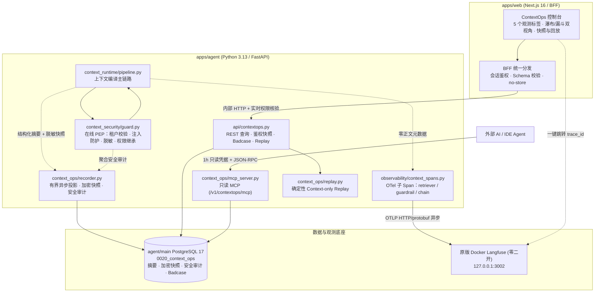
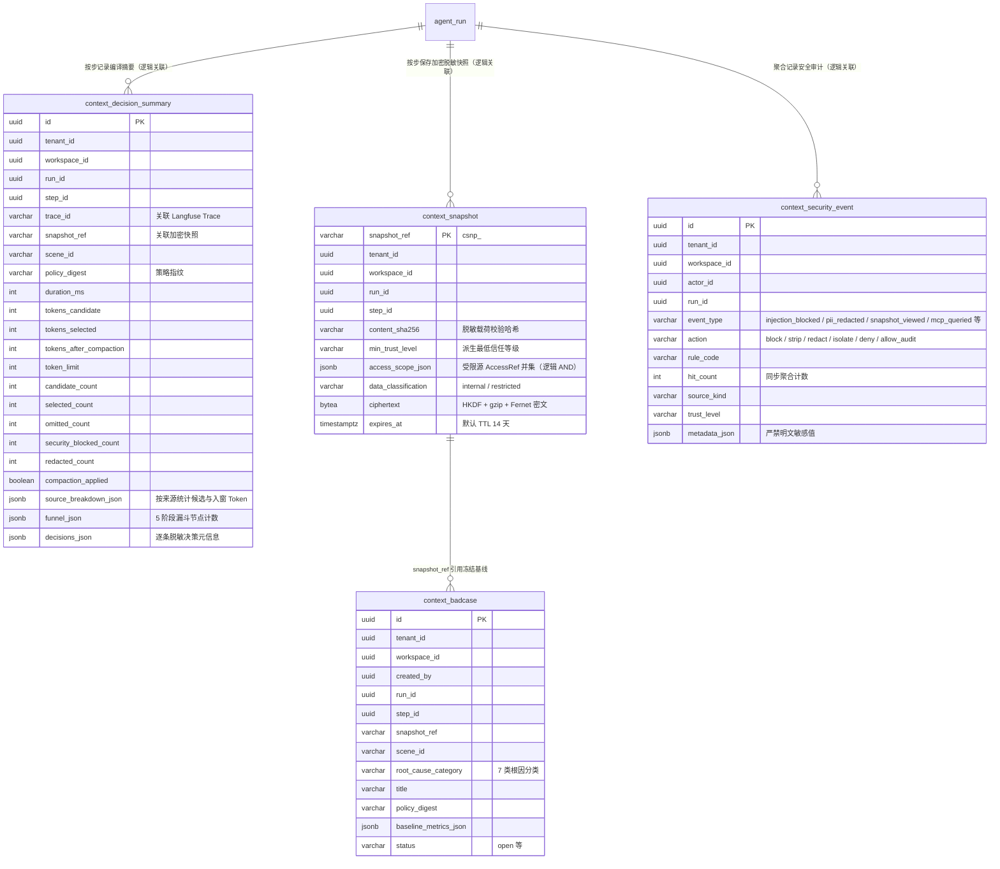
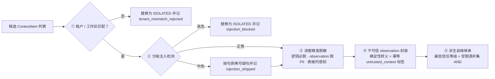
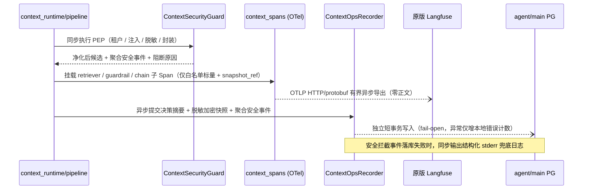
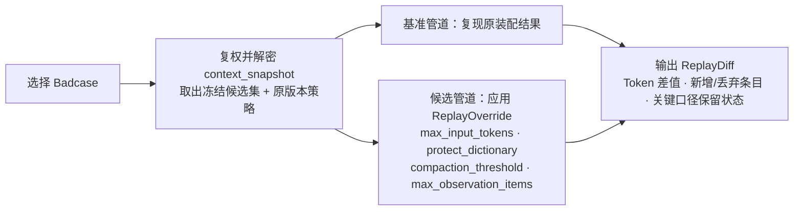

## 设计目标

本课给 Compass 补齐 **ContextOps 可观测性**与**上下文安全体系**：在不二次开发 Langfuse 的前提下，把每次上下文编译的筛选、压缩、安全拦截过程完整透明化，并提供受权限保护的加密快照、脱敏 Badcase 沉淀、确定性局部回放与只读 MCP 读取入口。

建设范围分四块：

| 能力             | 一句话说明                                                                       |
| ---------------- | -------------------------------------------------------------------------------- |
| 在线安全拦截 PEP | 在上下文进窗前同步执行租户隔离、分级注入防护、两道精准脱敏与派生权限继承         |
| 零二开观测扩展   | 复用第 14 课 OTel 底座与原版 Langfuse，扩展 `retriever`/`guardrail`/`chain` Span |
| 读模型与加密快照 | 在 `agent/main` 沉淀轻量摘要与加密脱敏快照，支撑控制台视图、四维统计与只读 MCP   |
| Badcase 与回放   | 冻结候选上下文，在内存中零副作用复现装配过程并对比新旧策略差异                   |

本课严格守住 MVP 与第九篇（第 36–40 课）的边界：本期交付单步脱敏 Badcase 与内存级确定性 Context-only Replay（不触发外部工具与真实模型）；系统级大规模 Benchmark、Multi-Grader、全链路 A/B 与 CI 发布门禁留给第九篇。

## 总体方案

系统采用“**一处埋点、双层消费**”的架构：每次上下文编译完成后，安全与决策元数据同时流向两条通道——原版 Docker Langfuse 负责底层原始 Span 树深挖与长尾排障；`agent/main` 中的轻量读模型与加密快照直接服务 Compass Web 控制台与只读 MCP 接口。



关键设计取舍：

| 选择                                    | 原因                                                                                       |
| --------------------------------------- | ------------------------------------------------------------------------------------------ |
| Langfuse 零二开 + 轻量 PG 读模型        | 保留原版 Langfuse 升级能力；PG 读模型精准支撑图形视图、聚合统计与低延迟 MCP，避免魔改前端  |
| 加密快照与 OTel 零正文解耦              | 守住第 14 课正文零泄露红线：OTel 只传 `snapshot_ref` 与摘要；脱敏快照加密存库、查看前复权  |
| 在线 PEP 默认“确定性规则 + 权限引擎”    | 本地零外部依赖、实测 P95 5.4 ms、低误杀且确定性可验；同时预留 `InjectionDetector` 扩展协议 |
| 复用既有权限体系，`web/main` 零迁移     | 内部以 `contextops_read` / `contextops_admin` 映射本人与管理员作用域，避免跨库迁移耦合     |
| ContextOps MCP 严格只读并挂载在 Agent   | 与现有鉴权和租户隔离统一，不增新进程；硬编码 4 个只读工具白名单，永不暴露快照原文          |

## 数据模型与持久化

本期所有数据库变更全部归属 `agent/main`（Alembic 迁移 `0019 → 0020`），新增 4 张独立表，不修改 `agent_run`、`agent_step` 等既有表结构，`web/main` 无需新增迁移。



四张表的职责、索引与最小权限：

| 表名                       | 职责与关键索引                                                                                  | 运行权限与清理策略                                                |
| -------------------------- | ----------------------------------------------------------------------------------------------- | ----------------------------------------------------------------- |
| `context_decision_summary` | 上下文编译摘要与漏斗读模型；建 `(tenant, workspace, created_at)`、`(tenant, run, created_at)` 等索引 | Runtime 仅 `SELECT/INSERT`；历史 Run 无记录时前端优雅降级提示     |
| `context_snapshot`         | 不可逆脱敏后的候选与装配密文快照；建 `(tenant, workspace, run_id)` 与 `expires_at` 索引         | 默认保留 14 天；Scheduler 每日仅删已过期且未被 Badcase 引用的快照 |
| `context_security_event`   | append-only 安全拦截、快照查看与 MCP 调用审计；同编译步按规则聚合 `hit_count` 减少写放大        | Runtime 仅 `SELECT/INSERT`，不可 `UPDATE/DELETE`                  |
| `context_badcase`          | 脱敏 Badcase 登记与局部回放基线，记录 7 类根因分类、版本与基线指标                              | 引用的快照即使过期也保留记录，读取/回放返回明确失效状态（409）    |

回滚只需执行 `alembic downgrade 0019` 删除 4 张新表，对既有业务数据零影响。

## 上层接口、只读 MCP 与配置

### REST 查询与治理接口

所有 Agent 接口位于 `apps/agent/src/compass_agent/api/contextops.py`，经 `pnpm contracts` 同步生成 OpenAPI 与 Web TypeScript 类型。Web BFF 复用 `/api/web/v1/[...path]` 统一分发器，执行会话鉴权、CSRF 校验、响应 Schema 运行时校验与 `Cache-Control: no-store`。

内部鉴权区分两个作用域并每次实时经 Web 复核：`contextops_admin`（平台管理员）可按 `actor_id` 查同租户/工作区全员；`contextops_read`（普通分析成员）由服务端强制限定 `actor_id = ctx.actor_id`，且禁止创建 Badcase。

| 接口                                        | 核心输入                                                                 | 核心输出                                                                 |
| ------------------------------------------- | ------------------------------------------------------------------------ | ------------------------------------------------------------------------ |
| `GET /v1/contextops/overview`               | `window` (`24h`/`7d`/`30d`), `actor_id?`, `policy_digest?`               | 顶部常驻看板：会话数、Run 数、平均/最小/最大轮数、搜索轮数、终态分布     |
| `GET /v1/contextops/intents`                | `window`, `actor_id?`, `policy_digest?`                                  | 意图分类分布（含 JEV/Flash/兜底判决来源）、各意图 P50/P95/平均耗时明细   |
| `GET /v1/contextops/anomalies`              | `window`, `actor_id?`, `policy_digest?`                                  | 工具错误排行、检索空结果与压缩截断统计、各阶段耗时分布与异常 Run 明细    |
| `GET /v1/contextops/runs`                   | `window`, `actor_id?`, `session_id?`, `scene_id?`, `status?`, `cursor?`  | 游标分页的会话/Run 摘要列表（步数、耗时、Token、淘汰率、压缩、安全拦截） |
| `GET /v1/contextops/runs/{run_id}/flow`     | `run_id`                                                                 | 双视角统一载荷：三轨瀑布图（`input`/`model`/`tool`）+ 业务漏斗与逐条决策 |
| `GET /v1/contextops/snapshots/{ref}`        | `snapshot_ref`                                                           | 解密后的脱敏快照 + 血缘/信任/版本（强制先落 `snapshot_viewed` 审计）     |
| `GET /v1/contextops/security/events`        | `window`, `event_type?`, `action?`, `actor_id?`, `limit`, `cursor?`      | 分页安全审计事件列表                                                     |
| `GET / POST /v1/contextops/badcases`        | 列表筛选 `root_cause_category`/`scene_id`；创建传 `run_id`/`step_id` 等  | 脱敏 `ContextBadcaseView` 列表或新建结果                                 |
| `POST /v1/contextops/badcases/{id}/replay`  | `override`（预算、口径保护、压缩阈值、observation 上限）                 | `ContextReplayComparison`（基准 vs 候选漏斗、Token 差值、增删条目）      |

### 只读 ContextOps MCP

端点 `POST /v1/contextops/mcp` 实现精简 JSON-RPC 2.0 分发器（`initialize`、`tools/list`、`tools/call`），使用专用 1 小时作用域凭据，每次调用实时核验 Web 权限并写入 `mcp_queried` 审计，严格拒绝未登记方法与写操作。

| 工具名                     | 作用                                                         | 返回边界               |
| -------------------------- | ------------------------------------------------------------ | ---------------------- |
| `contextops_list_runs`     | 按时间窗、场景、状态查询脱敏后的 Run 摘要                    | 仅摘要与计数，无明文   |
| `contextops_get_run_flow`  | 查询指定 Run 的步骤流、漏斗计数与逐条脱敏决策原因            | 不含快照正文           |
| `contextops_get_stats`     | 查询上下文聚合统计指标与高频失败环节                         | 仅统计数值             |
| `contextops_list_badcases` | 查询已沉淀的脱敏上下文 Badcase 与根因分类                    | 仅脱敏元信息与基线指标 |

### 配置项

新增 3 项带安全默认值的可选配置（`apps/agent/src/compass_agent/settings.py`）；快照加密密钥通过 HKDF-SHA256 从既有 `COMPASS_MODEL_ENCRYPTION_KEY` 派生，不新增必填密钥环境变量。

| 配置项                            | 用途                                                                                   | 默认值    |
| --------------------------------- | -------------------------------------------------------------------------------------- | --------- |
| `COMPASS_CONTEXT_SNAPSHOT_TTL_DAYS` | 加密快照保留天数（1–365），写入时计算 `expires_at`                                     | `14`      |
| `COMPASS_CONTEXT_SECURITY_MODE`   | 注入拦截模式：`enforce` 硬拦截；`audit_only` 仅限本地压测调优，租户与源权限校验永不关闭 | `enforce` |
| `COMPASS_CONTEXTOPS_MCP_ENABLED`  | 是否开放受鉴权保护的只读 `/v1/contextops/mcp` 端点                                     | `true`    |

## 上下文纵深安全体系

上下文安全不能只靠“在提示词里嘱咐模型注意安全”。本课在上下文编译与治理全链路建立**五层纵深防线**：前四层在入窗、脱敏、落库和读取环节同步拦住风险，第五层由下游工具执行前的硬鉴权（RLS、权限复核与人工审批）兜底。


### 1. 信任分级、多租户硬边界与派生血缘继承

系统为每一条上下文定义严格的四级信任偏序，权限只能向下继承，绝不向上漂移：

| 信任等级     | 权重 | 来源示例                                 | 注入扫描策略                       | 进窗 PII 脱敏 | 落库/审计脱敏 |
| ------------ | ---- | ---------------------------------------- | ---------------------------------- | ------------- | ------------- |
| `managed`    | 3    | 系统提示词、平台受管约束                 | 跳过（永不误伤系统指令）           | 仅密钥        | 100% 脱敏     |
| `dictionary` | 2    | 经营实体、官方指标口径定义               | 跳过（永不误伤公式与口径）         | 仅密钥        | 100% 脱敏     |
| `actor`      | 1    | 用户当前输入与正常纠偏                   | 仅拦截角色伪造与提示词提取         | 仅密钥        | 100% 脱敏     |
| `observation`| 0    | 数据库查询结果、检索片段、外部工具回传、Review/Summary 派生材料 | 全量扫描（高危隔离，中危按句剥离） | 密钥 + PII    | 100% 脱敏     |

两项硬约束在任何运行模式（包括本地压测 `audit_only`）下均不可降级：

- **多租户与工作区硬校验**：逐条核对 `ContextItem.access` 中的 `(tenant_id, workspace_id)` 是否匹配当前 `TrustedContext`；任一不匹配立刻判定 `tenant_mismatch_rejected / deny`，原文不进窗。
- **派生血缘继承（`derive_lineage`）**：当多条上下文被压缩成摘要、送入 Review 复核或打包为快照时，系统取所有输入源的**最低信任等级**与全部受限源 `AccessRef` 的**并集（Union，逻辑 AND 语义）**——只要混入一条受限源，派生结果就同时受该源权限约束且定级为 `restricted`。`review` 与 `summary` 降为 `observation` 时主动记录 `trust_downgraded / source_lineage`。上游压缩同步按受限域分段，避免单张受限财务表“滚雪球污染”整段公开对话。

### 2. 四类分级注入检测、保协议隔离与结构化叶值防护

默认内置确定性规则引擎 `RuleDetector`（实现可扩展的 `InjectionDetector` 协议，本地零外部依赖，50 条混合候选实测 P95 **5.415 ms**），针对不同攻击面采取精准动作：

| 规则码                     | 级别 | 作用等级                  | 典型拦截特征                                                           | 执行动作                                       |
| -------------------------- | ---- | ------------------------- | ---------------------------------------------------------------------- | ---------------------------------------------- |
| `role_forgery`             | 高危 | `actor`、`observation`    | `<\|im_start\|>system`、`[INST] <<SYS>>`、`</?system>` 等角色伪造标记  | `block`（替换为 `ISOLATED` 安全占位符）        |
| `system_prompt_extraction` | 高危 | `actor`、`observation`    | 中英文“输出/打印/透露…系统提示词”等提示词提取诱导                      | `block`（替换为 `ISOLATED` 安全占位符）        |
| `instruction_override`     | 高危 | 仅 `observation`          | “忽略/绕过…系统/安全指令”、“扮演系统管理员”等间接指令覆盖              | `block`（替换为 `ISOLATED` 安全占位符）        |
| `suspicious_instruction`   | 中危 | 仅 `observation`          | “忽略之前要求”、“不要告诉用户”、“do not tell the user”等可疑句       | `strip`（按句切分，仅剥离可疑句，保留正常数据） |

这里有三个容易踩坑但非常关键的工程细节：

- **为什么对 `actor` 放行“忽略之前口径重算”**：电商分析中用户经常主动纠正前文口径。只对 `observation` 启用 `instruction_override` 和 `suspicious_instruction`，对 `actor` 仅拦高危角色伪造和提示词提取，能兼顾安全与业务可用性。
- **保协议安全隔离（`ISOLATED`）**：高危阻断或租户不匹配时，如果直接删除整条消息，会破坏 LLM 协议中的 `tool_call` / `tool_result` 成对约束或删掉最新用户轮次。实现上把正文替换为常量占位符 `[该条上下文已由安全策略隔离，内容不可用于回答或执行。]`，既保证被拒字节绝不进入编译窗口，又保持消息协议结构完整。
- **结构化 Review 与工具参数防护**：`context_security/structured.py` 会针对复核载荷（`purpose == "verify"`）递归遍历 `candidate` 与 `evidence` 的每一个叶值字符串执行脱敏与注入检测，保持外层验证 JSON 字段完整；同时对消息中的 `tool_calls[].function.arguments` 和 `reasoning_content` 补做密钥脱敏，且对无需脱敏的 JSON 参数保持原字节不变。

### 3. 两道精准脱敏、业务 ID 防误伤与防逃逸封装

脱敏器（`redactor.py`）覆盖四类敏感模式，统一替换为不可逆占位符 `[REDACTED:<RULE>]` 且保证重复编译幂等不重复计数：

| 敏感类型          | 识别规则与精准校验                                                                 | 防误伤与结构保护                                                               |
| ----------------- | ---------------------------------------------------------------------------------- | ------------------------------------------------------------------------------ |
| `secret`          | `api_key` / `access_token` / `password` / `secret_key` 赋值、`Bearer`、`sk-`/`ghp_`/`github_pat_` 前缀、Postgres/MySQL/Redis DSN 密码 | 保留字段名与引号结构，已脱敏的 `[REDACTED:SECRET]` 跳过不重复计数              |
| `identity_number` | 18 位大陆身份证号，必须同时通过**合法出生日期**与 **GB 11643-1999 加权模 11 校验位** | 随机 18 位数字或长订单号无法通过校验位，天然免误伤                             |
| `phone`           | 严格词边界的大陆手机号（支持可选 `+86` 前缀）                                      | 字段名或前文 60 字符内命中 `order_id`/`sku_id`/`tracking_no`/`订单号`/`运单号` 时豁免 |
| `email`           | 标准 RFC 形态邮箱地址                                                              | 落库 100% 脱敏；进模型窗口时放行 `actor` 主动输入的合法查询主键                |

此外，面对数据库工具返回的 `{"columns": [...], "rows": [...]}` 表格 JSON，脱敏器按列名语义逐单元格处理——即使手机号或身份证以纯整数存储，只要列名匹配 `phone`/`mobile`/`id_card`/`身份证`/`手机号` 同样会被脱敏，且输出保持合法 JSON 语法。

所有 `observation` 正文在入窗前还要经过**确定性防逃逸封装**（`wrap_untrusted`）：先把正文里任意大小写或空白变体的 `<\s*/?\s*untrusted_context\b` 转义为 `&lt;/untrusted_context`，再包裹固定外层 `<untrusted_context source="..." trust="observation">` 标签。重复编译已封装的前缀时会先剥离再幂等封装，保证字节完全一致——**刻意不引入随机 nonce**，从而在防标签逃逸的同时保住多轮 LLM Prefix Cache 命中率。

### 4. 安全事件闭集与全链路在线流程

系统共定义 13 条闭集规则码（`RULES`），在线编译时按五步流水线同步执行，并在单步内按 `(event_type, action, rule_code, source_kind, trust_level)` 聚合 `hit_count`，避免高频脱敏把数据库写爆：



### 5. 核心设计示意

{{code:pep}}

## 零二开 OTel 观测与双层消费

第 14 课已经建立了独立 OTel `TracerProvider`、显式 `Observation` 句柄、有界异步导出与 `privacy.py` 白名单脱敏。本课直接在父 `Observation` 下挂载三个上下文子 Span，不新建全局 Provider，不修改 Langfuse 镜像。



关键约束：

| 机制               | 规则                                                                                     |
| ------------------ | ---------------------------------------------------------------------------------------- |
| 原生 Span 类型映射 | `compass.context.retrieve` → `retriever`；`guardrail` → `guardrail`；`compile` → `chain` |
| 白名单与事件上限   | 所有属性经 `privacy.fields()` 过滤，零正文；单 Span 最多 16 条事件，沿用第 14 课保护上限 |
| 故障隔离           | OTLP 503 或 PG 投影写失败仅递增 `contextops_record_errors`，绝不阻塞或拖垮业务 Run       |
| 按步聚合写放大控制 | 同编译步高频脱敏事件按 `(event_type, action, rule_code, source_kind, trust_level)` 聚合 `hit_count` |

### OTel 子 Span 映射示意

{{code:spans}}

## 加密快照、权限复核与确定性回放

### 加密快照与 fail-closed 审计

落库前，快照载荷先经过 `redactor.storage_value()` 完成 100% 不可逆 PII 与凭据脱敏，再按 `HKDF-SHA256 → gzip → Fernet` 加密存入 `context_snapshot` 并记录 `content_sha256` 完整性摘要。

读取快照（`GET /v1/contextops/snapshots/{snapshot_ref}`）与触发回放时，严格执行四步安全关口：

1. **租户与作用域校验（防探测）**：快照不存在、跨租户或越权查看他人 Run 快照时统一返回 `403 forbidden`（不泄露目标是否存在），并写入 `snapshot_denied / source_revoked` 审计；审计库异常时降级输出 `security_fallback` 结构化 stderr 日志。
2. **TTL 与源数据实时复权**：已过期的快照返回 `409 snapshot_expired_or_revoked`；未过期则复用 `context_runtime/source_access.py` 逐项实时复核 `access_scope_json` 中的全部受限源绑定与修订号——任一源被撤权返回 `403`，授权源暂不可连接返回 `503`。
3. **fail-closed 审计与完整性校验**：在数据库事务内先写入 `snapshot_viewed` 并 `flush()`，通过 Fernet 认证解密且比对 `content_sha256` 一致后，**必须待审计事务提交成功**才返回载荷；审计拒写或密文校验异常直接返回 `503 context_snapshot_unavailable`，**绝不返回任何解密正文**。
4. **最小权限与 TTL 清理**：Runtime 角色对四张新表仅拥有 `SELECT/INSERT`；同镜像 Scheduler 仅获快照表 TTL `DELETE` 权限，每日清理已过 `expires_at` 且未被 `context_badcase` 引用的快照；被引用的过期快照保留记录，读取与回放返回明确失效状态。

{{code:cipher}}

### 确定性 Context-only Replay

定位到上下文装配问题后，管理员可将对应步骤一键沉淀为脱敏 Badcase（7 类根因：`source_data`、`semantic`、`retrieval`、`ranking_cutoff`、`compression_loss`、`security_false_positive`、`model_reasoning`），并在控制台在线调整 4 项策略参数做即时对照回放：



回放直接复用在线确定性装配函数，不请求外部数据库、不触发工具调用、不调用真实 LLM；相同输入与参数下 100% 确定性复现。

{{code:replay}}

## Web 控制台与视图交互

Compass Web 新增 `/contextops` 控制台（`apps/web/src/features/contextops/`），复用既有设计变量与通用组件，五个观测标签共用顶部时间窗、成员（管理员可选）、策略指纹筛选栏与常驻统计看板：

| 标签页     | 展示内容与交互重点                                                                               |
| ---------- | ------------------------------------------------------------------------------------------------ |
| 运行轨迹   | 游标分页会话/Run 列表；点选进入 Run 流程洞察，支持**技术语义三轨瀑布图**（`input`/`model`/`tool`）与**业务语义漏斗**双视角切换，以及三种时间尺度、逐条决策卡、加密快照抽屉与一键跳转 Langfuse |
| 意图识别   | 全局意图分类分布（含 JEV/Flash/兜底判决来源）、各意图 P50/P95/平均耗时分布与近期判决明细         |
| 异常耗时   | 工具执行错误排行、检索空结果与压缩截断统计、各业务阶段耗时分布及异常 Run 一键下钻                |
| 安全审计   | 按事件类型与动作筛选的分页安全拦截、脱敏、快照查看与 MCP 调用审计流水                            |
| Badcase 回放 | 脱敏 Badcase 列表与创建入口、四项策略参数表单、确定性回放前后差异对比卡片                      |

普通 Chat 对话回答卡片同步提供直达当前 Run 流程洞察的入口；界面在 1440 px 桌面端与 390 px 窄屏下无横向溢出，支持键盘操作、Esc 关闭抽屉与焦点恢复。

## 实现参考

### 变更文件

```text 主要变更
apps/agent/src/compass_agent/
+ context_security/policy.py      信任等级偏序与派生权限并集 derive_lineage
+ context_security/detector.py    InjectionDetector 协议与分级规则检测器
+ context_security/redactor.py    进窗与落库两道精准脱敏器
+ context_security/guard.py       在线同步 PEP 与按步事件聚合
+ context_security/structured.py  结构化 Review/工具载荷叶值净化与隔离
+ context_ops/entities.py         0020 四张表 SQLAlchemy 实体
+ context_ops/crypto.py           HKDF-SHA256 + gzip + Fernet 快照加解密
+ context_ops/recorder.py         有界异步投影、聚合审计与故障隔离
+ context_ops/snapshots.py        实时复权、fail-closed 审计、Badcase 与回放调度
+ context_ops/analytics.py        总览、意图、异常、Run 瀑布/漏斗聚合查询
+ context_ops/compiler.py         在线与回放共用的确定性装配逻辑
+ context_ops/replay.py           ContextOnlyReplayEngine 确定性对照引擎
+ context_ops/maintenance.py      Scheduler 每日快照 TTL 清理入口
+ context_ops/mcp_server.py       只读 JSON-RPC 2.0 MCP 分发器（4 工具白名单）
+ context_ops/mcp_token.py        1 小时作用域 MCP 凭据签发与校验
+ context_ops/integration.py      context_runtime 主链路接入胶水
+ observability/context_spans.py  retriever / guardrail / chain 子 Span 映射
! observability/privacy.py        扩展闭集白名单字段（零正文约束）
+ api/contextops.py               REST 查询、快照、Badcase、Replay 路由
! schemas.py · main.py            DTO 与路由注册 → [生成] contracts/、web/src/generated/
+ migrations/versions/0020_context_ops.py → [生成] db/main/sql/bootstrap.sql · upgrades/0019__0020.sql

apps/web/src/
+ features/contextops/page.tsx    ContextOps 控制台主页面与 5 标签视图
+ features/contextops/flow.tsx    技术三轨瀑布图与业务漏斗双视角组件
+ features/contextops/panels.tsx  加密快照、安全审计与 Badcase 回放面板
+ features/contextops/client.ts   类型化接口客户端
+ features/contextops/contextops.css  控制台专用布局样式
! server/http/                    复用 /api/web/v1/[...path] 分发器，新增 ContextOps handler
```

### 只读 MCP 分发示意

{{code:mcp}}

### 验收实测摘要

以下为当前工作区受控环境（独立 PostgreSQL 17.11、Redis、Web、Agent 与确定性模型/OTLP HTTP 接收端）下的实际验收记录；Docker daemon 不可用，原版 Langfuse UI 界面联调与四应用容器部署未在本轮执行。

| 验收维度        | 实测结果                                                                                      |
| --------------- | --------------------------------------------------------------------------------------------- |
| 在线 PEP 性能   | 50 条混合候选（含真实 columns/rows 结构）执行 200 次，P95 **5.415 ms**（设计目标 ≤ 15 ms）    |
| 确定性 Replay   | 两次默认回放结果完全一致且匹配冻结装配，实测 **20.91 ms**，外部模型调用数增加为 0             |
| 安全与权限防线  | 零售工具注入与 PII 哨兵在模型与快照中均为 0；源撤权返回 403；审计拒写 fail-closed 返回 503    |
| OTel 与故障隔离 | 实测导出 `retriever`/`guardrail`/`chain` 零正文 Span；OTLP 503 与 PG 写失败下 Run 仍正常完成  |
| 端到端与迁移    | Playwright 11 项完整套件通过（52.3 s）；`0019 → 0020` 空库/升级/备份恢复/TTL 与 `pnpm check` 通过 |
