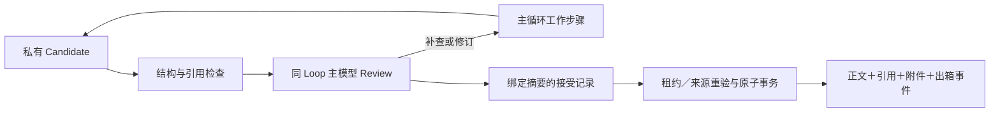

# 第 23 课 · 通用校验与答案交付的代码设计

[主方案](TECH_DESIGN.md) · [回答契约](EVIDENCE.md) · [知识库专题](VECTOR_SEARCH.md) · [离线阅读版](CODE_DESIGN.html)

**2026-11-22 实现核对版。** 下列入口对应本轮实际源码，代码块摘录现有定义。验证结果见 验收记录。

## 1. Loop 与工具注册

| 入口 | 实际责任 |
| --- | --- |
| harness/executor.py::AgentLoop.execute_tools | 共用 prepare、accept、dispatch、RepeatStep；公开响应采用通用回调 |
| runtime/turn.py → answer_turn.py | answerProtocol=2 时装配答案协议；仍调用同一个 execute_tools |
| runtime/tool_bindings.py | 工具执行后调用 after_tool_batch；完成能力和 status_only 控制公开投影 |
| tools/catalog_contracts.py / contracts.py | 可选 evidence_adapter、completion、public_projection 字段；默认值兼容已有工具 |
| tools/builtin/final_answer | 静态 SPEC、参数 Schema、私有候选收据；不执行业务操作 |
| context_runtime/evidence.py | 执行域内证据与批次记录，重放复用已签收结果 |
| context_runtime/answer_verification.py | 结构、引用、计算和 Review 绑定，返回下一步动作 |
| runtime/store.py | 校验接受记录与输出摘要；原子保存正文、引用、产物和出箱事件 |

完成能力独占一批调用。混合批次在实际执行与审批之前整体拒绝；完成工具不占业务工具次数。MCP 的返回内容无法自授 completion 能力。静态与动态工具由同一注册表装配，模型工具目录容量沿统一契约限制为 32。

## 2. 结果适配与知识库

文档适配器保留段落版本、字符定位及 Web 来源句柄；查询适配器保留真实行列、单位、范围和完整状态。Python 结果登记父查询 ID，Journal 将其关联到本执行域证据。MCP／工作流使用通用产物回执，保留内容摘要和所有者权限句柄，具体业务字段继续作为结果数据。

适配器只接收已签收的结果。没有适配器的工具照常执行并记录观察；适配失败返回引用定位反馈。恢复先读已持久化的批次与证据，保持 ID、修订和语义一致。

知识库默认装配。documents/service.py 首次执行时通过 journal.local_read 固定资料；同 Run 的并发首次调用共用锁和持久 pin。空库保留 no_library / no_indexed_documents，跳过 Embedding，返回可继续处理的空结果。工具每次读取都使用当前可信身份访问 Web owner。新 Run 不读取搜索工作区开关。

## 3. Verify 决策与接入

```python 实际决策定义
@dataclass(frozen=True)
class Decision:
    action: Literal["accept", "act", "revise", "partial", "review"]
    feedback: str = ""
    body: str = ""
    citations: dict | None = None
```

before_delivery 是纯检查函数。review 动作由 answer_turn 把下一次主模型调用设为 purpose=verify，工具列表置空；结果仍经现有持久模型调用、预算和取消机制执行。Review 使用原问题、候选和当前证据，声明目标覆盖、模式与每项结论的支持程度；程序复核候选摘要、证据修订和完整 ID 集合。

当前 plain 和 evidence 都走同主模型审阅。act / revise / partial 通过普通反馈回到工作步骤。已经准确说明缺口、满足部分交付条件的候选可以接受。通用终态 verify_result(hooks) 继续处理只读一致性，不在 hook 中隐藏第二次模型调度。

```python 实际交付预算预留
def needs_delivery_reserve(budget, route, output_tokens):
    """Forecast delivery headroom from settled usage; hard limits stay in the budget."""
    if budget is None:
        return False
    if budget.steps >= budget.limits.steps - 3:
        return True
    if not budget.attempts:
        return False
    profiles = [
        p
        for p in budget.profiles
        if (p.provider_id, p.binding_version) == (route.provider_id, route.binding_version)
    ]
    if not profiles:
        return False  # The budget's normal reservation reports unsupported profiles.
    # A profile's input bound may span the provider's entire context window.
    # Reserving it repeatedly would close tools before even a small task starts.
    tokens = budget.tokens // budget.attempts + output_tokens
    cost = budget.cost_microusd // budget.attempts + max(
        output_tokens * p.output_microusd for p in profiles
    )
    child_tokens = sum(c.limits.tokens for c in budget.children)
    child_cost = sum(c.limits.cost_microusd for c in budget.children)
    return (
        budget.tokens + child_tokens + 3 * tokens > budget.limits.tokens
        or budget.cost_microusd + child_cost + 3 * cost > budget.limits.cost_microusd
    )
```

工作步骤与工具额度临近上限，以及 Token／成本的已结算用量估计无法覆盖继续工作、候选和审阅三次调用时，仅保留完成能力。模型及工具批次实际耗时用于估计交付时间。所有实际调用仍按原预算器预留与结算；硬预算不足结束为未完成状态。

## 4. 候选、审阅与发布边界



私有记录键：answer/v2/candidate/{id}、answer/v2/evidence/{id}、answer/v2/batch/{path}/{step}、answer/v2/accepted/{id}。身份由 Run、执行路径和实际调用派生；候选参数只返回 candidate_received，不公开草稿和 Review 文本。

接受记录绑定 candidateDigest、evidenceRevision、textDigest、citationsDigest、artifactDigest、mode、completion 和 executionPath。store.finish 要求根执行域的持久接受记录与本次参数、正文、引用及附件完全一致。取消阻止终稿发布；恢复沿既有租约和幂等出箱执行。

content.answerMode 与 content.completion 仅随被接受的正文发布。旧消息省略这两个字段，新初始空消息保持原投影。前端按显式模式选普通 Markdown 或 CitedAnswer；引用目录中的 revision 和 textDigest 绑定正文，点击再取详情。旧引用存储键保留，公共读取入口已迁到 context_runtime/citations.py。

## 5. 权限与兼容

新工具调用的拒绝是工具反馈，可以继续使用其他获准工具。已经进入当前模型上下文的来源被撤权时，复用既有来源重验终止该 Run，并限制历史、引用和产物读取；后续新问题重新执行。当前上下文没有实现局部清除后继续生成。

子 Agent 按注册的效果、审批、本地变更、编排与完成元数据继承当前可见的只读能力，模型上下文使用 intermediate 角色。返回内部中间结果和证据，需要用户确认的事项交回父级，父 Agent 负责最终候选。旧 Run 保留固定的旧协议和搜索快照恢复；新 Run 的查询、候选和发布不进入旧搜索专属裁决分支。原零售场景判断留在历史兼容路径，默认协议仅使用通用目标、来源、计算和模型审阅。

## 6. 验证入口

- test_answer_protocol.py：模式、引用、计算、目标、Review 摘要、部分交付、混合批次、预算与旧消息序列化。
- test_document_tools.py：首次并发 pin、空库跳过 Embedding、来源 owner 重验。
- test_context_runtime_integration.py：真实 PostgreSQL 上的 plain / evidence / schema fallback、Markdown／CSV／看板、原子发布、拒绝被改写正文、恢复复用。
- Web 知识库集成与真实浏览器：资料来源、正文边界、引用入口、窄屏及键盘操作；具体运行记录见验收文档。

工具观察中的 `recordRef` 是指向同一回执原始结果的 JSON Pointer，仅合并完全相同的记录。未完全相同的记录仍完整展示，私有证据与摘要保持原样，旧协议观察继续兼容。

候选和 Review 的输出额度以模型与预算能力为界，最高 8,192 token；普通问答的历史 2,048 token 默认值不再限制新协议的结构化候选。截断输出不执行工具，返回缩短重提反馈。父子共享的模型步骤也预留提交与审阅空间。

子任务回传证据 ID；父级适配器声明 `importEvidenceId`，通用 `after_tool_batch` 从当前 Run 私有存储导入原记录并复核来源关系。导入保持原 ID、工具与调用关系，模型观察只展示事实定位。Review 保留完整事实和证据摘要，权限记录继续在服务端用于恢复、发布与回看重验。

Review 的模型回执继续持久提交检查点，当前 worker 接着完成接受与发布检查。该边界不主动交还租约，避免发布前再次完整重放历史。进程退出仍从已有模型回执恢复；工作模型步骤保留原调度边界。
