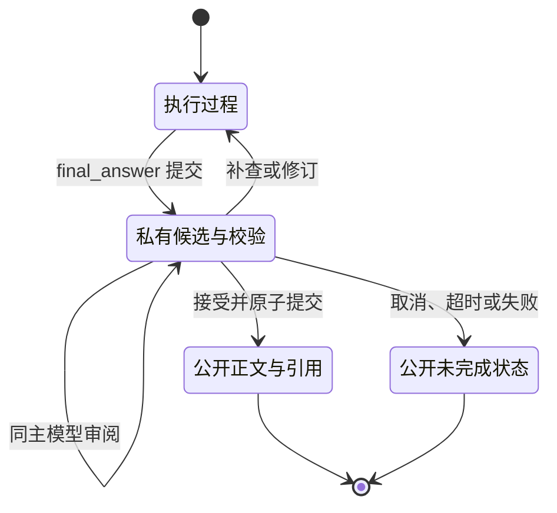

# 第 23 课 · 回答路由、校验与引用契约

[主方案](TECH_DESIGN.md) · [代码设计](CODE_DESIGN.md) · [离线阅读版](EVIDENCE.html)

**本册按当前实现核对。** 定义普通回答和循证回答共用的候选协议，以及候选如何变成可公开的正文。现有引用记录、来源回看与 `CitedAnswer` 组件继续复用；`final_answer`、统一决策和候选字段已实现。

## 1. 一次提交，两种回答

`final_answer` 是通用内置工具，参数使用 `mode` 判别联合。模型调用意味着“提交一个准备交付的候选”。Runtime 先接收私有候选，完成校验后发布。工具本身不向前端写正文。

| 参数             | plain                                      | evidence                                        |
| ---------------- | ------------------------------------------ | ----------------------------------------------- |
| `mode`           | `plain`                                    | `evidence`                                      |
| `completion`     | `complete / partial`                       | `complete / partial`                            |
| `coveredGoalIds` | 声明已回答的目标；简单任务使用根问题目标   | 同左；交付前对照原问题复核                      |
| `unresolved`     | 未解决目标、原因、可行下一步；完整回答为空 | 同左，缺口与正文结论保持一致                    |
| `body`           | 非空 Markdown；普通文本中的 [n] 保持普通文本      | 不使用此字段                                    |
| `claims`         | 不使用此字段                               | 事实、解释、建议及其依据，字段见第三节          |
| `blocks`         | 不使用此字段                               | 有序正文块，引用 claim ID；服务端据此排版、编号 |

候选修订、摘要、提交者、Run 与执行域由服务端赋值，禁止模型自报。结构大小沿现有参数与答案字节限制控制。附件通过可选 `artifact={format, title, evidenceIds}` 声明，format 为 markdown / csv / dashboard。Markdown 使用已核正文；CSV 与看板从登记的查询结果取值，产物与正文共同接受审阅和发布。

```json 一个普通回答候选
{
  "mode": "plain",
  "completion": "complete",
  "coveredGoalIds": ["root"],
  "unresolved": [],
  "body": "GMV 表示一定口径下的商品交易总额。具体是否扣除退款，需要结合当前业务采用的指标定义。"
}
```

通用概念、澄清、操作说明与执行状态走 plain。查询结果、公司制度及据此给出的业务判断走 evidence。用户已提供的材料也可登记为 `user_input` 来源，并标明“用户提供”，无需强制另行搜索。若只解释暂不可用的状态，plain 可作为部分答复；它不携带尚未得到支持的业务事实。

模型提出模式，`before_delivery` 检查模式与任务要求、正文内容和来源声明是否一致。规则检查能识别字段冲突；涉及内容语义时由同主模型审阅。无须为每个 Run 预选一种模式，也无工作区回答模式开关。

## 2. 执行过程与正文的三个状态



1. **Working。** 原有 execution nodes 展示获准的工具调用、进度和执行说明。每轮没有工具调用的文本继续属于过程，直到它通过声明的交付协议提交。
2. **Pending。** final_answer 工具只展示安全状态。候选参数、正文、审阅文本、校验细节保存在私有记录；工具回执为 `candidate_received` 和服务端候选身份。若继续模型调用，先写入配对的 tool result，保持 Provider 对话协议完整。
3. **Published。** 校验通过后保存最终消息、引用和事件。前端以已发布消息为正文依据。普通回答用 Markdown；循证回答使用带角标的 blocks。发布前不流式展示候选正文。

公开事件允许带通用的“继续核对资料／正在整理回答”说明。提交失败只改变执行节点状态。内部校验和候选内容也需从 trace 投影、公共 SSE、历史工具详情与子 Agent 结果预览中排除。子 Agent 使用既有中间结果协议，私下向父级交回结果与证据 ID；父级通过通用导入端口读取当前 Run 的原记录，保留原 ID 与来源关系，再统一提交候选。只有根执行域发布最终正文。

## 3. 循证候选的最小结构

一条 `claim` 包含 `id`、`kind`、`text`、`refs`，可选 `calculation`。`kind` 为 `fact / interpretation / recommendation`。事实可指向原文或结果格；解释与建议可以引用已核事实，注明适用条件或不确定性。依赖关系必须无环并最终落到已登记来源。

| 引用类型       | 必需定位                            | 校验内容                                                               |
| -------------- | ----------------------------------- | ---------------------------------------------------------------------- |
| 文档／用户材料 | `evidenceId`、段落 ID；精确摘录可加字符区间 | 来源版本、哈希、边界和原文；搜索候选片段保留定位，需完整语义时回读原文 |
| 查询／指标     | `evidenceId`、行键或行号、列名      | 真实值、数据类型、单位、对象、时间范围、覆盖／样本状态                 |
| 计算产物       | `evidenceId`、产物摘要、输入来源 ID | 当前 Run 的计算回执、输入版本、派生关系、可回看产物                    |
| 已核结论       | `claimId`                           | 先校验依赖，再校验当前结论；循环与悬空引用拒绝                         |

`blocks` 使用 `paragraph / list / comparison_table`。段落与列表通过 claim ID 组织正文；中性标题、连接语可用 text 字段，语义审阅同时检查这些文本中的事实。比较表的每一格从引用叶子取值，差额与环比从服务端计算，基期为零返回约定显示。`comparison_brief` 迁为 `comparison_table` 布局，解释与行动仍使用同一套 claims 和支持检查。

```json 循证回答候选示意
{
  "mode": "evidence",
  "completion": "partial",
  "coveredGoalIds": ["amount_change"],
  "unresolved": [
    { "goalId": "cause", "reason": "尚缺经营过程记录", "nextStep": "补充投放与可售记录" }
  ],
  "claims": [
    {
      "id": "c1",
      "kind": "fact",
      "text": "本期支付 GMV 为 88 万元。",
      "refs": [{ "evidenceId": "ev-current", "row": 0, "column": "paid_gmv" }]
    }
  ],
  "blocks": [{ "type": "paragraph", "claimIds": ["c1"] }]
}
```

示例 ID 与金额仅解释结构。真实候选必须引用当前 Run 登记且允许回看的证据。`calculation` 复用有界表达式，仅接受来源叶子、明确单位和获准运算；数值从私有结果重取。生产校验器维护通用取值、计算和引用规则。投放比例、整档采购与日历等场景判断由真实资料、通用计算和模型审阅处理，讲师金标准留在 Showcase。

服务端能程序核对“某格是 880000 元”及计算结果；“降幅由晚场投放导致”涉及解释支持程度，进入语义审阅。发布记录分别保存程序核对与模型审阅结果。

## 4. Verify 反馈和停止规则

`after_tool_batch` 为可适配的结果登记 Evidence，同时保留空、拒绝、故障等 Observation。观察记录包含 `callId`、工具身份、状态、源版本、范围、原始结果定位和摘要；派生证据带父来源。注册适配器失败时不生成引用，原工具执行事实保留并给出可修复反馈。持久完整性异常沿运行失败路径处理。

`before_delivery` 顺序处理结构、程序可核事实、目标／支持审阅、来源当前可访问性。plain 与 evidence 均使用同一主模型的一次受预算审阅调用。Review 包含原问题覆盖情况、每项结论的支持／冲突、缺口和可行动建议；审阅记录绑定候选摘要及证据修订。

Review 回执先持久保存，当前 worker 随即完成接受与发布检查；该边界不主动交还租约，避免最后一次审阅后额外重放历史。进程中断仍复用已保存回执，继续执行相同检查。

| decision                 | 含义                           | 回流                                 |
| ------------------------ | ------------------------------ | ------------------------------------ |
| `accept`                 | 候选满足当前完整或部分答复契约 | 发布器提交已检查的修订               |
| `revise`  | 候选格式或结论表达需要修复     | 将具体问题送入下一轮                 |
| `act`     | 缺少有机会取得的必要资料       | 主模型依据缺口选工具                 |
| `review`  | 本候选需要尚未执行的语义审阅   | 同 Loop 的 analyze 阶段，工具关闭    |
| `partial` | 剩余缺口无法在现有条件下解决   | 主模型形成范围清楚的部分答复，再校验 |

程序校验与语义审阅均不得把未经检查的候选直接发布。工具访问拒绝作为观察回到主循环，可以查询其他获准资料或用 plain 说明状态。已经进入模型上下文的来源撤权时，现有运行权限重验终止该 Run，并对历史正文、引用及派生产物应用受限投影；下一 Run 重新取得当前授权。硬预算耗尽则结束运行状态，不伪造正常完成消息。

搜索充分性以原问题的目标覆盖、结论依据和未解决冲突为核心。目标可随用户补充与实际发现修订，始终保留原要求。重复引用、重复结果、无关材料不增加目标进展。工具调用上限与模型预算沿现有机制计量，交付预留不足时提前进入部分回答。

## 5. 编号、保存和引用回看

Evidence 与候选复用现有 Run 私有 `AgentMessage` 记录；记录键按协议版本命名。模型只选择来源 ID 与定位。发布器先按正文出现顺序为通过校验的引用生成角标，重复引用复用编号，再派生正文与 citation anchors。渲染器生成的位置和 `textDigest` 绑定，前端无需从自然语言猜测引用关系。

| 发布字段                           | 用途                                                |
| ---------------------------------- | --------------------------------------------------- |
| `content.answerMode / completion` | 选择普通／循证呈现与完整／部分完成状态              |
| 正文与结构化角标                   | 已校验的唯一最终消息，定位至对应引用                |
| `revision, textDigest`             | 绑定当前正文与引用目录，避免不同修订串用            |
| 来源详情索引                       | 保存证据 ID、原始定位、版本、派生依赖和重验所需句柄 |

在既有持租提交／事件出箱机制内，正文、引用、修订和发布事件一次提交。以 Run、执行域和候选修订作为幂等键，恢复发现已提交记录时复用它。最终提交前核对候选摘要和证据修订仍与接受决定一致；变化则回到校验。跨服务权限检查复用所有者接口，公开读取也重验当前资格。

公开消息新增 `content.answerMode 与 content.completion`；消息修订位于 `MessageSnapshot.revision`。已接受的部分回答使用 `completion=partial`，消息可正常 completed。完整公开字段、SSE 信封和点击引用用例统一见[主方案第七章](TECH_DESIGN.md#7-前端推理接口协议)。

沿用引用目录和详情两个 GET 接口。目录仅提供当前允许公开的角标摘要；详情通过来源 owner 重开原文或查询结果，核对版本、定位、哈希和当前身份。内部记录区分过期／失效、无权与暂不可用；公开错误沿用现有 403／404 与 BFF 503 约定。引用正文、标题、缓存、历史摘要和派生结论共同受该投影约束。

资料编辑、停用或撤权后，旧 Run 的私有记录保留；对外历史与 SSE 回放根据当前来源状态显示受限提示或允许内容。所有依赖该来源的计算值、摘要和产物同步纳入检查。新 Run 再次调用文档工具时固定新的可用版本。

## 6. 验证

覆盖 plain 概念解释、澄清、无资料说明；evidence 单格取值、原文、比较表、多来源解释和部分回答。刻意提交混合工具批次、悬空引用、错误单位、过期 Review、缺失用户目标、无根据的普通模式业务结论，确认反馈回到通用 Loop。检查发布前撤权、发布事务重试、跨实例恢复与前端刷新，确保只有已接受修订进入正文。

本轮已执行候选、目标／Review 绑定、计算、预算、工具批次与 PostgreSQL 原子发布／恢复验证；真实模型及浏览器结论统一记录在 验收记录，历史课堂金标准保留原结论。
