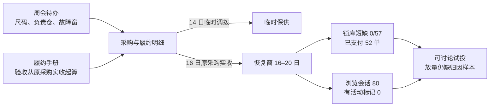

# 第 23 课 · Retail 数据准备与验收

[返回技术方案](TECH_DESIGN.md) · [需求与金标准](PRD.md) · [通用运行时代码设计](CODE_DESIGN.md)

本册维护工作区的时点副本、文档包、履约指标增量和既定业务验收。2026-11-22 按默认通用 Loop 更新装配边界；数据值和 PRD 金标准保持。新增回答协议与 Verify 尚待实施。生产 Skill 使用业务口径和检索方法。题目、反事实变体和评分留在讲师环境。

## 1. 运行快照

原实现把课堂范围聚合到 SearchSnapshot。本版把课堂时点与数据隔离留在 Showcase 装配侧：受限数据库连接固定零售 release 与 K 时点副本，文档来源服务按资料发布版本与业务日期约束可读内容。通用 Run 仍复用语义发布清单和 PromptOps pin；文档工具首次调用固定可读资料版本，版本身份进入工具回执。生产 Agent 不增加案例 ID、固定日期或来源开关分支。普通 Chat 与模型工具参数无法修改可信租户、角色或扩大已授权范围。

- **经营截止 K** 决定“到开会时知道什么”。案例 K 为 `2025-10-09T09:00:00+08:00`，数据为 `diagnostic-v3-20261019`。指标默认截止取受信 K 和 Run 接受时间的较早者。显式历史截止只能进一步收窄。文档发布日期、事实可见时间和数据水位受同一上界约束。
- **业务适用日** 决定“哪份规则管这件事”。例如复投使用复议日，返补使用申报对应的销售月份。历史查询可打开已发布的旧版。报价内预告的上线时间可以晚于 K，其发布日期必须早于或等于 K。截止时刻按报价原文和业务时区解释。
- **当前权限** 按实际请求时刻重新读取。资料重新分级、成员被移除、连接被撤销立即影响后续读取。历史 Run 保留内容版本，不继承历史访问资格。对后续新问题重新接受 Run 并固定其版本。
- 普通数据源在现有 `semantic/service.py` 中默认以 `journal.accepted_at` 为截止。课堂历史截止通过受限数据源与已有查询参数体现，相关版本写入工具来源说明和执行回执。任一绑定校验失败，由对应工具报告来源状态，不自动改连完整数据集。

### 时点副本怎样约束任意只读 SQL

为课堂准备一个可重建的 **K 时点 PostgreSQL 只读副本**。学员连接只获准访问该副本的业务表及必要元数据。运行时沿用 `database_query`，由数据库保证即使模型省略时间条件也读不到后来才可见的记录。

1. 课程装配器读取已分发的快照和分发校验和，使用独立候选目标，按关系维护切片清单。事实依 `available_at <= K`、水位依 `observed_at <= K` 筛选。有多版本记录时保留 K 前可见历史，由相应查询按业务窗取有效版。对维表、关系依赖、带版本或有效期的记录逐表声明判定方式。引用的父行不可见时排除其子行，维度与字典只暴露业务所需列。可提前得知的采购计划保留其当时已发布的内容。
2. 保持受批绑定依赖的 schema、基表形状、原始 RLS 与 session-user 守卫（学员 schema 的 `allowed`，独立发布配置为 `sec.allowed`）检查，用发布工具的区域受限身份复验 `session_user`、必需关系、历史水位。拒绝未列入清单的表、指导答案、其他数据库和完整库连接。阻止经数据库元数据、沙箱挂载或其他工具绕回原库。课程副本仅提供必要的授权连接。已有零售源、旧活动清单及全量分发文件保留原状。
3. 放行前用独立讲师连接对同一 K 重算 G1～G5、B、C，并用受限角色核对可见值、未来行、跨区数据及 9 月日结覆盖缺口。记录 release、切片清单版本、K、产物摘要与连接修订。因权限或完整性无法还原的表标为不可用。新 K 对应新副本，已有 Run 不改连。

这项准备换取了自由 SQL 与正式指标的相同时点边界。固定的经营日、租户映射和验算 SQL 都留在课程装配侧。生产工具保持通用。

## 2. 文档包和访问边界

### 包、段落与访问范围

Web 读取按摘要挂载的只读资料包。导入时仅接收[学员材料清单](PRD.md#fr-01--每份材料只写作者当时能知道的事)的七份原件，显式列出相对路径。发布前核对正文和清单摘要、文号与版本、发布人、时区、段落唯一性、发布与有效期、制度审批状态和受众工作区。整包准备好后切换新 Run 指针，保留旧摘要可读。Web 是包的唯一服务入口，Agent 通过内部 HTTP 访问。

| 数据粒度       | 主要字段 / 不变量                                                                                                   | 用途                                                                                                                                       |
| -------------- | ------------------------------------------------------------------------------------------------------------------- | ------------------------------------------------------------------------------------------------------------------------------------------ |
| 来源版本       | `collectionDigest, kind, docId, version, issuer, publishedAt, approvedAt?, validFrom, validTo, audienceWorkspaceId` | `kind` 分 knowledge / history / external。日期区间左闭右开，商业截止保留原文精度。文档可另指定适用的业务期间和对象                         |
| 可检索段落     | 标题层级、稳定 `sectionId`、正文摘要哈希、原文、作者使用的别名/业务键                                               | 纪要按待办，制度按条款，报价表与表头、单位、整档限制同段或相邻可读。多条资格条件和适用范围随命中一起展开                                   |
| 工作区来源绑定 | 工作租户/工作区、获准资料包、来源类别、授权受众工作区                                                               | 私有材料的受众对应现有 Web 工作区成员组。把角色/区域交集映射到对应组，例如“华东渠道报价可阅”。公开日历按资料服务的工作区归属与访问规则提供 |
| 可回查引用     | `kind=document, tenant, workspace, collectionDigest, docId, version, sectionId, sectionHash`                        | Web 根据受信清单重建受众和原文。引用中不接受客户端提供的权限声明                                                                           |

Web 对服务凭据和 Run 上下文验真，从服务端身份解析当前活动成员。要求业务工作区可使用 `module.analysis`，受限资料另查同租户 `workspace_member` 的**显式成员关系**，并同时满足固定版本与当前发布方的访问范围。资料撤回、分段停用、ACL 映射缺失或权限服务不可用时，由来源服务封闭该结果。当前限制覆盖同一文号的旧版本。管理角色的通用放行不能替代私有资料的受众成员资格。班级环境为授权组显式配员，可单独撤掉报价组并保留业务工作区。这一选择复用现有成员 CRUD，代价是每个独立受众要维护一个组。首版无需新权限码与数据表。

### 模型工具与 Web 接口

**Agent 提供两个业务工具** `search_documents`、`read_document`。每个工具在 `tools/business/<tool_name>/` 导出 `SPEC`，经既有 catalog 和 runtime bindings 装配。同步提供 `prompts/tools/search_documents.json`、`prompts/tools/read_document.json`，由 PromptOps 按已固定的 generation 读取工具声明。工具目录测试核对参数 schema、声明与执行入口一致。两者对各类工作区可复用，具备文档后端的部署即可注册；调用时由工具确认资料和权限，获准范围内没有知识库就返回空状态。沿用内部 service token、可信用户与 Run 作用域的传递方式，Web 重新鉴权。普通 Chat 的提交入口沿用现有契约；最终消息按新答案协议增加模式与完成范围，候选保持私有。已发布断言的详情通过独立只读端点获取。模型侧工具签名、内部服务操作和交付草稿属于本次变更。

| 调用                                                            | 输入                                                          | 返回与边界                                                                                                                                    |
| --------------------------------------------------------------- | ------------------------------------------------------------- | --------------------------------------------------------------------------------------------------------------------------------------------- |
| `search_documents` → 内部 `POST /api/internal/documents/search` | 自然语言 query，可选类别、实体/文号、业务适用日和历史查询意图 | 仅在有权的候选中打分。默认前三段，返回来源、版本、适用期、定位、短片段、可继续查的业务键和 `ref`。同文相邻段落可读。摘要亦登记来源            |
| `read_document` → 内部 `…/read`                                 | 上一轮已发出的 `ref`，可选同一文档的相邻段                    | 重验主体、K、版本与段落哈希，每次按段取原文，保留表头、单位及上下文。越界相邻段单独鉴权，重复读取可复用同一已授权观察                         |
| 首次文档调用 / 重验 → 内部 `…/pin`、`…/verify`                  | 可信上下文、包标识或同一 Run 的一组引用                       | pin 固定获准资料版本，支持空视图。verify 批量确认当前可访问性，不返回原文。Agent 私有状态保存内容。普通用户看不到内部 token、私有路径或评分卡 |

发布时对 Markdown 使用 NFC 规范化。线上词法检索对文本做 NFKC、小写和中文相邻双字切分，分别按文号、标题与章节名、别名、正文赋予 6、3、2、1 的权重。查询先缩小到授权范围、发布日期和适用期，再做精确文号匹配与分字段 BM25 排序。词频统计只用可见候选。优先精确编号、标题与别称，平分依稳定的文号/版本/段落键。需要审批的制度只进入已批准且批准时间不晚于 K 的集合。知识、纪要可按历史业务日期查询，当前签批时优先适用版本。同级条款冲突返回双方。角色筛选在标题、补全、片段、计数及评分之前完成。内容包可跨请求缓存，授权集合与检索结果按当前身份重新计算。投放复议的七份材料使用词法检索。华东 GMV 工作区另绑定 1024 维向量索引。

**原件上的设计验证。** 使用离线召回探针，在 PRD 指定的各自来源内固定可见版本，以标题、段标题和正文三个字段的 BM25 评分取前三。仅分词时，12 个问法命中 9 个。漏掉的是“能动几成”“最小一档多少钱”“周六上班吗”。加入“几成→比例/额度”“一档→档位”“上班→工作日”等七个词条，复跑同一输入命中 12/12。运行时将这类词条作为可审阅的通用业务词表随来源包发布，不把问答对、文号或排名写入提示词。该实验使用指定类别和有效原件，线上仍需实测模型选源、混合候选、ACL、版本与历史查询，并用未参与调优的问法检验泛化。

| 观察状态             | 模型看到什么                                               | 能做的下一步                                                     |
| -------------------- | ---------------------------------------------------------- | ---------------------------------------------------------------- |
| 已命中 / 已确认零    | 段落引用，或齐备回执中的 0、单位和范围                     | 提取实体继续补查，或直接交付                                     |
| 无匹配 / 不可见引用  | 搜索对无可见命中统一返回空。定向读取只给“该资料当前不可读” | 改业务叫法、按已知编号找，或列明缺口。无权标题与命中数量均不出现 |
| 过期 / 不齐 / 无样本 | 已有权限的资料标明适用期。指标保留水位、覆盖或样本状态     | 找有效版本或独立的授权事实。过期报价留在历史说明，采购建议待确认 |
| 暂不可用 / 预算耗尽  | 可重试标志、剩余预算或停止原因                             | 有预算且故障短暂才重试。合法路径用尽时交付已核部分               |

## 3. 指标与明细怎样接起来

同一个 Run 必须能在取得正式指标后继续查采购实收，也能从实收行回到正式缺货率。模型接口见[主方案](TECH_DESIGN.md)，五项指标及明细边界见下表。正式指标与明细查询都经自身工具权限执行，主 Agent 依据任务选择，不再要求搜索专用 independent_detail 放行。

| 问题                                           | 本轮能力                                                                    | 正确取数边界                                                                                               |
| ---------------------------------------------- | --------------------------------------------------------------------------- | ---------------------------------------------------------------------------------------------------------- |
| 渠道这三个月赚回多少销售款                     | 复用 `sales.paid_gmv`、`sales.net_gmv`，区分销售部门的“销售额”和“扣退款”    | 华东、微信小程序、三个自然月，支付与退款按各自成功发生月分别汇总，底层单位分                               |
| 出问题的尺码卖出多少，今天仓里有多少           | 复用 `channel.reported_paid_amount` 与 `inventory.closing_available_qty`    | 前者按销售渠道、SKU、最新齐备日报。后者按履约地点、SKU、单日日结。期间覆盖缺口和真实零分别返回             |
| 有多少订单锁不住货                             | 新增 `fulfillment.allocation_insufficient_rate`，给出分子、分母、比例和状态 | 尝试时刻、租户和尝试 ID 唯一。订单表补渠道，履约地点取尝试所在仓，SKU 取尝试记录                           |
| 怎样区分计划、调拨和采购实收，以及识别投放样本 | `database_query` 沿采购行查改期与实际入库，按商品浏览会话检查活动标记       | 采购行、库存流水、会话各按自己的键归集，再对齐窗口。访客人日与跨日去重会话分别呈现，缺少标记的归因留待试投 |

新增指标绑定沿用现有参数、relation 清单、`result_schema`、水位与运行回执。授权区、渠道、履约地、SKU 可组合过滤，时间窗用业务时区的左闭右开区间。OMS 和 WMS 都齐备后，分母统计 COMMITTED、INSUFFICIENT、ROLLED_BACK，分子只统计 INSUFFICIENT。日分组和全窗值分别按尝试数加权。跨日比率由分子分母重新相除。空窗输出 `NO_FACTS` 和空值，已齐备且有尝试而无短缺才输出比率 0。水位未知或延迟保留 `COVERAGE_UNKNOWN` / `SOURCE_DELAYED`。回执 `detail` 返回两个计数、来源水位与阈值判断所需的实际样本，声明 `ratio` 为 0～1。

Web 以**增量资产**发布新指标、绑定与术语。已有指标需要改别名时创建该身份的新修订。沿用既有定义审核、绑定试算、双人审批、发布清单与部门范围。保留 v1 安装包及校验摘要。现有 `retail-semantic-seed.mjs` 对重复身份和摘要有保护，实施采用既有草稿/发布入口装入差异，不把重跑 v1 安装器作为更新方式。验收涵盖干净安装、已有 v1、重复准备、旧 Run 的固定清单以及未批准时的行为。

## 4. 课堂验收

### 默认经营意见的对照值

下表供讲师评审。完整字段、适用条件和只读查询见 [PRD 金标准](PRD.md#3-主案例金标准)。模型仅能访问正式经营资产、学员业务记录及获准原件。

| 需要作出的判断         | 冻结输入下的验收值                                                                                                                                                                                                                        | 最容易选错的事实                                   |
| ---------------------- | ----------------------------------------------------------------------------------------------------------------------------------------------------------------------------------------------------------------------------------------- | -------------------------------------------------- |
| G1 渠道趋势            | 7、8、9 月支付 GMV 为 352,968.20、73,684.75、204,550.95 元，净 GMV 为 293,736.05、19,810.70、180,840.20 元。两者均 8 月下探、9 月回升                                                                                                     | 渠道级现金流与单一 SKU 的商品日报混用              |
| G2–G3 履约断点与恢复窗 | SKU 435、苏州履约地点 7。9 月 7–11 日，80 个浏览会话、68 单提交、0 支付，68/68 次锁库短缺。DOC13392 原计划 9 月 6 日到，9 月 4 日获改期通知，14 日调拨 80 件，16 日采购实收 400 件                                                        | 把调拨或计划作为恢复窗起点                         |
| G2、G4–G5 恢复和承接   | 9 月 16–20 日，80 个浏览会话、79 访客人日、57 单提交、52 单支付，实付 18,673.20 元，0/57 次锁库短缺，0 个活动标记浏览会话。10 月 8 日日结 407 − 1 = 406 件                                                                                | 把未标记流量归为付费，把 10 月库存反推到 9 月      |
| G6 采购意见            | H-0912 余额 20,000 元。K-17 v2 要求净额回升、至少 30 次尝试、短缺率至多 5%、可用至少 100 件，均达到。缺少放量所需的 20 个归因会话与消耗回款。按 40% 得 8,000 元。E-1009 当前可订 6,000 / 15,000 元，建议选 6,000 元，留 14,000 元，待签批 | 选内部上限作为采购额，或者在没有付费样本时建议全量 |
| G7 行动                | 华东渠道经理在 10 月 9 日 15:00 前回函。如期于 10 月 10 日 10:00 上线，由同一负责人 10 月 11 日 10:00 复核缺货率、活动标记会话、实际支出                                                                                                  | 漏掉调休工作日，把签批建议写成已购买               |

**一条可能的补查路径。** 下图记录观察之间的依赖。模型也可以先查月度口径，再从周会纪要定位商品。

### 评测矩阵与发布决策

下面保留原 PRD 的实验条件。实验中的删源和“关 Skill”通过隔离测试装配与 PromptOps 修订完成；新架构的 D23-01～07 另按主方案验证。历史成功记录对应旧协议。

| 验收               | 实验与隔离                                                                                                                                                                    | 判断口径                                                                                                                                                                                                                                                     |
| ------------------ | ----------------------------------------------------------------------------------------------------------------------------------------------------------------------------- | ------------------------------------------------------------------------------------------------------------------------------------------------------------------------------------------------------------------------------------------------------------ |
| AC-01 单源质量     | 七份材料，六组正式/口语问法逐条检索，另测当前/历史版。五个指标问法走正式发现、解析与受控执行                                                                                  | 12/12 在前三段中有足够原文继续工作，五项分别命中正确口径、粒度和预期状态。记录首次漏召回、错版本、丢表头                                                                                                                                                     |
| AC-02 主案例       | 普通 Chat 以销售部门 101.sales、华东只读身份，3 种问法各起 2 个全新会话。每组固定模型和采样配置                                                                               | 至少 5/6 次分别完整通过 G1～G7。每个通过样本都有五类贡献及可验证的跨源适应。金额到分，计数精确，比率展示误差至多 0.01 个百分点                                                                                                                               |
| AC-03 删源与改报价 | 单独禁用语义、原始明细、企业知识、历史、外部五种能力，清理该源派生缓存与会话记忆。禁用明细时保留受控指标执行。禁用语义时保留原始明细。文档类别筛选作用于发现、读取和已知引用  | 对应缺口依次为正式回执、实收与归因过程、规则比例、挂账对象/余额/负责人、可选档位/时限/日历。分别抽掉报价、日历核对局部缺口。仅将 08:45 新函最低档改为 9,000 元，上限仍 8,000，两档均超额，暂缓并保留 20,000 元                                               |
| AC-04 迁移与短路径 | 同一 Skill 跑财务对账 B、门店返补 C 及简单问数。C 再将附批改为 8 月到期                                                                                                       | B 的 9 月退款 23,710.75 元，归原支付月 8,994.00 / 4,360.60 / 10,356.15 元，前期合计 13,354.60 元。C 的上海 14,088.75、杭州 84,212.80，普通门槛 100,000、杭州特批 80,000，仅杭州达标。附批到期则两店均不达标。单问 9 月净额得 180,840.20 元，无关来源调用为零 |
| AC-05 时间与权限   | 切换租户同名材料、未来制度、到期报价、被撤权的报价组、9 月 10 日日结。在已召回后分别触发交付、恢复、回看和文件读取                                                            | 无越权标题、计数、片段、历史摘要或派生余款泄露。9 月日结保留覆盖不足。越权、虚构回执、超额、资格不齐仍采购任一发生即淘汰候选                                                                                                                                 |
| AC-06 成本与退化   | 同题同身份同模型同采样、同快照、同预算比较“仅 SQL”“仅语义”“全源关 Skill”“全源候选”。再固定 Skill 单改 systemPrompt、或固定 systemPrompt 单改 Skill。限额 2 次，另测持续源故障 | 报完整通过次数/总数、每 Run 实际派发和无增益重复次数、token、费用可计量性、用时中位及最慢值。硬限制最多 2 次，无增益重复成功派发为 0。候选须达 AC-02、硬项全部通过，完整通过次数至少与全源基线持平，同等效果选成本较低者                                     |

删源与关闭方法的对照均在讲师隔离环境实施：用来源服务权限／资料状态或测试装配的工具适配器制造对应缺口，用独立 PromptOps 修订比较方法效果。语义缺失组清除该来源预取和历史结果，明细缺失组保留受控指标内部查询。文档删源在来源所有者处落实，覆盖检索、回读与引用回看。各组使用新会话与隔离缓存；生产 Run 不新增搜索开关或来源白名单。

讲师在独立环境先运行参考 SQL，锁定输入摘要、连接角色、来源可用组合、语义清单、模型与采样配置、systemPrompt 与 Skill 修订、预算。每个 Run 关联“问题—动作—观察—下一步/停止”，分记检索排名、有效版本、工具引用、派发数量、耗时、模型 token 与费用。无法计价标为“未计量”。保存 G1～G7 逐项判定、失败原因与授权可看的记录。默认案例也检查同类资料确实支撑具体判断，仅调用一次来源不算贡献。失败先定位到召回、口径、关联、停止或交付，再改一个变量，用一条未参与调参的等义问法回归。

## 5. 华东 GMV 工作区与投放复议的区别

| 课堂问题                    | 经营时点与来源                                                      | 交付                                                                                         |
| --------------------------- | ------------------------------------------------------------------- | -------------------------------------------------------------------------------------------- |
| 节后跑鞋引流款怎么批        | 10 月 9 日 09:00，retail 冻结副本、正式指标、七份知识/历史/外部材料 | 复核可承接条件、制度比例与整档报价，目标以 evidence claims 组织签批意见                      |
| 华东支付 GMV 为什么下降 12% | 11 月 4 日 12:00，10 月两周的九表合成账本与 12 份业务原文           | 读取支付口径、投放排期、可售货池和门店券后，目标以 evidence 比较表与结论块交付贡献和优先行动 |

第二组案例的装载、授权和重新发布步骤见课堂入口。仓配线索需要区分月台签收、验收入库和前台可售三个时间。经营侧以实际前台可售为恢复点，结合缺货拒绝与支付变化复核判断。该工作区的经营文档和讲师复算分别存放，只有 corpus 中的业务原文进入向量索引。

### 管理课堂资料

在华东工作区的「知识文档」打开「华东经营分析资料库」。按文件名称搜索投放或库存资料，打开文档后可用分段搜索定位条款。「查看原文」保留导入时的 Markdown。课堂装载入口为案例目录下的 import_library.py，它逐段核对已发布索引的哈希，沿用向量。再次运行会保留用户之后编辑的分段和开关。演示修改时可以单独创建练习库并上传资料。
