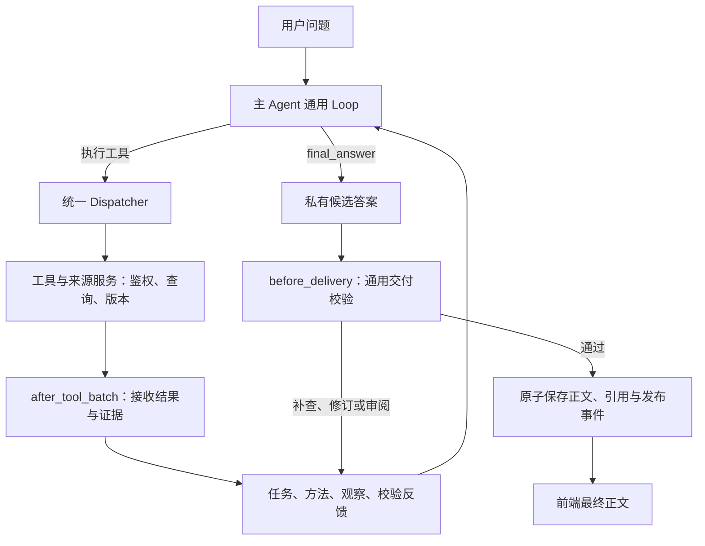
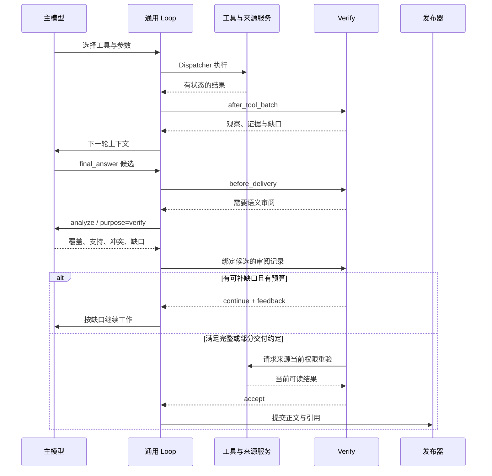
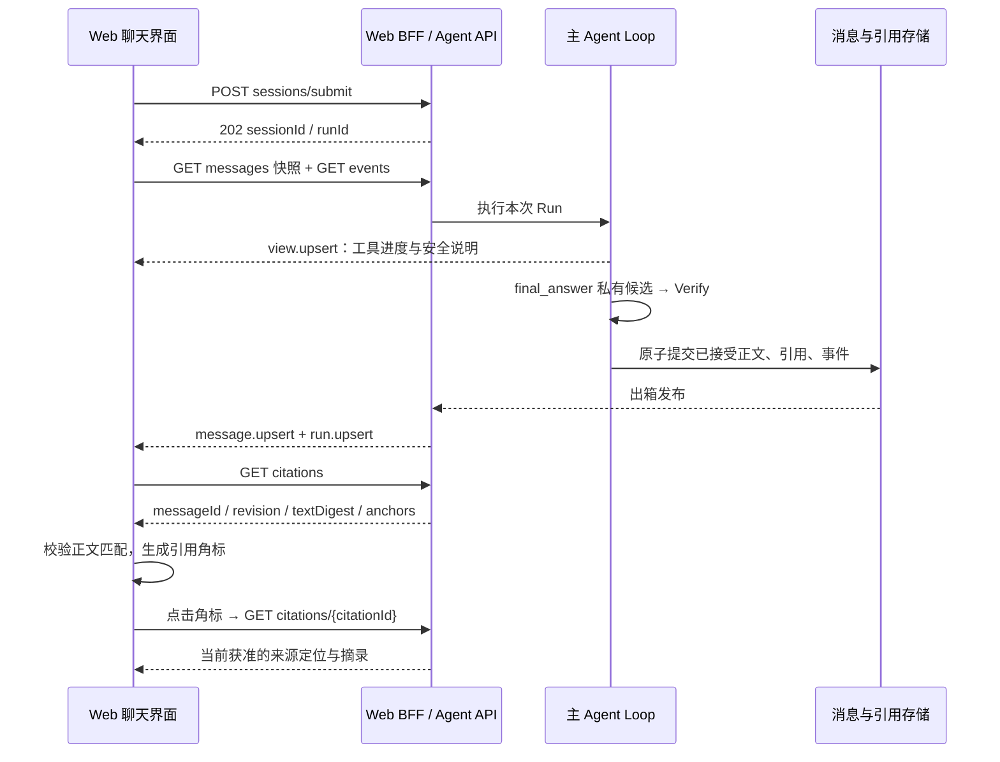

# 第 23 课 · 通用 Loop 中的 Agentic Search 与回答交付

需求简报 · [离线阅读版](TECH_DESIGN.html) · [回答与引用契约](EVIDENCE.md) · [供评审的代码设计](CODE_DESIGN.md) · [知识库与向量检索](VECTOR_SEARCH.md) · [课堂数据与验收](RETAIL_CASE.md)

| 项目              | 本版约定                                                                                                                                                    |
| ----------------- | ----------------------------------------------------------------------------------------------------------------------------------------------------------- |
| Feature / Profile | 973 / standard；沿用本 Feature 主方案与专题结构，按本次范围重新组织                                                                                         |
| 状态              | **实现与验收核对版**。2026-11-22；新 Run 已接入通用协议，验证结果与未通过项单列                                                                             |
| 实现基线          | Compass `98bda8b` 及当前工作区；现有知识库、检索工具、持久 Run、普通 Chat 和搜索专用分支分别核对                                                            |
| 需求依据          | 本轮确认：移除搜索模式开关，复用通用 Loop，权限在工具层执行，Verify 通用接入，普通／循证回答灵活路由，执行过程与最终正文明确分界                            |
| 既定业务验收      | [PRD](PRD.md) 的 FR-01～05、BR-01～02、AC-01～06 保留。本轮约定替代旧方案的搜索开关、来源白名单和专用交付流程；PRD 本次保持原文，技术差异在本文登记 |

本课建设三块能力：**补齐知识库检索；让主 Agent 在通用循环内按缺口查找和验证；通过统一交付入口输出普通回答或循证回答。** 搜索方法默认进入适用任务的上下文。工具执行时处理当前用户权限与来源状态。模型提交候选答案后，Runtime 校验，再把通过的答案交给前端正文区。

## 1. 交付范围与现有实现的调整

| 能力     | 实施前基线                                                                                                | 本版目标                                                                                                     |
| -------- | ------------------------------------------------------------------------------------------------------- | ------------------------------------------------------------------------------------------------------------ |
| 知识库   | Web 管理、索引、文档检索和原文读取已存在                                                                | 保留能力；文档工具首次调用时固定可用资料，工具层返回无库、无命中或访问受限状态                               |
| 搜索循环 | `COMPASS_SEARCH_WORKSPACES` 固定搜索快照；多个执行与呈现分支依赖该快照，`skillEnabled` 控制搜索方法注入 | 新 Run 使用通用 Loop；移除搜索模式和方法开关，按任务／阶段装配方法，保留 SQL、代码执行、MCP、子 Agent 等能力 |
| Verify   | 搜索路径直接调用 `verify_batch`、`verify_draft`；另有终态 `verify_result(hooks)`                        | 在工具批次返回后、答案提交后接入两个通用检查点；可修复问题回到同一个 Loop                                    |
| 回答     | 无工具调用的模型输出进入搜索草稿校验；断言草稿与比较简报采用不同校验路径                                | 新增统一 `final_answer` 工具，`plain / evidence` 两种模式共享候选、校验和发布流程                            |
| 界面     | 持久执行节点与最终助手消息已分离；搜索路径额外压制中间文本                                              | 按输出通道区分过程与正文；候选答案在发布前保持私有，保留正常执行进度                                         |

本版增加七条架构验收，业务金标准继续使用原 PRD。

| 编号               | 可判定结果                                                                                                 |
| ------------------ | ---------------------------------------------------------------------------------------------------------- |
| D23-01 默认循环    | 无搜索开关也能跨源检索；同 Run 的代码执行、MCP、子 Agent 与既有工具审批链路正常                            |
| D23-02 工具权限    | Agent 无来源 ACL 副本；无知识库、无匹配、拒绝访问、服务故障产生各自约定的工具反馈                          |
| D23-03 通用 Verify | 新工具通过结果适配器接入，无需在 Loop 增加工具名分支；未接证据适配器的工具仍可运行                         |
| D23-04 回答路由    | 概念解释／澄清走 plain；基于查询数据或企业资料的事实答复走 evidence；每次交付独立选择                      |
| D23-05 正文边界    | final_answer 只提交候选；校验通过、持久提交后才出现最终正文，失败草稿不闪现、不进入回放                    |
| D23-06 搜索充分性  | 对照用户原问题检查目标覆盖、结论依据、冲突与缺口；有用补查继续，无进展／预算不足时交付明确的已知部分与限制 |
| D23-07 恢复与撤权  | 重放不重复发布；恢复、发布、历史与引用回看均由来源所有者重验当前权限                                       |

模型检索接口继续复用 `search_semantics`、`get_metric_definition`、`resolve_semantics`、`query_metric`、`database_query`，保留本课新增的 `search_documents`、`read_document`。复杂任务可使用已有 `todo_write`。本次设计再新增一个通用内置工具 `final_answer`。工具数量属于建设范围统计，实际可调用集合由既有 catalog、能力与阶段规则装配。

知识库的 Web 管理、解析、索引、检索测试及 HTTP 所有权详见[知识库专题](VECTOR_SEARCH.md)。正式指标、比率口径和课堂数据见[课堂专题](RETAIL_CASE.md)。历史验收中，投放复议的完整业务通过数为 0/6，后续华东 GMV 比较简报有普通 Chat 成功记录；这些记录描述旧协议。本版架构验证、真实 Chat 与未通过项见本轮验收。

## 2. 通用 Loop 与工具边界



沿用 `harness/executor.py::AgentLoop`、既有阶段推进、Dispatcher、RuntimeJournal、预算和取消机制。Agentic Search 的动作来自主模型每轮对工具结果与缺口的判断。无需增加专用 Search Agent；已有子 Agent 可以在任务确有独立子问题时使用，其预算、作用域和返回值沿通用委派链路处理。

**Run 固定什么。** 接受 Run 时仍固定 PromptOps generation、语义发布清单、可信运行主体、时区和预算。新增内部答案协议版本用于新旧 Run 兼容。知识资料版本改为文档工具首次执行时按当前权限取得并持久固定；并发首次调用共用同一份 pin。无可用资料时保存空 pin，本 Run 的后续调用保持同一资料视图；新增资料在下一 Run 可见。权限撤销始终即时重验。

**工具负责什么。** `search_documents / read_document` 的 handler 经 Web 资料服务鉴权；语义工具经语义服务检查可用定义与执行绑定；`database_query` 沿连接授权和数据库只读身份执行。Run 的主体取自受信上下文，模型参数无法指定租户、角色或提升权限。资料清单仅表达已选版本。Agent 不维护 `search.kinds`、搜索专用连接白名单或 `READ_TOOLS` 限制。

现有工具 catalog 的能力注册与执行审批继续生效。工具是否有后端实现属于部署装配；知识库是否存在、用户能读哪些材料在实际调用时由工具处理。工作区管理页的文件与分段启停继续有效，它们属于资料状态。

| 工具反馈                                              | 含义与下一步                                                                 |
| ----------------------------------------------------- | ---------------------------------------------------------------------------- |
| `ok`                                                  | 有结果；零值同时保留范围、单位、水位与覆盖状态                               |
| `empty: no_library / no_indexed_documents / no_match` | 在用户获准范围内没有库、可检索文档或匹配结果；模型可换查询、换工具或说明缺口 |
| `rejected: access_denied`                             | 当前操作被拒绝；返回安全原因，不暴露不可见标题、数量或内容                   |
| `error: document_service_unavailable`                      | 来源暂不可用；保留服务故障代码，是否重试由剩余预算与任务决定                   |

以上是工具内部结果的规范化语义，继续兼容现有执行回执的外层状态。列表搜索中被权限过滤的材料对模型不可见，空结果不披露其是否存在。直接读取已失效的引用可以明确报告当前不可读。业务 SQL 的零行、指标覆盖不足和服务故障各自保留真实状态。

通用 Dispatcher／Journal 保留持久调用幂等与恢复，Evidence 按执行路径、步骤和调用身份复用已签收记录。新 Run 不设置搜索专属的重复查询拦截；模型根据已有结果决定是否重查。恢复缓存仍复核当前来源权限。正式指标后可继续查 SQL 明细。

## 3. Context Runtime 与搜索方法

Context Runtime 在已有任务／场景／阶段选材中加入搜索方法和交付契约。移除工作区搜索开关和 `skillEnabled` 分支；短概念解释可以直接回答，资料调查按缺口逐步调用工具。

| 上下文       | 装配位置与内容                                                                                  |
| ------------ | ----------------------------------------------------------------------------------------------- |
| 平台与任务   | 保留用户原问题、职责、阶段、预算、已有任务状态和输出通道约定                                    |
| 通用搜索方法 | query / analyze：拆目标、按缺口选工具、候选后读原文、根据结果改问法、处理矛盾和决定停止         |
| 场景方法     | 复用 PromptOps 场景资产，例如金额／比率口径、归因方法、历史制度适用期；只装配当前任务适用的小包 |
| 工具观察     | 实际获准结果、来源版本、查询范围、状态和必要原文；资料正文作为数据进入上下文                    |
| 回答约定     | final_answer 的统一契约，以及 plain / evidence 的输出指导；evidence 额外提供可引用 ID 与定位    |
| 校验反馈     | 未覆盖目标、无效引用、冲突、下一步建议和剩余预算；保留对用户原问题的对照                        |

```text 通用搜索与交付方法的核心约定
先明确用户需要得到哪些结果。简单任务直接执行；复杂任务维护计划。
依据当前缺口选择工具；用实际返回的实体、时间或线索调整下一问。
候选片段用于定位，结论引用可核对的原文、查询格或计算产物。
遇到空结果、拒绝访问或故障时，依据工具状态调整；记录尚未解决的缺口。
提交 final_answer 前对照用户原问题检查覆盖、依据与冲突。
概念解释、澄清与状态说明使用 plain；依赖资料或数据的事实答复使用 evidence。
收到校验反馈后继续补查或修订；预算不足时缩小答复范围并说明限制。
```

方法包负责行为指导，Runtime 负责结构、预算、发布时机与可核对值。遵守既有上下文预算和 tool-call/result 配对；压缩结果时保留来源句柄、范围与状态。旧数值只有在本轮采纳、版本和权限相容时才进入事实上下文。

现有搜索路径对推理、narration 和工具详情的整体隐藏分支退出。可展示的执行说明继续走过程通道；最终候选和私有校验记录采用明确的可见性规则。正文发布策略见第五节。

## 4. Verify 的通用接入

**技术形态：两个通用生命周期检查点，一组按结果类型工作的检查函数。** 在现有 Loop 的派发适配层接入，检查结果用统一决策返回。通用检查器不调搜索工具；需要补查时把缺口交还主模型，由下一轮自主选择工具。

| 检查点             | 输入                                           | 执行与输出                                                                                       |
| ------------------ | ---------------------------------------------- | ------------------------------------------------------------------------------------------------ |
| `after_tool_batch` | 已签收的工具调用、结构化结果、可信执行上下文   | 从工具注册的结果适配器提取观察／证据；登记状态与来源；返回本轮新增信息和缺口。失败调用也保留状态 |
| `before_delivery`  | 候选答案、用户原问题、任务目标、证据修订、预算 | 校验格式、路由、目标覆盖、引用和值；请求同一主模型审阅；返回接受、继续或要求部分交付       |

**怎样接新工具。** 在现有 `ToolSpec / RegisteredTool` 增加可选结果适配器。数据库工具提取查询行列；文档工具提取版本和段落；语义工具提取指标回执。通用 Loop 只调用统一端口。未提供适配器的 MCP／工具结果仍是观察，可以继续用于工作；若要进入可追溯引用，需提供来源适配或落为可回看的产物。代码计算可以登记输入证据和输出产物，保留派生关系。工具专属校验留在工具目录。

**哪些可用程序检查。** 候选结构、模式字段、Run 所属、引用存在、原文位置与哈希、查询行列、范围／单位、计算表达式和值、目标 ID、预算与修订绑定。当前访问资格由工具／来源服务提供重验接口，检查点只调用该接口。

**“搜够了”怎样判断。** 用户原问题中的目标是否被覆盖、解释是否得到所引材料支持、是否遗漏冲突，含有语义判断。复杂调查、归因与行动建议在候选提交后，由**同一个主模型**在既有 `analyze` 阶段执行一次 `purpose=verify` 的审阅调用。输入包括原问题、候选、来源摘录、目标和缺口，输出覆盖判断、支持情况、冲突和下一步。该调用计入通用模型预算，审阅步骤不执行工具，不引入独立搜索 Agent。Runtime 按固定策略处理审阅结论。

当前实现对普通简短回答、单格取数、直接引用和复杂解释统一执行语义审阅，检查模式选择与目标覆盖。结构、定位与计算由程序先核对。审阅结果绑定 `candidateDigest + evidenceRevision`，输入变化即失效。模型审阅属于质量检查，程序核对与模型判断在记录中分别标注。最终发布前仍须重验当前权限。



“搜够”看的是目标完成程度。一个直接问题取得一份适用回执即可结束；多目标问题要分别有答复或明确的未解决项。初始目标也要对照原问题复核，避免遗漏用户要求。跨源次数、总命中数、todo 完成数都只记录过程。同主模型 Review 根据目标、实际结果和缺口判断是否继续；重复结果与无关新增来源不增加目标覆盖。当前版本没有新增通用无进展计数器。

| 判断                                             | Loop 动作                                                                      |
| ------------------------------------------------ | ------------------------------------------------------------------------------ |
| 格式／引用／值有可修复错误                       | `continue(next=revise)`；返回具体字段错误，修订后重新校验                      |
| 存在可补的事实缺口                               | `continue(next=act)`；携带缺口，下一轮由模型选工具                             |
| 需要判断支持程度或目标遗漏                       | `continue(next=review)`；同主模型在 analyze 阶段审阅                           |
| 已有可靠结果，余下缺口在预算或可用来源内无法解决 | `continue(next=partial)`；要求候选声明已完成范围、限制和下一步，随后校验再接受 |
| 内容完整，或部分答复已经清楚声明范围             | `accept`；保留 `completion=complete / partial`                                 |
| 超时、取消、租约丢失、持久状态损坏               | 沿现有运行失败／取消路径退出；未经接受的候选保持私有                           |

预算提前预留交付／必要审阅调用；搜索工具预算耗尽后仍允许本地 `final_answer` 提交。模型总预算硬耗尽且没有合法候选时，只提供执行状态与未完成原因。无效补查由方法提示与 Review 引导调整，运行硬上限沿既有预算执行。Verify 内部不发起工具调用。

现有 `harness/verification.py::verify_result(hooks)` 继续承担终态只读检查，其失败语义保留。可恢复的搜索缺口接到上述 `before_delivery`，使主循环有机会补查；事务、租约与最终一致性继续由已有运行设施守护。首版固定组合这些检查函数，无新增插件管理平台或第二套调度框架。

## 5. 普通回答、循证回答与正文边界

**统一入口为新内置工具 `final_answer`，参数 `mode` 选择 `plain` 或 `evidence`。** 它执行一次本地候选提交。调用返回后先校验，接受后由发布器生成最终消息。每次候选独立选择模式，Run 不锁定“搜索模式”。完整字段由[回答与引用契约](EVIDENCE.md)维护。

| 场景                                             | 模式与约束                                                                  |
| ------------------------------------------------ | --------------------------------------------------------------------------- |
| 概念解释、澄清问题、操作说明、资料不可用说明     | `plain`；提供正文与完成范围，沿用基础完整性检查                             |
| 经营数值、企业制度、文档事实、查询后的比较与建议 | `evidence`；提供正文块、结论与来源定位，程序核值并执行同主模型语义审阅            |
| 事实不足                                         | 可交付部分循证答复并列明缺口；完全无可用事实时可用 plain 说明状态／请求补充 |

路由由模型根据任务和实际候选内容提出，`before_delivery` 依据任务要求和引用字段检查。依赖业务事实的同一段结论在循证校验失败后，仍须补齐或删减相关结论；切为 plain 不解除该任务的事实依据要求。两种模式都允许带明确限制的部分回答。

`final_answer` 必须独占一个工具批次；和搜索／写操作混在同批时，在任何派发发生前拒绝整批并要求重提。Registry 用可信的完成能力元数据识别该调用，通用 Loop 无需判断某个工具名字符串。参数执行前完成 schema 和运行状态检查。子 Agent 的完成只结束自身执行域，回到父 Agent 的结果端口；父 Run 正文由父级发布器提交。

模型输出无工具调用的自然文本时，仍按本轮执行说明处理，并提示通过交付入口提交。对支持结构化输出但缺少原生工具调用的 Provider，generate 阶段由已声明的答案 schema 归一为同一候选。两者都不支持的模型在能力预检给出明确原因。禁止用文本前缀、Markdown 标题或“这一轮没有工具”猜测正文边界。

| 边界               | 后端与前端行为                                                                                         |
| ------------------ | ------------------------------------------------------------------------------------------------------ |
| 模型 → Runtime     | final_answer 的参数与草稿为私有候选；其工具节点只展示“整理回答／校验中”等安全状态                      |
| Runtime → 发布存储 | Verify 接受且当前权限检查通过后，原子保存正文、引用、`textDigest`、修订与事件；使用 Run 与候选修订去重 |
| 发布事件 → 前端    | 过程区域消费 execution nodes；正文区域只消费发布器已提交的最终助手消息，普通与循证答案使用相同边界     |

用户所说的 COT／执行过程区域沿用现有运行节点。可公开的 reasoning、narration、工具状态按现有规则展示。候选正文和审阅内部文本不进入公共 SSE、历史过程详情、调试摘要或子 Agent 预览。拒绝草稿只能产生安全的进度反馈。

第一版采用**校验后发布完整正文**。前端收到接受后的消息可使用现有打字动画；生成中的候选 token 留在服务端。完成消息附 `mode` 和 `completion`，界面据此选择普通 Markdown 或带角标的循证渲染。`RunCompleted` 与完成消息保持现有提交顺序，部分回答单独显示“已完成部分／仍有缺口”。

## 6. 证据、引用与知识库持久化

复用现有 Web 知识库表、资料版本、Agent Run 私有记录和引用只读接口。本次循环与交付重构无需新增数据库表、独立证据服务或向量基础设施。

| 对象               | 保存位置与责任                                                     |
| ------------------ | ------------------------------------------------------------------ |
| 工具观察／Evidence | Agent 既有私有记录；结果适配器登记来源、范围、定位、状态与派生关系 |
| AnswerCandidate    | 同一 Run 私有记录；区分候选修订、模式、正文块、结论和未解决项      |
| VerificationRecord | 同一 Run 私有记录；程序结果、主模型审阅、输入摘要、证据修订和决策  |
| PublishedAnswer    | 已接受的助手消息及引用记录；正文、角标、详情、摘要和修订一起提交   |
| 资料正文／ACL      | Web 或对应来源所有者；检索、读原文、发布和回看时执行当前权限检查   |

正文使用结构化引用位置，由服务端为引用编号，模型提供的原始链接或 `[1]` 文本不直接成为可点击来源。沿用已有引用目录与详情两个 GET 接口、`CitedAnswer` 呈现。程序校验通过只允许发布所校验的候选修订。

撤权影响引用详情、依赖该材料的结论及派生计算。恢复、历史消息、SSE 回放与产物访问复用来源重验端口，返回受限状态或重建允许公开的投影。Web 管理员修改或停用分段后，旧引用的哈希／可用状态按原资料契约失效，新 Run 使用新版本。历史内容与私有审计记录继续保存。

Web 知识库既有迁移为 `web/main: 0009 → 0010_knowledge_library`，来源与恢复流程见[知识库专题](VECTOR_SEARCH.md)。本版新增私有记录使用现有 AgentMessage 存储，无新 DDL；实施时若发现容量或事务结构必须新增迁移，应补齐迁移 owner、版本及恢复设计后实施。

## 7. 前端推理接口协议

**前端继续使用同一套 Session / Run 接口。新增内容集中在已发布助手消息的回答元数据；证据通过现有引用目录与详情接口传递。** `final_answer` 是模型在 Runtime 内调用的工具，浏览器提交的内容仍是用户问题。

以下协议已落入 DTO、发布事务与 Web 组件。沿用现有接口路径、`compass.run` v2 信封和引用 DTO；新增 `content.answerMode / completion` 明确正文路由与完成范围。接口示例使用虚构制度内容，展示各字段怎样关联。

**接口变化一览**

| 前端 HTTP 接口（前缀 `/api/web/v1/analysis`） | 本版变化                                                      | 传递内容                                                            |
| --------------------------------------------- | ------------------------------------------------------------- | ------------------------------------------------------------------- |
| `POST /sessions/submit`                       | 请求与 202 回执保持现有结构                                   | 问题、模型选择、会话、requestId；无搜索开关，无调用者指定的回答模式 |
| `GET /runs/{runId}/events?after=…`            | 保留 `event: agent` 和 v2 信封；助手消息增加 `content.answerMode / completion` | 过程节点、已发布正文、模式、完成范围、正文摘要                      |
| `GET /sessions/{sessionId}/messages`          | 快照中的助手消息同步增加相同字段                              | 刷新和历史回看复用同一消息模型                                      |
| `GET /runs/{runId}/citations`                 | 复用 `RunCitations`，绑定本次发布修订                         | 引用 ID、编号、正文位置及正文摘要                                   |
| `GET /runs/{runId}/citations/{citationId}`    | 复用 `CitationDetail`，每次重验来源                           | 结论、核验状态、计算说明、来源版本、定位与摘录                      |

所有浏览器请求沿用登录 Cookie。POST 同时携带同源 `Origin`、`Content-Type: application/json` 和 `X-CSRF-Token`；`tenantId / workspaceId` 在 POST body 或 GET query 中传入。Web BFF 校验当前身份后构造受信上下文，代理到 Agent 的 `/v1/analysis` 对应路径；服务凭据只在服务端使用。成功及失败响应均沿用 `no-store`。



**新增 Schema 与已有引用 Schema**

下列 TypeScript 表达 HTTP JSON 字段，便于前后端一起阅读。正式契约仍在 Agent `schemas.py` 定义，再生成 OpenAPI、JSON Schema 与 Web 类型。`MessageContent` 增加可选的 `answerMode` 与 `completion`。旧消息和运行中的空占位省略它们，保持既有投影和修订一致。正文摘要继续放在引用目录。

```typescript 公开回答与引用字段
type UUID = string;
type Sha256 = string; // UTF-8 正文的 SHA-256，小写 64 位十六进制

interface MessageContent {
  text: string; // 保留：最终 Markdown，包含服务端生成的 [n]
  artifactIds: UUID[]; // 保留：公开产物 ID
  answerMode?: "plain" | "evidence" | null; // 仅发布器填写
  completion?: "complete" | "partial" | null; // 用户消息、空占位及旧消息省略
}

interface MessageSnapshot {
  messageId: UUID;
  ordinal: number; // 本 Run 中的消息顺序
  role: "user" | "assistant";
  revision: number; // 消息修订，和候选内部修订分别管理
  status: "streaming" | "completed" | "incomplete";
  content: MessageContent;
}

// 已有：目录修订必须等于 MessageSnapshot.revision。
interface RunCitations {
  messageId: UUID;
  revision: number;
  textDigest: Sha256;
  anchors: Array<{
    // 最多 96 个，按正文位置排序、互不重叠
    citationId: UUID;
    ordinal: number; // 显示编号，从 1 开始
    start: number; // Unicode 码点下标，闭区间起点
    end: number; // 开区间终点，text[start:end] 等于 [ordinal]
  }>;
}

// 已有：详情的 revision 表示详情自身修订。
interface CitationDetail {
  citationId: UUID;
  claimId: UUID;
  revision: number;
  status: "supported" | "refuted" | "insufficient" | "contested";
  statement: string;
  calculation: string | null;
  sources: Array<{
    // 最多 64 个，均为当前允许公开的来源
    kind: "metric" | "definition" | "detail" | "knowledge" | "history" | "external";
    title: string;
    version: string;
    locator: string; // 段落、查询单元格或其他来源定位的可读说明
    scope: string; // 时间、门店、组织等适用范围
    excerpt: string;
  }>;
}
```

`content.answerMode / completion` 与消息正文、引用目录来自同一次发布。`textDigest` 对实际返回的 `content.text` 原始 UTF-8 字节求 SHA-256，包含空白、换行和角标；前端校验时保持原文。角标位置按 Unicode 码点计数，Web 使用 `Array.from(text)`，服务端使用同一规则。模型内部的 evidenceId、候选草稿、Review 和访问句柄留在 Agent 私有记录。

新协议的已发布助手消息必须带 `answer`。用户消息和初始空助手消息可为 null。受限投影撤去不可读正文及其回答元数据，并显示安全的访问状态；前端清除该修订的引用缓存。历史旧消息走已有读取适配。外层 `AgentResponse.version=2` 继续表达传输协议；内部答案存储版本单独管理。

**完整 API 用例：提问、交付、角标与溯源**

示例沿用一个已经打开的会话。用户问“现行制度规定的退货期限是多少天？”；主 Agent 检索制度并提交循证候选。

**① 提交问题。** 以下是浏览器发给 BFF 的请求，`selection.mode=auto` 沿用当前主模型选择。`requestId` 用于提交幂等；重试同一次请求时保持不变。新会话可将 `sessionId` 设为 null。

```http 提交用户问题
POST /api/web/v1/analysis/sessions/submit
Content-Type: application/json
Origin: http://localhost:8100
X-CSRF-Token: <当前登录会话的 CSRF token>
Cookie: <当前登录 Cookie>

{
  "tenantId": "10000000-0000-4000-8000-000000000001",
  "workspaceId": "10000000-0000-4000-8000-000000000002",
  "requestId": "10000000-0000-4000-8000-000000000003",
  "sessionId": "10000000-0000-4000-8000-000000000005",
  "question": "现行制度规定的退货期限是多少天？",
  "selection": {
    "mode": "auto"
  }
}
```

返回 `202 Accepted`：

```json SessionAccepted 回执
{
  "sessionId": "10000000-0000-4000-8000-000000000005",
  "runId": "10000000-0000-4000-8000-000000000004",
  "streamUrl": "/v1/analysis/runs/10000000-0000-4000-8000-000000000004/events",
  "session": null
}
```

`streamUrl` 沿用当前 Agent 回执中的路径。浏览器根据 `runId` 访问下列 BFF 路径。先刷新该会话的 messages 快照，再使用快照 `cursors` 中本 Run 的 seq 订阅；下例用示意游标 `1795334390000-0`。

```http 加载快照并订阅本次 Run
GET /api/web/v1/analysis/sessions/10000000-0000-4000-8000-000000000005/messages?tenantId=10000000-0000-4000-8000-000000000001&workspaceId=10000000-0000-4000-8000-000000000002&runId=10000000-0000-4000-8000-000000000004

GET /api/web/v1/analysis/runs/10000000-0000-4000-8000-000000000004/events?tenantId=10000000-0000-4000-8000-000000000001&workspaceId=10000000-0000-4000-8000-000000000002&after=1795334390000-0
Accept: text/event-stream
```

**② 执行过程与正文分界。** 搜索、读原文、整理回答和 Verify 进度通过既有 `view.upsert` 的 `execution.node` 展示。`final_answer` 参数和候选 token 留在私有通道。校验接受后，发布器一次提交完整正文；初始 `streaming` 助手占位升级为 `completed`，示例消息 revision 从 1 增至 2。

以下是一帧交付事件的完整 `data` JSON。它前面可以已有多帧过程事件；这里按“消息、Run 终态”演示排列。消费者先归并整个信封，再读取消息和状态；两种事件在同批内的先后位置无需作为正文判断依据。

```text SSE 帧的外层格式
id: 10000000-0000-4000-8000-000000000004:1795334400000-1
event: agent
data: <下方 AgentResponse 压缩成单行 JSON>

每帧以空行结束；HTTP Content-Type 为 text/event-stream。
```

```json 交付帧的完整 AgentResponse
{
  "protocol": "compass.run",
  "version": 2,
  "sessionId": "10000000-0000-4000-8000-000000000005",
  "mode": "delta",
  "packets": [
    {
      "packetId": "10000000-0000-4000-8000-000000000004:delivery:0",
      "runId": "10000000-0000-4000-8000-000000000004",
      "seq": "1795334400000-0",
      "requestId": "10000000-0000-4000-8000-000000000003",
      "occurredAt": "2026-11-22T08:00:00Z",
      "event": {
        "type": "message.upsert",
        "payload": {
          "messageId": "10000000-0000-4000-8000-000000000006",
          "ordinal": 2,
          "role": "assistant",
          "revision": 2,
          "status": "completed",
          "content": {
            "text": "退货期限为7天。[1]",
            "artifactIds": [],
            "answerMode": "evidence",
      "completion": "complete"
          }
        }
      }
    },
    {
      "packetId": "10000000-0000-4000-8000-000000000004:delivery:1",
      "runId": "10000000-0000-4000-8000-000000000004",
      "seq": "1795334400000-1",
      "requestId": "10000000-0000-4000-8000-000000000003",
      "occurredAt": "2026-11-22T08:00:00Z",
      "event": {
        "type": "run.upsert",
        "payload": {
          "ordinal": 1,
          "version": 4,
          "status": "completed",
          "reasonCode": null,
          "recoveryStatus": "ready",
          "cleanupStatus": "none"
        }
      }
    }
  ],
  "cursors": [
    {
      "runId": "10000000-0000-4000-8000-000000000004",
      "seq": "1795334400000-1"
    }
  ],
  "page": null
}
```

`packets` 由服务端生成稳定的 `packetId`；`seq` 是递增的流游标，`cursors[0].seq` 等于本帧最后一个 packet 的 seq。重连使用已经归并的游标。收到 `409 / 410` 等游标恢复响应时，沿既有流程重新取消息快照。`run.upsert` 表达任务生命周期；界面正文取 `message.upsert.payload.content.text`。内部 `RunCompleted` 经同一发布事务落到消息和运行事件，正文展示统一读取助手消息。

**③ 读取引用目录并展示角标。** 仅 `answerMode=evidence` 请求引用目录。模型写出的 `[1]` 文本须经过服务端引用发布流程才具有来源关系。

```http 读取当前正文的引用目录
GET /api/web/v1/analysis/runs/10000000-0000-4000-8000-000000000004/citations?tenantId=10000000-0000-4000-8000-000000000001&workspaceId=10000000-0000-4000-8000-000000000002
```

返回 `200 OK`，沿用现有 `RunCitations`：

```json 引用目录响应
{
  "messageId": "10000000-0000-4000-8000-000000000006",
  "revision": 2,
  "textDigest": "74b59980c57a8c07d5af83d0560ec2cdb54af67d5e39139a59d92ac6dcec7107",
  "anchors": [
    {
      "citationId": "10000000-0000-4000-8000-000000000007",
      "ordinal": 1,
      "start": 8,
      "end": 11
    }
  ]
}
```

本例 `text[8:11]` 正好为 `[1]`。前端同时检查 messageId、消息 revision、正文 SHA-256、角标范围和片段内容；全部匹配后，将这一片段呈现为可点击脚标。服务端按发布修订生成 citationId，旧目录与新正文无法串用。目录传输过程中，正文可以先以普通文本显示；失配时暂停角标并刷新当前消息／目录。

**④ 点击角标读取来源。**

```http 点击引用读取溯源详情
GET /api/web/v1/analysis/runs/10000000-0000-4000-8000-000000000004/citations/10000000-0000-4000-8000-000000000007?tenantId=10000000-0000-4000-8000-000000000001&workspaceId=10000000-0000-4000-8000-000000000002
```

返回 `200 OK`，沿用现有 `CitationDetail`：

```json 引用详情响应
{
  "citationId": "10000000-0000-4000-8000-000000000007",
  "claimId": "10000000-0000-4000-8000-000000000008",
  "revision": 1,
  "status": "supported",
  "statement": "退货期限为7天。",
  "calculation": null,
  "sources": [
    {
      "kind": "knowledge",
      "title": "退货制度（接口示例）",
      "version": "3",
      "locator": "退货条件 / 第1段 / 字符0–8",
      "scope": "当前工作区；现行制度",
      "excerpt": "退货期限为7天。"
    }
  ]
}
```

详情展示结论、核验状态、来源标题、版本、适用范围及原文摘录。`locator` 是定位说明，现有详情 DTO 不带可直接跳转的原文 URL。点击操作完成来源弹层溯源；若后续增加“打开原文”，须另行声明受权读取接口。

前端把详情请求绑定到当前消息修订与选中的 citationId；消息更新或作用域改变时取消旧请求、清空详情。详情的 `revision=1` 是详情自身版本，与本例消息 `revision=2` 各自计数。服务端只允许读取当前已发布目录中的 citationId。

**⑤ 普通回答、部分回答与历史回看。** 普通回答使用相同的 `message.upsert` 和 `run.upsert`；下面只展示其消息 payload，外层信封与上例一致：

```json 普通回答的消息 payload
{
  "messageId": "10000000-0000-4000-8000-000000000016",
  "ordinal": 2,
  "role": "assistant",
  "revision": 2,
  "status": "completed",
  "content": {
    "text": "GMV 表示一定时期内的商品交易总额。",
    "artifactIds": [],
    "answerMode": "plain",
      "completion": "complete"
  }
}
```

| 公开状态                          | 前端处理                                                                        |
| --------------------------------- | ------------------------------------------------------------------------------- |
| `answerMode=plain`               | 以 Markdown 显示正文，跳过引用目录请求                                          |
| `answerMode=evidence`            | 显示正文，匹配目录后生成角标，点击后请求详情                                    |
| `completion=partial`       | 已接受的部分回答；消息与 Run 都可为 completed，正文明确已完成范围、限制及下一步 |
| 消息 `status=incomplete`          | 沿用运行中断／取消等语义；新协议候选保持私有，执行区显示未完成状态              |
| 新协议初始 `streaming` 空助手消息 | 仅为占位；执行过程显示在节点区                                                  |

两种回答模式均支持 partial。正文的完成范围以 `completion` 表达；传输／运行状态保留各自含义。前端无需按工具名或正文正则选择回答模式。历史 GET 返回 `mode=snapshot` 的相同 `AgentResponse`：消息 payload 与实时发布一致，packet.seq 为 null，page 为分页对象，cursors 提供后续订阅位置。

引用目录或详情返回 404 时显示“当前无法查看这条引用”，并刷新当前消息投影；权限不足沿用 403，来源服务暂不可用由 BFF 返回统一 503，界面提供重试。公开错误继续使用现有错误信封，失效细因留在内部记录。引用不可读时，正文、派生结论及产物同步经过来源投影，缓存也随作用域与消息修订清理。

## 8. 按 App 划分的文件改动

以下目录树描述本版方案涉及的代码落点。`A` 表示本 Feature 新增文件，`M` 表示调整现有文件，`G` 表示从规范源生成。清单列出本轮实现的主要落点；详细文件职责见代码设计，验证结果见验收记录。

**Agent App：通用循环、结果适配、回答交付与公开协议**

```text Agent App 文件改动树
apps/agent/
├── src/compass_agent/
│   ├── schemas.py                          [M] answerMode / completion
│   ├── settings.py                         [M] 移除搜索工作区开关
│   ├── runtime/
│   │   ├── answer_turn.py                  [A] 候选、Review、反馈与预算预留
│   │   ├── turn.py / service.py            [M] 版本选择与默认装配
│   │   ├── tool_bindings.py / subagent.py  [M] 通用证据和私有中间结果
│   │   └── store.py / durable_service.py   [M] 接受记录与原子发布
│   ├── context_runtime/
│   │   ├── answers.py / answer_candidates.py [A] 类型与候选持久化
│   │   ├── evidence.py / receipt_evidence.py [A] 批次与通用回执适配
│   │   ├── answer_verification.py          [A] 引用、计算与审阅绑定
│   │   ├── answer_artifacts.py / citations.py [A] 附件与引用存取
│   │   └── model_step.py / profiles.py     [M] 同 Loop 的工作／审阅上下文
│   ├── documents/                         [M/A] 延迟 pin、空状态与 evidence
│   ├── semantic/evidence.py               [A] 查询和指标定义证据
│   ├── tools/
│   │   ├── builtin/final_answer/          [A] SPEC 与私有提交
│   │   ├── contracts.py / catalog_contracts.py [M] 适配及完成能力
│   │   ├── batch.py / dispatcher.py       [M] 完成批次与预算
│   │   └── mcp/service.py                 [M] 通用回执适配
│   ├── harness/executor.py                [M] 公开响应回调
│   └── prompts/                           [A/M] 完成工具与方法资产
└── tests/
    ├── test_answer_protocol.py            [A] 通用候选、审阅、预算
    ├── test_document_tools.py             [M] 并发首次 pin、空库
    └── test_context_runtime_integration.py [M] 交付、恢复、三种附件
```

通用终态 `harness/verification.py`、Redis 出箱传输和运行租约继续使用现有机制。改动集中在结果接入、候选检查和持久发布的调用边界。资料 pin 与工具适配的具体数据结构见知识库方案。

**Web App：来源权限、BFF 契约和正文／引用呈现**

```text Web App 文件改动树
apps/web/
├── src/components/analysis-run-turn.tsx    [M] 显式模式与部分回答提示
├── src/server/http/documents-handler.ts   [M] v2 pin 请求
├── src/server/modules/documents/
│   ├── contracts.ts / library.ts          [M] 新协议与空资料视图
│   └── search.ts / store.ts               [M] 首次 pin 与所有者权限
├── src/generated/
│   ├── api.ts                             [G] 消息元数据
│   └── model-contracts.schema.json        [G] 消息运行时 Schema
└── tests/knowledge-library.test.ts        [M] 空资料契约
```

Web 的账户、租户与知识资料授权沿用现有所有权。资料管理的完整 API、表结构和页面路径在知识库专题展开，本树列出本次通用搜索与交付调整直接涉及的文件。

**Home App：课程方案与两份阅读材料**

```text Home App 文件改动树
apps/home/
├── README.md                                   [M] 第 23 课分发说明
├── src/lib/lesson-resources.json                [M] 主方案、知识库方案两个入口
├── scripts/lesson-resources.mjs                 [M] 单课分发、链接处理与旧副本清理
├── tests/lesson-resources.test.mjs              [M] 两份材料的分发约束
├── turbo.json                                  [M] 两份材料的构建输入
└── public/resources/lessons/23/
    ├── technical-design.html                   [G] 主技术方案阅读版
    ├── technical-design.md                     [G] 主技术方案 Markdown
    ├── vector-search.html                      [G] 知识库技术方案阅读版
    └── vector-search.md                        [G] 知识库技术方案 Markdown
```

Home 目录保持两份方案，每份提供 HTML 和 Markdown。Memory App 本轮无改动。

**契约与方案源：与各 App 一起维护的文件**

```text 契约产物与方案源文件
contracts/
├── openapi.json                                [G] 从 Agent 路由与 DTO 生成
└── model-contracts.schema.json                  [G] 从 Agent DTO 生成
mai-specs/973-lesson-23-agentic-search/
├── BRIEF.md                                    [M] 主方案阅读入口
└── design/
    ├── TECH_DESIGN.md                          [M] 主技术方案，含接口与文件树
    ├── TECH_DESIGN.html                        [G] 同名离线阅读版
    ├── EVIDENCE.md                             [M] 候选与引用契约，链接公开协议
    ├── EVIDENCE.html                           [G] Feature 内回答契约阅读版
    ├── CODE_DESIGN.md                          [M] 对齐通用校验模块名称
    ├── CODE_DESIGN.html                        [G] Feature 内代码设计阅读版
    └── document/
        ├── guide.md                           [M] 八章阅读组织
        ├── edition.json                       [M] 图与代码的唯一源块索引
        └── README.md                          [M] 生成与单课同步说明
```

HTTP 契约以 `schemas.py` 与 FastAPI 路由为唯一源，已运行 `pnpm contracts` 生成；派生类型、Schema 和 Home 副本均通过现有入口更新。知识库仍使用 Web 既有迁移，候选与 Review 复用 Agent 私有消息记录，本版未安排新增数据库迁移。

## 9. 实施核对与验证入口

新 Run 固定 `contextRuntime.answerProtocol=2`。旧 Run 继续使用已固定的协议；旧搜索专用校验代码仅保留给历史恢复。通用引用存取已迁入 `context_runtime/citations.py`。

当前实现对 plain 和 evidence 都执行一次同主模型的语义 Review，统一核对模式与目标覆盖。新协议子 Agent 按注册元数据继承当前可见的只读能力，排除本地变更、写入、固定审批、递归委派和完成能力；动态需要确认的事项交回父级。其 Prompt 使用中间结果角色，返回结果及证据，由父 Agent 统一提交最终候选。工作步骤与工具额度临近上限时进入交付；Token／成本按已结算用量估计候选与审阅所需预算，工具批次与模型实际耗时共同用于交付时间估计，所有调用继续受硬预算约束。原始回执与证据登记相同的记录使用 `recordRef` 关联，减少重复上下文；私有证据保持完整。

新工具访问被拒绝会返回工具状态，模型可选择其他资料。已经进入当前上下文的来源被撤权时，沿既有运行权限重验终止该 Run，历史内容转为受限投影；重新提问会按新权限执行。当前没有对既有上下文实施局部删除后继续生成的机制。

父级导入子任务证据时保留原 ID 与原始记录，通用导入端口复核本 Run 的来源关系。Review 回执持久保存后，当前 worker 继续完成接受与发布检查；该边界不主动交还租约，减少最后交付前的重放开销。中断恢复继续复用已保存回执。

普通 Chat 已验证 plain 概念回答、180,840.20 元的正式指标循证回答和可预览／下载的 Markdown 报告。复杂投放复议已交付带 10 个引用的部分回答，仍缺完整履约诊断和采购资格核验，尚未达到 PRD 的重复运行发布门槛。

候选、程序校验、Review 和发布记录保存在既有私有消息存储。实现与持续审查见 实施记录，本轮验证见 验收记录。
