# 第 23 课 · 知识库检索技术方案

[本课主方案](TECH_DESIGN.md) · [离线阅读版](VECTOR_SEARCH.html)

## 1. 目标与建设范围

本方案建立从**知识资料维护、解析入库、向量检索，到 Agent 原文回读**的完整链路，让工作区资料可以被维护、查找、引用和追溯。

| 核心问题                   | 本方案要交付的能力                                                                   |
| -------------------------- | ------------------------------------------------------------------------------------ |
| 业务资料怎样变成可检索知识 | 知识库 → 文件 → 分段三级管理；保留原文件，解析正文，生成向量并入库                   |
| 用什么生成向量、存在哪里   | Agent 调用 OpenAI Embedding；Web 自有 PostgreSQL 使用 pgvector 保存和检索向量        |
| Web 和 Agent 怎样协作      | Web 管理页完成入库与检索测试；主 Agent 通过文档工具找段落、读原文，结果进入通用 Loop |
| 资料变化与权限怎样生效     | 编辑同步更新文本、哈希和向量；删除、停用与撤权影响后续检索、引用和回看               |
| 开发者怎样实施与维护       | 给出数据库 ER、接口清单、调用时序、失败恢复及文件级改动位置                          |

**版本说明。** 2026-11-22 按当前代码核对。知识库 CRUD、文件解析、Embedding、pgvector、混合检索和检索测试已有实现；首次工具调用固定资料、无库空状态和默认通用 Loop 已接入，具体交付协议见[主方案](TECH_DESIGN.md)。

## 2. 整体架构与技术选型

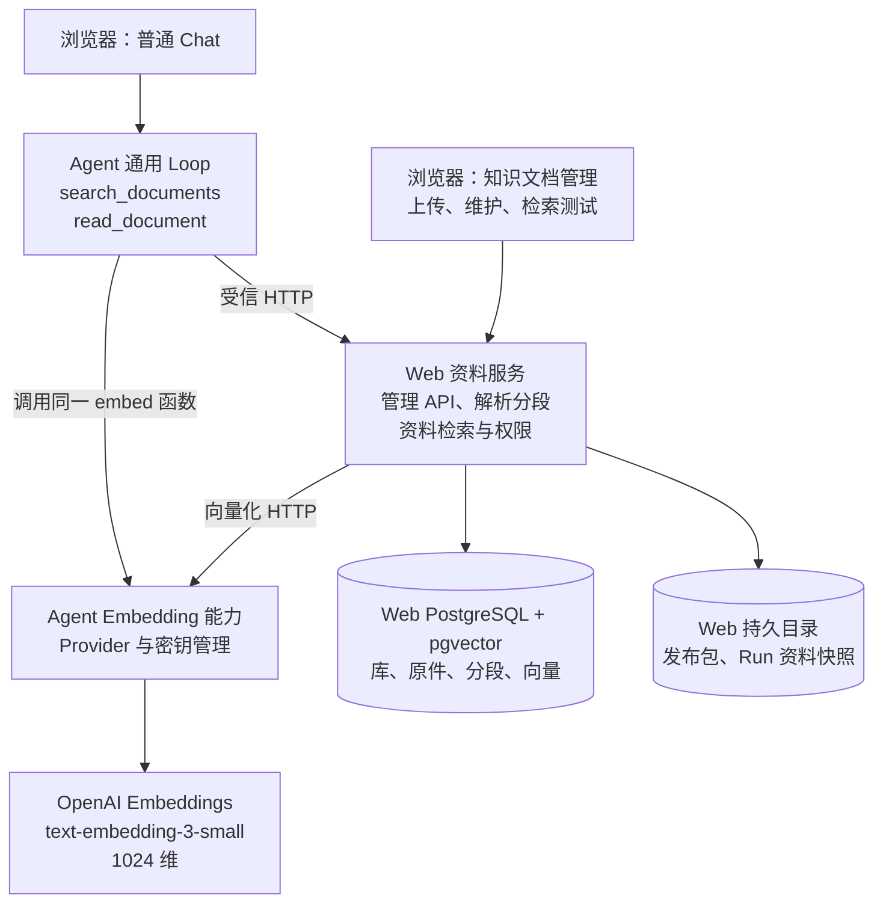

图中 Agent 的两条向量化路径共用 `documents/embeddings.py::embed`。Web 上传和检索测试调用 Agent 的内部模型 API；Agent 文档工具直接调用同一个 Python 函数。数据库、资料 ACL 和文件生命周期由 Web 负责，Agent 通过 HTTP 访问资料。

### 已采用的选型

| 层次           | 当前选择                                                                             | 设计取舍与实际边界                                                                                            |
| -------------- | ------------------------------------------------------------------------------------ | ------------------------------------------------------------------------------------------------------------- |
| Embedding      | OpenAI `text-embedding-3-small`，显式请求 `dimensions=1024`、`encoding_format=float` | 复用 Agent 已配置的 OpenAI Provider；文档和查询使用同模型、同维度                                             |
| Provider 选择  | `COMPASS_EMBEDDING_PROVIDER_ID` 可指定连接；省略时要求恰好一个已启用 OpenAI Provider | 多个候选须指定连接。密钥由 Agent 的 SecretStore 解密，浏览器和 Web 不接收模型密钥                             |
| 向量存储       | Web 主库 PostgreSQL 17 + `public.vector(1024)`                                       | 复用现有数据库，文本、状态与向量可在同一事务中提交；本地 Compose 使用固定摘要的 `pgvector/pgvector:pg17` 镜像 |
| 向量查询       | pgvector `<=>` 余弦距离，精确排序                                                    | 当前迁移没有 HNSW / IVFFlat 索引；现有课堂样本为 12 份文档、131 个片段，采用精确检索                          |
| 词法查询       | Web TypeScript 内的分字段 BM25，中文相邻双字分词                                     | 文号、标题／章节、别名、正文权重分别为 6 / 3 / 2 / 1，统计基于可见候选                                        |
| Agent 混合检索 | 词法 Top 10 + 向量 Top 10，RRF 融合，最多返回 3 段                                   | RRF 常数为 60；精确文号优先，保留同条款的有效冲突版本                                                         |
| 文件解析       | Markdown / TXT 采用 UTF-8；文本型 PDF 使用 `unpdf`                                   | Markdown 按标题、自然段拆分；PDF 提取文本层，扫描件需要先取得可提取文本                                       |
| 原件与快照     | 原文件 `bytea`、分段 `text` 存在 Web 库；发布包和 Run pin 存在 Web 持久目录          | 编辑分段保留最初上传的原文件。当前快照目录还承担历史发布兼容                                                  |

模型调用本身的超时为 25 秒，Web 等待每个向量批次最长 35 秒；每批最多 32 条文本。Agent 校验返回模型、条数、索引、1024 维、有限数值与非零向量，Web 再检查返回数组和条数。

模型调用的关键参数如下，来自现有 `documents/embeddings.py`：

```python 当前 Embedding 请求参数
{
    "model": "text-embedding-3-small",
    "dimensions": 1024,
    "input": texts,
    "encoding_format": "float",
}
```

## 3. 数据库模型与 ER 图

四张资料表均属于 **`web/main`**。管理入口使用 `knowledge_base / knowledge_file / knowledge_chunk`；原有离线发布保留 `document_vectors`。Agent 无需直连这些表。

### 3.1 数据归属与关系

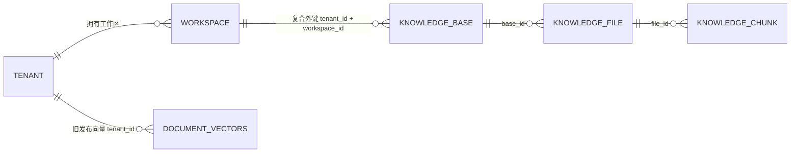

`workspace` 是已有表，`(tenant_id, id)` 有唯一约束。`knowledge_base` 通过复合外键保证库属于指定租户的工作区。文件和分段通过父级链路取得归属。`document_vectors` 与管理表之间通过来源标识、版本和哈希匹配，数据库未设置两者之间的外键。

### 3.2 知识库与原文件

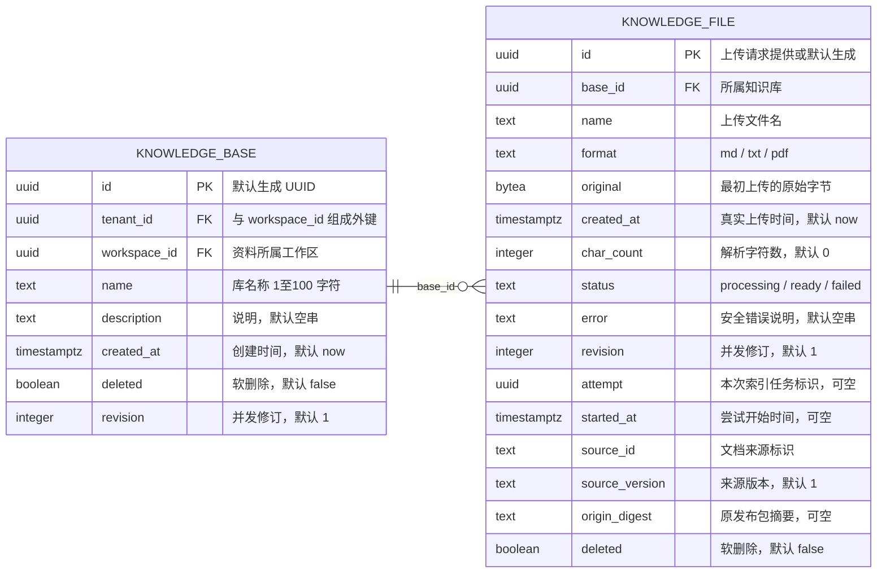

活跃库名称在 `(tenant_id, workspace_id, lower(name))` 上唯一，已删除库不占该名称。文件按 `(base_id, source_id, source_version)` 唯一。`revision` 参与编辑／删除的乐观锁；索引流程还使用 `attempt` 判断提交者，防止过期请求覆盖后续尝试。

### 3.3 分段及其向量

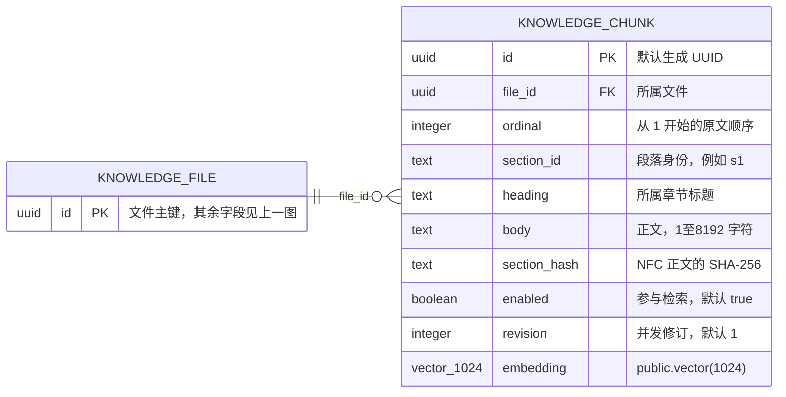

`(file_id, section_id)` 和 `(file_id, ordinal)` 分别唯一。分段向量非空，索引成功后整体写入；修改正文时重新生成向量，再同事务更新 `body / section_hash / embedding / revision`。仅启停分段时保留原向量。

当前 `knowledge_chunk` 未逐行保存模型／索引版本，维度由列类型固定，模型由代码常量固定。更换模型或维度需要设计全量重新向量化与兼容切换；现有管理 API 的 `/index` 用于未就绪文件的处理与失败重试。

### 3.4 原有发布向量与文件目录

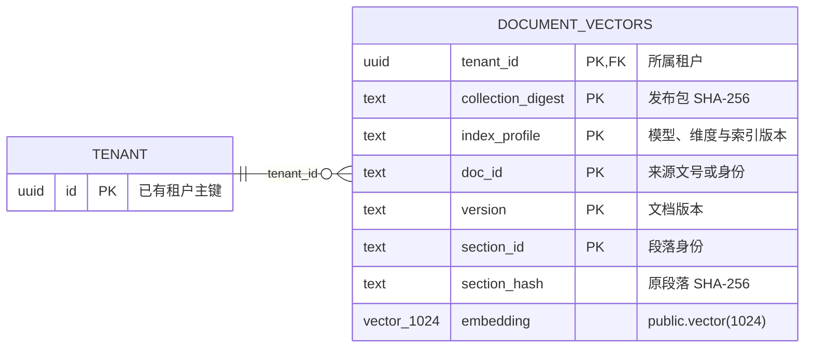

`document_vectors` 的前六个字段组成复合主键，正文保存在发布 collection 中。当前 `index_profile` 为 `text-embedding-3-small:1024:v1`。管理表与旧发布表检索结果通过 `doc_id / version / section_id / section_hash` 对齐、去重。

| 非数据库存储                                                | 内容与所有者                                                       |
| ----------------------------------------------------------- | ------------------------------------------------------------------ |
| `COMPASS_DOCUMENTS_ROOT/collections/<digest>.json`          | Web 只读发布包：文档正文、发布方、生效区间、审批、受众、别名与段落 |
| `COMPASS_DOCUMENTS_ROOT/bindings/<tenant>/<workspace>.json` | 当前发布包指针与来源政策；包含旧协议兼容字段                       |
| `COMPASS_DOCUMENTS_PIN_DIR/collections/<digest>.json`       | Web 保存管理库派生的不可变资料快照                                 |
| `COMPASS_DOCUMENTS_PIN_DIR/<tenant>/<workspace>/<run>.json` | 当前 Run 的资料版本与主体身份                                      |
| Agent 既有 Run 私有记录                                     | 已签发引用、工具结果和候选证据；引用正文的发布与校验沿主方案       |

上表目录对象采用 JSON 持久化。ER 图仅描述数据库实体。管理库中资料的历史政策复用发布包；普通上传文件采用当前工作区参考资料语义，记录真实上传时间。

## 4. 文件上传到可检索的流程

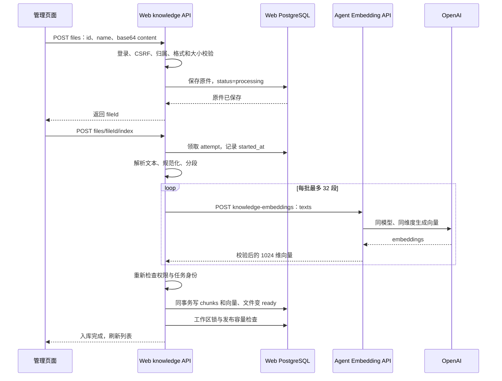

前端一次可选择多文件，当前按文件顺序执行“上传 → 索引”两次 HTTP 请求，并显示第几个文件的进度。索引在请求内完成，网络模型调用位于短事务之间。中途失败保留原件，文件记录安全错误，管理页可重试。

### 解析与索引约束

| 环节           | 当前实现                                                                                                     |
| -------------- | ------------------------------------------------------------------------------------------------------------ |
| 上传           | `md / txt / pdf`；单文件最大 5 MiB；JSON 携带 Base64 内容，服务端核对编码、扩展名与字节长度                  |
| PDF            | 检查文件头，`unpdf` 提取文本；最多 300 页；空正文、加密／无文本层给出失败原因                                |
| 规范化         | UTF-8 严格解码，NFC 规范化，统一换行，正文最长 150,000 个 JavaScript 字符长度单位                            |
| 分段           | Markdown 识别 1～6 级标题；按自然段合并，目标长度约 600；长段按 Unicode 字符每 900 个切开；单文件最多 256 段 |
| Embedding 文本 | `文件名 + 换行 + 章节标题 + 换行 + 分段正文`；文档与查询共用同一向量空间                                     |
| 原子提交       | 全部向量就绪后一次插入分段并将文件置 ready；同事务核对工作区发布容量                                         |
| 发布容量       | 工作区最多 512 份检索文档；有效文件即使全部分段停用仍占文档名额                                              |
| 并发与重试     | 每次索引用 attempt 标识；处理超过 6 分钟可由新尝试接管，旧尝试提交时核对身份                                 |

当前切片对超长段落执行定长拆分，表格也可能在较长时被切开。需要稳定表头传播或版面解析时，应增加专门的解析规则与用例；现有实现边界见本表。

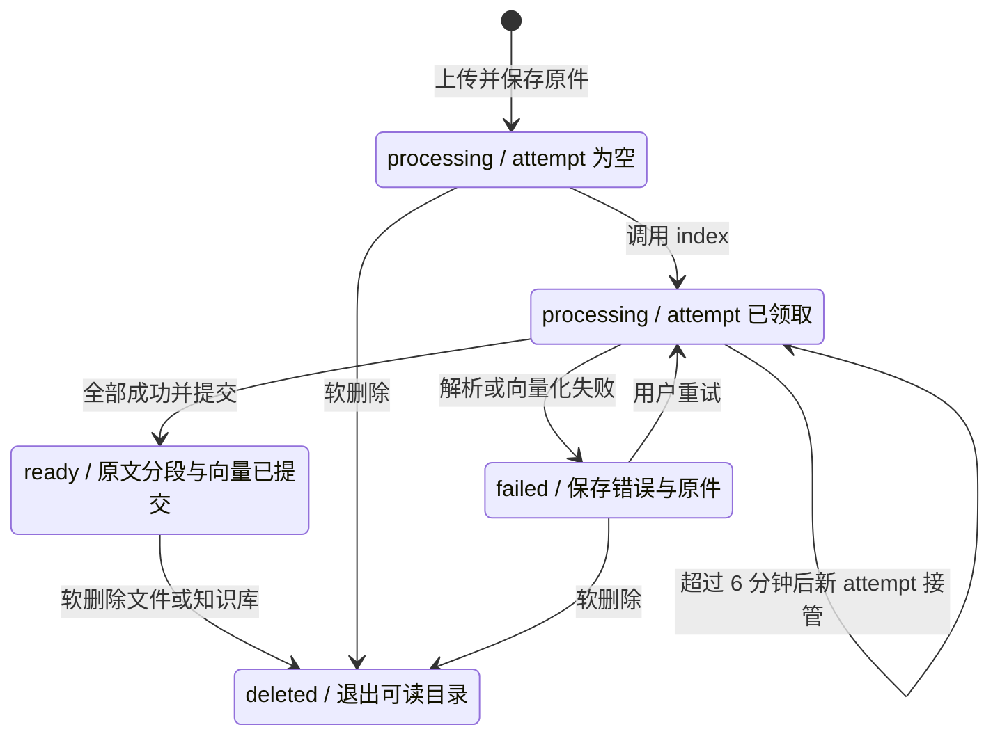

## 5. 两条检索链路

### 5.1 管理页的检索测试

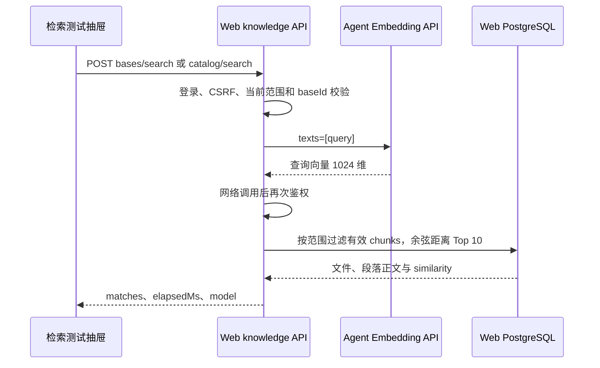

抽屉提供查询输入、可选知识库、结果预览与进入原文件。普通成员按当前工作区查询；平台管理员的目录检索可跨租户。实际可编辑性仍按资料所属工作区授权。匹配只来自未删除库、未删除且 ready 的文件、已启用分段。

展示的 `similarity = 1 − cosine_distance`，界面转换为百分数供比较。该值表达向量相似程度。检索测试共用 Embedding、pgvector 和分段状态，当前直接返回向量 Top 10；此路径不创建 Run pin，也不执行 Agent 的 BM25／RRF。Embedding 失败会返回可重试的界面错误。

### 5.2 Agent 的资料检索与回读

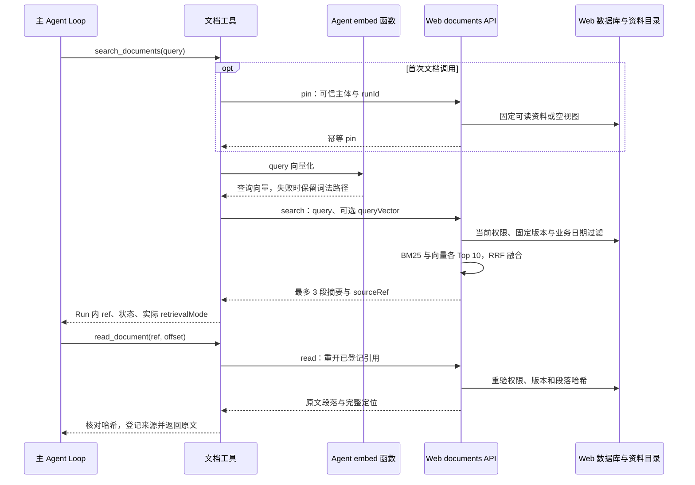

图中首次调用 pin 已在 documents/service.py 实现；并发首次调用共用一份持久 pin，空库跳过 Embedding。内部 `pin / search / read / verify` 的所有权与工具边界可继续复用。

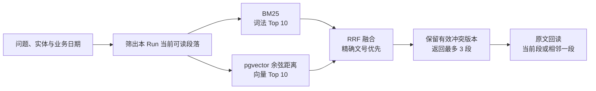

```text 当前 RRF 规则
score(section) = sum(1 / (60 + rank))  # rank 从 1 开始
检索身份 = (doc_id, version, section_id, section_hash)
返回摘要最多 180 个字符，原文通过 read_document 取得。
```

Web 在排名前处理用户、工作区、受众、文件状态和生效区间。SQL 向量候选将管理表和旧发布向量表合并，与可见段落身份连接，再按余弦距离取前十。Agent 查询向量生成失败时省略 queryVector，继续词法检索；返回 `retrievalMode=hybrid / lexical` 表示实际路径。

`read_document` 接受本 Run 已登记的 UUID ref，`offset=-1 / 0 / 1` 表示前一段、当前段、后一段。工具重验 Run、租户、工作区、包摘要、文档版本和段落哈希。原文进入通用 Loop 的证据适配与交付校验；回答模式、Verify 和正文发布见主方案。

## 6. 本课新增的 API 与工具

本节按当前实现列出 **18 个 Web 管理 HTTP 操作、4 个 Web 内部资料操作、1 个 Agent Embedding 操作，以及 2 个模型工具**。数量按“HTTP 方法 + 路径”计算。对应路由已存在，本次方案重梳不新增这些端点。

### 6.1 Web 管理 API

统一前缀为 **`/api/web/v1/knowledge`**。表中的路径拼接该前缀。请求沿用登录 Cookie，携带 `tenantId / workspaceId` 查询参数；写请求和检索测试 POST 校验同源与 CSRF。响应沿用 Web 的数据与 viewRevision 封装，原文件以字节响应。

| 方法与路径                              | 主要输入                                    | 返回／用途                                          |
| --------------------------------------- | ------------------------------------------- | --------------------------------------------------- |
| `GET /bases`                            | 当前租户与工作区                            | 库列表、文件数、原件总字节数、revision              |
| `POST /bases`                           | `name, description`                         | 创建知识库，返回 id                                 |
| `PATCH /bases/{b}`                      | `name, description, revision`               | 更新名称和说明                                      |
| `DELETE /bases/{b}`                     | `revision`                                  | 软删除知识库                                        |
| `GET /bases/{b}/files`                  | 库 ID                                       | 文件列表、格式、字节／字符数、状态、错误和 revision |
| `POST /bases/{b}/files`                 | `id, name, content`，content 为 Base64      | 保存原件，返回 fileId                               |
| `PATCH /bases/{b}/files/{f}`            | `name, revision`                            | 重命名文件                                          |
| `DELETE /bases/{b}/files/{f}`           | `revision`                                  | 软删除文件                                          |
| `POST /bases/{b}/files/{f}/index`       | 空对象                                      | 解析、分段、向量化并提交；失败可重试                |
| `GET /bases/{b}/files/{f}/original`     | 文件 ID                                     | 最初上传的字节，带私有响应头与 sandbox CSP          |
| `GET /bases/{b}/files/{f}/chunks`       | 文件 ID                                     | 按 ordinal 返回全部分段，前端筛选和分页             |
| `PATCH /bases/{b}/files/{f}/chunks/{c}` | `{revision, body}` 或 `{revision, enabled}` | 修改正文并重新向量化，或启停分段                    |
| `POST /bases/search`                    | `query, baseId?`                            | 当前工作区的向量 Top 10，含耗时与模型               |
| `GET /catalog`                          | 平台管理身份                                | 跨工作区库目录、归属、canManage、canCreate          |
| `GET /catalog/{b}/files`                | 平台管理身份、库 ID                         | 跨工作区只读文件列表                                |
| `GET /catalog/{b}/files/{f}/original`   | 平台管理身份、文件 ID                       | 跨工作区只读原文件                                  |
| `GET /catalog/{b}/files/{f}/chunks`     | 平台管理身份、文件 ID                       | 跨工作区只读分段                                    |
| `POST /catalog/search`                  | 平台管理身份、`query, baseId?`              | 平台目录范围的向量 Top 10                           |

`catalog` 的平台读取权限与 `bases` 的工作区维护权限分别判断。修改跨工作区资料时，前端传资料归属，服务端重新鉴权。名称、正文和 revision 由 Zod 校验；版本冲突返回可恢复错误，界面保留输入并要求刷新。

### 6.2 Web 内部资料 API 与 Agent 模型 API

| 方法与完整路径                         | 调用方与输入                                                                           | 返回与边界                                                                  |
| -------------------------------------- | -------------------------------------------------------------------------------------- | --------------------------------------------------------------------------- |
| `POST /api/internal/documents/pin`     | Agent；`actor_user_id, tenant_id, workspace_id, run_id, args={}`                       | 幂等固定资料版本；新方案需支持无资料空 pin                                  |
| `POST /api/internal/documents/search`  | 同一可信 envelope；args 含 query、可选 kind/entity/businessDate/historical/queryVector | `status, knownAt, collectionDigest, sections, retrievalMode`；最多 3 段摘要 |
| `POST /api/internal/documents/read`    | 同一 envelope；`sourceRef, offset`                                                     | 原文与定位，当前不可读则无有效段落                                          |
| `POST /api/internal/documents/verify`  | 同一 envelope；本批 refs，当前兼容字段 kinds                                           | `allowed, accessDigest`；当前读取资格核对，单批至多 64 条引用               |
| `POST /v1/models/knowledge-embeddings` | Web → Agent；受信上下文、`texts` 数组                                                  | `vectors`；1～32 条，每条最多 10,000 字符，模型输出 1024 维                 |

内部资料 API 使用服务 token 和受信用户／Run 上下文，Web 重查当前用户与工作区权限。Embedding API 接受租户 `knowledge_manage` 或平台 `manage` purpose，复用已有服务间鉴权。普通 Chat 的查询向量由 Agent 文档工具直接调用 embed 函数生成。

### 6.3 模型可调用的工具

| 工具               | 参数                                                                  | 结果                                                                |
| ------------------ | --------------------------------------------------------------------- | ------------------------------------------------------------------- |
| `search_documents` | `query` 必填，最长 256；可选 `kind, entity, businessDate, historical` | 安全摘要、docId/version/sectionId、可回读 ref、检索模式、耗时与状态 |
| `read_document`    | `ref` 为本 Run UUID；`offset` 默认为 0，范围 −1～1                    | 原文段落、身份、版本、哈希与来源定位                                |

queryVector、主体身份和真实 sourceRef 由后端装配。新方案中工具在文档后端可用时注册；工具实际执行负责确认是否有库、是否命中和是否有权。空结果、拒绝和暂时故障的统一语义由主方案定义。

## 7. 资料管理、维护与恢复

### 管理操作怎样影响检索

| 操作               | 数据变化                                                 | 对检索与历史引用的影响                                         |
| ------------------ | -------------------------------------------------------- | -------------------------------------------------------------- |
| 创建／编辑知识库   | base 元数据与 revision                                   | 所属租户／工作区固定，活跃名称唯一                             |
| 上传文件           | original 原字节与 processing 记录                        | 只有索引成功、状态 ready 的有效分段进入检索                    |
| 文件重命名         | file.name 与 revision                                    | 更新显示标题；当前实现只更新元数据，已有 embedding 保留        |
| 修改分段正文       | 先生成新向量，再原子更新 body、hash、embedding、revision | 后续新快照看到新正文，旧 Run 对应旧哈希段落退出当前可读集合    |
| 停用／重新启用分段 | enabled 与 revision                                      | 停用立即退出召回和原文读取；重新启用沿用已存向量               |
| 删除库／文件       | deleted=true，保留数据                                   | 子级通过有效父链过滤，退出检索和回读                           |
| 解析／向量失败     | failed、error、原件保留                                  | 文件列表可重试；当前已就绪资料继续可用                         |
| 权限撤销           | 来源服务读取当前成员与政策                               | 后续检索、回读、交付和历史回看重新检查；失效内容不进入公开投影 |

管理页支持按文件名搜索、逐文件处理状态、分段正文搜索、原文件预览、分段编辑与启停。当前文件列表每页 10 条、分段每页 9 条，分页与筛选在前端完成。批量上传显示逐文件进度，失败文件可以逐个修复和重试。

原文件与编辑后的分段各自保存。当前系统没有分段编辑历史表，也没有任意历史文本版本的编辑回滚入口。Run 的不可变快照服务于运行回看；读者能看到的内容还须满足当前哈希与权限约束。

### 数据库迁移与备份

| 项目                            | 当前交付                                                                           |
| ------------------------------- | ---------------------------------------------------------------------------------- |
| owner                           | `web/main`，Web 自有数据库与迁移链                                                 |
| `0008 → 0009_document_vectors`  | 创建原发布向量表，运行角色授予 SELECT                                              |
| `0009 → 0010_knowledge_library` | 创建库／文件／分段三表，运行角色授予 SELECT、INSERT、UPDATE                        |
| 扩展供应                        | Web 数据库 provision 由供应管理员在 public 安装 vector；迁移不借用运行账号安装扩展 |
| 发布顺序                        | 备份 → 供应扩展 → 应用迁移 → 导入或索引资料 → 发布可读目录 → 检索与回读检查        |
| 恢复对象                        | Web 应用库及迁移账本、只读发布包、工作区绑定与可写 Run pin 目录                    |
| 恢复方式                        | 在新受管目标准备 pgvector，恢复验证过的备份并匹配目录版本；旧发布包和 Run 记录保留 |

迁移真源为 0009、0010，完整与增量 SQL 沿 Web 数据库入口生成。当前没有本次新增的 DDL。多 Web 实例共用资料目录与 pin 目录，文件系统需支持同目录硬链接；管理资料快照与 Run pin 采用临时文件加原子链接接收。

## 8. 代码改动与实施位置

### 已有知识库链路

| 模块与文件（相对仓库根）                                                                 | 本课承担的职责                                                       |
| ---------------------------------------------------------------------------------------- | -------------------------------------------------------------------- |
| `apps/web/src/features/knowledge/page.tsx`、`directory.tsx`、`types.ts`、`knowledge.css` | 三级目录、上传、索引重试、搜索与分页、分段编辑／启停、归属权限反馈   |
| `apps/web/src/features/knowledge/retrieval-drawer.tsx`                                   | 检索测试抽屉、查询取消、结果预览与定位文件                           |
| `apps/web/src/server/http/handler.ts`、`knowledge-handler.ts`                            | 管理 API 路由、登录与 CSRF、归属鉴权、索引 attempt、乐观锁与事务提交 |
| `apps/web/src/server/modules/documents/indexing.ts`                                      | 解析、分段、向量批次调用与响应校验                                   |
| `apps/web/src/server/modules/documents/retrieval.ts`                                     | 管理页 pgvector 精确余弦 Top 10                                      |
| `apps/web/src/server/modules/documents/library.ts`                                       | 合并管理资料与原发布包，容量限制，按当前状态过滤旧快照               |
| `apps/web/src/server/modules/documents/contracts.ts`、`store.ts`                         | collection、pin、sourceRef 契约；摘要校验、不可变快照和幂等 pin      |
| `apps/web/src/server/http/documents-handler.ts`、`modules/documents/search.ts`           | 内部资料端点、可见性过滤、词法与向量融合、原文回读和访问重验         |
| `apps/agent/src/compass_agent/documents/embeddings.py`                                   | Provider 选择、密钥读取、OpenAI 请求、返回模型／维度／数值检查       |
| `apps/agent/src/compass_agent/api/models.py`、`schemas.py`                               | knowledge-embeddings 端点、可信 purpose 与批次 DTO                   |
| `apps/agent/src/compass_agent/documents/service.py`、`client.py`、`tool.py`              | 查询向量、跨服务请求、引用签发和回读验证、结构化工具回执             |
| `apps/agent/src/compass_agent/tools/business/search_documents/`、`read_document/`        | 两个工具的参数、SPEC 与统一注册；PromptOps 工具说明同步维护          |
| `apps/web/db/main/migrations/0009_document_vectors.sql`、`0010_knowledge_library.sql`    | 四张 Web 资料表与权限；派生 SQL 随真源生成                           |
| `apps/web/scripts/db-provision.mjs`、`deploy/compose/compose.yaml`                       | pgvector 扩展供应、数据库镜像、发布与 pin 挂载                       |

### 默认通用 Loop 的实现改动

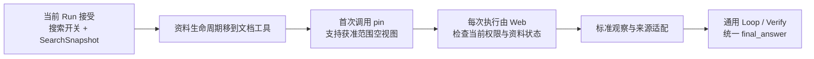

| 改动点                                              | 实现内容                                                                            | 与已有能力的关系                                         |
| --------------------------------------------------- | --------------------------------------------------------------------------------------- | -------------------------------------------------------- |
| `documents/client.py`、`service.py` 与 Runtime 装配 | 移除 COMPASS_SEARCH_WORKSPACES 对工具接入的控制；首次实际调用取得并复用 pin             | 保留可信主体、跨服务请求和来源回执                       |
| Web `library.ts / contracts.ts / store.ts`          | 支持无库／无可索引文档的空 pin；旧字段按协议版本兼容                                    | 无绑定且无管理资料时，新协议返回 no_library 空状态 |
| 文档工具执行回执                                    | 区分 no_library、no_indexed_documents、no_match、access_denied、document_service_unavailable | 复用已有 ok／rejected／error 外层回执                    |
| 来源权限                                            | 清理 Agent 搜索专用 kinds／连接白名单依赖，Web 继续维护资料归属、状态和访问政策         | 当前用户权限始终由工具及来源所有者执行                   |
| 结果适配与引用                                      | 文档工具输出通用 Evidence；原文与引用交给统一 Verify 和答案发布流程                     | 新 Hook 与 final_answer 契约见主方案；本专题不另建循环   |

这组改动已编码；空资料状态与并发 pin 已有用例，具体执行结论见本轮验收记录。

## 9. 验证范围与课堂记录

| 验证层              | 已有入口与后续检查重点                                                                                              |
| ------------------- | ------------------------------------------------------------------------------------------------------------------- |
| 解析与资料目录      | `apps/web/tests/knowledge-library.test.ts`：标题、长段、非法编码、空文本；旧快照对修改／停用的处理                  |
| 文档检索            | `apps/web/tests/documents.test.ts`：版本、生效期、政策、显式受众与原文回读                                          |
| Embedding 边界      | `apps/agent/tests/test_knowledge_embeddings.py`、`test_document_tools.py`：管理 purpose、工具隔离、取消与结果处理   |
| PostgreSQL 真实查询 | `apps/web/tests/integration/knowledge-retrieval.integration.ts`：余弦排名、有效分段、工作区隔离、平台目录与状态变化 |
| 管理接口与权限      | `apps/web/tests/e2e/knowledge-catalog.spec.ts`：平台读取、所属工作区维护、普通成员边界、查询输入与 CSRF             |
| 新主方案            | 无搜索开关、首次并发 pin、空知识库、撤权、通用 Verify 和普通／循证交付联调                                          |

历史课堂使用 12 份业务原文和独立经营账本。旧协议的一次普通 Chat 完成 10 次混合检索、15 次原文读取、9 次 SQL 查询；知识库管理接入后的另一轮完成 9 次混合检索，给出基期 100 万元、本期 88 万元及经营单元差异。原件与金标准留在课堂案例，本轮没有重跑这些业务验收。

本轮执行了空库与并发 pin 单元检查、Web 知识库 PostgreSQL 集成、Agent 通用交付集成及阅读版检查。没有新增 DDL；完整执行结果见 验收记录。
