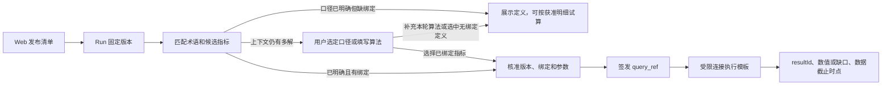

# Compass Retail 默认语义资产设计

**教学资产包 v1–v3 · 零售底本 `diagnostic-v3-20261019`。** 管理者在「管理与治理 → 数据与语义 → 指标口径」维护实体、术语和指标。保存即发布定义，具有使用权限的人可在目录和新任务中查阅。正式取数另需工作区已发布的执行绑定，以及调用者当前可用的只读数据连接。[图解与完整字段字典](RETAIL_SEMANTIC_ASSETS.html) · [主技术方案](TECH_DESIGN.md) · [内容需求](PRD.md)

**Run 开始时能看到什么。** 意图识别拿到受理时刻、租户时区和授权组织。识别后的分析步骤从 Run 固定的发布清单读取全部可见术语的名称、别名及释义，此外最多加入 8 个与本题匹配的可见实体或指标，先取直接命中，再取相关候选。没有命中时只带词表。新建的个人维护术语默认共享到当前工作区，历史私有术语仅本人可见。在仅获资料检索、未开放语义来源的模式下，单独读取已发布的非个人词表。正式取数另查指标版本、绑定与数据连接。

## 1. 三类语义资产如何存储和使用

同一句“上月销售额”可能对应成功付款、扣退款后的净回款或会计确认收入。术语保存这些候选，指标定义各自规定公式和事件日期，Agent 结合当前提问和前文选定业务事件，仍有多解时询问用户。查询时再按所选指标版本找到当前工作区的执行绑定。

| 建模层              | 实际存储（Web PostgreSQL）                                                                                                                                             | 消费方得到什么                                                                         |
| ------------------- | ---------------------------------------------------------------------------------------------------------------------------------------------------------------------- | -------------------------------------------------------------------------------------- |
| 配套 · 来源与作用域 | `semantic_source` 记录来源定位符、版本和摘要。`semantic_scopes` 标识平台、租户、部门等范围。资产的 `owner_scope_id` 与版本的 `usage_scope_id` 分别记录谁维护、谁可使用 | 目录展示来源与负责人。Web 结合成员归属和授权计算每次请求的可读、可维护范围             |
| 实体、维度与关系    | `semantic_assets(kind=entity)` 是稳定身份。`semantic_versions.definition` 记录表、粒度、字段、键、时钟及连接规则。`semantic_relations(entity_join)` 把版本连到目标实体 | 预览可沿关系查看实体，区分原销售地、发货地和持货地。维度由实体字段及指标允许的维度表达 |
| 术语与别名          | `kind=term` 的版本保存释义、典型问法、反例。`semantic_aliases` 提供名称索引，`semantic_relations(denotes)` 记录术语指向                                                | 检索同义词，解释业务用语，为口径解析提供候选指标                                       |
| 度量与指标          | `kind=metric` 的版本保存公式、单位、粒度、业务时间、聚合规则及适用边界。`derived_from` 记录来源实体，组成度量可写入 `definition.components`                            | 读公式、解释差异、确定合计方式，限制可分组或筛选的维度                                 |
| 配套 · 执行绑定     | `execution_bindings` 关联指标版本、租户、工作区，保存来源、模板及摘要、参数和结果 Schema、访问要求。生效清单选用具体绑定                                               | 通过获准的工作区连接执行查询、对比或下钻                                               |

当前语义模型在 Web/main 有 16 张表（15 张 `semantic_*` 及 `execution_bindings`），Agent/main 有 1 张 `semantic_metric_offer`。按职责列出完整表集如下，HTML 数据库章节提供分组 ER 图及逐表样例。

| 职责                 | 所属库与表                                                                                                                                         |
| -------------------- | -------------------------------------------------------------------------------------------------------------------------------------------------- |
| 内容、来源与执行绑定 | Web · `semantic_assets`、`semantic_versions`、`semantic_relations`、`semantic_aliases`、`semantic_source`、`semantic_scopes`、`execution_bindings` |
| 组织与授权           | Web · `semantic_scope_memberships`、`semantic_scope_grants`、`semantic_asset_grants`                                                               |
| 审批、发布与撤销     | Web · `semantic_reviews`、`semantic_release`、`semantic_release_head`、`semantic_revocation`                                                       |
| 操作与版本使用记录   | Web · `semantic_event`、`semantic_reference`                                                                                                       |
| 会话私有引用         | Agent · `semantic_metric_offer`                                                                                                                    |

组织与账户身份复用 `tenant`、`tenant_member`、`app_user`、`workspace`，任务归属复用 `agent_session`、`agent_run`。发布清单 `semantic_release.manifest` 以 JSON 保存资产、版本和绑定的逻辑引用。Agent 通过内部 HTTP 取得清单，在 `agent_run.config_snapshot.contextRuntime.registry` 固定发布 ID 与摘要。Web 0007 已移除 `semantic_policy`、`semantic_feedback`，Agent 0018 已移除 `semantic_run_binding`。

三类资产共用一套版本目录。v2 在 10 个教学维护范围内发布 **121 个定义**，其中实体 74 个（37 种）、术语 29 个（16 种）、指标 18 个（12 个业务键）。按表去重覆盖 382 个物理字段、95 条实体关联规则。两个租户的 v2 版本共写入 190 条实体关联、33 条术语指向和 70 条指标来源关系，合计 **293 条**，另有 191 条名称和别名索引。

### 管理页的写入与生效

列表按类型、业务域、维护归属和状态筛选，支持按名称、代码或别名搜索。点击任一类型，在右侧抽屉预览完整定义；具有维护权限的人可以切换编辑。术语指向和实体关联能在抽屉内继续打开，返回时保留列表位置。新建资产和登记来源分别使用抽屉。目录的人工维护路径直接保存并生效，Chat 的候选提议属于独立入口。

| 操作           | 写入与可见结果                                                                                                                                   |
| -------------- | ------------------------------------------------------------------------------------------------------------------------------------------------ |
| 新建、修改定义 | `POST /api/semantic/assets`。Web 在同一幂等事务内检查来源、范围及可见依赖，追加定义版本，更新发布清单。新版定义需要匹配该版本的执行绑定          |
| 删除定义       | `POST /api/semantic/assets/{id}/remove` 提交预期摘要。被其他有效定义引用时提示先调整关系；成功后归档身份并从当前清单移除，历史版本留存           |
| 登记来源       | `POST /api/semantic/sources` 记录来源版本、摘录及维护范围，可在维护定义时选用                                                                    |
| 资产授权       | 具有语义治理权的租户管理员在「资产授权」抽屉按部门或成员多选实体和指标，批量授予或撤销使用权。术语按发布范围共享；维护、分享及发布职责另行授予。 |

### 对外能力与一次受控取数

| 入口                 | 工具或接口                                                                         | 契约                                                                                                                                                               |
| -------------------- | ---------------------------------------------------------------------------------- | ------------------------------------------------------------------------------------------------------------------------------------------------------------------ |
| 查目录、读定义       | `search_semantics`、`get_metric_definition`                                        | 在使用者可见的发布清单内检索三类资产，按资产 ID 读取版本、别名和可见依赖                                                                                           |
| 解析“销售额”         | `resolve_semantics`                                                                | 展开术语指向，在可见指标中核对业务事件。仍有多解时，原会话可选择候选或填写算法。有语义查询权但缺绑定时返回 `unavailable_binding`，缺查询权时返回 `query_forbidden` |
| 正式查询、对比、下钻 | `query_metric`                                                                     | 接收本 Run 的 `query_ref` 与结构化条件。Agent 获取模板，经受限连接执行，返回 `resultId`、数值、单位、完整度及来源回执                                              |
| Chat 授权维护        | `discover_semantic_candidates`、`review_semantic_change`、`submit_semantic_change` | 可提名本轮可复用结果、按要求从同会话回执建草稿、修订原指标或校验及送审草稿。工具按能力装配，管理页日常增删改查独立进行                                             |
| 服务间协作           | Agent → Web `/api/internal/semantic/{op}`。Web → Agent `/v1/semantic/trial`        | Web 核验服务身份和实际用户上下文，返回可见清单或指定绑定。试算通过 Agent 的受限连接与独立预期值核对                                                                |

一次正式查询跨三个数据所有者。**Web** 决定可见定义和可用绑定。**Agent** 在 `agent_run.config_snapshot.contextRuntime.registry` 固定本 Run 的发布 ID 和摘要，解析成功且期间参数完整后，用 `semantic_metric_offer` 保存私有计划，返回 `query_ref`。**零售库** 按实际登录身份、租户和地区执行通过 SHA-256 摘要校验的参数化 SQL。模型传业务条件，执行器校验模板与访问范围。主查询窗口、筛选或分组变化须重新解析计划。对比须显式提交 `comparison`。用户要求比较紧邻的上一等长期间时，可传入解析返回的 `previous_equal_window`。回看、恢复和交付继续复核使用者的权限。



## 2. 经营实体、维度与关系

两家教学租户从同一份映射实例化独立的实体。业务事实以人民币分、基准件和上海自然日计量。Web 租户 UUID、零售 `tenant_id` 与地区授权是三个不同的键。v1 定义粒度、主键、业务时钟及首批 40 条关联。v2 补全逐列含义和另外 55 条键关系，HTML 字典按业务域展示合并结果。实体基础定义 · v2 字段 · v2 关联

| 经营主题   | 首批登记的实体                                                              | 如何用于经营分析                                                                                               |
| ---------- | --------------------------------------------------------------------------- | -------------------------------------------------------------------------------------------------------------- |
| 组织与期间 | tenant、calendar、geo_area、org_unit、site、channel、store_operating_day    | 识别渠道类型、经营地区、网点开闭与营业日。原销售门店可空，空值保留“未归属”。自然周对齐 ISO 周年及周号          |
| 商品       | brand、category、sport、spu_sport、spu、sku、channel_listing                | SKU 为颜色/尺码规格，SPU 为商品款。日报按 SKU 取唯一有效版再上卷。运动标签可能一款多标，支持筛选；加总须有权重 |
| 交易       | order_header、order_line、order_unit、payment、refund、refund_allocation    | 订单、行、单件分别计数。支付尝试只有成功行构成收款。退款继承原订单销售归属。退款单件分配独立于原支付额商品分配 |
| 履约与售后 | shipment、return_header                                                     | 发货地、退货接收地各自保留。确认收入从会计分录取数，原销售维度从单件回到订单                                   |
| 财务       | revenue_entry、cost_entry、order_fee、target_monthly                        | 收入分录自带正负号；成本、费用冲回、月目标计划版分别建模。毛利和达成率需要匹配授权、版次和经济口径             |
| 营销与渠道 | campaign、campaign_daily、campaign_attribution_daily、channel_product_daily | 活动计划、区域投放消耗、整租户归因、商品实付日报各有粒度。归因修订与消耗修订独立选取                           |
| 库存       | assortment、inventory_snapshot、inventory_valuation_snapshot                | 用配货有效期形成期末应有集合，校验同一收盘时点的件数；估值读取独立受控                                         |
| 客户与实验 | customer、experiment_assignment                                             | 识别会员与随机化单位各有身份。留存需定义首购和成熟期，实验需固定分母、观察窗与退款护栏                         |
| 数据质量   | source_watermark、asset_period_status                                       | 交易/财务按来源水位，商品日报按日对账，广告按投放计划，库存按组合及收盘时间核对                                |

**四条决定数值的关联。**

1. 支付关联订单头的键为 `(tenant_id, order_id, region_id)`。退款关联原支付使用 `(tenant_id, payment_id, order_id, region_id)`。退款分支单独验证原支付成功，支付分支保留一笔一次。
2. 收入分录用 `(tenant_id, order_unit_id, region_id)` 关联单件，再取原订单和 SKU。一笔分录最多映射一份原销售归属。按商品筛下单数走 `EXISTS`，同一订单命中三行商品仍计一单。
3. 库存预期集合按 `valid_from <= D < valid_to`、租户、授权地区、地点和 SKU 选取，按地点与规格去重；逐项左联同日期、同地区、准确期末时刻的快照。只有全部可见且件数平衡时才返回完整合计。
4. 平台归因没有地区粒度。按活动生效区间、目标平台渠道枚举活动日。消耗从地区先汇总到活动日，再与归因相除。按区域筛选、下钻或仅有区域授权，均无法使用此绑定。

## 3. 指标版本与可加性

下表的“期间”均指业务时区左闭右开的 `start,end)`。K 是含边界的数据可见截至时点。教学源中静态商品分类取固定数据集发布；重新导入新版分类需要重新评估历史比较。12 个业务键都有公式、负责人、粒度、单位、业务时间、时区和聚合规则。下列 8 个业务键有候选模板，模板还声明分组、过滤及输出约束。[指标基础目录 · v2 指标与词条修订

| 业务键                             | 计算与归期                                                                                       | 可分组维度                                    | 关键边界                                                                               |
| ---------------------------------- | ------------------------------------------------------------------------------------------------ | --------------------------------------------- | -------------------------------------------------------------------------------------- |
| `sales.order_count`                | 按 `order_header.ordered_at` 计创建的订单，单位单                                                | 日、渠道、原销售地区、销售网点                | 取消单计入。SKU、款、品类可筛选，跨商品集合的订单数重新去重                            |
| `sales.paid_gmv`                   | 成功支付 `amount_cent` 求和，以成功行 `attempted_at` 归期                                        | 日、渠道、原销售地区、销售网点                | 失败尝试剔除。真实清算接入需核对到账时钟。订单级支付缺少用于 SKU 分配的依据            |
| `sales.net_gmv`                    | 支付正项与成功退款负项按各自事件日期合并                                                         | 同支付 GMV                                    | 原单可以发生在上期，本期可以是负数。退款前后的归因队列另立口径                         |
| `finance.recognized_revenue`       | 按 `recognized_at` 合计 `DELIVERY` 和 `RETURN_ACCEPTED` 带符号的收入分录                         | 日、渠道、原销售地区、销售网点、SKU、款、品类 | 部分退货按受理日冲减，实际退款日期不产生第二次收入冲减                                 |
| `marketing.net_roas`               | 平台末次点击 7 天、模型版本 1；总归因净回款 / 总投放消耗，单位倍                                 | 归因日、活动、平台渠道                        | v1 冻结归因支付，后续修订更新累计退款。每个范围重新算比率，保留分子、分母与版本        |
| `inventory.closing_available_qty`  | 取 end 前一天上海 23:59:59，逐组合校验 `available_qty = sellable_qty - reserved_qty`，合计基准件 | 期末日、持货地点、地区、SKU、款、品类         | 跨期取末日，缺组合时返回地点/SKU 清单。数据包首次期末为 2025-10-01                     |
| `channel.reported_paid_amount`     | 按报表日，每个渠道×SKU×地区取 K 内最高修订，再合计 `paid_amount_cent`                            | 日、渠道、报表地区、SKU、款、品类             | 每日须有截至 K 的 COMPLETE；展示该组实取的版本。筛报表渠道即可下钻商品贡献             |
| `channel.first_report_paid_amount` | 按报表日固定 `report_version=1`；返回首报实付分及实际参与的明细行数                              | 总计、自然日；可筛渠道与地区                  | 教学首报齐备时状态为 PARTIAL 或 COMPLETE；保留无可见明细的日期，首报原值独立于后续订正 |

**另有 4 个已生效的指标定义，可查阅公式和来源。** 以下条件决定何时可增加本地执行绑定。教学包对这 4 项均未提供 SQL。

| 指标业务键                  | v2 公式与来源                                                                       | 执行前提                                   |
| --------------------------- | ----------------------------------------------------------------------------------- | ------------------------------------------ |
| `marketing.profit_roi`      | （归因贡献毛利合计 − 投放成本合计）/ 投放成本合计。读取归因日报、投放日报及成本分录 | 统一归因窗、成本分摊与授权；零分母返回缺口 |
| `finance.gross_profit`      | 带符号收入分录之和 − 同口径净销售成本之和。收入、成本经订单单件对齐                 | 核准成本冲回符号、成本列权限及可见完整度   |
| `inventory.closing_value`   | 同一截止日按持货地点、SKU 合计可售库存估值金额。从估值快照关联 SKU 和地点           | 对齐期末快照，确认估值规则和成本授权       |
| `personal.channel_net_cash` | 选定渠道成功支付之和 − 原单归属该渠道的成功退款之和。由支付、退款回溯原订单及渠道   | 指定本人获准的渠道、连接及分享范围         |

## 4. 时间、完整度与输出

模板的业务参数包含 `start`、`end`、带时区的 `as_of`、可选 `group_by` 和 `filters`。每次取一个分组维度，渠道内商品分析可把渠道放入筛选、商品款放入分组。两期比较固定同一 K、时区、单位和来源发布，两次独立归并后按维度键全量对齐。只有完整的可加金额允许将缺键按零参与差额；缺报窗口的变化额留空。

| 来源                      | 用什么判断完整                                                                                            | 无法给出金额或件数时的输出                                                                                           |
| ------------------------- | --------------------------------------------------------------------------------------------------------- | -------------------------------------------------------------------------------------------------------------------- |
| 订单 / 支付 / 退款 / 收入 | 按来源读取 `observed_at <= K` 的最后水位。`complete_through` 须覆盖窗口右端。交易依赖 OMS，收入还依赖 ERP | 水位未知 `COVERAGE_UNKNOWN`、水位未到 `SOURCE_DELAYED`；完整期无事实，总计为 0，分组空集为 `NO_FACTS`                |
| 最新商品日报              | 逐天查 `core.channel_product_daily` 的对账声明。明细的修订号按其自然键选择，各行允许处于不同修订号        | `COVERAGE_UNKNOWN` 或 `REPORT_INCOMPLETE`，附缺口日期。首报的 `NO_REPORT_ROWS` 保留无明细与实报零金额的区别          |
| 平台归因                  | 活动日归因取 K 内最高版，消耗按地区取 K 内最高版并查齐地区 1–7。按选定范围重算加权结果                    | 缺归因、最新归因未知、缺区、零消耗、无适用活动各有状态。混合缺口留空总比率，明细回执给出逐活动日的归因版及各区消耗版 |
| 期末库存                  | 比较 D 与首个快照日、K 与收盘时刻，再核对有效组合及准确时点的可见快照                                     | 区分覆盖期外、未到期末、快照尚未到达、部分缺失、无配货组合及件数不平。缺失组合保留在回执                             |

每行返回分组键、数值、状态、期间、时区、K、数据发布、单位和明细元数据。SQL 中数值为 `numeric`，JSON 按无损十进制字符串交付。金额先合计分，显示元时换算并保留两位；倍数展示到四位。多行结果中的空销售网点独立成组。Run 回执另记录版本 ID、绑定摘要、授权范围和发布清单，才能按同一时点复查。

## 5. 维护归属、语境与执行授权

教学映射使用已有的合成 Web 租户与工作区。远山零售/经营总部对应 101，星河商贸/电商运营对应 102。两家分别建立销售、财务和营销部门。库存由租户公共作用域内的库存计划负责人维护。个人示例引用现有 101 教学分析师的成员身份。v1 的导入编辑者为教学平台管理员，`responsible_ref` 保存岗位职责。归属决定维护权限，目录按发布范围、当前身份及工作区资产授权裁剪。正式取数还需对应工作区的已发布绑定。每个初始版本独立登记维护归属、创建者、编辑者和发布使用范围。组织映射 · 词汇表

| 所问内容             | 可适用的候选关系                                   | 发布后应观察的行为                                                                         |
| -------------------- | -------------------------------------------------- | ------------------------------------------------------------------------------------------ |
| “上月销售额”         | 可见的支付 GMV、现金流净 GMV、确认收入             | 根据对话核对是在问付款、净回款还是会计确认；仍有歧义则请用户选择。                         |
| “扣退款后的成交额”   | 所属租户的现金流净 GMV                             | 按原话中的退款限定核对公式、日期和归属                                                     |
| “广告 ROI”           | 101 营销范围的净 ROAS 与利润 ROI 候选              | 问归因净回款/消耗可取倍数；问利润时展示待补项，含义不清时先澄清                            |
| “下单数”             | 平台 `sales.order_count`，101/102 有独立工作区绑定 | 公共摘要只显示正式名称、定义、键、版本和范围。一家缺绑定时仍可阅读，同名私有别名仍在本租户 |
| “地区、门店、商品款” | 对应有角色的实体关系                               | 原销售地、持货地、发货地分别取值。解释型词条通过相应指标取数                               |

数据库读取角色、实际 `session_user`、所限租户和地区由受管连接核准。绑定声明 `retail_tenant_id` 和来源发布。服务端校验业务 JSON Schema 后，通过第二个驱动参数传入该连接的授权范围。学员 SQL 导入账号可用于准备数据；正式计算需使用真实受限登录、RLS、只读事务及固定的关系搜索路径。101 营销的全租户授权与 102 区域身份分别核验。工作区绑定和组织归属都不授予业务底表访问权。

## 6. Showcase 如何验收

第 22 课的四张 Chat 预填卡覆盖支付明细与正式指标联合查询、发现可复用指标、在原资产上修订去重规则，以及联席会选择“销售额”口径。新建分析显示 PromptOps 已发布的题面，课堂账号的可见定义、执行绑定和受限连接决定实际路径。课堂步骤

下表的数字来自固定教学底本。可直接用候选 SQL 对账；通过正式指标工具重放时，先为该版本发布工作区绑定并配置对应连接。

| 教学问题                                     | 本包提供的资产                                                    | 验收观察点                                                                                                                                                  |
| -------------------------------------------- | ----------------------------------------------------------------- | ----------------------------------------------------------------------------------------------------------------------------------------------------------- |
| 两周渠道实付变化最大的是谁，哪些商品贡献最大 | `channel.reported_paid_amount`；以渠道分组后对选中渠道按 SPU 分组 | 两个窗口采用相同 K。按绝对差额排序、保留方向；前三项加其余与渠道差额相等。11 月 17–23 日对 24–30 日，101 的渠道 4 变化 −4,287,590 分                        |
| POS 首报金额核对、每日明细、经营报告         | `channel.first_report_paid_amount`；渠道 6，按日和总计各取一次    | 101 在 2025-11-17 至 23 日首报 453 行、44,597.20 元。七日金额应回勾周总计；实际使用首报版                                                                   |
| 现金流与财务对账                             | 支付 GMV、现金流净 GMV、确认收入                                  | 一张 100 元订单跨月支付 / 妥投、次月退 20 元；增加失败支付并拆成两次成功退款，支付仍 100 元，次月净现金流 −20 元、确认收入 80 元                            |
| 营销活动回报的历史复盘                       | `marketing.net_roas` 按整租户活动、归因日查询                     | 101/活动 30/渠道 3，6 月 1 日消耗 8,053 分。6 月 10 日零点 K 的 v1 为 2.8306 倍，8 月 2 日零点 K 的 v2 为 1.9862 倍。缺消耗区、零分母、最新版本未知分别检查 |
| 库存健康度中的期末可用量                     | `inventory.closing_available_qty` 配合 SKU、配货范围、持货地点    | 101/地点 1/SKU 9 在 10 月 1 日 23:59:59 时快照尚未到达，次日零点可见 9 件。相邻两日 8 和 5 件取末日 5 件；缺一个组合时总值留空                              |
| 周报、差额图、重用工作流                     | 消费相同定义及版本的分组回执                                      | 报告中的金额、单位和图表差额可回勾到查询结果。固定日期仅在验收输入中出现                                                                                    |
| 从开放查询提议新口径                         | 个人候选、无绑定候选的归属与缺项结构                              | 抽取时区分长期条件和本次日期、网点。用户确认后保存草稿，具有维护权的成员可在目录编辑并使定义生效                                                            |
| 并行 SQL、MCP 审批、沙箱转元、同店/实验分析  | 日报、来源水位、营业日与实验分配的实体说明                        | 前三种 Showcase 依各自工具协议验收。直接数报表物理行时保留报表版本粒度。同店集合、ITT 分母及归因毛利需独立定义，再进入正式指标                              |

## 7. SQL 装载、重跑与恢复

Web/main 管理目录、治理和发布。与本功能相关的迁移是 `0004_semantic_content`、`0005_semantic_governance`、`0006_semantic_search`、`0007_semantic_cleanup` 和 `0008_semantic_asset_grants`。0007 收缩目录，0008 增加实体和指标的部门／成员使用授权。Agent/main 当前版本 0018 在 Run 快照内保存发布清单，会话私有引用独立保存。零售事实及其权限由业务库管理。v2 和 v3 是独立的内容发布，复用已迁移的 Web 表。Web 迁移清单 · v2 发布器

安装顺序为 v1 写入基础草稿、v2 发布完整定义、v3 修订两个租户的「销售额」释义。在已供应的教学 Web 库上，先迁移并初始化教学身份。首次身份初始化需配置本地教学口令 `WEB_FIXTURE_PASSWORD`。

```bash
pnpm db:migrate -F web
pnpm db:seed -F web -- --fixture teaching
pnpm db:seed -F web -- --fixture retail-semantics
pnpm db:seed -F web -- --fixture retail-semantics-v2
pnpm db:seed -F web -- --fixture retail-semantics-v3
```

如需使用独立 SQL，下面的文件替代第三步的 **v1 初装**。随后依次执行 v2、v3 发布命令。v1 的 121 个初始版本和 167 条关系保留在历史中。独立 SQL · 模板与参数

```bash
psql -X -v ON_ERROR_STOP=1 "$WEB_MIGRATION_DATABASE_URL" \
  -f apps/web/db/main/seeds/retail-v1.sql
pnpm db:seed -F web -- --fixture retail-semantics-v2
pnpm db:seed -F web -- --fixture retail-semantics-v3
```

v2 在包级事务锁内核验 v1 摘要、目标身份及最新版本，生成 121 个不可变的第二版定义。发布器复制名称、别名和候选模板，补齐字段、关系和指标来源，将新定义合入平台、101、102 三个分区的稳定清单。新条目只写定义版本，初装产生 **14 份候选绑定、0 份随包生效的绑定**，原清单中其他资产和历史引用继续保留。

v3 仅修订 101、102 两个租户仍在使用预置第二版的「销售额」释义。新版本保留别名和指标指向，让读者按成功支付、扣除退款或财务确认区分口径。已有人修订或撤下的词条会跳过，历史发布清单可以回看。

同版重复安装且摘要一致时返回 `already_installed`。v2 首次发布要求所有目标仍为 v1 草稿且尚未进入稳定清单。v3 逐词检查当前稳定版，跳过已修订或撤下的词条。待写入分区有灰度发布，或锁内发现清单与预期版本冲突时，本次事务回滚。恢复时先在独立 Web 库还原备份，核对三个分区的发布指针、版本摘要及权限后再切换。

下面的只读 SQL 单独核对 v2 指标与候选模板。订单数在两个工作区各有一份候选，利润 ROI 的绑定列为空。要确认可执行性，还须检查实际使用者选中的清单条目及当前连接权限。

```sql
SELECT s.kind, s.tenant_id, s.department_key, a.code, v.name, v.version_no,
       a.lifecycle, v.unit, b.workspace_id, b.binding_id, b.target_hash
FROM web.semantic_assets a
JOIN web.semantic_scopes s ON s.scope_id = a.owner_scope_id
JOIN web.semantic_versions v USING (asset_id)
JOIN web.semantic_source src ON src.source_id = v.source_id
LEFT JOIN web.execution_bindings b ON b.version_id = v.version_id
WHERE a.kind = 'metric'
  AND src.locator = 'compass-retail/semantic-content' AND src.source_version = '2'
ORDER BY a.code, s.tenant_id, b.workspace_id;
```

## 8. 按层验证

| 验证对象     | 操作                                                                                          | 观察结果                                                                                                     |
| ------------ | --------------------------------------------------------------------------------------------- | ------------------------------------------------------------------------------------------------------------ |
| 资产包内容   | 用 v2 发布器的 `loadDefinitions()` 读取组合后的定义。运行 PostgreSQL 迁移与种子集成用例       | 各类型数量与本页一致，每个指标有公式和业务时钟，每个术语有释义、例子、反例和指向，实体键对可定位到已登记字段 |
| 目录与管理   | 按类型过滤，打开三类定义并沿关系跳转，用有维护权的账号编辑并保存，检验删除引用中的资产        | 新定义可检索，抽屉内能回到上一个资产，删除冲突可见；版本和生效清单可追溯                                     |
| 模板与教学库 | 以 101、102 的受限只读登录运行下方脚本，核对 SQL 摘要、分组结果、状态、窗口、单位、底本和时区 | 100 个样例逐项与独立查询对账。可同时覆盖正常结果、空窗口和完整度边界                                         |
| 正式工具     | 仅发布定义时解析一个指标；随后为该版本配置已批准绑定及可用连接，用新 Run 再解析、查询和回看   | 前者可读定义并返回 `unavailable_binding`；后者按固定清单返回结果引用。撤销发布或失去授权会触发复核           |

```bash
# 设置 WEB_TEST_DATABASE_URL、SEMANTIC_RETAIL_101_URL、SEMANTIC_RETAIL_102_URL
uv run --frozen python mai-specs/974-lesson-22-enterprise-semantic-governance/test/score_sql_bindings.py --edition 2
```

PostgreSQL 装载与升级用例 · 管理与清单测试 · 目录与抽屉回归 · 受控查询测试
