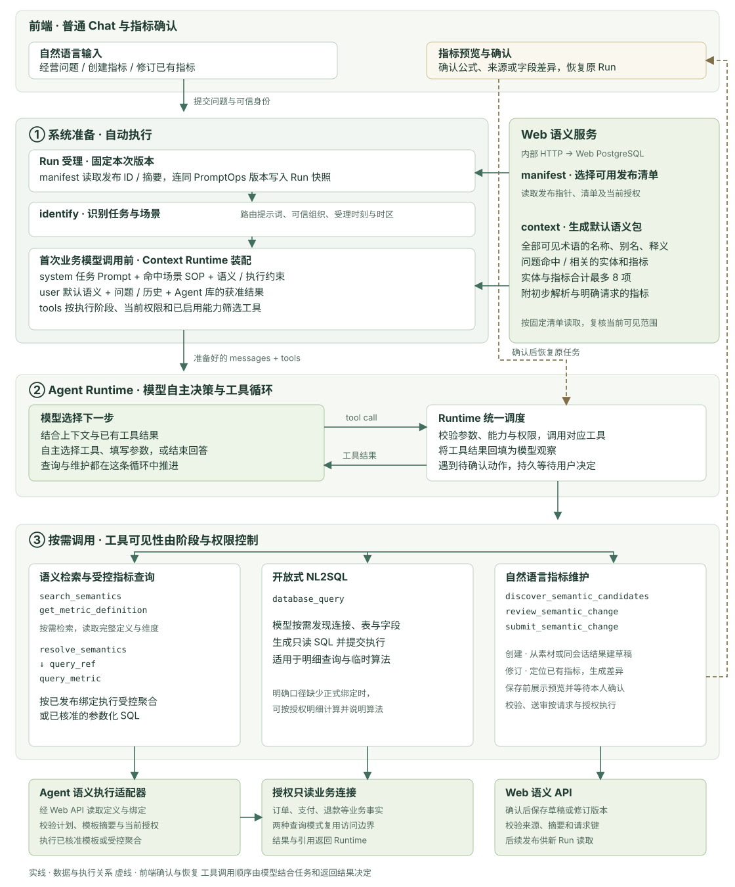
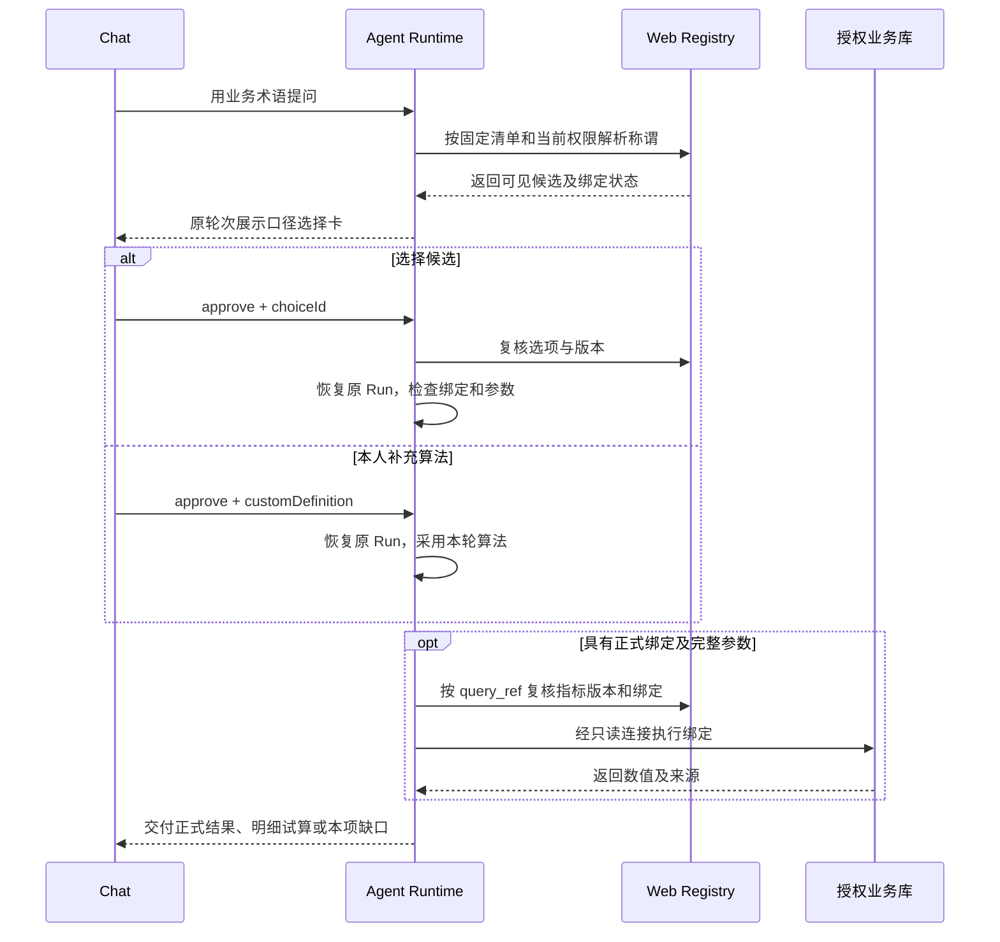

# 第 22 课｜Compass 企业经营语义治理技术方案

> Feature 974 · Profile standard · 三类资产与上下文消歧版 · [企业语义内容专项需求](PRD.md) · [产品需求与验收](PRD.md) · 标准模板 · 返回需求简报

## 需求依据与代码基线

先确定企业经营语义中需要管理的内容，再实现定义、查询和治理。业务术语、指标清单、实体关系、来源适用性与首批口径样例以专项需求为准。主 PRD 的 FR-01–13、AC-01–16 负责产品流程及验收。方案讨论稿选定 PostgreSQL + JSONB、基于作用域的检索、模型辅助消歧和确定性执行绑定。本文给出这些选择在 Compass 中的表、工具和交互协议。

本文按第 22 课当前工作区的 Web、Agent 和零售教学包描述实现。Web/main 的迁移头为 `0008_semantic_asset_grants`，Agent/main 为 `0018`。教学包由 v1 初装、v2 定义发布和 v3 术语修订组成。

| 现有能力                     | 本课接入点                                                                                                                                                                                                                                                                                                                                                                                                                                 |
| ---------------------------- | ------------------------------------------------------------------------------------------------------------------------------------------------------------------------------------------------------------------------------------------------------------------------------------------------------------------------------------------------------------------------------------------------------------------------------------------ |
| 身份、工作区、授权及业务连接 | Web 权限模块、内部运行鉴权、受管连接、只读执行                                                                                                                    |
| 当前上下文                   | 文件指标字典与匹配、模型调用前的上下文组装、来源复核与可见性投影                                                                                                                                                      |
| 工具、持久等待与 Chat        | 工具目录、工具规范、已有查询工具、等待与决策、Run 契约、控制路由 |
| 指标页面、原轮次与保存邀请   | 导航目录、分析消息、等待操作、指标保存卡、界面规范                                                                                                                     |

## 1. 整体设计

Agent 通过语义上下文、可调用工具和场景提示词使用 Web 管理的语义资产。前端普通 Chat 支持经营查询，以及自然语言创建、修订指标。模型依据当前问题、上下文和工具结果自主决定调用，Runtime 管理执行、持久等待与恢复。



| 环节               | 读取内容与职责                                                                                                                                                        |
| ------------------ | --------------------------------------------------------------------------------------------------------------------------------------------------------------------- |
| Run 受理           | 固定 PromptOps generation，调用 Web `manifest` 取得发布 ID 和摘要，写入 Run 快照                                                                                      |
| 任务识别           | 使用路由提示词确定任务与场景，注入受理时刻、时区和可信范围                                                                                                            |
| 首次业务模型调用前 | `context` 读取全部可见术语及相关实体、指标摘要。实体和指标最多 8 项，附初步解析与明确请求指标。普通 Chat 还读取同会话当前获准的历史结果                               |
| 动态工具循环       | 模型选择 `search_semantics`、`get_metric_definition`、`resolve_semantics`、`query_metric`、`database_query` 或资产维护工具，Runtime 校验并执行，结果回填后继续决策    |
| 自然语言维护       | `discover_semantic_candidates` 准备新草稿或修订预览，经前端确认恢复原 Run，由 Web 保存。`review_semantic_change` 和 `submit_semantic_change` 处理获准的校验、送审请求 |

开放式 NL2SQL 通过 `database_query` 执行模型提交的只读 SQL。指标绑定模式先由 `resolve_semantics` 固定版本、绑定和业务参数，再由 `query_metric` 执行受控聚合或已核准模板。两条路径复用当前授权连接。Web 管理定义、授权和发布，Agent 保存运行状态与私有引用，跨应用通过内部 HTTP 协作。

专用检索仅开放非语义来源时，默认语义改由 `glossary` 提供已发布的非个人共享术语。工具续调用复用已记录的输入前缀并复核当前权限，模型根据实际返回结果决定下一步。

### 1.1 各类变更由谁承接

| 变化                                                 | 维护入口与交付物                                                                                           | 对运行链路的影响                                                                             |
| ---------------------------------------------------- | ---------------------------------------------------------------------------------------------------------- | -------------------------------------------------------------------------------------------- |
| 新增术语、指标、时间口径、维度或依赖                 | 维护者在指标管理页保存定义、别名和关系，按归属与分享权限立即发布                                           | 发布下一份清单，同一组工具读取新数据。编码、单位、日期字段、表名和指标公式均从版本与绑定取得 |
| 新租户、部门或岗位采用已有能力                       | 通过 IAM 配置成员与能力，在 Registry 登记可见范围、所用连接及已审绑定                                      | 相同工具签名和提示词版本可服务多个租户。数据负责人只在本地范围安装执行绑定                   |
| 业务希望改变 Agent 的协作方式                        | 在 PromptOps 修订对应任务或阶段的 SOP，按既有发布机制绑定 generation。需要复用的领域说明可作为已登记 Skill | 改变模型何时解释、检索、澄清或建议保存。指令只能使用当前已授予的工具和可见材料               |
| 接入另一个使用已支持协议的来源                       | 登记来源、映射、列与行保护、类型化参数、结果契约，经验证和审批后发布                                       | 复用已有执行与授权适配器。复杂公式可通过已核准的参数化模板计算                               |
| 现有执行语义无法表达新计算，或新来源需要新的授权协议 | 工程侧新增可复用的算子或来源适配器，声明适用条件和验证方法                                                 | 新能力按种类接入，独立验证权限、重放与结果契约。原有租户与指标沿用原契约                     |

Registry 保存企业的业务词汇和计算事实；工具提供产品操作；场景提示词指导模型选操作。权限、绑定签名、用户决定和发布事务由服务端执行。生产代码按资产类型、授权能力、操作和协议分派。课堂提问由 PromptOps 预填资产提供，教学指标、说明和样例见可选导入包、评测集及静态原型。原型中的固定对话、候选与示例表单值只供交互演示。

### 1.2 正式与临时查询

| 链路         | 输入与计算责任                                                                                                                  | 输出                                  |
| ------------ | ------------------------------------------------------------------------------------------------------------------------------- | ------------------------------------- |
| Metric Query | `query_metric` 按已发布绑定计算。工作区可由列映射编译受控聚合，或复用单位、粒度一致的本地已发布绑定                             | 查询、对比或下钻的正式回执            |
| Trusted SQL  | 同一工具按版本读取已核准的参数化 SQL。零售模板实现支付、退款、历史订正、比率及期末快照等计算                                    | 回执记录指标版本、绑定 ID 和 SQL 摘要 |
| Open SQL     | `database_query` 在获准连接上执行只读明细查询。复合问题中可先查独立事项。已明确算法但缺少正式绑定时，可用明细计算并说明实际算法 | 标记 `open_sql`，保留临时查询引用     |

例如，“失败支付最多那天，销售额比上周同日变了多少”包含两项计算。先按失败尝试确定日期。若用户已指明成功支付，可按支付 GMV 比较两天；若“销售额”仍可能指净回款或确认收入，先请本人选择或填写算法，再给出金额。

## 2. 存储、版本和权限

### 2.1 分层与键

[默认零售语义资产设计](RETAIL_SEMANTIC_ASSETS.md)列出教学词条、指标公式与数据映射。三类定义共用 Web/main 的身份与版本表。维护归属决定谁可改定义，版本的使用范围和当前授权共同决定谁可读、谁可用。

| 对象       | 数据与约束                                                                                                                                                                                                                                |
| ---------- | ----------------------------------------------------------------------------------------------------------------------------------------------------------------------------------------------------------------------------------------- |
| 来源与范围 | `semantic_source` 保存定位符、版本、摘要及素材。`semantic_scopes` 区分平台、租户、工作区、部门、岗位和个人。部门与岗位键均存于 `department_key`。                                                                                         |
| 成员与授权 | `semantic_scope_memberships` 记录组织成员；`semantic_scope_grants` 授予维护、分享、业务审批、数据审批和发布职责。`semantic_asset_grants` 以工作区、资产和一个部门或成员为键，记录使用授权的启用或撤销。                                   |
| 资产与版本 | `semantic_assets` 以 `(owner_scope_id, kind, code)` 唯一标识实体、术语或指标。`semantic_versions` 按资产递增 `version_no`，保存上一版本、草稿 ID、使用范围、编辑者、来源位置、正文与摘要。资产的 `open_draft_id` 指向当前逻辑草稿。       |
| 名称与关系 | `semantic_aliases` 以来源版本、目标资产、范围、语言和规范名区分别名。`semantic_relations` 从版本指向资产，记录范围、角色和规则，包括术语指向、实体关联、指标来源及依赖。名称、摘要与别名支持全文检索。                                    |
| 执行与审批 | 同一指标版本可在 `execution_bindings` 登记多个工作区绑定，它们各有独立 ID、SQL 正文及 SHA-256、参数与结果 Schema、访问要求。`semantic_reviews` 按分区、版本和审批摘要记录步骤、处理人与意见。                                             |
| 生效与追溯 | `semantic_release` 保存分区每一代清单，`semantic_release_head` 指向稳定版及可选的灰度版和受众。`semantic_revocation` 记录撤销。`semantic_event` 以操作者、工作区和请求键去重并保存回执。`semantic_reference` 反查引用该版本的查询和报告。 |

Web 按平台、租户和工作区选择分区，根据成员身份选择各分区的稳定版或灰度版。清单的 `assets` 条目记录版本，可附绑定 ID、绑定摘要和依赖版本。别名、术语指向和实体关系随来源版本读取。平台公共定义可以附加工作区绑定，只有版本相符时才合并。Agent 保存有序发布 ID 及分区、发布 ID、摘要组合的哈希。

旧 Run 继续读取受理时的定义，同时核验原清单和当前生效清单中的可见性。已归档、撤销或失权的对象退出投影。执行器还检查本地绑定、连接身份及实际可读数据范围。

### 2.2 创建、查看和计算的作用域

| 操作           | 服务端规则                                                                                                                                                                               |
| -------------- | ---------------------------------------------------------------------------------------------------------------------------------------------------------------------------------------- |
| 读取术语       | 在当前租户、工作区边界内，共享的已发布术语进入分析上下文。个人维护的新术语默认发布至当前工作区，历史个人私有术语仅本人可见。仅获共享词表的请求返回非个人术语。                           |
| 读取实体或指标 | 先过滤租户、工作区、私有范围及版本依赖，再核对管理员目录可见性、维护权、岗位范围、部门归属及资产授权。部门发布范围自带本部门使用权，可显式撤销。成员或其他所属部门授予的使用权分别生效。 |
| 授予资产使用权 | 具有语义治理权的租户管理员可批量授权非个人发布范围的实体和指标，按部门或按成员选取。批次只调整资产使用权。                                                                               |
| 维护与分享     | 检查 `semantics.draft` 和原归属的维护资格，再校验目标使用范围。普通个人指标默认仅本人使用。共享接收者按获准范围读取，续编原件另验维护权及版本摘要。                                      |
| 读取业务数据   | 正式查询需要语义查询权、固定指标版本的本地发布绑定和本人获准的受管连接。开放查询独立检查连接；每次计算及结果读取继续受数据源行列权限约束。                                               |

服务端从会话和可信 Run 所有者读取租户、工作区、用户、角色、部门、岗位及允许连接。当发布缩小使用范围时，旧 Run、回执及报告在投影前同时检查当前生效的使用权和原运行固定版本。授权缩小时即时收窄，版本固定继续保证口径一致性。工具参数中的部门或域只能作为筛选意图，客户端无法写入身份字段。操作系统角色、IAM 权限、组织业务标签和指标口径规则分别检查。建草稿、看定义和读取底层数据分别授权。

### 2.3 Agent/main 的运行状态和迁移

Agent 在受理事务内将发布 ID 列表与摘要分别写入 `agent_run.config_snapshot.contextRuntime.registry.pins` 和 `manifest`。恢复时按原 Run 读取这份快照，并通过 Web 复核当前权限及撤销状态。

若已启用语义工作区，专用检索快照又只允许非语义来源，Run 改用 `contextRuntime.glossary` 固定清单，只读取共享词表。登记清单暂不可用时记录 `registryIssue`，在模型输入中返回不可用状态。文件字典路径服务于尚未启用 Registry 的工作区。

`semantic_metric_offer` 已在 0017 建立，字段为 `offer_id, session_id, run_id, owner_id, kind, status, private_payload, expires_at`。Agent 将计划、搜索游标、查询回执和用户选择加密存放，引用通常有效一天。计划按原 Run 读取，临时结果可由同一所有者在原会话再次引用。待确认动作复用持久化 Wait、动作和 outbox。

| 所有者           | 迁移与交付                                                                                                                                                                                                                                                      |
| ---------------- | --------------------------------------------------------------------------------------------------------------------------------------------------------------------------------------------------------------------------------------------------------------- |
| Web/main         | 0004 建内容表，0005 加治理与分区发布，0006 加全文索引。0007 先检查仍有效的历史限制，再移除策略与反馈表。0008 增加部门／成员资产授权表及运行账号权限。原生迁移 · 完整 SQL、增量及清单 |
| Agent/main       | 0017 → 0018 逐行比对旧 `semantic_run_binding` 与 Run 快照中的清单 ID 和摘要，一致后移除重复表。私有回执继续保留。Alembic · 完整 SQL、增量及清单         |
| data-seed/retail | 沿用独立教学快照及受限只读角色。参考查询                                                                                                                                                    |

升级前暂停旧 Agent 与 Scheduler，备份 Web、Agent 数据库及私有状态密钥。先迁移 Web，再迁移 Agent，然后启动相应版本的服务。遇到旧发布仍有禁用能力，或持久清单与 Run 快照不一致，迁移事务回滚，核对处理后重试。恢复在独立库还原备份，核对权限、发布指针和运行版本后切换。Run 固定 PromptOps generation；恢复时按版本及允许的策略摘要读取，文件与 Registry 路径的兼容条件见上下文装配。

## 3. 运行时与管理时工具

在 `apps/agent/src/compass_agent/tools/business/<tool_name>/` 分别导出 `SPEC: ToolSpec` 并登记到现有静态目录，模型声明、前置检查和执行装配共用启用条件。读定义、受控查询、提议与送审分别绑定 ToolSpec 能力。声明给模型和实际分派使用相同的“当前授权 ∩ 任务阶段 ∩ 已注册且可用”结果；工具内部再核验目标资产、来源和目标范围。治理工具只在具有对应提议、校验或送审能力的入口装配。普通 Chat 的保存邀请通过服务端确认流程建草稿，不向普通分析模型发放发布或任意写权限。下面列出运行时接口；`?` 表示可缺省。

### 3.1 四个运行时工具

| 工具                    | 模型参数                                                           | 行为                                                                                                                                                                               |
| ----------------------- | ------------------------------------------------------------------ | ---------------------------------------------------------------------------------------------------------------------------------------------------------------------------------- |
| `search_semantics`      | `query, kinds?, domain?, scope_filter?, cursor?, limit?`           | 在授权目录搜索，返回 `items`、`match_reason` 和可选续页 `cursor`。默认每页 12 项，上限 50 项。游标绑定所有者、Run、清单和条件。                                                    |
| `get_metric_definition` | `asset_id, version_id?`                                            | 读取固定清单中可见资产的定义、别名和可见依赖，三类资产均可查询。                                                                                                                   |
| `resolve_semantics`     | `mention, metric_id?, dimensions?, parameters?, historical_as_of?` | 结合原话与前文，已明确时可传可见指标 ID。多个可见候选触发澄清；单一候选按资格返回 `unavailable_binding`、`query_forbidden`、`needs_parameters` 或正式计划。无匹配返回 `no_match`。 |
| `query_metric`          | `query_ref, operation?, parameters?, comparison?, parent_group?`   | `query` 执行原计划。`compare` 须显式传入对照期，可采用解析返回的 `previous_equal_window`。`drilldown` 在原参数中固定子分组和父级筛选，可从 `total` 开始。                          |

解析参数含 `start`、`end`、可选的 `group_by` 和 `filters`。Agent 默认以 Run 受理时刻为可见截止 K；有检索快照时还受 `knownAt` 限制。用户指定的 `historical_as_of` 须带时区且不晚于有效截止。服务端填入 `as_of` 并校验参数 Schema，签发本 Run 的 `query_ref`。更改本期、分组或过滤需重新解析。对比固定相同截止、分组及筛选，并核对两次来源授权一致。

### 3.2 三个治理工具和平台写入口

| 工具                           | 模型参数                                                                                                        | 行为                                                                                                                                    |
| ------------------------------ | --------------------------------------------------------------------------------------------------------------- | --------------------------------------------------------------------------------------------------------------------------------------- |
| `discover_semantic_candidates` | `source_refs?, owner_scope_id?, usage_scope_id?, result_ref?, trigger?, reuse_reason?, revise_metric?, fields?` | 按来源发现素材，按同会话回执提议指标。`suggest` 提名可复用结果；`requested` 请求建草稿，或用 `revise_metric` 与字段改动请求修订原指标。 |
| `review_semantic_change`       | `version_id`                                                                                                    | 返回该版本的摘要、检查发现与影响范围。                                                                                                  |
| `submit_semantic_change`       | `version_id, expected_digest, note, request_key, binding_id?`                                                   | 校验草稿及阻断项后展示送审确认，授权维护者确认后进入业务评审。                                                                          |

「数据与语义 → 指标口径」支持按类型、业务域、维护归属及状态筛选。实体、术语和指标均从右侧抽屉查看和编辑，可沿术语指向或实体关系打开相关定义。管理页经 `GET /api/semantic/assets` 读取目录，`POST assets` 在一次事务内保存并发布定义，`POST assets/{id}/remove` 检查引用后归档，`POST sources` 登记来源。

「资产授权」抽屉经 `GET /api/semantic/asset-grants` 读取部门、有效成员、组织实体／指标及其授权。`POST` 接受 `mode, target_ids, asset_ids, active, request_key`，以一个事务授予或撤销所选组合。范围成员和治理职责由 `scopes`、`grants` 管理。

Chat 建草稿、修订和送审分别复核归属与权限。对原指标修订时按资产加事务锁，校验 `expected_digest`，在同一逻辑草稿上追加版本。已送审的草稿须先退回才能续编。过时摘要或冲突写入返回 409。管理页的“保存并生效”会关闭该资产的开放草稿；新版定义的执行能力须单独核准。

### 3.3 默认上下文、动态检索与停止条件

**本轮的时间与组织。** Web 在受理新 Run 时校验当前用户对租户和工作区的访问，返回租户名称、工作区名称与租户时区。Agent 将这些字段随 Run 保存，并以受理时间生成当地日期、星期、时间和 UTC 偏移。意图识别和后续模型步骤共享这个参照，恢复或重试沿用原值。用户再次提问时重新取值。租户时区缺失或无效时，依次取资料包时区和 UTC。历史资料另列可见截止时间，“昨天”仍以本次提问为参照，用户显式指定的日期或时区优先。

系统指令带入可信的租户、工作区标识；可编辑的组织名称放在单独的结构化输入中。个人、部门或岗位影响可见资产的筛选，工具执行时仍复核实际授权。旧 Run 按原模型输入恢复。

**固定版本，实时鉴权。** Run 固定 Registry 清单和 PromptOps generation。Web 先按 Run 的固定发布清单、当前主体的租户与工作区、成员授权和版本依赖筛出可见资产。分析首包带入全部已发布共享术语的名称、别名、释义及版本。个人私有词条仅本人可用。实体和指标按问题匹配和显式授权选取，匹配候选最多八项。开通语义治理的工作区在仅启用文档检索时同样读取共享术语。术语引用随模型输入记录，恢复和交付前分批复核当前版本与权限。

**逐步补齐。** 模型有足够信息解释问题时即可回答。需要补充时，先在完整授权视图内按规范化名称/别名、关键词和 PostgreSQL 全文索引排序，返回匹配原因与带权限的游标。名称规范化与中文分词属于检索实现，可以统一升级。模型可以改变搜索词、域或类型，查看定义，再请求解析。服务端在完整可见集合检查冲突，分页截断、相关度最高或默认注入的条目数均不参与唯一性判定。模型提出指标、维度、期间等意图，Resolver 依据版本化定义、当前可见候选、显式约束与会话上下文核验。比较多个已明确的指标时分别绑定；对同一指代存在多种合理解释时，暂停并请用户确认。

**停止与审计。** 可回答、正式请求已唯一绑定、需要用户决定、重复检索无新信息、预算耗尽或权限失效均可结束检索。单个 Run 最多接受 8 轮不同检索。同一工具调用在权限复核后重放上一页；新调用重复同一条件、偏移和候选列表，或已用完预算时，返回 `budget_exhausted`。未匹配、无查询权限、无绑定和参数不全都返回本项状态。模型据此决定继续调查、交付已有结果或请本人补充。正式绑定被撤回后，正式查询失效。独立明细查询仍按当前连接、字段和业务行授权执行。私有回执记录清单摘要、来源、所见版本与预算消耗。下一模型步、恢复、引用旧结果和交付时都复核当前访问。工具续调用复用原消息前缀。已声明工具失权、连接版本变化或来源复核失败时，拒绝继续使用该前缀。

### 3.4 PromptOps 场景与工具使用 SOP

经营问答、数据分析、看板、经营报告各有任务说明。40 个路由场景在同一份 PromptOps 场景目录中分别保存 SOP。分类器只读描述和示例，路由完成后才将命中场景的 SOP 加入 system 消息。资产摘要以 user 消息传入，所有阶段沿用 Run 固定的提示词版本。

正式取数按实际调用的指标、绑定版本和范围校验回执。相对时间和绝对日期采用相同规则。模型可在获准工具中继续查定义、业务事件或独立资料。数值、授权和来源由执行器核验；具体的调查次序、竞争解释和报告组织由场景 SOP 指导。跨来源草稿默认支持引文、行列、比较和计算；采购档位和工作日历只随显式启用的零售资料包提供。

`context_runtime/assembly.json` 登记范围配置、任务场景模板和可选资料包。`shared/policies.json` 保存公共语义指引，`prompts/tools/<name>.json` 保存各工具的模型描述与示例。工具输入由 ToolSpec 的类型定义约束。`identify` 和 `generate` 无工具，`plan` 至多提供 `todo_write`，`query/analyze` 按任务和当前权限开放工具。财务范围的基础工具、Registry 能力及插件前缀由同一装配配置控制。

| 场景与意图                                  | 系统提示词要求模型怎么做                                                                                                                         | 服务端保证与用户出口                                                                                           |
| ------------------------------------------- | ------------------------------------------------------------------------------------------------------------------------------------------------ | -------------------------------------------------------------------------------------------------------------- |
| 释义与发现                                  | 已注入的当前定义足以回答时，说明其含义与适用范围；未知术语用 `search_semantics`，需精确公式、版本或可用维度时用 `get_metric_definition`          | 只投影可见已发布定义；解释口径无需访问业务行                                                                   |
| 正式取数、对比、下钻                        | 根据已有摘要或检索结果调用 `resolve_semantics`。取得有效 `query_ref` 后用 `query_metric` 选择相应操作。按回执标明期间、口径和范围                | Resolver 确认唯一版本及参数，适配器校验权限与绑定。多个明确指标分别取数                                        |
| 歧义、没有匹配或信息不全                    | 可用新线索补搜；多个合理口径影响答案时，展示可见候选，支持本人选择或填写算法。定义明确且缺少绑定时可用授权明细试算，并说明算法和来源             | 独立明细可以先行查询。本人提交选择卡后在原轮次继续。正式绑定、来源访问和业务行范围分别核验，临时结果带独立标识 |
| 完成开放查询后建议沉淀，或跨轮提出创建/修改 | 从本轮完整的开放查询结果提炼可复用指标，先查已有等价定义，再按需提名；显式要求则从用户指明的授权结果或资产版本直接提取。多项指代未清时请用户选择 | 提议工具检查来源与可见目录。主动提名由用户勾选保存；明确创建或修订时核对可编辑预览后确认                       |
| 指标管理与发布                              | 管理场景从获准来源发现候选、复核缺项和影响，向维护者解释差异；已保存的草稿由获准维护者明确送审时才用 `submit_semantic_change`                    | 平台核验目标范围、草稿摘要和审查回执；业务与数据两级审批、发布和回滚由获授权的人执行                           |
| 分析诊断、看板与报告                        | 复用当前仍可见的结果引用；需要新数据时使用相同的解析、对比和下钻工具。结论按行、组或已验证的派生值引用回执                                       | 展示层只从受信工具记录取数，遵守单位、粒度、时点和可聚合性，交付前重新鉴权                                     |

公共语义指令随 PromptOps 发布。每个 Run 使用其受理时固定的 generation。

### 3.5 受控执行与草案转为可执行绑定

Web 的 `compileBinding` 从映射生成 `sum/count/min/max/avg` 聚合 SQL，校验所用维度、筛选和业务时区。工作区也可复用已发布且单位、粒度一致的本地绑定。零售包中去重计数、比率、期末快照和版本订正等计算由专用参数化 SQL 表达；导入后属于候选。数据库允许的模式为 `aggregate`、`trusted_sql` 和 `view`。管理入口接收映射或既有绑定 ID；执行器校验存储的 SQL 字节与哈希，并在受限 PostgreSQL 连接上执行。

参数 Schema 限定分组、筛选和类型，执行器把业务参数与授权范围分别绑定到 SQL。先核对实际会话身份、只读权限和来源访问要求，执行后按结果 Schema 验行；返回正式回执前再读绑定。新建映射要求以独立预期试算后才能完成数据审批。开放分析产出的草稿只保存可复用的业务定义和来源。

比较时按同一截止时刻取两个左闭右开业务窗口。结果按两期分组键全量对齐，给出本期减对照期的差额。完整可加金额可将单侧缺失分组视为零；缺报或不可比时保留空值。快照、比率及来源修订的具体计算见[零售语义资产](RETAIL_SEMANTIC_ASSETS.md)。

## 4. 治理与 Chat 的状态协议

### 4.1 版本、双审批与发布

工作台直接保存人工维护的三类定义。正式取数绑定走独立流程：登记本地绑定、按要求试算、业务与数据审批、灰度或稳定发布。模板及目标连接变更产生新的绑定摘要，重新核对。Chat 保存提议使用私有草稿，维护者可在目录继续编辑。

定义保存由 `changeDefinition` 分别更新稳定清单和已有灰度清单，保留两个通道各自的其他条目。治理发布使用 `digest({version, partition, binding})` 关联同一对象的送审、业务和数据决定。两级评审人须相互独立，并避开创建者、编辑者、提交者和绑定作者。需要试算的绑定以同审批摘要查找成功试算回执。发布者核对草稿摘要、依赖和预期代数，在分区指针锁内追加发布并更新指针。撤销会登记撤销记录，回切会产生新一代清单。

### 4.2 Chat 中选择口径并恢复原 Run

仍有多个可见定义符合原话时，Agent 用歧义称谓调用 `resolve_semantics` 并省略 `metric_id`。候选可以只有定义；执行绑定的有无会影响后续取数。决定“销售额”含义时依据用户给出的业务事件与前文。卡片最多展示三项，注明口径差异、单位及可用性。用户可选一项，也可点「都不合适，我来补充算法」填写本轮算法。



Agent 把私有选择写入现有审批等待，公开视图用 `semanticKind=choice` 标识。控制端点 `POST /v1/analysis/runs/{run_id}/decisions` 要求 `waitId, proposalId, proposalRevision, proposalDigest, decisionId, requestId, expectedVersion, decision`。候选选择提交 `approve + choiceId`；手填算法提交 `approve + customDefinition`；点取消发送 `reject`，关闭本次等待。展示和提交候选时重新核验可见版本，冲突反馈给当前会话。Agent 加锁记录决定、更新 Run 并发出事件，重复请求按既有控制幂等规则处理。

自填算法按 Run 与原称谓保存，恢复后作为 `user_definition` 供本轮使用。选择仅有定义的指标时，返回所选口径及缺绑定状态。两种情况下都可在当前获准的明细上按明确算法计算，注明实际方法；数据不足时交付独立完成的部分及缺口。

### 4.3 从查询结果建草稿或修订已有指标

| 入口         | 用户看到什么                                                                                   | 服务端行为                                                                                                                                                                                                          |
| ------------ | ---------------------------------------------------------------------------------------------- | ------------------------------------------------------------------------------------------------------------------------------------------------------------------------------------------------------------------- |
| 主动建议     | 已完成回答下方至多三项，逐项列出名称、口径、一行公式和复用场景。勾选后「保存所选」，也可忽略。 | 模型用 `trigger=suggest` 提名本轮完整回执及字段、复用理由。Agent 核验来源，并通过 Web 比对定义摘要、名称／别名和口径／公式。已有等价定义、普通明细或未获提名的探查结果不显示保存卡。                                |
| 明确要求新建 | 同一会话有多份可用结果时先指认来源，随后核对可编辑草稿并确认。                                 | `trigger=requested` 定位所有者仍可读取的回执。Agent 在 `semantic_result_choice` 或 `semantic_draft` 等待后恢复；Web 按 `result-draft` 请求键保存。默认归属本人，显式编辑范围时另验维护与分享权。                    |
| 明确要求修订 | 展示原指标、字段原值与拟改值。可调整提议字段、确认或取消。                                     | `revise_metric` 通过 `revision-lookup` 查可维护指标；目标唯一且有实际改动时进入 `semantic_revision`。读取卡片重验 `revision-preview`，确认后 `revision-save` 校验原摘要，以动作 ID 为请求键将修订追加到原资产草稿。 |

回答下的保存卡经 `GET/POST /v1/analysis/runs/{run_id}/semantic-results` 读取及处理建议。界面逐项提交所选结果，各项可单独重试。保存时 Agent 再验所有者、有效期及来源，Web 检查范围并返回草稿。相同结果和字段的重试复用原回执；保存后的新草稿或修订须经管理页保存生效或进入治理发布流程。

### 4.4 跨工具结果与运行回执

正式回执以 `resultId` 标识，含 `metric`、`manifest_hash`、`binding_id`、`binding_hash`、`calculation_mode`、`time_range`、`as_of`、`data_release`、授权范围和结果行列。独立的开放查询在留存成功时使用 `calculation_mode=open_sql`，同时以 `semantic_result_ref` 关联本会话临时结果。两者都从可信工具结果进入模型上下文。释义类请求可仅交付定义。

报告和看板在交付及回看时依来源引用复核可读权限。正式查询已取得所需指标时可直接生成交付物。合计遵循定义的可加性，快照与比率按目标粒度重新计算。

报告和分析表允许一次模型修订。修订后仍有无来源的数字或输出结构不合法时，系统仅在所需各指标均有当前可用正式回执的条件下，按原行与列交付 Markdown 表或 CSV，并说明自动解读未通过校验。跨维度对账须有相同绑定、来源授权、截止、筛选和窗口下的独立总计及完整分组合计，逐维度给出相等或实际差额。公式与版本取舍从本次生效的已批准定义读取。

以下伪代码概括普通 Registry 模式的三个步骤。候选解释由模型结合对话判断，Web 复核可见版本，执行器核验绑定及参数。

```text
prepare_business_step(run, question):
  binding = bind_once_or_read_existing(run, registry_manifest, prompt_generation, policy_digest)
  access = current_authorization(run.owner, run.workspace)
  tools = enabled_registered_specs(run.task, run.phase, access, availability)
  visible = registry.visible_projection(access, binding)
  items = visible.matched_entities_and_metrics(question)[:8] + visible.terms()
  history = require_authorized_history(run, access, binding)
  return compose(approved_prompt_paths(run), tools, as_untrusted_data(items), history)

resolve_for_run(run, intent):
  view = currently_visible_versions(run.owner, run.binding)
  matches = validate_intent_over_all_applicable_candidates(intent, view)
  outcome = resolve_visible_candidate_or_clarify(matches, intent, conversation)
  if outcome.requires_user_choice: return persist_wait_and_suspend(run, outcome.options)
  if outcome.needs_input_or_has_no_binding: return metric_status_with_visible_definition(outcome)
  return issue_run_bound_query_ref(run, outcome, validated_time_and_source_versions(outcome))

execute_metric(run, query_ref, parameters):
  access = current_authorization(run.owner, run.workspace)
  plan = verify_resolved_ref_and_parameters(run, access, query_ref, parameters)
  binding = verify_published_binding_and_source_grants(plan, access)
  result = execute_read_only(binding, bind_values(plan), timeout=run.remaining_time)
  require current_access_to_definition_and_sources(run.owner, plan)
  return record_trusted_result(run, result, plan, binding)
```

## 5. 实施切片与验收

### 5.1 实现入口与验证范围

| 链路           | 实现入口                                                                                                                                                                                                                                | 核对行为                                                             |
| -------------- | --------------------------------------------------------------------------------------------------------------------------------------------------------------------------------------------------------------------------------------- | -------------------------------------------------------------------- |
| 定义与授权     | 目录与可见性、资产授权、管理页                         | 保存生效、归档、查看关联、私有术语及跨部门／成员授权。               |
| 受理与模型输入 | 运行时快照、时间与组织、模型步骤 | 原 Run 的时间、清单及 PromptOps 版本，普通与专用检索模式的语义输入。 |
| 可信执行       | 绑定编译、审批发布、查询适配器               | 试算、双审批、灰度和回切、参数校验、只读身份及行列范围。             |
| Chat           | 候选与等待、决定投影、保存建议                   | 选择口径、填写算法、多项勾选、显式建草稿、修订冲突及撤权后的恢复。   |

课堂的四道题分别演示支付明细与正式指标联合查询、发现可复用指标、跨会话修订原指标、联席会选择口径。题面由 PromptOps 的 `support/starters/semantic-analysis.json` 分发，具体范围与课前准备见第 22 课课堂案例。

### 5.2 通用性验收

验收保留一套实施团队未据此编写场景提示词的合成数据。冻结应用镜像、工具 Schema 和 PromptOps generation，只通过产品配置、授权和导入/发布接口接入。以下是实现后的放行用例。

| 变更或操作                                                                                                      | 合格结果                                                                                                        |
| --------------------------------------------------------------------------------------------------------------- | --------------------------------------------------------------------------------------------------------------- |
| 在新租户建立两个交叉范围，导入陌生术语、同名不同义的指标、已支持的新单位，以及物理表名/列名不同的已支持来源绑定 | 释义、查询、对比、下钻均经原工具完成；部署版本、工具签名、场景提示词不变。可见定义与可计算的业务行分别受控      |
| 用同一身份询问成功支付、扣退款的成交额，再单独问含糊的“销售额”                                                  | 明确的上下文分别解析到支付 GMV、净 GMV。仍有多个合理解释时等待用户选择。用户也可填写本轮算法。                  |
| 用未出现过的说法引用上轮结果，同时产生多份相似结果；选择、改选、创建和修订均从真实卡片回传                      | 可唯一指向时复用授权引用，多义时由用户选。重复提交只产生一份草稿，未确认不写库，前端从服务端 DTO 渲染候选和差异 |
| 移除成员资格、撤回绑定或让来源失去保护，随后恢复旧 Run、卡片、continuation 或报告                               | 旧摘要、选项、数据或回执不再投影，过期决定无法执行；未知来源与不足权限不会被开放 SQL 绕过                       |
| 用返回陌生单位的正式工具结果生成报告，再分别对比率和期末值求汇总                                                | 正式回执直接支撑报告；合计能力从该指标的聚合契约读取。未经允许的合计需按目标粒度重查，伪造或无权的事实引用被拒  |
| 单独修订一个任务的 SOP 后发布，再对同样资产执行相同请求                                                         | 模型可以改变检索或解释步骤，工具授权、数值来源、人审、事务边界维持同样约束；历史 Run 使用其已固定的提示词和策略 |

教学域的业务口径、真实源表映射和黄金查询维护在专项需求、教学数据包及评测集中。它们验收计算是否正确；上述替换测试单独检验扩展是否需要改应用代码。两组测试均需通过。

上线前运行 `pnpm contracts`、`pnpm contracts:check`，检查两应用的 lint、类型与测试，验证 PostgreSQL 空库/升级、模板哈希、绑定权限、断网重试、幂等以及旧 Run 兼容。独立标签和基准 SQL 沿用主 PRD AC-10：核心域 ≥3、语义识别 ≥95%、同名消歧 ≥98%、SQL 语义正确 ≥95%、复杂任务成功 ≥90%。各版运行数据及独立业务复核进度见本课验收记录。

### 5.3 部门与成员的资产授权迁移

数据库 owner 为 Web，迁移单位为 `web/main`。从 `0007_semantic_cleanup` 升级到 `0008_semantic_asset_grants`，按工作区、资产、部门或成员保存使用授权。历史发布与个人范围继续生效。迁移前备份，先升级 Web 主库，再启动 Web 和 Agent。恢复时向新库还原备份，核对版本、组织授权与运行权限，撤销恢复库会话后切换连接。迁移源 · 完整 SQL · 增量 SQL
