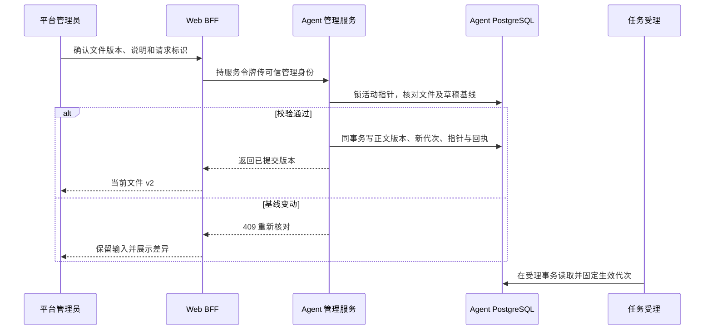

# PromptOps 技术方案 · 文件管理、在线发布与版本恢复

Feature 975 · standard · 已复评 · 2026-11-19。返回 BRIEF · [配套 Context Runtime 方案](TECH_DESIGN.md) · [资产迁移与接入附录](CODE_DESIGN.md)

采用项目标准技术方案模板。需求以[管理端 PRD](PRD.md)、[主 PRD](PRD.md)及[四类场景的方法与交付要求](PRD.md)为准，交互以文件树原型为准。下文给出设计约定和评审伪代码。实际发布链路、兼容性与恢复验证见开发与验收记录。

## 1. 交付目标与架构决策

管理员在现有平台管理里打开与本地同名同层级的 Markdown 文件树。首次导入后整体发布。以后可只改一个片段，核对谁会用它、保存、试填变量、单独发布。目标工作空间的新任务在 60 秒内采用新正文；其他文件、未发布草稿、历史版本及在途任务有各自明确的版本。整库发布或恢复时可重看每一个原文件。

| 参考构想                                                                                                            | 采用与适配                                                                                                                                                                                 |
| ------------------------------------------------------------------------------------------------------------------- | ------------------------------------------------------------------------------------------------------------------------------------------------------------------------------------------ |
| PromptOps 技术构想 的 Workspace、Asset、Version、ReleaseBundle 和 ReleasePointer | 单项目、单环境一棵文件树，以规范相对路径作资产标识。正文版本不可变，所有生效组合都有精确清单。区分单文件版本、内部生效代次和面向管理员的整库快照。先用随包导入、编辑器和下载满足本地协作。 |
| Context Runtime 技术构想 的固定版本与模板支持                                  | 同一 Agent 既管理提示词又运行任务。Runtime 通过同库只读方法在受理事务中固定代次，各阶段按路径精确读取。组合规则、能力授权、指标和四类方法归 Runtime。                                      |
| 观测技术构想 的决策和来源记录                                               | 发布回执关联代次、变更路径和操作人；Runtime 把实际采用的路径和版本附在已有 OTel／Langfuse 链路。持久发布历史承担业务审计，观测导出失败不撤销已成功的发布。                                 |

**基线。** 课程依赖标签 `compass/L20-complete` 指向 `b547e91`，Agent 数据库到 0010。当前核对的集成树 `main@d5d36e5` 已有 Scheduler、共用受理事务和 0015。本稿按这套可同时验证即时与定时任务的集成入口预排 0016；仅检出课程标签时须先对齐这些前置改动。Agent 数据库现状 · 前版设计评审

**职责。** Web 拥有账号、平台管理员判断、页面和 BFF。Agent 的 `agent/main` 拥有文件、发布历史、活动指针及 Run，便于单库事务固定生效代次。调用方向为浏览器 → Web BFF → Agent HTTP。管理服务和 Runtime 复用 Agent 的 SQLAlchemy Session 工厂与一个模板渲染器。一个文件可供多个规则引用，也可在“尚未接入”状态下保存、发布和下载。管理员修改内容；租户、部门、任务、场景和阶段到路径及能力的关系由代码维护。首版无新 app、跨库业务表读写、在线规则编辑器或独立 Eval 服务。

以下以单文件发布为例。管理员看到成功以数据库提交为准，任务受理固定其读取 head 时已提交的组合。跨模块时序详见[发布与受理](TECH_DESIGN.md#uml-publish-admit)、[逐阶段精确读取](TECH_DESIGN.md#uml-step-read)及[整库恢复与旧任务接管](TECH_DESIGN.md#uml-restore-resume)。



## 2. 本地资产、文件树和模板

工程内唯一可编辑的出厂正文目录拟为 `apps/agent/src/compass_agent/prompts/`，通过 `importlib.resources` 枚举。现有 Hatch wheel 打包 `src/compass_agent`，实施时解包 wheel 并比对来源路径和 SHA-256，容器同样验证。当前原型的本地目录只提供教学样例。生产清单按当前真实消费者补齐，详见[资产迁移与接入附录](CODE_DESIGN.md)。

| 路径族                                                                                  | 纳入对象与现有接入位置                                                                                                                                                                                                                               |
| --------------------------------------------------------------------------------------- | ---------------------------------------------------------------------------------------------------------------------------------------------------------------------------------------------------------------------------------------------------- |
| `tasks/{business_qa,data_analysis,dashboard,business_report}/system.md`、各自 `scenes/` | 四类任务的通用方法和具体场景片段。财务周报和通用周报可共享目录而有各自路径、正文和版本。产品方法与交付原则见场景规格。                                                                                                                               |
| `shared/{fragments,stages,tools,skills}/`                                               | Harness 通用指令、数据库工具说明、各阶段及 Skill 片段；静态工具面向模型的可编辑描述移至此树，工具字段、类型、授权、执行校验仍以 ToolSpec 与注册表为准。                                                                                              |
| `support/routing/`、`support/session/`、`support/subagent/`                             | 盘点 `routing/prompts.py`、`routing/intent.py`、`runtime/context.py`、`runtime/session_management.py` 和父子任务装配。保留分类 Schema、消息角色与现有输出契约；把固定指令与每次任务产生的内容拆开。                                                  |
| `support/starters/` 及模型测试辅助模板                                                  | 包括 Web `analysis-composer.tsx` 的预填、模型 playground 的出厂预设和 `llm/litellm_chat.py` 的结构化输出辅助说明。用户提交的对话、个人 MCP 描述与用户自编工作流只属于对应主体。固定介绍文字、动态协议 Schema、业务数据和密钥分别在各自原有边界维护。 |

新增 `promptops/catalog.py` 登记非 Run 消费点、公开预填白名单以及变量类型、可信值来源、用途与样例。Runtime 通过 `context_runtime/profiles.py::enumerate_usages(policy_version)` 提供动态组合规则的静态引用位置，与实际 `resolve_profile` 使用同一份规则定义。使用位置展示“这个路径被哪些规则引用”；每次实际运行使用了哪一个路径以任务记录为准。部署时验出同一规则引用的路径都可到达；新增目录中的自由文件可单独发布，使用位置显示“尚未接入”。

**路径与正文。** 请求以 JSON 字段或查询参数传规范路径，支持项目目录及合法中文命名。统一为 Unicode NFC、相对 POSIX 分段、扩展名 `.md`；拒绝绝对路径、空段、点段、反斜杠、控制字符和大小写／规范化碰撞。随包扫描限资源目录内的普通文件，跳过链接并报告；任何校验出错都在写入前反馈。树由路径前缀即时分组，无目录表。名称搜索返回完整路径，版本比较使用 UTF-8 原文 SHA-256，保留空格和末尾换行。新文件必须声明路径；更名视为引入新路径，旧历史保留。列表仅传元数据和游标，正文按选中文件读取。大小限制应覆盖首发清单并低于现有 BFF 的 2 MiB 单响应界限；建议正文初值 256 KiB，清单分页，导入从随包资源运行，不把全库正文拼成一个 HTTP 响应。

**模板。** 后端只支持一次替换的 `{{name}}`，名称按标识符规范校验。解析器扫描普通文本和完整占位符，遇到不配对的定界符或表达式时返回行列和原因。没有条件、函数调用、路径取值或正文嵌套包含。变量声明在用途目录中，如 `period`、`unit`、`audience`，只允许该路径的各个既有调用点都能提供的变量；无调用方文件可用公开样例变量，接入代码时追加兼容检查。声明描述值类型、是否必需、可选值的默认表达和最大长度。正文用了某变量就须在渲染时有合法值或明确声明的默认值。值替换后作为一次字面数据，不再次解释其花括号。变量提供者只取已授权、已验证的值，用户自由输入保留原消息角色。编辑器可保存不完整草稿，试填、发布校验及 Runtime 使用同一解析器；发布校验覆盖共享路径的全部调用方及构造出的默认清单。浏览器预览使用现有 Markdown 组件的 GFM、跳过 raw HTML 和禁用外部资源的嵌入模式。发布正文的表达不能改变工具注册、授权或控制输出 Schema。

## 3. 持久模型与原子发布

### 3.1 三种版本和表

`v2` 仅表示一个路径的第 2 个正文版本。`generation=8` 是一次已提交的完整生效组合，供 Run 固定；该组合是所有路径到版本的映射。`S003` 是面向人的整库快照编号，仅在整库发布或恢复时颁发。单发后的当前代次常常晚于页面的最近快照。每代仅复制路径及版本号，正文存储一份，不按 Run 或快照复制。

数据字典中的 pg 类型采用 PostgreSQL 17 名称。除标注 `NULL` 外字段均为 `NOT NULL`。摘要以小写十六进制 SHA-256 存入 `char(64)`，版本与 epoch 均用 `bigint`。ID 的生成由 Agent 库负责，Web 的用户身份使用 UUID 逻辑引用。

| 表                  | 字段与类型                                                                                                                                                                                                                                                                                                             | 键、约束与写入者                                                                                                                                                                                                                                                                                                                                  |
| ------------------- | ---------------------------------------------------------------------------------------------------------------------------------------------------------------------------------------------------------------------------------------------------------------------------------------------------------------------- | ------------------------------------------------------------------------------------------------------------------------------------------------------------------------------------------------------------------------------------------------------------------------------------------------------------------------------------------------- |
| `prompt_file`       | `path text`、`portable_key text`、`origin text`、`edit_rev bigint`、`max_version bigint`、`active_epoch bigint`、`draft_body text NULL`、`draft_base_version bigint NULL`、`draft_base_epoch bigint NULL`、`last_import_body text NULL`、`last_import_hash char(64) NULL`、`updated_by uuid`、`updated_at timestamptz` | PK(path)，UNIQUE(portable_key)，后者为 NFC + casefold 结果。origin 为 bundled/online，max_version 与 active_epoch 初值 0；edit_rev 从 1 递增。草稿不存在时 draft_body 和两项基线均空；新文件草稿 base_version 可空，base_epoch 为 0。last_import_* 成对有值。只通过管理服务修改。                                                                 |
| `prompt_version`    | `path text`、`version bigint`、`body text`、`byte_count integer`、`sha256 char(64)`、`created_by uuid`、`created_at timestamptz`、`note text`                                                                                                                                                                          | PK(path,version)，path FK→prompt_file.path。version>0，byte_count>0。仅插入；恢复旧正文再发布时按路径 max_version+1 分配。                                                                                                                                                                                                                        |
| `prompt_generation` | `id bigint generated by default as identity`、`parent_id bigint NULL`、`manifest jsonb`、`manifest_digest char(64)`、`policy_version text`、`policy_digest char(64)`、`action text`、`snapshot_no bigint NULL`、`restored_from_id bigint NULL`、`created_by uuid`、`created_at timestamptz`、`note text`               | PK(id)，parent_id 与 restored_from_id 分别 FK→本表 id，UNIQUE(snapshot_no)。action=file 时 snapshot_no 为空；all/restore 时要求正数。restored_from_id 仅 restore 有值且指向可见快照。manifest 为 object，值为正整数；事务内校验所有 path/version 成对存在并按路径排序计算清单摘要。policy_digest 是规则、文件契约及变量元数据的代码指纹。仅插入。 |
| `prompt_head`       | `id smallint`、`generation bigint NULL`、`last_snapshot_no bigint`                                                                                                                                                                                                                                                     | PK(id)，CHECK(id=1)，generation FK→prompt_generation.id；唯一初始行为 (1,null,0)。管理写加行锁，发布／恢复更新活动字段。Runtime 使用普通 MVCC 读取。                                                                                                                                                                                              |
| `prompt_command`    | `actor_id uuid`、`request_id uuid`、`action text`、`input_hash char(64)`、`receipt jsonb`、`created_at timestamptz`                                                                                                                                                                                                    | PK(actor_id,request_id)，receipt 保存涉及的路径／版本或快照与摘要。实现超时重试、幂等和操作记录。仅插入，与业务写同事务。                                                                                                                                                                                                                         |

活动内容只从当前 generation 的 manifest 读取。单例锁覆盖低频管理写，解决整库预览后他人新增草稿的幻读。不同文件同时编辑各自使用自己的 `edit_rev`；锁只串行化提交瞬间，互不制造版本冲突。导入计算、差异展示、用户等候及远程调用均在锁外。使用单一写入口，顺序为锁 Head → 按规范路径更新文件 → 插入不可变记录 → 移动指针 → 写回执 → 提交。读快照与正文可通过相同 immutable ID 重读。

### 3.2 状态转换

| 操作                   | 确认时固定的对象                                                                                  | 提交后                                                                                                                                                                                                                                                                 |
| ---------------------- | ------------------------------------------------------------------------------------------------- | ---------------------------------------------------------------------------------------------------------------------------------------------------------------------------------------------------------------------------------------------------------------------- |
| 首次导入和整体发布     | 随包目录摘要、待导入路径，随后确认全量草稿集合                                                    | 导入只建草稿。首发校验随包清单齐全、必要路径都可渲染；所有路径建 v1，建立首代、S001 和 Head。首发前单文件发布返回“请先整体发布”。                                                                                                                                      |
| 保存／从历史恢复到草稿 | path、期望 edit_rev 及所见生效基线                                                                | 保存成功仅变更该文件草稿。存在过期草稿时展示草稿、最新生效内容和基线版本。用户确认合并／保留自己编辑后，以新基线保存，未保存输入留在编辑器。                                                                                                                           |
| 发布此文件             | path、草稿修订、该文件的 base 版本与 epoch、说明、request_id                                      | 在锁内读取最新完整 manifest，只替换该路径。创建新的不可变文件版本和内部代次，清除此草稿。其他路径单独发布后也可在本事务中继承其最新结果。                                                                                                                              |
| 整体发布               | 预览时的 Head、全部草稿的有序 (path, edit_rev, base_version, base_epoch, body_hash)、最新快照编号 | 全部候选校验后同批生效，新代次带新快照号。仅有单发差异也可形成快照，此时文件不升版。无有效改动且清单和策略版本／摘要与最近快照全部相同时返回原快照。仅策略升级也可整体发布新代次与快照。                                                                               |
| 恢复整库快照           | 目标 S 编号、当前 Head、恢复差异预览摘要与说明                                                    | 以历史 manifest 和 policy_version/digest 原样创建新代次及新快照，清单外的路径退出生效，历史文件及全部草稿保留。对发生变化的路径推进 active_epoch 与 edit_rev，旧基线草稿需重新核对。先检查目标符合当前代码可执行的路径／变量契约，不兼容时列出逐项原因并保留当前组合。 |

**数据例。** S001＝`{finance:v1, report:v1}`。两个文件各保存一份草稿，只发 finance 后生效为 `{finance:v2, report:v1}`，S001 仍可读，report 草稿可继续编辑。再整体发布生成 S002＝`{finance:v2, report:v2}`。恢复 S001 形成 S003，正文原样读 v1；下一次发布 finance 分配 v3。省略的其他路径在每份真实清单中均存在。发布相同当前正文时视为无正文变化，明确返回现行版本；用相同 request_id 重试先返回历史回执。

### 3.3 一致性代码设计

以下为 `promptops/service.py` 的事务伪代码，省略 DTO 序列化。preview 使用同一纯计算计划函数，提交在锁内重新计算和验证。单发的确认摘要只包含目标文件和当时使用关系，整库的确认摘要覆盖整批候选、Head 及最新整库快照。恢复摘要包含目标及新旧完整清单差异。校验授权和幂等身份后才进入函数。

```python
def commit_release(db, cmd, actor):
    with db.begin():
        head = db.lock_prompt_head()
        receipt = db.command_receipt(actor.id, cmd.request_id)
        if receipt:
            require_equal(receipt.input_hash, canonical_hash(cmd), "request_id_conflict")
            return receipt.result

        current = db.manifest_at(head.generation) if head.generation else {}
        plan = compute_plan(cmd, current, head, db.files_for_command(cmd))
        require_equal(plan.confirmation_hash, cmd.confirmation_hash, "review_stale")
        for draft in plan.drafts:
            require_equal(draft.base_epoch, draft.file.active_epoch, "base_changed")
            require_equal(draft.base_version, current.get(draft.path), "base_changed")
        usages = registered_usages(plan.policy_version, plan.policy_digest)
        validate_candidate(plan, usages, db)
        if plan.no_change:
            db.clear_committed_drafts(plan.drafts_to_consume)
            result = db.current_receipt(cmd, head)
        else:
            for change in plan.new_versions:
                db.insert_version_and_advance_max(change.path, change.next_version,
                                                  change.body, actor, cmd.note)
            generation = db.insert_generation(
                parent=head.generation, manifest=plan.final_manifest,
                policy_version=plan.policy_version, policy_digest=plan.policy_digest,
                actor=actor, note=cmd.note,
                snapshot_no=plan.snapshot_no, restored_from=plan.restored_from,
            )
            db.advance_changed_files(plan.changed_paths, generation.id)
            db.clear_committed_drafts(plan.drafts_to_consume)
            db.set_head(generation)
            result = receipt_for(plan, generation)
        db.record_command(actor.id, cmd.request_id, canonical_hash(cmd), result)
        return result
```

`compute_plan` 对单发在最新完整清单上计算目标路径的覆盖，对整库以所有已保存草稿覆盖，在比对正文时逐路径复用相同生效版本。单发沿用当前策略版本和摘要。整库发布确认摘要还包括目标策略版本／摘要、预期 Head 和完整草稿集，先验证该策略的全部引用，再允许切换；无正文变化也可激活新策略。对恢复则准确拷贝目标快照清单，消费的草稿集合为空。任何路径缺失、变量不兼容或基线冲突均在一个事务内使提交整体回滚。对内容等同当前的已确认草稿可清除并递增 edit_rev，即使未生成新代次也应在同事务完成；仅重复导入／请求不会清空现有草稿。

### 3.4 随包基线与在线草稿的合并

Agent 只读枚举已安装 wheel 的资源。生产导入接口接收目录摘要和逐项选择，由 Agent 自己重读同一份随包基线。浏览器选本机目录试导入用于教学原型；生产导入入口只读当前运行包中的资源，不接受浏览器提供的服务器路径。首版用户可通过“下载当前文件”将线上新增内容放回同一工程路径。

以 `B = last_import_body`、`L = 本地正文`、`O = 未发布草稿，否则取当前生效正文` 做三向核对。初次碰到同路径的线上新增文件且缺 B 时，相等则认领，内容不等则人工选择。L=B 时保留在线编辑；L=O 时只记已对齐；O=B 时用 L 建草稿。其余展示 B/O/L 差异，由管理员选保留在线、采用本地或编辑合并稿。用户确认处理后更新该文件的导入基线为 L，取消和未选择项保留原基线。上次快照恢复后已退出生效的文件，重新引入须显式采纳为草稿；目录遗漏绝不触发删除。导入确认包含目录摘要、用户选项和每个涉及文件的 edit_rev。整批检查后写草稿、基线和回执，任一冲突返回差异列表供重新确认。新建文件、保存草稿和历史还原使用同一文件级 CAS。

## 4. 管理契约与 Runtime 读取

### 4.1 HTTP 与 DTO

拟增 Agent FastAPI 前缀 `/v1/promptops`，Web 同形代理前缀 `/api/web/v1/platform/promptops`。文件身份通过查询参数或 JSON 中的 path 传递。所有写提交带服务端确认所需字段和 UUID request_id；客户端重新编辑生成新 ID，网络超时可按原命令重试。列表 DTO 分页只返回摘要。

| 后缀与方法                                        | 请求与响应关键内容                                                                                                                                                                                                                                                          |
| ------------------------------------------------- | --------------------------------------------------------------------------------------------------------------------------------------------------------------------------------------------------------------------------------------------------------------------------- |
| `GET /tree`、`GET /file`                          | 目录前缀、搜索词及游标 → FileEntry 页（path、标题、来源、当前版本、草稿状态、使用状态）。按 path → FileDetail（正文、edit_rev、草稿基线、生效版、用途与变量）；`GET /file?path=&version=` 只读历史正文。                                                                    |
| `GET /history`、`GET /snapshots`、`GET /snapshot` | 文件版本及说明分页；整库快照列表；按 snapshot_no 分页读路径与版本；点入历史项按确切版本读取。返回 generation、清单摘要、policy_version 和 policy_digest；清单变化时返回前后版本、增减集合。                                                                                 |
| `POST /file-draft`、`POST /draft-from-version`    | `{path,body,expected_edit_rev,base_epoch,request_id}` → 新 edit_rev 和草稿摘要；新路径 expected_edit_rev=0。历史恢复指定 path/version，保留当前基线，创建草稿供复核；过期草稿合并命令显式携带本次确认的新 base。                                                            |
| `POST /render-preview`                            | path、已保存版本或待编辑正文、样例变量 → 解析后的变量表、渲染结果或带位置的校验错误。试填值只用于本次请求，预览不调用模型，不写草稿。                                                                                                                                       |
| `POST /import-preview`、`POST /import`            | 枚举包内路径和 SHA、分组增改冲突与总数。提交带包摘要、每项期望 edit_rev 和冲突选择；成功回执包含采纳、保留和跳过数。差异分页读取；如果确认后镜像基线变动要求重新预览。                                                                                                      |
| `POST /release-preview`、`POST /releases`         | 判别联合体 `file(path)` / `all` / `restore(snapshot_no)`。预览返回候选路径、新旧版本、使用位置、相对上个快照的变化、错误及 confirmation_hash；提交携带 hash、说明、request_id。成功回执示例 `{action:"file",generation:8,path:"…/finance.md",version:2,snapshot_no:null}`。 |
| `GET /commands?request_id=`                       | 当前管理员可按自己的命令定位成功回执。授权的管理历史以发布、快照的 actor/time/note 与回执显示。请求失败后可重试；尚未收到回执时界面显示“核对提交结果”。                                                                                                                     |

响应使用 Agent 现有结构化错误风格。未登录在 BFF 返回 401，无管理权限 403，缺文件／旧版 404，过期限、基线变化或复用不同内容的 request_id 返回 409 和可读差异标识，草稿不具备发布条件 422，过大内容返回 413，服务／旧协议暂不可用返回 503。BFF 对成功和错误体做对应 AJV 校验，协议漂移与上游不可用统一作 503，响应 `no-store`。所有 path 与整数版本按 DTO 做输入验证和对应资源校验。前端以服务端回执和重读状态更新，管理员点击取消或出现校验错误可继续编辑原内容。

### 4.2 信任边界与真实入口

1. Web 在 page-catalog.ts 的 platform 分组新增 `platform-promptops` / `platform/promptops`，经 `app/(product)/[...path]/page.tsx` 服务端权限投影和 `components/product-content.tsx` 挂载。同步页面契约、图标及现有访问查询映射。直接访问和任意管理读写都要求 `actor.isPlatformAdmin`，租户管理员默认受限。
2. 在 HTTP 分发器 注册 `http/promptops-handler.ts`，限定路由和方法。会话 cookie → `execute` 内现有身份判断 → `TrustedContext { actor_user_id, scope:{kind:"platform"}, purpose:"promptops_manage" }`；新增窄用途至 `TrustedContext` 与 Web 授权类型。复用 `models/application/authorize.ts` 的平台管理员分支或提取同一身份判断函数。POST 按现有 same-origin、CSRF、受限 JSON 解析规范处理。Web 身份事务提交后再调用 Agent。
3. Agent 在 `api/promptops.py` 注册路由到 `main.py`，复用 trusted_context 的服务令牌与可信头解析，所有管理端点同时要求上述 purpose 和 platform scope。Web 每次重建 `Authorization` 与 `X-Compass-Context`；私有令牌和 `AGENT_API_URL` 仅由 BFF 读取。Browser 不透传调用者自填的身份头。数据库表的 actor_id 为 Web 身份逻辑引用。权威发布记录与指针同事务提交；Web 现有审计可另记访问结果，跨库审计故障不改变 Agent 提交事实。
4. 从现有 `requestModelAgent` 提取服务端共用的鉴权请求、超时和有界契约校验，保留原模型请求的 SSE 与模型专属错误处理。拟增 DTO 位于 Agent `schemas.py`，契约脚本当前会搜集该模块模型。运行 `pnpm contracts` 后使用生成的 OpenAPI 类型及 `model-contracts.schema.json` 的 AJV 校验。普通用户即使知道 path 也无法从 BFF 管理接口读取任意正文。
5. 用户预填属于另一个业务投影。分析页拟走 `GET /api/web/v1/analysis/prompt-starters`，平台模型测试页拟走 `GET /api/web/v1/platform/models/prompt-starters`。BFF 根据现有入口验证 tenant/workspace 的 chat 权限或平台 test 权限，两者内部调用 `GET /v1/prompt-starters`。Agent 只按授权目的返回 `StarterCard{id,title,text}`，id→文件路径白名单由 `promptops/catalog.py` 登记；请求不能带任意路径或选择草稿／旧版。每次读取固定同一个已发布代次；用户修改后的预填按正常用户消息提交，服务端从可信任务受理时另行固定系统提示词。

<a id="prompt-reader-contract"></a>

Web 将两个业务预填端点放在通配模型与分析路由前精确匹配。管理 BFF 单独校验领域错误并保留 409、413、422，使页面可以区分重新预览、缩小输入和修正模板。保存草稿核对用户所见的 active epoch，以覆盖恢复后版本号相同的情况。

### 4.3 受理端唯一共享接口

拟增 `compass_agent/promptops/reader.py`。本段定义接口与存储语义，运行侧的调用位置、旧任务兼容和重放见[Context Runtime 方案](TECH_DESIGN.md)。Reader 不负责场景分类、授权或对上下文裁剪。管理 API 使用单独的写服务，模型、工具与 Runtime 只获得 Reader。

```python
@dataclass(frozen=True)
class VersionedPrompt:
    path: str
    version: int
    sha256: str
    body: str

@dataclass(frozen=True)
class GenerationInfo:
    id: int
    policy_version: str
    policy_digest: str
    manifest_digest: str

class PromptReader:
    def pin_current(self, session: Session) -> int:
        generation = read_head_generation(session)    # 在调用者原事务读取已提交 Head
        if generation is None:
            raise NoPublishedBaseline()
        return generation

    def describe(self, session: Session, generation: int) -> GenerationInfo:
        row = require_generation(session, generation)
        return GenerationInfo(row.id, row.policy_version, row.policy_digest, row.manifest_digest)

    def load_exact(self, session: Session, generation: int,
                   paths: Sequence[str]) -> tuple[VersionedPrompt, ...]:
        entry = require_generation(session, generation)
        manifest = entry.manifest
        if canonical_hash(manifest) != entry.manifest_digest:
            raise IncompleteGeneration(generation)
        absent = set(paths).difference(manifest)
        if absent:
            raise IncompatibleGeneration(sorted(absent))
        keys = {(p, manifest[p]) for p in paths}
        rows = read_versions_in_one_query(session, keys)
        if rows.keys() != keys:
            raise IncompleteGeneration(generation)
        for value in rows.values():
            if sha256(value.body.encode("utf-8")).hexdigest() != value.sha256:
                raise IncompleteGeneration(generation)
        return tuple(rows[p, manifest[p]] for p in paths)
```

提交命令先按原有幂等键找到既有 Run，重试返回既有绑定。新 Run 受理在同一事务中调用 pin_current 再 describe，以该代次声明的 policy_version、policy_digest 和 manifest_digest 持久化绑定并入队。受理读与发布提交交叠时，以受理读到的数据库可见版本为界。发布确认后开启的受理事务读新代次，无须等待缓存失效。消费者、子任务、恢复与接管读取保存的代次；只可缓存不可变代次和 file@version，正文首次缓存前校验 SHA 与 manifest 对应。空库无生效版、版本损坏或数据库不可用时显式报告不可用／保留可重试任务。既有 Chat 在首次整体发布和新版流量切换之前沿原部署提供服务。线上启用后拒绝静默转回磁盘正文。各副本按绑定的 policy_version 取规则并校验 policy_digest。规则升级先部署同时支持旧、新策略的服务与消费者，按部署清单完成所有副本兼容检查，再允许整库切换新策略。恢复快照检查整组正在服务的镜像可执行该快照的策略与文件引用；读取节点若缺精确代码版本则显式报告不兼容，不自行选择默认策略。旧策略须保留至引用它的任务完成并满足恢复承诺。

## 5. 管理页面、观测与恢复

**文件库。** 当前 file explorer 原型对应新增 `apps/web/src/features/promptops/`。Page 管理选中路径、树游标与当前标签。Editor 将当前输入与最近保存的草稿 revision 分开，切换文件、整体发布前提示本地未保存编辑。History 用不可变 version 或 snapshot_no 加载差异，打开旧快照时只读历史正文。PublishDialog 展示单发与整库的不同粒度、受影响引用、预计版本及确认说明。提交中禁用重复点击。409 后保留输入并可展示双方差异、重建预览；鉴权失效时结束编辑操作并清理正文页面状态。保存、导入、发布和恢复均从重载后的真实数据复现。沿用UI 样式规范，390 px 下文件树和编辑区切换，表格／代码局部滚动，Esc 关闭弹层后焦点回到触发项。

**追踪。** 管理命令沿 BFF 和 Agent 的既有请求 trace，成功记录动作、结果、请求 ID、generation、目标快照及受影响路径数。每个文件版本与快照可按已授权路径查询作者、时间和说明。按 Run 解释选用了哪份正文时，走 Runtime 原有 trace 下的决策事件。外部观测默认只发安全元数据和摘要，保留正文、样例变量和操作说明在管理库的权限边界内。OTel 导出失败不影响发布、受理和读取。

**迁移与上线。** 唯一 owner `agent/main`，拟统一迁移 `apps/agent/migrations/versions/0016_prompt_context.py`，`revision=0016, down_revision=0015`。本稿维护 prompt 表、约束、必要的复合 PK/FK 和索引；Runtime 增量及旧 Run 的处理随同一 revision 在配套方案维护。Web 库无新增表和迁移。按数据库规范更新 `apps/agent/scripts/database.py` 的受管版本、权限及 SQL 生成，`apps/agent/db/main/README.md`、`sql/bootstrap.sql`、`sql/upgrades/0001__0016.sql` 至 `0015__0016.sql` 和 `sql/manifest.json`。历史升级字节保持可核对。若实施基线前进，先核对单一 head，重新分配后继 revision 和 SQL 区间再实施。

1. 用 PostgreSQL 17 备份 Agent 库并验证可恢复。由迁移账号代表 owner 执行 DDL 和空 Head 初始化。运行账号只需文件表 SELECT/INSERT/指定列 UPDATE、不可变版本／清单／回执 SELECT+INSERT、Head SELECT+活动字段 UPDATE及所需序列权限；不可变表禁止 UPDATE/DELETE，运行账号无 DDL。Scheduler 专用账号只通过原有受理入口，不得获得提示词写权限。表以 `prompt_` 命名，显式接入受管授权，防止被 `agent_*` 常量自动赋予通用 UPDATE。
2. 先发布兼容管理读取和历史 Run 的 Agent，再开放管理员 BFF；旧 Agent 遇到新接口返回受控不可用，旧 Web 可继续使用。管理员先导入随包正文，首次整库发布 S001，并确认覆盖四类任务和所有既有消费入口。切换所有业务受理端与消费者前，完成代次可读、代码规则兼容及历史任务接管检查。受理开始绑定代次后，所有副本从同一已提交 Head 读取。迁移、契约生成、进程重启、普通 seed 均不自动导入或覆盖线上版本。
3. 文件误改优先恢复历史正文并单发，组合误发可按整库快照恢复。新版本代码临时回退时保留库和版本数据，保持能处理当前在途任务的消费者直到排空。数据库层故障时暂停管理写入与受理，将备份恢复到隔离的已供应库，以原加密配置验证版本、授权、活跃指针、旧 Run 精确读取和队列状态后有序切换。保留原库，单独对账备份后新受理的任务及已提交副作用。

## 6. 文件级实施任务与验证

| 任务                  | 主要新增或修改（基于当前工程）                                                                                                                                                       | 依赖与完成条件                                                                                                                                                                                                                      |
| --------------------- | ------------------------------------------------------------------------------------------------------------------------------------------------------------------------------------ | ----------------------------------------------------------------------------------------------------------------------------------------------------------------------------------------------------------------------------------- |
| P1 资产与渲染         | Agent 新增 `prompts/`、`promptops/catalog.py`、`template.py`，调整现有 harness／routing／runtime／llm 和 Web 预填消费点；清单见代码附录                                              | 实际固定 prompt 逐条归档，原调用点可定位，与真实代码策略核对引用。wheel 和镜像内逐字节匹配清单。样例变量、缺变量、重名文件和未知用途均有用例。AC-04、12、16。                                                                       |
| P2 DB 和读取          | 新增 `promptops/entities.py`、`reader.py` 和共用 0016；更新 Agent DB 工具、README 与派生 SQL                                                                                         | PostgreSQL 17 空库、0015 数据库升级、旧任务仍可读取；执行原生和派生 SQL 结果一致，错误前置版本或 checksum 被拒，运行与 Scheduler 权限按预期，备份可恢复。AC-07、14。                                                                |
| P3 管理服务           | 新增 `promptops/service.py`、`imports.py`；修改 `schemas.py`、`main.py`，新增 `api/promptops.py`                                                                                     | P1/P2 后以 PostgreSQL 用两客户端验证同文件冲突、不同文件独立提交、发布与草稿创建交错、重复命令、单发后快照与恢复。注入提交前失败保持整批状态。AC-04、05、14、15。                                                                   |
| P4 Web 管理与公开预填 | 修改页面 catalog、page payload 与授权、`product-content.tsx`、HTTP 分发、`server/model-agent-client.ts`；新增 `http/promptops-handler.ts`、`features/promptops/`，更新生成契约和测试 | P3 后用真实 BFF 验证管理员、租户管理员、成员的直接访问与写入权限。公开预填白名单、越权路径拒绝，草稿不可从业务投影读取。桌面、窄屏及键盘完整执行原型主流程。AC-05、08、10、12。                                                     |
| P5 生效闭环           | 复用 Runtime 受理与恢复，接入管理变更和 Run trace，补 PostgreSQL 双副本与浏览器集成用例                                                                                              | S001 后同时编辑财务与通用模板，只发前者，60 秒内目标即时／定时任务用 v2，其他范围和在途仍用原组合。整库发布 S002 后回切到 S001 并产生新快照，先前已受理任务能跨副本继续。重复导入、重启、失去观测连接再验证。AC-06、07、11、14–16。 |

**验证入口。** 实施时运行 `pnpm contracts`、`pnpm contracts:check`，Agent/Web 的 lint、typecheck、test，`pnpm db:sql -F agent`、`pnpm db:sql:check -F agent`、`pnpm db:migrate -F agent`、两次 `pnpm db:seed -F agent`，将新增真实 PostgreSQL 用例接入现有 `pnpm test:integration -F agent`。按项目门禁执行前后端构建、适用的 PostgreSQL／浏览器验收与 `pnpm smoke`，用已打包部署验证文件完整性。这里列的是实施验收任务，本设计阶段验证仅覆盖文档、源码接口和原型的对照。
