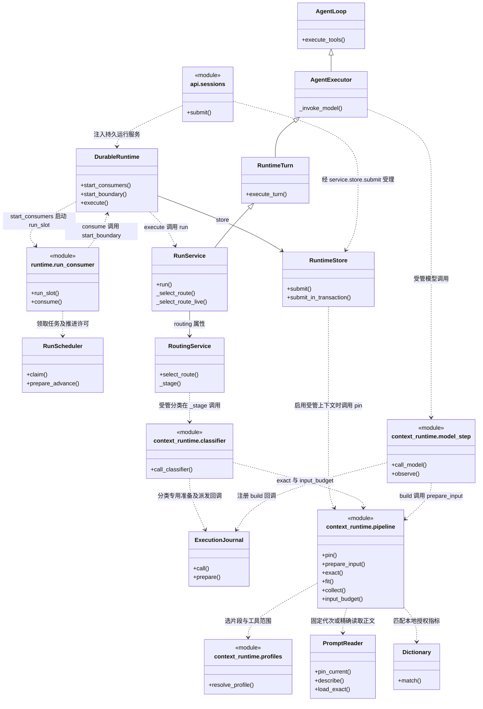
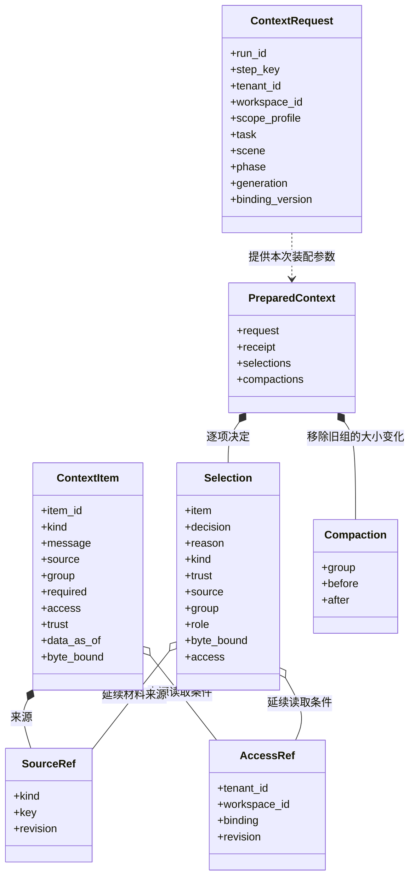
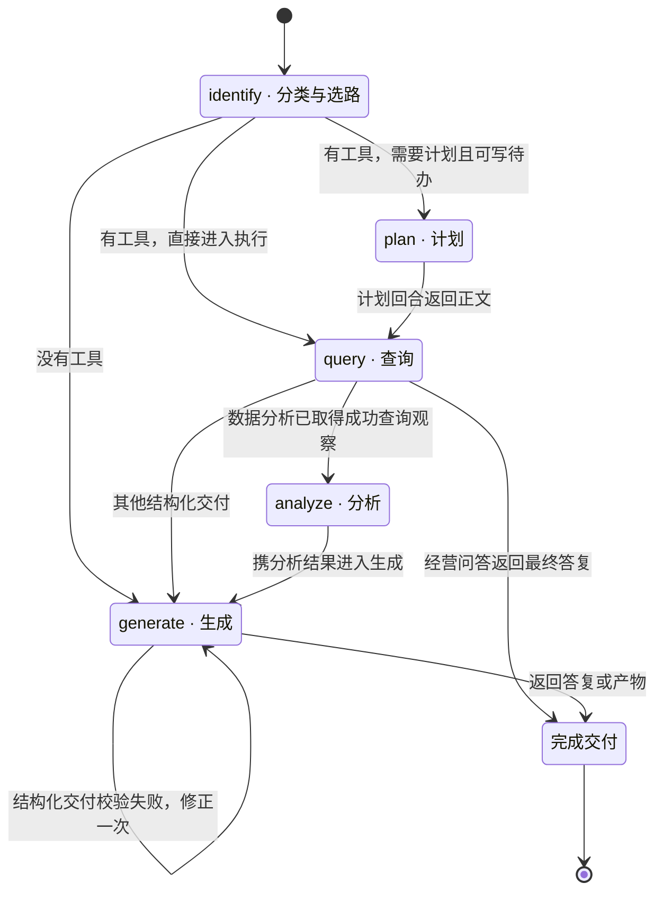
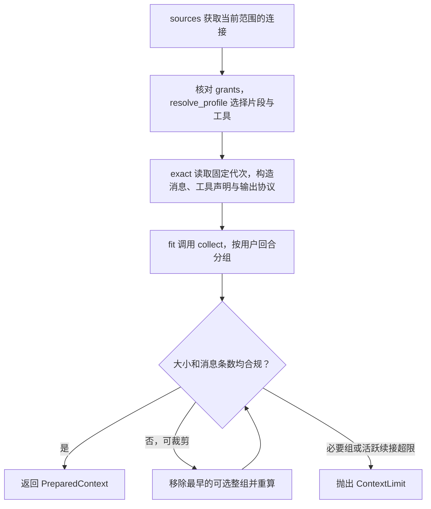
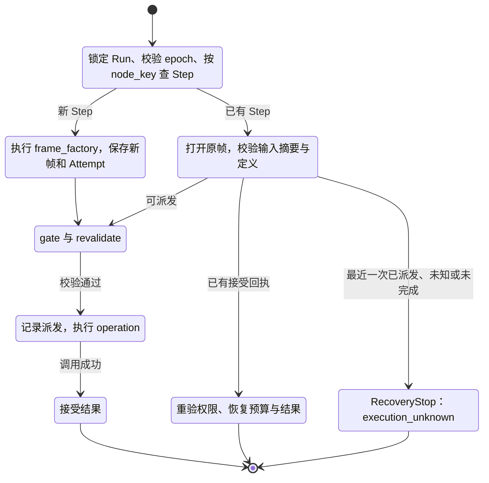
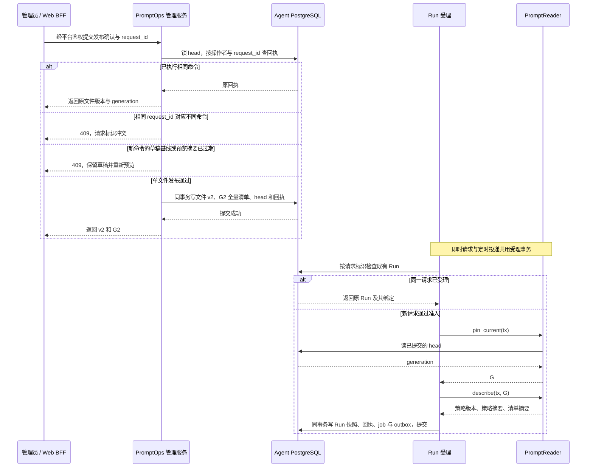
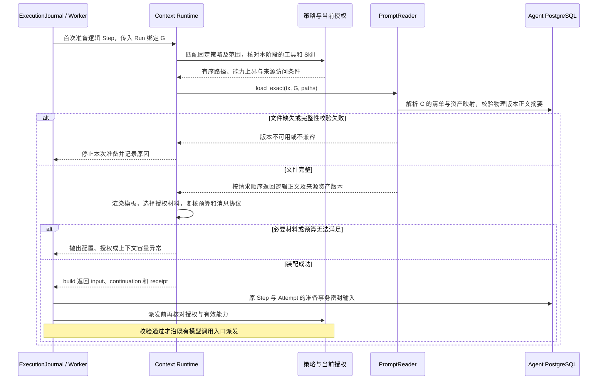
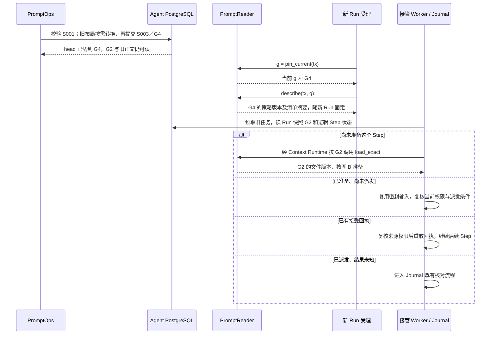
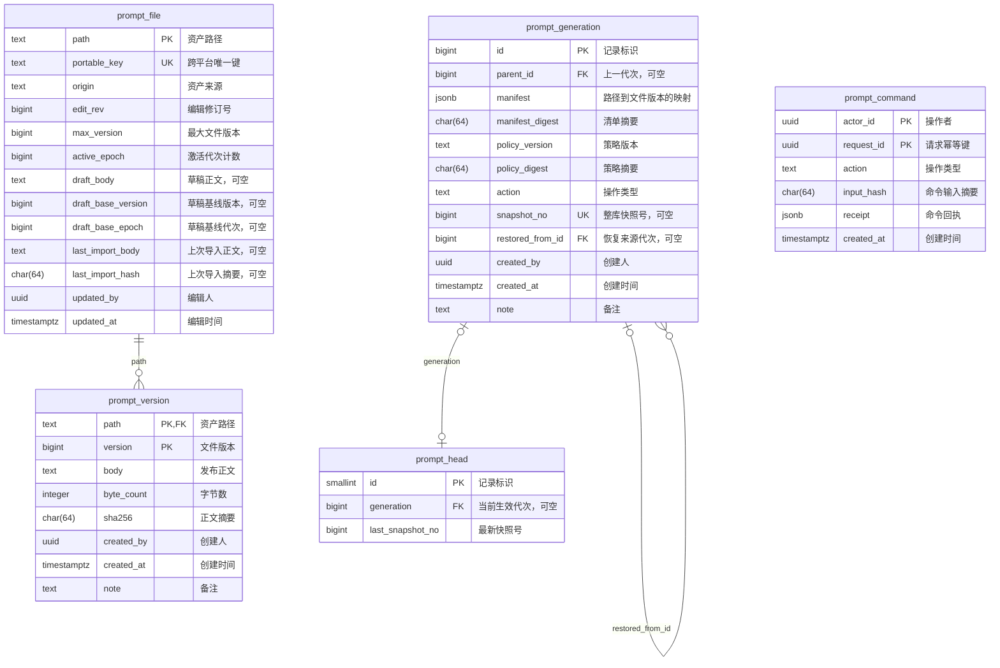

# 第 21 课技术方案 · Compass Agent Context Runtime

# PromptOps 资产粒度修订

日期：2026-11-20。有效需求来源为本次用户确认的方案：场景目录聚合为 JSON、工具展示完整定义、参数 Schema 由代码维护并在后台只读、描述与示例支持在线编辑发布、源码与数据库同步。此修订覆盖原管理方案中逐条 Markdown 资产的相关约定。

## 需求与验收

| 编号  | 验收条件                                                                                     |
| ----- | -------------------------------------------------------------------------------------------- |
| AC-A1 | 40 个场景在一个 JSON 中维护；场景描述和示例参与实际分类请求；ID 与路由属性保持代码契约。     |
| AC-A2 | 一个工具对应一份完整 JSON 声明，展示名称、描述、完整参数 Schema 和调用示例。                 |
| AC-A3 | 描述、参数说明与示例可保存草稿、发布、回看和恢复；新任务使用新版本，已有任务保留绑定。       |
| AC-A4 | 服务端拒绝工具名、参数名、类型、必填项、约束等结构修改；示例 arguments 符合代码 Schema。     |
| AC-A5 | 分类说明、阶段与技能短指令、公共规则、工具补充说明和前端示例按职责归组；管理树显示当前资产。 |
| AC-A6 | 显式同步入口保留在线修改与未发布草稿，创建新的不可变发布清单；重复执行不产生多余版本。       |
| AC-A7 | 历史版本可读；旧格式快照恢复时将历史文本转换到当前资产结构，保留原快照与现存草稿。           |

## 资产结构与权威来源

本次将 129 个随包文件收敛为 39 个资产：14 个完整工具声明、一个场景目录、六个前端示例集合、四个职责指令集合及 14 份独立任务或辅助提示词。

```text
prompts/
├── tools/<tool_name>.json              # 完整工具声明；参数结构源于 ToolSpec
├── shared/
│   ├── execution.json                 # 阶段目标与可复用技能指令
│   ├── policies.json                  # 通用约束与输出协议
│   ├── tool-guidance.json             # 工具使用补充说明
│   └── fragments/base.md              # 主体职责
├── support/
│   ├── routing/
│   │   ├── scenes.json                # 40 个场景、描述与识别示例
│   │   └── instructions.json          # 分类、分流与交付类型识别指令
│   ├── starters/
│   │   ├── analysis.json              # 分析入口问题
│   │   └── models/*.json              # 按完整模型测试用途归组
│   ├── delivery/repair.md
│   ├── diagnostics/reliability-request.md
│   ├── session/title.md
│   └── subagent/analysis.md
└── tasks/                             # 四类任务及确有差异的场景交付规则
```

工具的参数结构以各目录的 `ToolSpec` / `ToolDefinition` 为权威来源。`catalog.bundled()` 生成当前代码对应的完整 JSON，导入时更新声明；参数描述作为注释保留。`structured.validate_tool()` 在保存、导入与发布时核对代码契约。比较时仅忽略 JSON Schema 的 description 注释，名为 description 的真实业务参数仍受结构校验。

场景的固定属性与可编辑文字在同一份随包 JSON 中维护。分类器读取本次绑定版本的描述和示例；路由特征从安装包读取并进入部署策略摘要。工具通过 `tool_text()` 读取完整 JSON 中的描述与参数说明。修改代码中的参数后，可在上述同步命令增加 `--write-sources`，将当前注册代码的 Schema 重新导出到源码 JSON；未加 `--apply` 时数据库保持预览模式。

Web 的工具编辑器只开放描述、参数说明和示例；完整 JSON 通过共用代码组件只读展示。示例使用 description 与 arguments，arguments 按可信代码 Schema 校验。发布的描述和示例进入模型实际收到的工具声明。工具注册的授权、审批、执行后端与资源限制继续由代码负责。

描述与示例合计遵守现有 `ToolFunction` 的 2000 字符限制。参数说明遵守 Runtime 的 Schema 大小和嵌套限制；示例同时检查 Schema 格式约束、JSON 大小与深度。在发布前完成这些检查。运行回执保留实际资产路径、完整资产摘要与成员选择；追踪日志按实际 JSON 资产去重，历史投影则记录原文件来源。

`legacy_layout.json` 只用于明确的成员定位和历史读兼容。运行时按职责取结构化资产的成员，校验其所属不可变版本的摘要。旧文件名退出随包资源与管理树，已绑定旧清单的 Run 仍可读取旧版本。当前选择策略摘要覆盖聚合布局与校验实现。

## 持久化、升级与恢复

Owner 为 Agent / main，沿用现有 `prompt_file`、`prompt_version`、`prompt_generation`、`prompt_head`、`prompt_command`。**本次不增加表或列，不增加 Alembic 版本或 SQL 交付。** JSON 正文仍保存于现有 Text 字段。本次数据整理由显式命令执行，API 导入和应用启动均不隐式升级资产。

从 Compass 根目录预览：

```sh
uv run --env-file .env --locked --package compass-agent python -m compass_agent.promptops.sync
```

停止 Agent 与 Scheduler 后提交，并允许当前部署重新注册策略：

```sh
uv run --env-file .env --locked --package compass-agent python -m compass_agent.promptops.sync --apply --reset-runtime-policy
```

提交前将文件、版本、代次及原 Head 信息保存到 `work/promptops-assets-upgrade/`，文件权限为 0600。事务锁定 Head，保留旧版本与旧清单，将当前正文聚合到新路径。已发布的在线修改覆盖对应源码成员；未修改的成员采用当前源码；未发布草稿迁移为新资产草稿，保留独立发布步骤。遇到源码与线上同时修改同一现有资产时拒绝覆盖，要求先合并。有效执行租约存在时拒绝重置部署策略。

旧格式快照仍可按原路径与版本回看。恢复旧格式快照时，新建一份当前结构的清单，按成员复制历史正文，并补齐当前代码需要的新资产；原快照保持不变。草稿继续保留，受影响文件按现有 CAS 规则重新核对基线。当前格式的快照沿用原来的精确版本恢复行为。


Feature 975 · standard · 已复评 · 2026-11-19

需求简报 · [主 PRD](PRD.md) · [四类场景的方法与交付要求](PRD.md) · [PromptOps 技术方案](PROMPTOPS_TECH_DESIGN.md) · [供评审的代码附录](CODE_DESIGN.md)

采用项目 standard 模板，沿用布局契约中的 `design/TECH_DESIGN.md` 作为运行侧设计入口。课程前置标签 `compass/L20-complete` 指向提交 `b547e91`，其 Agent 库为 0010。本次集成以当前 Compass 提交 `d5d36e5` 及 `agent/main` 0015 为实施前基线，其中即时与定时任务已共用受理事务，消费者运行在 Agent 副本。本文记录设计决策和时序，交付结果见开发与验收记录。

阅读图示可从[运行侧全景](#runtime-uml)进入，再查看[上下文对象与版本](#runtime-uml-schema)、[任务阶段](#runtime-uml-stages)、[输入装配](#runtime-uml-pipeline)、[逻辑 Step 恢复](#runtime-uml-recovery)以及[与 PromptOps 的交互时序](#promptops-runtime-sequence)。

## 1. 目标、设计输入与边界

一条已授权的经营问题进入 Compass 后，每次模型调用取得当步需要的提示词、口径、对话事实、工具与 Skill。追问改变交付形式时沿用仍适用的条件。发布提示词文件只影响随后受理的匹配任务，暂停、接管与重试保留原任务的文件版本组合。聊天、看板、报告与导出的数据都要服从读取时的权限。

| 素材                                                                 | 在 Compass 内的取舍                                                                                                                                                                                |
| -------------------------------------------------------------------- | -------------------------------------------------------------------------------------------------------------------------------------------------------------------------------------------------- |
| Context Schema 与 Pipeline 构想 | 采用有来源与权限的 ContextItem、模型预算、Collect → Select → Compact → Assemble 四步，以及每次调用的 PreparedContext。策略由少量版本化 Python 函数组成。当前四场景共用它们，首版只实现确定性裁剪。 |
| PromptOps 与精确版本读取构想      | 文件树集中管理正文，单文件版本、整库快照与内部 generation 独立。受理固定 generation，运行时只按已固定版本和代码选择的相对路径读取。管理操作、存储与版本事务见配套方案。                            |
| 上下文可观测构想             | 沿现有 OTel → Langfuse 追踪增加选择原因、来源与变换记录。复用现有 Step 私有记录和固定夹具重放。第二套观测平台、在线策略插件与评测调度不在本期范围。                                                |

对应主 PRD 的 FR-01、06～09，以及 AC-01～03、06～09、11、13。文件发布与恢复在两侧联合验证 AC-14～16。涵盖四类产品交付及其共同执行机制，保留当前分类字典的澄清、交接、拒绝、定时管理与其他已有行为。

## 2. 架构与真实接点

<a id="runtime-uml"></a>

**图 1 · Context Runtime 类型与关系**

空心三角指向父类，实线箭头表示持有对象，虚线箭头从调用方指向依赖。标有 module 的框列出 Python 模块函数。



分类入口在 RunService。消费者领取任务后，DurableRuntime.execute 调用 RunService.run；其中 _select_route 通过 _select_route_live 调用 self.routing.select_route。受管分类需要模型时，RoutingService._stage 调用 classifier.call_classifier。路由完成后，同一个 RunService 实例调用继承自 RuntimeTurn 的 execute_turn，执行回合通过 AgentExecutor 进入 model_step.call_model。

<a id="runtime-uml-schema"></a>

**图 2 · 主模型输入与决策收据**

字段名对应 context_runtime/contracts.py 的不可变 dataclass。



ContextRequest 提供逻辑步骤、范围与模型绑定。PreparedContext.request 是 GenerateInput，receipt 保存文件版本、预算和请求摘要。model_step 把请求、续接信息和收据包装成字典，Journal 将该帧密封到 AgentStep.prepared_context。

<a id="runtime-uml-stages"></a>

**图 3 · 任务阶段与交付路径**

为什么同一个问题前后两次调用模型，收到的上下文会不同？以数据分析为例，查询阶段需要可用工具和指标口径，分析阶段要带上已取得的查询结果。图三说明 phase 从哪里来；图四说明如何按这个 phase 准备输入。



RuntimeTurn.execute_turn 根据路由、有效工具和本轮结果设置 journal.context_phase。分类阶段通过 call_classifier 准备输入，后续受管模型调用通过 call_model 准备输入。确认工具回合完成后才能切换阶段；跨阶段使用带引用的已确认观察重新组装。交付键决定最终验收对象，问答给出直接答复，分析按需要附表图或导出，看板生成可重开的快照，报告同时交付对话摘要与可下载正文。

<a id="runtime-uml-pipeline"></a>

**图 4 · 主模型与子 Agent 的输入装配**

给定当前阶段，一次模型调用究竟会收到什么？图四展开 prepare_input：按权限和阶段选片段与工具，读取固定版本，组装请求，再按预算决定保留哪些消息。



prepare_input 先组装模型请求，再由 fit 按 UTF-8 字节上界和消息条数检查容量。collect 给消息分组并标记必要项。超限时 fit 从最早的可选组开始整组移除，每次重新计量。活跃续接保留完整前缀，仍超限则停止派发。

<a id="runtime-uml-recovery"></a>

**图 5 · 逻辑 Step 的冻结、派发与恢复**

同一个 Run 被另一台 Worker 接管后，这一步要用哪份输入？图五说明 Journal 如何用逻辑 Step 找回已保存的请求帧，以及何时复核权限、复用已接受的结果。



Journal 用 run_id 和 node_key 定位步骤。准备事务先锁定 Run 并检查 epoch；已有步骤还要校验输入摘要和定义。恢复接受结果时重新核验权限，恢复该步记录的预算和续接状态。

| 已有模块（Agent 相对 `src/compass_agent/`）                                                                                                   | 实施变更                                                                                                                     |
| --------------------------------------------------------------------------------------------------------------------------------------------- | ---------------------------------------------------------------------------------------------------------------------------- |
| `runtime/store.py`、`scheduler/admission.py`、`runtime/durable_service.py`                                                                    | 保留幂等与容量校验、会话锁、入队、租约和接管。事务内固定 generation，消费时加载固定运行配置。                                |
| `routing/service.py`、`routing/intent.py`、`runtime/service.py`                                                                               | 识别阶段先装配分类输入，分类成功再选择四类任务之一、具体业务场景与模型。替换既有散落文本，保留现有路由、模型准入和边界判断。 |
| `runtime/turn.py::RuntimeTurn.execute_turn`、`harness/executor.py::AgentLoop.execute`、`execution_context.py::recorded`、`runtime/journal.py` | RuntimeTurn 构造请求草稿。AgentExecutor 转入 call_model，由 Journal 在首次准备时执行 build，恢复时读取已有帧。               |
| `runtime/tool_bindings.py`、`tools/catalog.py`、`tools/loader.py`、`tools/dispatcher.py`                                                      | 从真实注册项构造 Run 能力上界，用当前任务、阶段和授权收窄声明与执行。个人 MCP 继续使用现有绑定、准入与重验。                 |
| `runtime/resources.py`、`runtime/public_visibility.py`、`api/runs.py`、`api/sessions.py`                                                      | 增加受管结果规范化、可重开产物、来源授权及公开投影过滤。                                                                     |
| `context_runtime/{contracts,profiles,semantics,pipeline,model_step,classifier,delivery}.py`                                                   | 内部类型与四步流水线、固定组合、指标释义检索、结果蓝图和校验。保持在 Agent 内，通过现有应用 HTTP 契约让 Web 使用结果。       |

### 2.1 受理、首发与固定版本

`PromptReader.pin_current(session) -> int` 读取生效 generation。随后在同一事务调用 `PromptReader.describe(session, generation)` 获取发布时校验的 policy_version、policy_digest、manifest_digest；运行规则只按该版本与摘要加载。`load_exact(session, generation, paths)` 按请求顺序返回路径、文件版本、SHA-256 与正文。完整接口、不变量及错误归 [PromptOps 技术方案](PROMPTOPS_TECH_DESIGN.md) 维护。每次单文件发布同样形成不可变清单，用户可见的整库快照由整体发布或恢复产生。新任务直接读 PostgreSQL 主库；若启用进程缓存，只缓存已按 generation 和正文摘要校验的不可变内容。

将绑定放在 `RuntimeStore.submit_in_transaction` 的重复 request_id 返回与容量校验之后、Run 写入之前。随 `AgentRun.config_snapshot["contextRuntime"]` 保存 schemaVersion、generation、代码策略版本与其内容摘要。租户、工作空间、用户沿用所持有 Session 的可信身份。与新 Run、受理回执、job、首次 outbox 同事务提交。Scheduler 的 `TriggerAdmissionService.apply` 在外层同事务完成投递回执，重复投递读取原 Run。一次新的对话追问是新的 Run，可以使用新版本。受理与发布并发时以读取已提交 head 的时刻分界。已确认发布后开始的新受理直接看到新 generation。

首发部署在流量切换前完成本地导入、校验与第一次整体发布。受管模式下缺 head、必需路径或已知 policyVersion 无法解析时返回明确的配置不可用原因，停止本次受理或派发；重启和恢复保持原绑定。旧 Run 通过持久快照中缺少 `contextRuntime` 识别，沿专用兼容路径，重放原 Journal，兼容指令从标记为旧版的集中本地基线读取。维护上一版本策略代码直至其在途 Run 清空，历史结果的只读展示依赖产物及来源权限。混合部署先升级所有消费者再启用新版受理，防止旧消费者忽略新字段。

### 2.2 路由、组合与可信边界

当前 `Intent` 只给 category_id 与 scene_id，`SC-25` 可以是一次图表咨询，`SC-26` 可以是摘要，业务词典覆盖四十种情况。新增内部 `DeliveryIntent(scene_id, deliverable)`，`deliverable` 为四类键、`existing` 或 `clarify`。保留原 scene_id 分类与分类置信阈值，在 JEV 分类原请求加入交付形式 choice、Flash 回退的受限 JSON 同时校验两字段；模型和适配器无法一次返回两项时，提取已可靠判定项，按现有回退机制补齐，最终仍不清楚时澄清。分类时可使用获授权的前文指代。先处理词典决定的 refuse、clarify、handoff 和原有系统任务，再对可执行的经营问题采用交付形式。要求分析后生成报告时以报告交付。运行时分类结果写入原 routing receipt，采用经代码校验的二元结果；保留现有对外 Routed DTO。测试覆盖简图建议与持久看板、报告和定时调度的区别。

新增纯函数 `profiles.resolve_profile(scope, task, scene, phase, policy_version) -> Profile`，`enumerate_usages(policy_version) -> tuple[PathUsage, ...]`。运行加载与 PromptOps 文件使用位置从同一份规则生成。系统组合按通用角色/边界 → 任务方法 → 场景 → 执行阶段 → 租户与工作空间扩展 → 输出模板/有效 Skill 构造，路径有序去重。扩展由代码中标记的插槽追加或替换；仅允许声明的输出模板槽替换。租户和工作空间用二元可信 UUID 精确匹配，各层同一插槽至多一条最具体规则，冲突阻止启动/发布校验。每个策略版本列明路径、变量契约、所需上下文种类、允许工具和 Skill、适用交付类型。平台默认可独立工作，部署映射显式绑定真实租户/工作空间；财务、运营等显示名称只用于界面。每次改组合更新策略版本、矩阵用例和影响索引。上线先在所有副本部署支持原策略与新策略的兼容镜像，逐实例 readiness 核对支持集及摘要。整体发布按新策略检查全量必需路径，连同策略与清单一次切换 generation，允许只有策略版本发生变化。单文件发布沿用现行策略。整库恢复前核对所有活跃服务支持目标策略和路径。文件编辑只改变被引用的正文。

系统角色仅接收受控、已发布、按变量白名单解析的指令片段。标量变量来自已核对的服务端字段，经过类型、长度和枚举校验；问题、历史、报表数据、外部文档、MCP 返回和指标说明作为带来源的数据输入，模板占位符不接受可执行表达式或自由指令拼接。输出格式协议、路由枚举及鉴权在代码中再次强制。无法取得必须模板变量时返回缺项，允许缺省的片段才可跳过并记录原因。

<a id="promptops-runtime-sequence"></a>

### 2.3 Context Runtime 与 PromptOps 的交互时序

跨应用的 HTTP 调用发生在 Web BFF 与 Agent 管理 API 之间。下面的 `PromptReader` 属于 Agent 内的 PromptOps 模块，和受理、执行代码共用 Agent 库。**管理侧决定哪些文件版本已生效，运行侧决定本次任务在当前权限下需要哪些文件、数据和能力。** 同一份代码策略既用于发布时核对文件引用，又用于模型 Step 选择路径。接口字段见 [PromptOps 读取契约](PROMPTOPS_TECH_DESIGN.md#prompt-reader-contract)。

<a id="uml-publish-admit"></a>

#### A. 发布与受理 · 生效的分界在哪里

假设 S001 对应 G1。管理员单独发布财务周报文件后，G2 只替换该路径的版本，其他路径沿用 G1。此时最近一次整库快照仍是 S001。图中的 G1、G2 是内部 generation 的简写。



并发时，以受理事务**读到的 head** 为准。发布提交前已经读到 G1 的任务仍固定 G1，提交后新受理的任务读 G2。首发前 head 为空、绑定策略不兼容或受理事务失败时，不会留下可执行的新任务。

<a id="uml-step-read"></a>

#### B. 模型 Step · 谁选路径，谁读正文

识别、取数和生成可以选择不同的文件。路径由当前任务、阶段、工作空间和有效能力决定，文件版本由受理时固定的 G 决定。PromptReader 按逻辑路径从独立文件或聚合 JSON 提取正文，模型请求在 Context Runtime 完成组装。



子 Agent 沿用父 Run 的 G 和授权上界。模型调用记录关联本次装配的路径和版本，可以据此查明某段提示词在哪一步被采用。

<a id="uml-restore-resume"></a>

#### C. 整库恢复与任务接管 · 新旧任务各读哪一版

沿用图 A 的例子。之后整体发布产生 S002／G3，再恢复 S001，形成 S003／G4。同布局快照复用其文件清单；恢复已合并的历史资产时，服务会转换为当前布局，使用兼容策略生成新代次。先前按 G2 受理的任务在接管后仍按 G2 工作。



恢复快照改变的是**新任务**的配置。恢复任务依据的是**原 Run** 的配置和 Journal 状态。即使精确文件仍可读取，已经撤销的数据或工具权限也会限制后续读取与派发。

## 3. Context Schema 与处理流水线

图 2 列出内部 dataclass。消息沿用 ChatMessage，模型请求沿用 GenerateInput。

### 3.1 指标语义召回的方法

初版采用部署时装载的只读词条清单。由工作空间业务负责人确认已有指标释义，实施人员将其转换为版本化 JSON，部署维护者在 Agent 启动时显式挂载相同的只读文件。Agent 设置 `COMPASS_METRIC_DICTIONARY_PATH`，缺省代表未配置业务词典。来源与批准版本写进词条，启动校验 JSON Schema、ID 唯一性、有效期、派生依赖与引入环路。以规范内容 SHA-256 寻址，部署保留在途 Run 使用中的只读版本，所有副本在 readiness 报告可读取的相同摘要。每个 Run 固定其受理时的词典摘要或“无词典”状态，副本缺该摘要时拒绝用另一版重算。词典可以随部署更新，课程用合成词条放测试夹具。线上编辑提示词仍走 PromptOps。现有 `routing/dictionary.py` 是意图字典，`tools/data-seed/semantic.py` 服务于离线造数，两者均不充当经营指标口径来源。

每条含稳定 metricId、名称/别称、业务定义、对象、期间生效区间、统计粒度、聚合/分子分母/依赖指标、单位、可比较维度、scope、source/accessRef 和版本。配置按 tenant+workspace 隔离，部署校验连接引用与允许范围。不持有连接密码或自定义可执行 SQL。采纳的正式定义以数据角色进入模型。用户临时定义有显式 provenance，不能覆盖正式词条。

1. 抽取本轮概念、经授权历史中的指代、对象/期间等约束。纯规则问答可直取适用规则。先按 scope、授权、生效时段过滤，再用规范化名称、别名精确命中，补充使用定义词/对象标签的稳定词项重合排序。按稳定 ID 打破展示顺序的平局，不用该顺序替用户解决业务歧义。
2. 过滤单位、对象、粒度与时间轴矛盾项，并检查候选对于用户所需比较或聚合是否可用。对派生指标沿有效依赖图取有权限的分子/分母和允许聚合方式。查数时还需取得可用观测，释义本身不提供实绩。
3. 唯一可用即采纳；候选有实质差异时保留区别，回到最小澄清；零命中时说明缺口，可先回答已确认部分。工作空间、对象、期间、汇总层次变化时重新校验上轮定义。记录候选 ID 与排除原因，不把相似词得分当成已确认口径。

| 任务键          | 选材和验证侧重点                                                                      | 成功交付                                                     |
| --------------- | ------------------------------------------------------------------------------------- | ------------------------------------------------------------ |
| business_qa     | 找最贴切的事实或定义。只问含义时省去取数，问值时核对有效范围、单位与截止时间。        | 可重读的直接答复，明确零、缺数及口径歧义。                   |
| data_analysis   | 确认主指标、比较对象、派生关系和可比范围；沿与判断相关的维度补资料。                  | 可复核的结论，区分观察与解释，按目的选用文字、表、图或导出。 |
| dashboard       | 从观察目的选择指标、维度和筛选，校验跨视图聚合、读数与时间范围。                      | 只读、可重开的有界看板快照及对话入口。                       |
| business_report | 依据读者、议题与部门模板选择得到确认的发现，核对摘要/正文之间的参照期间、实绩与预测。 | 对话摘要和可独立阅读、下载的完整报告。                       |

### 3.2 工具、Skill 与每个阶段的授权

`profiles.py` 的 SkillSpec 定义唯一键、说明文件路径、依赖工具、适用阶段及所需授权。首批将通用“指标口径核对”“报告组织”落成受管文件。它们是附加指令与依赖声明，执行动作仍交给已有工具。现有 `ExecutionSkill` 只是展示结构，教学 Showcase 实现保持在隔离目录。拟在 Web 原 `authorizeRuntime` 服务端授权响应增加有界 `capabilityGrants`；直接复用已有 Web 有效权限计算。例如受管分析继续要求当前会话获准分析与模型调用，插件型 Skill 还检查现有 `module.plugins`。BFF 返回这些实际已授权操作的布尔值与原 permission revision。Agent 按组件依赖映射授权，数据查询再要求当下存在允许的真实数据绑定，MCP 再匹配 actor 自己的连接与工具。数据绑定、插件使用权或成员资格撤销后即时收窄。沿用现有权限目录与 Web 库结构。非经营 Run 沿用旧响应，受管请求缺新字段时视为没有该项授权。读取远端配置失败返回可重试的授权不可用，不静默开放。

先建立 Run 首次发现的上界，包括注册有效、模型支持、用户/工作空间授权、部署规则允许的静态工具、个人 MCP 动态绑定以及 Skill。每个阶段求该上界、层层允许范围、当前绑定、当前用户权限与阶段规则的交集。MCP 以 connection_id 与远端工具名标识授权，不允许同名替代。Skill 所需工具必须全部在最终工具清单内。收窄后的同一清单生成模型声明、`RunToolBindings.dispatch` 的 visible_names 以及预检，Dispatcher 仍校验参数、授权、HITL、超时和未知副作用。冻结一次基础 Registry，各个阶段投影视图，保留 `journal.freeze_catalog` 的接管比较语义。已撤绑定立即失效，恢复时新增工具不扩大原授权上界。展示层只读使用位置。

| 阶段     | 进入依据与退出条件（由已接受状态决定）                                                                                                      |
| -------- | ------------------------------------------------------------------------------------------------------------------------------------------- |
| identify | 使用问题及授权指代，限定分类目录与范围，无执行工具。有效分类结果产生后，保存 task/scene 或进入澄清、拒绝。                                  |
| plan     | 交付需要多个独立事实、用户已要求计划或既有约束要求计划时进入。已确认 todo 回执/有界任务事实清单明确所需观察后进入取数；信息充足可直接生成。 |
| query    | 仍缺某个已定义事实且具备授权来源。将具体工具请求、批准和回执作为事实，待全部对应调用确认后才能使用其结果。空/受限状态不当作业务零。         |
| analyze  | 已有观察需要比较、计算或调和口径。优先使用已接受的读数，发现新缺项时回 query。确认不可得的材料记录为局限或澄清。                            |
| generate | 必要事实齐全或允许交付受限说明。按场景检查答案、产物与来源权限。收到完整且验证通过的结果后才结束任务。                                      |

RuntimeTurn.execute_turn 的局部函数 prepare 根据 next_phase、可用工具与 route.requires_plan 设置阶段。循环只在完整工具回合边界改变阶段及系统指令，未结清的调用继续走暂停/确认/对账。在同阶段用 provider continuation 时保持原可见消息前缀与工具调用 ID，下一轮只追加匹配的全部结果，沿用 `llm/continuation.py::restore`。跨阶段或裁剪上下文时把已确认观察转换为带引用的数据块，关闭该 continuation，创建全新消息帧。供应商私有推理正文不进入新帧。子 Agent 继承父 generation、scope、预算、当前有效能力上界及独立 execution_path，父进程代理实际模型和工具派发。

### 3.3 预算与最终模型输入

model_limits 依次检查路由容量、匹配 Provider 和绑定版本的预算配置、模型目录。input_budget 取可用输入上限与窗口扣除输出预留后的较小值，再预留 32。prepare_input 同时施加 192 KiB 帧上限。fit 使用 utf8_upper_bound，计入序列化请求、每条消息的开销、结构化输出协议及续接占用。

### 3.4 模型调用与恢复

沿源码阅读主模型调用时，从 harness/executor.py 的 AgentExecutor._invoke_model 进入 context_runtime/model_step.py 的 call_model。其 build 调用 pipeline.prepare_input，取得 PreparedContext 后生成 input、continuation、receipt 三部分。model_step.observe 从收据导出装配摘要。分类调用从 context_runtime/classifier.py 的 call_classifier 进入，单独构造并计量分类请求。

ExecutionJournal.prepare 在事务内锁定 Run 并核验 epoch，按 run_id 和 node_key 查询 AgentStep。新步骤调用 frame_factory(tx)，已有步骤打开 prepared_context；receive_frame 接收相应帧。已有步骤的帧缺失时返回 checkpoint_corrupt。恢复沿用原输入摘要与模型绑定，派发及结果复用前执行当前权限检查。

## 4. 交付对象与来源权限

### 4.1 从模型输出到真实产物

最终生成阶段按任务传入有界的交付 schema。问答/澄清可沿用普通文本，受管结构化交付复用已有 schema output、本地 JSON Schema 校验和模型准入。模型只提出展示结构、叙述与事实引用。宿主从已确认观察绑定事实、核验单位与期间，按类型生成可持久化结果。有工具调用的中间文本与结构化 JSON 不推为用户的最终答案。校验错误时注明可修正项，在已有步骤/成本预算内允许一次修正；最终无法交付时保留可安全显示的部分及重试入口。

| 产物           | 内部/公开合同                                                                                                                                                                               | 验证与显示                                                                                                               |
| -------------- | ------------------------------------------------------------------------------------------------------------------------------------------------------------------------------------------- | ------------------------------------------------------------------------------------------------------------------------ |
| 问答、分析结果 | 授权的文字/Markdown；可选 TableSpec 含列名、单位、范围、稳定行与 factRef，导出使用同一快照                                                                                                  | Analysis Chat 复用 Markdown，受限文字回退为安全摘要。CSV 转义分隔符和引号，处理以公式标识开头的不受信文本。              |
| 看板           | 保存 `application/json` 的 `DashboardDocumentV1`，含 schemaVersion、标题、范围、截至时间、组件数组与有界行列；白名单指标、表、折线及条形视图使用 FactRef，不接受脚本、fetch URL 或任意 HTML | Agent/前端均校验 schema；Web 从受权 API 获取并用本地组件渲染，过滤只作用于创建时快照。在数据缺失的位置给出清楚状态。     |
| 报告           | 将完整 UTF-8 Markdown 正文保存成 `text/markdown`，独立摘要与正文共用经核对的 factRef                                                                                                        | 打开与下载使用同一内容 SHA-256。Web 渲染使用已有安全 Markdown 展示，禁用原始 HTML 与危险链接。报告文件名经服务端规范化。 |

`RunCompleted.file` 的既有语义沿用；持久结果通过 `AgentArtifact` 和 `view.upsert(kind="artifact")` 的产物引用交付。`schemas.py::PublicArtifact` 加入 `application/json`、`text/markdown`，可选的 `documentKind` 区分 dashboard/report；`schemas.py` 定义 dashboard schema 并挂到 FastAPI 的类型化读取端点，供生成契约与 Web 运行时校验。`GET /v1/analysis/runs/{run_id}/artifacts/{artifact_id}` 按真实 media_type 与 Content-Disposition 返回，旧 PNG、CSV 仍可用；看板类型化预览新增 `GET /v1/analysis/runs/{run_id}/artifacts/{artifact_id}/dashboard`，返回经过相同权限检查的 DashboardDocumentV1 并导出明确的 JSON 响应模型。报告预览/下载按同一字节串和安全响应头处理。BFF 继续使用服务身份、校验、no-store 和 512 KiB 响应上限；生成端将**单份新增文档或导出的 CSV 限为 512 KiB**，沿用 Run 所有文件合计 2 MiB。超限给用户缩小范围、减少明细或重试的说明，禁止截断文件后声称完整。React 扩展 `analysis-attachments.tsx`、`analysis-run-turn.tsx` 及现有 session 客户端，手机可重开、滚动/下载。

现有 `RuntimeResources.artifact` 服务于工具且会自开事务。拟抽出事务内的保存分支，由工具端原入口和受管完成事务共同调用。受管模型结果已被 Journal 接受后按确定性 key `uuid5(run, node_key + delivery_slot)` 生成产物 ID，固定对应 accepted model/tool attempt。新增来源为最终模型的产物使用明确的逻辑交付 key 作为现有非空 tool_call_id 的兼容标识，注明 origin/finalStep；对外保持原字符串字段相容，自增可选 origin 字段表达模型来源。事务校验 epoch、归属、digest 和限额，保存产物、公开引用、终态答复与 outbox 后一次提交；同 ID 同摘要重试复用，异摘要冲突。先前运行已接受模型结果且写产物前崩溃时从密封结果完成保存，不再次调用模型。临时存储错误允许按原任务重试，该情形不生成“已保存”链接。

### 4.2 读取权限贯穿所有派生数据

`CurrentAccess` 已回调 Web 核查 current membership/purpose。Agent 再用当前 `DataConnections`、MCP 个人绑定和数据源可核验授权范围检查每个来源。上下文 AccessRef 记录 tenant_id、workspace_id、binding 和 revision。持久零售来源凭据另存连接、角色及授权范围，读取时重新核验。对按区域、行、列授权的源，适配器必须给出读取数据的实际 scope/实体键及可再查询的授权依据，例如管理的上游授权视图返回的 ACL 版本或按安全范围键的可见性检查。读取时用原只读身份验证该范围仍获授权；业务数据截至日与授权版本分别保存。连接 ID、角色相同不足以跨过已变窄的上游范围。通用 MCP、任意 SQL 若只返回文本且无法产出细粒度可重验引用，将该观察标为一次性来源，后续重新取数或给出受限说明；不将其导出为承诺长期重开的受管数据。可重开产物须全部有可重验授权来源。部署验收使用一个可独立收窄来源范围的真实适配器，核对授权而不要求历史指标值与今天相同。

**首个可重验适配器。** Agent 使用 `data_connections/retail_access_refs.py`，由现有 PostgreSQL 数据连接调用。复用 read_database 与 check_identity 及只读账号与 RLS 检查。仅对来源覆盖可计算的查询提供持久读取凭据。适配器从已审核投影取得参与计算的基表与所用列（含分组、筛选及关联列），在同一条受控 SQL 的同一快照中取得业务结果与实际覆盖的租户/区域键集；聚合须覆盖参与统计的全部范围，跨表结果合并各来源凭据。空集、不可完整枚举、超出凭据上限或区域来源缺键时走一次性来源规则。范围与列引用由服务端投影产生，模型参数和查询结果自报的范围都不作为授权凭据。

读取历史时，先重验当前 workspace/连接/绑定版本，再以原只读角色调用已有 `sec.allowed(tenant_id, region_id)` 核验每个区域键，并以 `has_column_privilege(session_user, relation, column, 'SELECT')` 核验每个基表列及当前 RLS 状态。租户级凭据与区域凭据分型；仅对已审核且数据策略本来就是租户级的表使用 `sec.allowed(t, NULL)`，它只检查租户匹配。区域凭据中的 NULL 直接判无效。任一范围或列授权失效即限制整份派生结果。验收在隔离的已发布零售库，用覆盖两个区域的受限账号生成聚合看板，再单独撤销一个区域授权；另以可见成本列的角色生成报告后撤销该列 SELECT。两例均保留 Chat 权限和连接 ID，历史、SSE 与下载均须收窄。复用零售授权配置的现有授权函数与列级授权，四类任务仍共用 SourceRef 接口，零售库沿用既有 schema。

新设计在 `AgentMessage.source_refs` 记录受管消息 lineage，已确认工具/模型观察在现有密封回执中记录，`AgentArtifact.scope` 加 source_refs 与 origin。聚合、说明文字、图、标题和摘要保存所有参与输入的来源引用，与输出同事务落库。读取时逐项核验，任一来源失权即限制整项派生结果。元数据缺失与确定没有受限来源分别用 null 和空数组区分。历史没有来源元数据的业务回答保持旧结果留档；用于新受管回答时只继承用户问题和经确认的安全条件，按当前授权重新查询。旧私有产物无法证明来源可读时不回传其历史字节。

同一 `authorize_refs(principal, refs, purpose)` 接入以下读路径。数据库/授权服务故障返回可恢复的不可用状态，不当作已授权或已撤权。

| 路径                                      | 执行点与反馈                                                                                                                                                                                                                                               |
| ----------------------------------------- | ---------------------------------------------------------------------------------------------------------------------------------------------------------------------------------------------------------------------------------------------------------- |
| 模型、新旧历史、续问、子 Agent、Step 接管 | `history_command`、collect、私有输入重建、Journal 派发/回放前核验。可选来源被撤则从新帧移除，已冻结请求受影响时停止这次派发，提示重新发起。                                                                                                                |
| 会话列表、消息和详情                      | `session_management.py`、`message_reader.py`、`execution_detail.py` 对摘要、标题、正文和观察应用相同检查。标题优先仅用首个用户问题，可能含源派生信息时遵守同样的 lineage。                                                                                 |
| 公开进度、SSE、Redis 重放与快照           | 受管结果默认在 outbox/Redis 只传无敏感摘要及资源/消息引用。SSE 在每批输出时、快照在读取时复核，受权时按引用投影正文，不允许绕过检查回放旧明文 delta。受管流禁用未经校验的模型/工具原始文本流，将状态与产物引用优先推送；已展示内容的后续重开仍需当前权限。 |
| 看板、报告、CSV                           | 归属检查 → 当前来源授权 → 大小、类型与摘要校验 → 返回。直接请求历史下载 URL、其他租户同名部门与已有会话转发都走此链。BFF 清理缓存，失权的原页面收到受限/刷新响应时移除旧预览。                                                                             |

### 4.3 装配观测与可重放验证

沿用 `runtime/observation.py` 与 `observability/{observer,privacy,export}.py` 的父链、采样、脱敏和有界导出。在既有 Run / Step / Logical Call 下添加 `context.assemble` span 和 selection、compaction、capability、prompt.used 等有界事件。属性包括 run/step/call 相关键、generation、policyVersion、task/scene/phase、已发布逻辑路径与文件版本、过滤原因枚举、工具与 Skill 的稳定标识、来源类型与脱敏引用、tokens.before/after/limit、计数方法与耗时。将新增标量明确列入 privacy allowlist，逻辑路径只允许登记过的规范路径；外部连接/用户自定义名称使用匿名 ID。路径与单项决策留在 trace，不作低基数指标的标签。禁止正文、SQL、租户名、模板变量值、工具参数、行值、原始异常、token 与 DSN。

Context receipt 保存完整有界决策及 lineage，遥测独立失败时沿既有 BSP 丢弃/降级；诊断只向 `runtime_diagnostics` 权限开放，返回同版本选择和原因的安全摘要。精确重试读已冻结请求。策略对照用固定的授权夹具、确定性 selector/compactor、模型绑定与 token 计数版本运行两次，对比 selected/dropped、budget 与交付校验，不重跑有副作用的工具。观测验收在真实 Langfuse 中从一次问答找到文件路径、版本、所用 Skill 及一个被排除项的原因，断开 OTLP 后正常完成任务。默认使用已有 OTel 架构，不增追踪数据库。

使用相同装配记录派生低基数统计，便于上线后发现质量退化。按任务类型、阶段和有限原因码分组。Run ID、用户标识和文件路径只用于单次追查。

| 观测量               | 计算口径                                                                                                                                  |
| -------------------- | ----------------------------------------------------------------------------------------------------------------------------------------- |
| 必要材料保留率       | 被选中且在最终输入中通过关键事实校验的必要项数 ÷ 已识别的必要项总数。分母为零时跳过。授权拒绝或必要材料超限导致无法派发时单独计失败原因。 |
| 预算利用率与压缩效果 | 已装配请求的估算输入 token ÷ 可用输入预算；发生压缩时同时记录变换前后估值。供应商实际用量来自原 generation 观测。                         |
| 装配延迟与拒绝原因   | 从 Collect 开始至准备完成或返回失败的耗时，按成功、澄清、受限、预算不足和配置不兼容区分结果。                                             |

## 5. 数据迁移、发布与恢复

Owner `agent/main`，SQLAlchemy 模型 `runtime/entities.py` 及 PromptOps 新模型。本课迁移 `apps/agent/migrations/versions/0016_prompt_context.py`，从 0015 至 0016，与 PromptOps 表一次交付，迁移负责人在实现阶段合并。项目数据库规范与派生产物见数据库规则、Agent 数据库入口。

| 实体           | Runtime 增量与兼容                                                                                                                                                        |
| -------------- | ------------------------------------------------------------------------------------------------------------------------------------------------------------------------- |
| agent_run      | 在现有 config_snapshot 新增版本化 contextRuntime 记录；旧行无此属性，不回填来源或伪造历史版本。                                                                           |
| agent_step     | 新可空 prepared_context BYTEA，封装固定模型输入、来源与决策收据引用。原有 input_sha256、definition_snapshot、Step 唯一键和 accepted_attempt_id 沿用。旧 SQL 行得到 null。 |
| agent_message  | 新可空 source_refs DOCUMENT，包含读取时核验所需的有界引用；旧行 null。上下文密文仍用 `PrivateState`。                                                                     |
| agent_artifact | 扩展现有媒体 check 至 image/png、text/csv、application/json、text/markdown，scope 复用 JSON 保存 lineage、origin 和文档类型；保留 size、外键及 Run 限额。                 |
| PromptOps      | generation、文件版本及 head 由配套方案单独定义，Run 快照按 ID 逻辑引用不可变目录，禁止清理在途/历史仍引用的版本。                                                         |

`apps/agent/db/main/sql/bootstrap.sql`、`upgrades/0015__0016.sql` 及受管旧起点到 0016 的增量、`manifest.json` 由现有 `pnpm db:sql -F agent` 派生。保留既有迁移和历史增量原字节。正式升级备份 Agent DB/Redis 和密钥，先迁移，再部署能够识别旧/新任务与 DTO 的 Agent/BFF，验证所有消费副本，并导入首次基线；最后开放受管受理和 Scheduler 投递。混合版本期间由可回退配置开关控制受管受理，旧消费者移出池后才打开。既有聊天、模型可用性调用、工具行为按兼容样例回归。产物新类型仅向支持的 Web/BFF 放量，支持新版 Agent 是新版 BFF 前置条件。

业务回退优先恢复文件/快照，继续运行已 pin 任务。代码回滚先关闭受管新受理、让支持原策略的消费者处理或受控暂停活动任务，回旧 BFF 时先收回新产物入口，前移兼容修复优先。不得直接在已写新 MIME/密封帧的库上降级旧运行镜像或删除文件历史。确需恢复升级前整库时，在隔离库/Redis 恢复配套备份与密钥，核对切换期受理和副作用记录后切换。

### 5.1 新增表与既有表变更

沿生效指针、发布代次和文件版本，可以找到一个 Run 当时使用的提示词正文，并看出草稿和管理命令回执各自保存在哪里。



agent/main 的 0016 迁移新增这五张表。prompt_head 只有 id=1 一行，首发前 generation 为空。prompt_generation.manifest 用 JSONB 保存 path → version，agent_run.config_snapshot.contextRuntime.generation 引用受理时的代次；这两处由应用解析。prompt_command 独立保存幂等回执，以 (actor_id, request_id) 为主键。单文件发布无快照号，整库发布和恢复产生快照号。

已有表的变化：agent_step 新增可空 BYTEA prepared_context；agent_message 新增可空 JSONB source_refs；agent_artifact 扩展 media_type 检查，允许 JSON 看板与 Markdown 报告；agent_run 沿用 config_snapshot 保存绑定。迁移还将 agent_runtime_control 中 execution 行的 policy_sha256 置空，以重新登记执行策略。

## 6. 实施切片、验证与评审

以下为拟实施任务。共享的契约生成、权限、DB 发布任务与 PromptOps 同一批次执行。文档内代码、用例和时延均为待实现/验证的合同。

| 切片                    | 文件与前置                                                                                                                                                                              | 可复核的完成条件                                                                                                                                                                       |
| ----------------------- | --------------------------------------------------------------------------------------------------------------------------------------------------------------------------------------- | -------------------------------------------------------------------------------------------------------------------------------------------------------------------------------------- |
| R1 固定基线与受理       | `runtime/{store,entities}.py`、`scheduler/admission.py`、`0016_prompt_context.py`；依赖 PromptReader 与首发种子                                                                         | PG 真库覆盖空库、0015 升级、错误起点、SQL 一致性、独立运行/迁移权限与恢复。并发发布/即时提交/定时重投，重复 request_id 返回相同 generation。首发缺失显式不可用。                       |
| R2 分类、固定组合与语义 | `routing/{intent,service,dictionary}.py`、`context_runtime/{contracts,profiles,semantics}.py`、本地 prompt 清单及设置                                                                   | 跨租户同名部门、同场景不同交付意图、子任务/混合指代、歧义口径、缺词典、派生分母、拒绝及接管。四类各 20 例按预期文件组合、口径、工具/Skill、裁剪原因逐项核对，至少 79/80。              |
| R3 全模型通路与权限     | `harness/{context,executor}.py`、`runtime/{context,turn,service,tool_bindings,subagent,session_management}.py`、`llm/{capabilities,litellm_chat,continuation}.py`、Web 当前授权 handler | 按大小与 tokenizer 边界、结构化输出、thinking continuation、同阶段续接与跨阶段、Skill 失依赖、MCP 同名不同绑定、能力测试及标题。允许注册、可见声明、运行预检与真实 dispatch 四者一致。 |
| R4 恢复与观测           | `execution_context.py`、`runtime/{journal,durable_service,diagnostics,observation}.py`、`observability/{observer,privacy,export}.py`                                                    | 准备前、准备后、派发未知、结果已接受时跨副本接管；同一步输入摘要/预算一致，已接受动作的物理调用增量为零。Langfuse 关联版本和选择原因、故障注入不影响用户交付。                         |
| R5 历史与产物           | `context_runtime/delivery.py`、`runtime/{resources,message_reader,public_visibility,store}.py`、`api/{runs,sessions}.py`、`schemas.py`、Web BFF、分析会话与附件组件                     | 四类都交付，保存失败可重试。CSV 与表同源，报告摘要/正文/下载一致，看板重开保留筛选与时间，512 KiB 两侧一致。独立撤销连接/来源范围后续问、SSE 重放、历史、看板和下载均受限。            |
| R6 产品验收             | Agent 已有 `test_durable_runtime_faults.py`、`test_intent_routing.py`、`test_tool_catalog.py`、`test_runtime_visibility_integration.py` 及 Web 浏览器覆盖；增加本 Feature 固定样例      | 四场景不同主题各 5 题，按方法、语义、答复与交付质量评审，至少 19/20，安全与关键用例全过。两副本定时/即时发布或恢复后 60 秒内新任务命中，排队、运行、暂停、接管均无发布导致的关键中断。 |

实施执行 `pnpm contracts` 和 `pnpm contracts:check`，Agent/Web lint、typecheck、test，`pnpm check`、`pnpm build`；数据库运行 `pnpm db:sql:check -F agent`、`pnpm db:migrate -F agent`、重复 `pnpm db:seed -F agent` 与 `pnpm smoke`。真实 PostgreSQL、两个 Agent、Scheduler、Redis、Langfuse 及 Web 浏览器的集成用例单列结果，记录样例集、模型/策略/词典/文件版本、受理时刻与首个匹配结果。课程样例与授权数据库、工具清单通过配置和测试夹具注入，生产装配不含演示 ID、关键词或固定工具顺序。

**实施前优先验证三处。** 在真实模型绑定上核对结构化最终交付和 provider continuation 的输入计量；在真实数据源上独立调整一项可见范围，验证已保存读数的重验；在恢复夹具中打断同一 Step 的准备与派发，确认 Journal 唯一入口不会重复模型调用或提交两次产物。这三项对应前次设计评审的模型 Step、来源撤权和跨层产物合同。旧评审的六场景、审批及灰度假设已随现行 PRD 收敛；本轮修正、验证范围和结果见设计复评与验收记录。

## 7. 新增 HTTP 接口

第 21 课新增 15 个 Agent HTTP 接口。Web 管理端将 /api/web/v1/platform/promptops/{操作} 映射到同名 /v1/promptops/{操作}，使用平台 promptops_manage 授权，POST 还要通过同源和 CSRF 校验。

| 方法 | Agent 路径                                                   | 查询参数、路径参数或请求 DTO | 响应 DTO             | 用途                           |
| ---- | ------------------------------------------------------------ | ---------------------------- | -------------------- | ------------------------------ |
| GET  | /v1/analysis/runs/{run_id}/artifacts/{artifact_id}/dashboard | run_id、artifact_id          | DashboardDocumentV1  | 按当前权限重开看板             |
| GET  | /v1/prompt-starters                                          | 无                           | PromptStarterCards   | 读取当前用途的示例卡片         |
| GET  | /v1/promptops/commands                                       | request_id                   | PromptReceipt        | 按请求 ID 取回操作回执         |
| POST | /v1/promptops/draft-from-version                             | PromptDraftFromVersion       | PromptReceipt        | 从历史版本建立草稿             |
| GET  | /v1/promptops/file                                           | path、version                | PromptFileDetail     | 读取文件详情或指定版本         |
| POST | /v1/promptops/file-draft                                     | PromptDraft                  | PromptReceipt        | 保存草稿                       |
| GET  | /v1/promptops/history                                        | path、cursor、limit          | PromptHistory        | 分页查看文件历史               |
| POST | /v1/promptops/import                                         | PromptImport                 | PromptReceipt        | 确认导入资产                   |
| POST | /v1/promptops/import-preview                                 | PromptImportPreviewInput     | PromptImportPreview  | 预览随包资产导入差异           |
| POST | /v1/promptops/release-preview                                | PromptReleaseTarget          | PromptReleasePreview | 预览发布或恢复                 |
| POST | /v1/promptops/releases                                       | PromptRelease                | PromptReceipt        | 确认单文件发布、整体发布或恢复 |
| POST | /v1/promptops/render-preview                                 | PromptRenderInput            | PromptRendered       | 预览变量渲染结果               |
| GET  | /v1/promptops/snapshot                                       | snapshot_no、cursor、limit   | PromptSnapshot       | 读取指定快照清单               |
| GET  | /v1/promptops/snapshots                                      | cursor、limit                | PromptSnapshots      | 列出整库快照                   |
| GET  | /v1/promptops/tree                                           | prefix、q、cursor、limit     | PromptTree           | 浏览、筛选资产树               |

分析页通过 GET /api/web/v1/analysis/prompt-starters 携带 tenantId、workspaceId；模型测试页通过 GET /api/web/v1/platform/models/prompt-starters 进入。两者都转到 /v1/prompt-starters，由可信用途决定返回内容。看板专用 GET 返回 DashboardDocumentV1；文件下载沿用原产物入口。PromptReader 与 pipeline 都是 Agent 内部 Python 接口。既有 Web 内部接口 POST /api/internal/analysis/authorize 增加 capabilityGrants 请求选项，供 Agent 在派发或恢复时复核当前能力。

## 8. 核心代码目录

### Agent · Run 受理、分流与恢复

从 sessions.submit 跟到 Run 入队、路由选择和执行回合；恢复已有步骤时看 journal.py。

```text
apps/agent/src/compass_agent/
├── api/
│   └── sessions.py  # 接收会话提交，返回 Run 受理回执
├── routing/
│   └── service.py  # 识别问题意图，选择场景和模型
├── runtime/
│   ├── store.py  # 在受理事务中保存 Run、固定版本并入队
│   ├── durable_service.py  # 启动持久 Run，处理暂停与接管
│   ├── service.py  # 串联路由、工具绑定和 Agent 执行
│   ├── turn.py  # 根据模型回复和工具结果推进回合
│   └── journal.py  # 保存步骤输入和结果，供接管时恢复
└── harness/
    └── executor.py  # 运行模型与工具循环，调度每次模型调用
```

### Agent · 模型输入装配与交付

分类输入从 classifier.py 进入，主模型从 model_step.py 进入；pipeline.py 组装请求，delivery.py 校验并生成交付。

```text
apps/agent/src/compass_agent/context_runtime/
├── classifier.py  # 准备分类请求并记录分类结果
├── model_step.py  # 将一次主模型调用接入 Journal
├── pipeline.py  # 装配消息和工具，按预算裁剪旧回合
├── profiles.py  # 按任务、阶段和权限选择片段与工具
├── contracts.py  # 定义上下文请求、材料和决策收据
├── semantics.py  # 从本地指标词典匹配可用的业务口径
├── source_access.py  # 重验来源权限，控制历史结果的可见性
└── delivery.py  # 校验交付内容，生成看板、报告或 CSV
```

### Agent · PromptOps 版本管理

发布事务和版本读取分别在 service.py 与 reader.py；entities.py 定义持久化结构。

```text
apps/agent/src/compass_agent/
├── api/
│   ├── promptops.py  # 提供草稿、预览、发布和历史查询接口
│   └── prompt_starters.py  # 按使用场景返回已发布的示例问题
└── promptops/
    ├── entities.py  # 定义提示词文件、版本、代次及回执表
    ├── service.py  # 处理草稿编辑、版本发布和快照恢复
    ├── reader.py  # 按固定代次读取并校验提示词正文
    ├── layout.py  # 将逻辑片段路径映射到聚合资产
    ├── catalog.py  # 维护随包资产目录，校验发布内容
    └── sync.py  # 将随包提示词的更新同步到数据库
```

### Web · 管理界面、代理与产物展示

管理页通过 BFF 调用 Agent；分析页提交问题后，由附件组件展示报告和看板。

```text
apps/web/src/
├── features/promptops/
│   ├── page.tsx  # 组织管理页的文件选择和编辑工作区
│   ├── editor.tsx  # 编辑提示词正文并保存草稿
│   ├── release.tsx  # 展示发布预览并提交发布操作
│   ├── history.tsx  # 查看文件历史版本与整库快照
│   └── client.ts  # 封装管理界面对 BFF 的请求
├── server/http/
│   ├── promptops-handler.ts  # 校验管理请求并转发到 Agent
│   └── durable-analysis-handler.ts  # 代理持久会话和 Run 操作
└── components/
    ├── analysis-composer.tsx  # 接收问题、填入示例并提交分析请求
    └── delivery-attachment.tsx  # 打开看板或报告，提供附件下载
```
