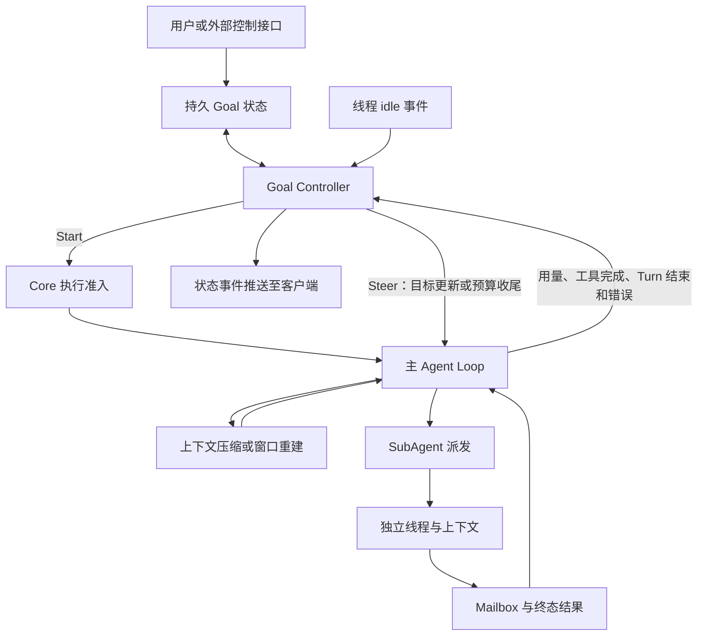
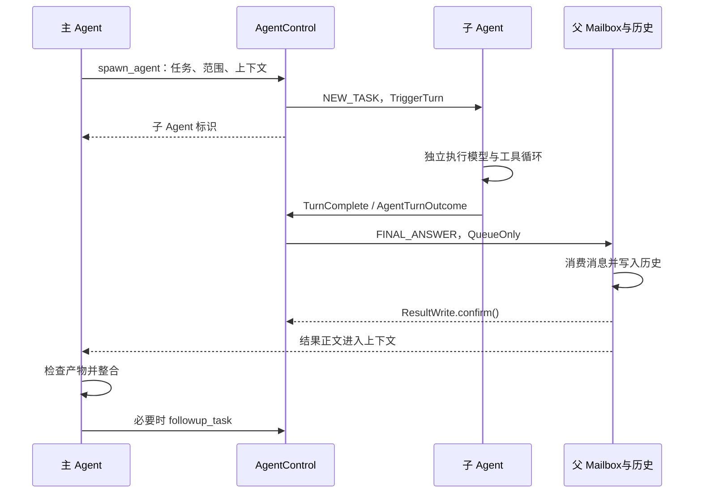

# Codex Harness Goal 实现技术方案

Codex 将 Goal 实现为普通 Agent Loop 上方的线程级控制器：持久保存目标，监听执行事件，在空闲边界启动下一轮，累计目标资源消耗，并在完成、暂停、阻塞或预算耗尽时关闭自动续轮。上下文窗口管理和多 Agent 协作由 Harness 通用运行时提供。

本文整理指定会话《梳理 Codex Harness Goal 模式》中对本地源码的分析，并合入后续关于窗口接力、MultiAgentV2 和 Goal Controller 的补充。描述范围为该次分析涉及的代码路径；受特性开关控制的能力单独标注。文中伪代码表达控制流程，末节为第 25 课的应用设计建议。

配套材料：[DeepSeek Harness Goal 实现技术方案](deepseek_harness_goal_implementation_design.md)。两份材料供《企业级Agent工程架构实战营》第 25 课备课使用，状态为 `review`。

## 1. 架构与职责

系统存在三种执行节拍：Goal Controller 驱动跨 Turn 续跑；每个 Agent 在 Turn 内进行模型与工具循环；SubAgent 在独立线程中并行执行。窗口切换可以发生在某个 Turn 内。



| 组件                  | 负责内容                                | 实现入口                                       |
| --------------------- | --------------------------------------- | ---------------------------------------------- |
| `GoalService`         | 设置、读取、清除目标，关联线程运行时    | `codex-rs/ext/goal/src/api.rs`                 |
| `GoalExtension`       | 接入线程、Turn、工具、用量生命周期      | `codex-rs/ext/goal/src/extension.rs`           |
| `GoalRuntimeHandle`   | 续轮、停止续轮、恢复、目标修改 Steering | `codex-rs/ext/goal/src/runtime.rs`             |
| `GoalAccountingState` | 用量基线、目标归属、异常计数            | `codex-rs/ext/goal/src/accounting.rs`          |
| Goal 状态存储         | SQLite 中的目标及累计用量               | `codex-rs/state/src/runtime/goals.rs`          |
| Steering 与模型工具   | 续轮提示、预算提示、三个 Goal 工具      | `codex-rs/ext/goal/src/steering.rs`、`tool.rs` |
| Core 与 MultiAgentV2  | 执行准入、历史管理、子线程、消息与资源  | Harness 通用运行时                             |

任务拆解、工具选择、是否委派以及业务完成判断主要由执行模型决定。Controller 提供执行连续性、记账和停止控制；当前 Goal 路径的完成判断由执行模型按协议自检后提交。

## 2. 数据模型与控制接口

### 2.1 持久状态和运行中状态

一个线程维护一个当前目标。主要持久字段如下：

```text
Goal
  thread_id             所属线程
  goal_id               当前目标身份
  objective             完整目标文本
  status                目标状态
  token_budget          可选的累计 Token 预算
  tokens_used           已记账用量
  time_used_seconds     累计耗时
  created_at / updated_at
```

`time_used_seconds` 用于消耗记录，该路径未提供对应的通用时间截止字段。目标 Token 预算由专门逻辑控制。

Controller 的内存状态包括：当前 Turn 的目标归属和用量基线、尚未结算的后代用量、自动续轮 Turn ID、空响应及执行失败计数、预算提示发送状态，以及下一轮的 `parent_turn_id / root_turn_id`。

数据库保存可恢复的目标生命周期；内存状态协调当前执行周期。

### 2.2 状态机

| 状态             | 进入来源                           | 自动续轮                 |
| ---------------- | ---------------------------------- | ------------------------ |
| `active`         | 创建或外部恢复操作                 | 满足 Core 准入条件后允许 |
| `complete`       | 执行模型提交完成                   | 停止                     |
| `paused`         | 用户要求暂停，经工具或外部控制执行 | 停止                     |
| `blocked`        | 模型报告业务阻塞，或运行时异常熔断 | 停止                     |
| `budget_limited` | 累计目标用量达到预算               | 停止，并引导当前轮收尾   |
| `usage_limited`  | 服务使用额度错误                   | 停止                     |

模型工具为：

- `create_goal`：创建目标；存在未完成目标时拒绝覆盖。
- `get_goal`：读取完整目标、状态和用量。
- `update_goal`：提交 `complete / blocked / paused`。

恢复目标、编辑目标和修改预算由用户及外部控制接口承担。暂停遵循用户意图，完成要求全部工作已完成，业务阻塞要求按续轮协议进行重复阻塞审计。

### 2.3 三种控制动作

| 动作              | 触发                     | 对执行的影响                   |
| ----------------- | ------------------------ | ------------------------------ |
| Start             | 线程空闲且目标可继续     | 提交新的 Goal Turn             |
| Steer             | 目标文本变化或预算耗尽   | 向当前 Turn 注入更新或收尾提示 |
| Stop continuation | 目标进入非 `active` 状态 | 关闭后续自动续轮               |

当前 Turn、工具和子 Agent 的立即中断由各自的取消接口处理。目标状态变化与执行中断需要分别建模。

## 3. 自动续轮：事件驱动的外层控制循环

核心路径为：

```text
on_turn_stop
  → 结算用量、检测异常、保留轮次关联
on_thread_idle
  → continue_if_idle
  → 读取最新 Goal
  → continuation_request
  → start_turn_if_idle
  → 在原线程创建下一 Turn
```

简化伪代码：

```python
async def on_thread_idle(thread):
    async with goal_state_lock:
        if runtime_unavailable(thread) or continuation_deferred(thread):
            return
        goal = store.get_goal(thread.id)
        if goal is None or goal.status != "active":
            return

        request = continuation_request(goal)
        result = await thread.start_turn_if_idle(
            request,
            trigger="goal",
            lineage=previous_turn_lineage,
        )
        if result.started:
            accounting.mark_automatic_turn(result.turn_id)
```

Controller 检查目标状态、延期标记和运行时可用性。Core 统一检查活跃 Turn、触发型 Mailbox 输入、Plan 模式、服务 draining 等准入条件。拒绝的自动输入不会写入历史或积压在队列里，后续生命周期事件可以再次触发检查。

自动调度依赖被加载的线程与 ThreadManager。仅保存一条 `active` 目标记录时，需要宿主恢复并驱动线程生命周期，才能继续工作。

### 3.1 生命周期事件

| 事件                     | Controller 的处理                              |
| ------------------------ | ---------------------------------------------- |
| Thread start / resume    | 注册运行时，恢复目标与记账关联                 |
| Turn start               | 建立用量基线，关联当前目标                     |
| Token usage              | 接收本轮及相关后代用量                         |
| Tool finish              | 结算增量，检查预算，必要时发收尾提示           |
| Turn stop / interruption | 最终结算，处理异常计数和续轮关系               |
| Turn error               | 按错误类别进入 `blocked` 或 `usage_limited`    |
| Thread idle              | 尝试续轮                                       |
| 外部目标修改             | 结算旧状态，持久化新状态，向活跃 Turn 注入更新 |

### 3.2 一致性约束

目标状态锁串行化外部修改与“读取目标—发起续轮”过程。记账锁串行化“计算增量—持久化—推进基线”过程。`expected_goal_id` 将旧 Turn 的结算和异常限制在对应目标内。

每轮保存 `parent_turn_id / root_turn_id`，并以 `turn_trigger = goal` 标识来源，使多轮执行保持共同归属。

## 4. 预算、停止与防空转

会话分析中的目标用量口径为：

```text
目标 Token 消耗 = 非缓存输入 Token + 输出 Token
非缓存输入 Token = input_tokens - cached_input_tokens
```

相关后代 Agent 的用量纳入根目标记账。工具完成、Turn 结束、中断和目标状态更新等边界，基于累计观测与上次基线结算增量。成本估算仍需另行结合模型价格，Token 计数与费用口径分别维护。

预算耗尽的路径为：

```text
记账达到上限
  → 持久状态进入 budget_limited
  → 当前 Turn 收到收尾提示
  → 汇报已完成内容、剩余项和下一步
  → Turn 结束后关闭自动续轮
```

控制粒度位于用量和生命周期边界，当前轮的收尾允许产生额外消耗。窗口容量预算另由 Core 管理，与累计 Goal 预算各自生效。

防空转分为两层：

| 检查                               | 判断主体                       |
| ---------------------------------- | ------------------------------ |
| 是否取得实质进展、是否覆盖全部要求 | 执行模型按续轮协议审计         |
| 同一业务阻塞持续多个 Goal Turn     | 执行模型判断；协议要求至少三轮 |
| 符合条件的连续三次自动空响应       | 程序计数并转为 `blocked`       |
| 符合检测条件的多轮执行设施失败     | 程序计数并熔断                 |
| 不可重试或重试耗尽的 Turn 错误     | 运行时停止策略                 |

“空响应”“执行设施失败”和“业务无进展”使用不同判断条件。普通工具失败也有独立处理语义，应按具体错误和恢复路径决策。

## 5. 上下文工程：续轮、换窗与恢复

### 5.1 同线程续轮与目标重新锚定

普通 Goal 续轮保留线程历史。新输入包含两部分：内部 `goal` 控制上下文，以及承载用户目标的 `goal_objective` 附加上下文。后者标记为 `Untrusted`，按任务数据处理。

附加上下文按键和值去重；相同内容可以复用。通用注入预算约为 1,000 Token，长目标可能被中间截断，续轮指令要求目标缺失或截断时调用 `get_goal` 取回完整文本。数据库保留完整目标。

续轮协议要求模型：检查当前文件和外部状态，保留完整目标范围，维护多步骤计划，对照全部要求审计完成情况，并区分实质推进、有效等待和无进展。有效等待应持续检查已确认存活的进程、Job 或工具句柄，避免观察超时后重复启动同一工作。

目标编辑通过 Steering 进入活跃 Turn；下一轮从数据库读取更新后的目标。

### 5.2 三类连续性

| 场景              | 执行机制                   | 主要保留对象                          |
| ----------------- | -------------------------- | ------------------------------------- |
| 跨 Turn           | Goal Controller 启动下一轮 | 同线程历史、最新目标和预算            |
| 跨窗口            | Core 压缩或重建模型输入    | 保留消息、压缩项、当前运行上下文      |
| 进程退出后 Resume | 加载 Rollout 并重建历史    | 历史快照、后续日志、窗口元数据和 Goal |

窗口切换可以发生在同一 Turn 内。业务阶段切换与窗口切换可以由应用协调，但当前 Goal Controller 不要求每轮都生成交接摘要。

### 5.3 三条窗口管理路径

会话后续分析补充了以下分支：

| 路径         | 重建方式                                                       | 条件                         |
| ------------ | -------------------------------------------------------------- | ---------------------------- |
| 远程 V2 压缩 | 服务端压缩项、筛选保留消息、当前运行上下文                     | Provider 支持对应能力        |
| 本地摘要压缩 | 文本摘要、预算范围内保留的用户消息等                           | 本地摘要路径                 |
| 新窗口重建   | 装配新窗口上下文，选择保留指定消息，按配置接入 History / Notes | `TokenBudget` 等相关特性开启 |

`new_context` 在启用时允许模型请求新窗口，环境状态独立保留。History / Notes 扩展可以提供窗口和历史条目的列举、读取、搜索，以及笔记读写；`thread_hint` 帮助新窗口定位已有笔记。实际工具暴露依赖配置、Provider 和后端。

`build_world_state_for_step` 与 `assemble_initial_context` 负责装配权限、项目指令、工具、协作模式、环境及适用的命令会话状态。初始或新窗口装配完整上下文，常态执行按基线补充变化部分。

### 5.4 异步压缩的一致性

后台压缩捕获历史前缀 `H0`。压缩运行期间追加的新历史记为 `ΔH`，安装时形成：

```text
新历史 = 重建后的运行上下文 + compact(H0) + ΔH
```

安装前检查历史版本、前缀范围、认证上下文和模型兼容性。相关路径保留捕获快照之后的目标编辑、有效附加上下文及待处理输入，并刷新易变状态。

`CompactedItem` 可包含 `replacement_history`、`retained_context`、窗口标识、压缩响应标识、最新 Token 记录和 `resume_metadata`，并配合 `WorldState / TurnContext` 写入日志。

### 5.5 Resume 的恢复范围

`reconstruct_history_from_rollout` 从有效压缩快照重建历史，再重放后续消息、工具结果和 Agent 通信记录，处理回滚并恢复窗口与轮次信息。这里重放的对象是历史记录。

恢复时使旧的 `command_sessions` 基线失效，再依据当前运行实例刷新句柄。对于缺少结果的历史工具调用，可补入 `aborted` 等配对结果以修复模型输入协议。外部操作的实际提交状态交由相应工具或业务系统查询。

Goal 表和历史快照提供目标及上下文连续性。业务进度账本、数据快照版本、外部操作幂等键和统一业务恢复校验需要应用层补充。

## 6. SubAgent：任务派发与结果交接

### 6.1 派发接口与上下文

MultiAgentV2 的派发链路为：

```text
spawn_agent(task_name, message, fork_turns, ...)
  → thread_spawn::prepare
  → thread_spawn::spawn
  → AgentControl::spawn
  → 子线程注册与 NEW_TASK 投递
```

准备内容包括任务路径、父子关系、深度、`parent_turn_id / root_turn_id`，以及模型、权限、审批策略、工作目录、角色和工具配置。初始任务使用 `TriggerTurn`，创建成功后返回子 Agent 标识。

| `fork_turns` | 启动上下文                                                         |
| ------------ | ------------------------------------------------------------------ |
| `all`，默认  | 刷出待写历史，捕获父上下文快照，按保留策略处理，再补入子身份和任务 |
| `none`       | 新任务上下文、运行配置、角色与环境，以及明确要求保留的上下文项     |

`preserve_fork_prefix` 路径尽量保留前缀和上下文基线，便于缓存复用。其他路径可以筛选历史并重建角色信息。父线程后续新增历史通过消息按需同步；活跃工具会话和进程句柄保持各自运行时归属。

多个 Agent 独立维护模型上下文，工作区可以共享。文件归属、修改范围和整合顺序应在派发任务中约定；需要更强文件隔离时由上层安排 worktree。

### 6.2 并发与协作工具

| 工具              | 行为                                                           |
| ----------------- | -------------------------------------------------------------- |
| `spawn_agent`     | 创建独立子线程；容量或深度超限时拒绝                           |
| `send_message`    | `QueueOnly`，投递协作消息                                      |
| `followup_task`   | `TriggerTurn`，向已有非 root Agent 追加任务，空闲时申请新 Turn |
| `interrupt_agent` | 中断当前执行，保留 Agent 供后续交互                            |
| `wait_agent`      | 等待 Mailbox 活动、用户输入或超时                              |
| `list_agents`     | 查看协作树状态                                                 |

消息可按相对路径或完整任务路径寻址，支持父子和同级协作。运行中的接收者在相应执行边界接收消息；相关路径可以请求抢占采样。工具执行有自己的消息交付边界。

容量、深度和驻留资源由 Harness 管理。任务依赖、并行范围、整合时机和是否返工由主 Agent 决策。

### 6.3 结果交接时序



终态路径为 `maybe_publish_terminal_agent_result → AgentControl::turn_finished → notify_parent_of_terminal_turn`。结果沿结构父子关系回到父 Agent，包含最终答复或错误信息。完整过程保留在子线程；文件和 Artifact 通过引用交付。

`unconfirmed_results` 跟踪尚未确认写入的终态结果。接收方写入历史成功后调用 `ResultWrite::confirm()`，完成消息持久化层面的交接。随后由主 Agent 检查业务交付。

同级 Agent 发起追加任务时，自动终态结果仍回到结构父 Agent；需要通知发起者时应另发消息。

### 6.4 消息到达后的接续条件

| 父 Agent 状态     | 接续方式                                                                            |
| ----------------- | ----------------------------------------------------------------------------------- |
| 正在执行          | 在执行边界接收消息                                                                  |
| 正在 `wait_agent` | Mailbox 活动结束等待，正文另行进入上下文                                            |
| 已空闲            | `QueueOnly` 先排队；由条件启用的 `WakeOnAgentMessages`、Goal 续轮或用户输入驱动执行 |
| 实例已卸载        | Mailbox 按运行时生命周期保留消息，加载后处理                                        |

`wait_agent` 返回等待状态，结果正文走 Agent 消息通道。接续可以先处理已返回的一个分支，随后继续等待其他分支。

源码中的 `root_handoff` 服务于条件启用的 Guardian 上游指令与授权上下文选择；执行交接由线程创建、消息、准入和结果回传共同完成。

## 7. 第 25 课的应用设计建议

以下为 Compass 扩展建议，供后续技术设计使用。课程范围以[当前课程输入](_INDEX.md#当前课程输入)及其人工批准结果为准。

| 可复用机制             | 本课补充的业务机制                                              |
| ---------------------- | --------------------------------------------------------------- |
| 持久 Goal 与空闲续轮   | Goal Contract：验收条件、约束、总预算、确认版本                 |
| 模型侧完成审计         | 程序硬校验与独立 Verifier，统一提交完成决策                     |
| 线程历史和窗口重建     | Progress Ledger：已完成步骤、查询身份、阶段结论和 Artifact 引用 |
| 子线程与 Mailbox       | Delegation / Return Contract：口径、范围、预算、输出格式和缺口  |
| 历史恢复与当前状态刷新 | 恢复前检查数据快照、已执行查询、未结算操作和权限                |

建议业务闭环：

```text
用户提出利润归因任务
  → 收集并确认验收条件
  → 保存 Goal Contract，进入 running
  → 按收入 / 成本 / 费用派发独立分支
  → 回收摘要与版本化 Artifact，更新 Progress Ledger
  → 换窗时装配 Goal + Ledger + 必要引用
  → 执行 Agent 提交验收，进入 verifying
  → 硬校验与独立 Verifier 通过：completed
  → 未通过且可补救：写入补救待办，继续 running
  → 预算耗尽或需人工决策：blocked
```

业务状态 `draft / confirmed / running / verifying / completed / blocked` 由应用维护。底层 Goal 状态负责调度资格；业务 `completed` 通过验收后再映射为底层 `complete`。预算停止记录具体原因，保留已完成产物与待办。

Progress Ledger 至少关联 `goal_id`、契约版本、步骤 ID、状态、查询指纹、数据快照、Artifact 版本、结论摘要和下一动作。副作用提交、Checkpoint 与幂等复用第 19–20 课机制；窗口内压缩复用第 24 课机制。

建议验证以下场景，作为实施后的检查项：

1. 用户修改目标与自动续轮同时发生时，执行读取到正确版本。
2. 工具并发完成和后代用量上报时，累计记账无重复。
3. 达到预算后进入收尾并关闭续轮，记录实际超额用量。
4. 压缩期间到达的目标修改与子 Agent 结果在安装后仍可见。
5. 子 Agent 终态结果写入历史后确认，主 Agent 按实际唤醒条件接续。
6. 重新加载线程后刷新命令句柄，业务查询按账本去重复用。
7. 执行 Agent 提交完成后，Verifier 至少打回一次并生成可执行补救项。

以上为文档中的设计检查项，本次整理未执行 Harness 运行实验。
