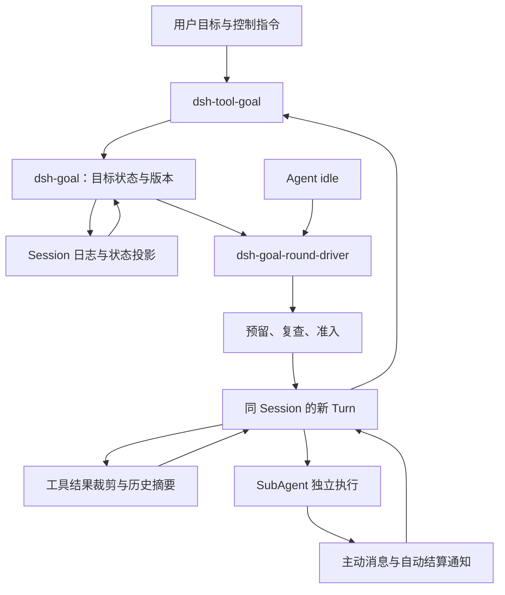
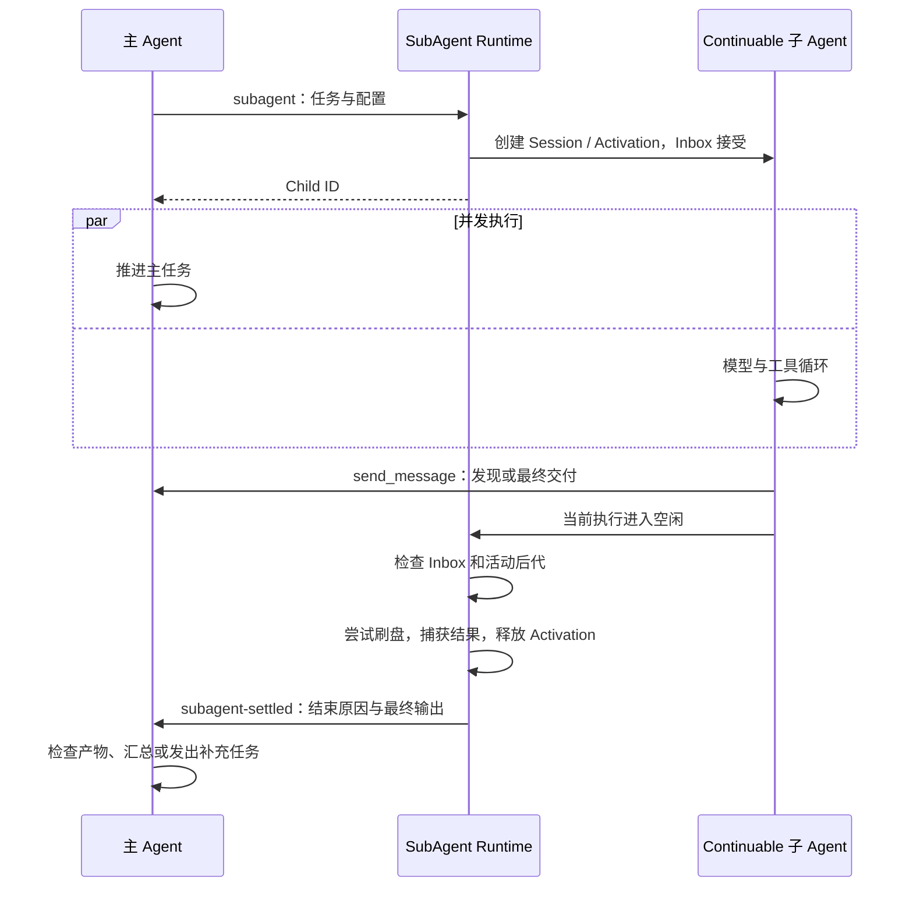

# DeepSeek Harness Goal 实现技术方案

DeepSeek Harness 通过三个插件组织 Goal：目标服务保存持久状态，Round Driver 在同一 Session 中自动续轮，模型工具按调用身份和消息来源控制目标操作。上下文压缩维持窗口容量，SubAgent 提供独立执行上下文、并发任务和结果回传。

本文整理指定会话《梳理 Goal 模式实现机制》中对本地源码的分析，并合入后续关于任务派发、Inbox 接受、主动回传和自动结算的补充。描述范围为该次分析涉及的代码路径；默认数值以对应插件配置为前提。伪代码为流程归纳，末节为第 25 课的扩展设计建议。

配套材料：[Codex Harness Goal 实现技术方案](codex_goal_implementation_design.md)。两份材料供《企业级Agent工程架构实战营》第 25 课备课使用，状态为 `review`。

## 1. 架构与职责



| 组件                    | 核心职责                                         | 实现入口                                            |
| ----------------------- | ------------------------------------------------ | --------------------------------------------------- |
| `dsh-goal`              | 目标生命周期、版本校验、状态投影和激活资格       | `packages/goal/goal/`                               |
| `dsh-goal-round-driver` | 空闲检测、续轮预留、输入竞争、轮数限制、取消处理 | `packages/goal/goal-round-driver/`                  |
| `dsh-tool-goal`         | Goal 工具、调用权限、模型阻塞策略、收尾提示      | `packages/goal/tool-goal/`                          |
| Agent / Agent Loop      | Turn 执行、模型请求、工具调度和输入边界          | `packages/core/agent/`、`packages/core/agent-loop/` |
| Compaction 插件         | 可见历史裁剪、摘要与超限恢复                     | `packages/compaction/`                              |
| SubAgent 服务与工具     | 创建、委派、消息、恢复和结算                     | `packages/subagent/`                                |

模型决定任务如何拆分、结果是否充分和何时提交完成；运行时负责目标版本、输入准入、执行顺序和生命周期。Goal 与 SubAgent 通过主 Agent 的决策及会话消息协作。

## 2. Goal 状态模型：持久阶段与进程激活

### 2.1 数据对象

```text
GoalSnapshot
  id                    目标身份
  revision              每次持久变更递增的版本
  objective             完整目标文本
  phase                 active / paused / blocked / complete
  maxGoalRounds         自动续轮上限，默认 256
  blockedReason         blocked 时的 code 与 message

GoalProjection
  goal                  当前持久快照
  roundsStarted         已准入自动续轮的最高轮次
  createdAt / updatedAt

GoalView
  上述当前状态与计数
  activation            armed / disarmed，仅存于当前进程
```

`phase` 表达业务生命周期，`activation` 表达当前进程是否有资格自动续跑。续轮同时要求 `active + armed`。

Session 恢复、Fork 或进程重启后，持久目标可以保持 `active`，激活资格恢复为 `disarmed`。用户要求继续后，通过 `resume` 重新授权自动执行。新一轮执行由宿主加载与事件驱动共同启动。

| 组合                | 含义                           |
| ------------------- | ------------------------------ |
| `active + armed`    | 可申请自动续轮                 |
| `active + disarmed` | 保留目标，等待用户授权恢复     |
| `paused`            | 显式暂停                       |
| `blocked`           | 存在阻塞原因，包括自动轮数用尽 |
| `complete`          | 目标已提交完成                 |

### 2.2 事件日志和状态投影

目标变更追加 `goal/change` 事件，事件携带操作类型、变更后的完整快照及相关计数和时间。清除目标使用 tombstone。操作包含 `create / edit / pause / resume / complete / block / clear`。

自动续轮消息携带独立来源：

```text
source.kind = goal
source.goalId
source.revision
source.round
```

状态投影从 `goal/change` 恢复生命周期，并从匹配的已准入 `user/message` 事件推进 `roundsStarted`。原始日志、模型可见历史和 Goal 投影分别管理；历史压缩后仍可由结构化事件恢复目标。

更新要求携带准确的 `goal_id + revision`。旧版本调用返回 `GOAL_STALE_REVISION`，调用方应重新读取当前状态并重新判断操作。每次持久变更推进版本，为目标编辑、暂停与恢复提供并发边界。

## 3. 模型工具与控制权限

三个模型工具为 `create_goal`、`get_goal`、`update_goal`。其中 `update_goal` 的动作包括 `edit / pause / resume / complete / blocked`；这与 Codex 工具仅接收三种停止状态的接口不同。

| 操作                          | 运行时权限                                      |
| ----------------------------- | ----------------------------------------------- |
| 创建、编辑、暂停、恢复        | 顶层 Agent 的当前 Turn 含宿主认证的直接用户输入 |
| 完成、报告阻塞                | 直接用户 Turn，或当前 Goal 的准确续轮           |
| 子 Agent 经委派消息操作根目标 | 委派来源不具备根用户控制权限                    |

运行时核验当前调用 Agent、活跃 Driver 和开放 Turn 边界，再依据事件来源判断授权。续轮权限要求 `goalId / revision / round` 与当前状态匹配。

宿主调用 `followup / steer` 时，非用户生产者需要显式填写来源。默认来源会被视为用户输入，因此 Agent 消息、自动续轮与其他系统输入必须保留自己的来源类型。

模型负责理解用户是否表达了创建或恢复目标的意图；代码负责身份和来源校验。

阻塞控制也分层执行：默认提示要求相同阻塞持续至少三个 Goal round；自动 Goal round 中的工具调用还受最小已准入轮数检查。阻塞是否相同且连续由模型判断，并通过 `blocked_reason` 说明。直接用户控制走相应授权路径。

## 4. 自动续轮：预留、复查、准入

一个 Goal round 对应一个新的 Agent Turn，Turn 内可以包含多次模型请求和工具执行。`roundsStarted` 统计已准入的自动 Goal 轮次，普通用户 Turn 独立处理。

续轮过程为：

1. 等待 Agent 进入 idle。
2. 检查 Goal 为 `active + armed`，且尚有轮数。
3. 等待相关 Session 状态刷盘。
4. 为下一轮建立预留，准备 `<goal_round>` 消息。
5. 在 `agent/pre-step` 相关边界复查目标版本、取消状态和竞争输入。
6. 消息实际准入执行后，记录轮次并推进投影。

简化伪代码：

```python
async def on_idle(agent):
    goal = goals.get(agent)
    if not eligible(goal):
        return
    if goal.roundsStarted >= goal.maxGoalRounds:
        goals.block(agent, goal.ref, code="round-limit")
        return

    await session.flush()
    attempt = reserve_round(goal.ref, goal.roundsStarted + 1)
    message = render_goal_round(goal, attempt.round)

    # 准入钩子重新读取目标和输入状态。
    # 过期、取消或被其他输入优先占用的预留不消耗轮次。
    submit_with_admission_check(agent, message, attempt)
```

### 4.1 竞争和失败处理

| 情况                               | 控制策略                               |
| ---------------------------------- | -------------------------------------- |
| 用户在预留后修改目标               | 版本复查使旧续轮失效                   |
| 新用户输入先到                     | 自动续轮让出执行机会                   |
| 续轮取消或被拒绝                   | 撤销预留，保持已准入轮数               |
| Session 持久化失败                 | 撤销自动续跑资格                       |
| 达到 `maxGoalRounds`               | 转为 `blocked`，记录 `round-limit`     |
| 用户取消正在执行或排队的 Goal 工作 | 后续空闲时按对应版本暂停，避免立即续跑 |
| 暂停后立即恢复                     | 利用 revision 将旧取消动作限制在原版本 |

该 Goal 服务的原生预算维度是自动轮数。全树 Token、费用和总耗时预算需要另行接入统一记账服务。即使轮数较少，单个 Turn 也可能产生较多模型和工具调用。

### 4.2 完成与收尾

模型提交 `complete` 或 `blocked` 后，工具路径补入收尾上下文，引导模型说明结果或具体阻塞，再结束当前轮。后续自动续轮受目标状态控制。

当前完成判定由执行模型执行；独立验收器可在业务层接管最终完成权限。目标停止、当前 Turn 中断、子 Agent 中断和整个执行树释放是分别管理的生命周期动作。

## 5. 上下文工程：保持目标与控制可见历史

### 5.1 每轮带入完整目标

Round Driver 在原 Session 追加 `<goal_round>` 消息，包含完整 objective、当前轮数及上限，并要求检查实际工作区、工具结果和持久状态。

Goal 状态变更事件用于状态恢复；模型通过工具结果、续轮消息和收尾上下文看到相应信息。实现新的业务状态时，也需要同时设计模型可见入口。

### 5.2 原始事件与可见历史

Session 保留原始事件，模型请求使用派生后的可见历史。Compaction 用摘要替换较早历史区间，原事件继续保存在日志中。恢复时可以重建相同的可见上下文，并独立恢复 Goal 状态。

应用中的结构化 Progress Ledger、查询去重和 Artifact 版本应放在持久业务状态中，再把必要内容装配到模型窗口。

### 5.3 先裁剪工具结果，再摘要

加载相应插件后，先对大工具文本做确定性裁剪，再按剩余压力决定是否模型摘要。

| 配置             | 分析中的默认值        | 含义                       |
| ---------------- | --------------------- | -------------------------- |
| 工具文本裁剪阈值 | 8,192 个 Unicode 码点 | 超过阈值才裁剪             |
| 保留头部 / 尾部  | 4,096 / 1,024 个码点  | 中间使用固定裁剪标记       |
| 基础压缩触发压力 | 约窗口容量的 80%      | 可按 Provider / Model 覆盖 |
| 近期原文保留预算 | 约窗口容量的 16%      | 维护近期执行连续性         |

压力估算包含 system prompt、工具定义和消息。历史区间选择保持工具调用与结果配对完整。

摘要保留需求变化、关键概念、文件与代码、错误及修复、未完成任务、当前工作、下一步和用户约束。遇到已有摘要时合并最新信息并移除过时内容，压缩器检查替换后是否实际缩小输入。

Provider 返回明确上下文超限时，可以尝试更大范围的头部压缩；只有可见历史实际发生有效替换后，才进行相应重试。

### 5.4 缓存与额外上下文

普通续轮使用追加方式，保留已有请求前缀。摘要调用尽量复用上一请求的 system prompt、工具和待压缩历史，再追加摘要指令。

项目指令插件按版本和摘要值识别变化，减少重复注入。跨会话引用使用有预算的只读快照，并标记为外部背景信息。

Goal Driver 负责续轮，Compaction 插件负责历史容量，SubAgent 负责将分支探索留在独立 Session。三者可以组合部署。

## 6. SubAgent 的两个配置维度

上下文来源和生命周期是两个独立选择，配置可以组合。

| 上下文来源 | 子 Agent 的输入                                           |
| ---------- | --------------------------------------------------------- |
| Spawn      | 新 Session 与本次委派任务                                 |
| Fork       | 父 Session 截至最后一个已完成 Turn 的日志前缀，再追加任务 |

Fork 不包含父 Agent 当前尚未结束的 Turn。本轮新发现的文件内容、工具结果和决策需要写入委派 prompt。Fork 前缀在创建时捕获一次，之后子 Agent 维护自己的历史，恢复也读取自己的 Session。随附 Fork 工具保持父模型路由，以利用前缀缓存。

| 生命周期与执行方式 | 返回值        | 后续结果获取                             |
| ------------------ | ------------- | ---------------------------------------- |
| One-shot 前台      | 等待执行结果  | 工具直接返回，随后清理运行资源           |
| One-shot 后台      | Job ID        | `job_output` 获取，`job_kill` 停止       |
| Continuable 后台   | 持久 Child ID | 主动消息、自动结算，支持后续任务和冷恢复 |

通用工具默认配置为 One-shot；启用 Continuable 后，默认后台执行。`run_in_background: false` 可以用于下一步依赖结果的前台路径。

子 Agent 继承适用的 preset 组合，应用 persona 和 toolFilter，并维护独立注册作用域。进程内执行可以共享工作区；上下文隔离和文件写入分工分别管理。

## 7. 第一次 Handoff：从委派到 Inbox 接受

模型调用入口：

```json
{
  "description": "分析成本分支",
  "prompt": "按统一口径分析成本变化，输出结论、产物引用和未解决问题。",
  "run_in_background": true
}
```

工具将请求与宿主配置合并为：父 Agent、标签、任务 prompt、`agentOptions`、`persona`、`toolFilter` 和 `maxDepth`。模型选择字段受能力开关和授权策略约束；persona、工具过滤和深度主要由工具实例配置决定。

Continuable 启动链路：

```text
验证父 Agent、绝对深度和 Provider 能力
  → 捕获模型与委派权限
  → 准备 Spawn / Fork 上下文
  → 创建独立 Session 与 Agent
  → 注册 Activation 和父子关系
  → 初始任务进入 Inbox
  → 返回 Child ID
```

Activation 表示持久子 Session 在当前进程中的一次活动实例，拥有 Agent、Inbox、后代关系与释放状态。

交接边界是 Inbox 接受：

- 接受前，调用方取消可以终止启动并清理未完成创建。
- 接受后，子 Agent 拥有独立执行生命周期，父调用返回。
- 消息接受与日志刷盘属于两个阶段；崩溃恢复需要考虑两者之间的间隔。

委派捕获父 Session 的显式 sandbox 配置。挂载审批能力时，子 Agent 的 approval policy 固定为 `never`，超出授权范围的工作可通过结果或消息交回父 Agent 处理。

当前委派 prompt 是自由文本。目标、输入、负责范围、验收条件和返回格式可以由上层定义为结构化契约，再渲染为工具输入。

## 8. 并发与运行中协作

### 8.1 工具并发与 Agent 并发

委派工具声明为并行安全。工具调度器使用有界滚动池，默认每个 step 最多同时执行 10 个并行安全调用；独占工具形成串行屏障，结果按原调用顺序提交。

后台子任务启动并返回后，对应工具槽位释放，子 Agent 继续运行。因此需要单独配置活跃子 Agent 的数量限制和预算，才能约束整个协作树的资源消耗。

默认委派最大深度为 3，按子 Agent 在树中的绝对深度检查；超深调用明确失败。任务依赖、分支间同步和汇总时机由主 Agent 规划。

### 8.2 消息路由

Continuable 模型消息使用 `send_message({agent_id, message})`。消息以可读文本进入接收方上下文，同时携带 `agent-message`、`relay`、`senderSessionId` 等来源信息。

| 目标状态           | 投递方式                       |
| ------------------ | ------------------------------ |
| 正在运行           | Steer 到最近可接收的 step 边界 |
| 空闲且驻留         | 启动下一 Turn                  |
| 仅保留持久 Session | 冷恢复直接子 Agent，再投递消息 |

运行中的模型请求通常在后续执行边界接收更新。每个 Child 的控制逻辑串行化投递、恢复和释放，关闭中的 Inbox 拒绝新消息。

模型通信拓扑限于直接父子关系；兄弟通信由父 Agent 转发：

```text
子 A → 父 Agent → 子 B
```

`send_message` 返回接受确认和消息身份，回复通过后续消息到达。消息接受后，发送工具的取消不撤销已接受投递。

## 9. 第二次 Handoff：主动回传与自动结算

Continuable 有两条结果通道：

| 通道                   | 触发者 | 内容与时机                                              |
| ---------------------- | ------ | ------------------------------------------------------- |
| 主动 `send_message`    | 子模型 | 自包含发现、进度或交付结果，执行中即可发送              |
| 自动 Settlement Notice | 运行时 | 结束原因与最后 assistant 输出，在 Activation 结算后投递 |

当子 Agent 可用 `send_message` 时，启动上下文会指导它向父 Agent 发送自包含结果，关键发现提前汇报。发消息后，子 Agent 可以继续执行当前 Turn。

自动结算区分完成、停止、Token 用尽、拒绝和错误。通知进入父会话后，忙时走 Steer，闲时可以开启新 Turn。



两条通道可以同时到达，父 Agent 可能收到两份相近的结果信息。当前实现未将两路信息统一去重为单份业务交付物；上层 Return Contract 可增加 `task_id / attempt_id / artifact_version` 管理交付身份。

### 9.1 结算条件与资源释放

自然结算同时要求：

```text
Agent 已 idle
+ Inbox 无待处理输入
+ 无仍由它持有的活动子 Agent
```

子 Agent A 派出 A1 后，即使 A 自己暂时空闲，A1 仍在运行也会保留 A 的 Activation，便于继续接收后代结果。

结算阶段处理持久化、捕获终态和最终输出，再释放活动实例并通知父 Agent。持久 Session 和 Child ID 保留，之后可通过新消息恢复。

`interrupt_agent` 停止目标当前 Turn，排队消息与后代继续保留。整个树的释放由外层生命周期管理负责。

### 9.2 返回契约与机制边界

完整工具记录留在子 Session，父 Agent 接收选定消息、最终输出和产物引用。建议业务返回内容为：完成项、Artifact 引用、关键口径、校验结果、剩余缺口、阻塞和下一步。

One-shot Provider 的执行服务支持 `outputSchema` 与 `structured_output`；会话分析中的通用委派工具未直接暴露该参数。需要强制结构化交付时，应在上层工具或服务接口接入。

当前 Inbox / Activation 属于进程内机制。跨进程执行权、持久邮箱和崩溃后补投尚未写日志的已接受消息，需要额外实现。消息投递完成后，主 Agent 仍负责业务验收、文件冲突协调及补充委派。

## 10. 与 Codex 的实现对照

| 维度            | DeepSeek Harness                             | Codex 会话分析中的实现                            |
| --------------- | -------------------------------------------- | ------------------------------------------------- |
| Goal 持久化     | Session `goal/change` 与投影                 | SQLite Goal 记录                                  |
| 并发修改控制    | `goal_id + revision`                         | 目标状态锁与 `expected_goal_id`                   |
| 进程恢复        | 恢复持久阶段，自动执行默认 `disarmed`        | 恢复 Goal，依赖线程加载、生命周期及 Core 准入     |
| 自动续轮        | idle、刷盘、预留、pre-step 复查与准入        | idle、读取最新目标、Core `start_turn_if_idle`     |
| Goal 原生预算   | 自动续轮数                                   | 累计 Token，用量包含相关后代                      |
| 模型更新工具    | `edit / pause / resume / complete / blocked` | `complete / paused / blocked`；其他控制走外部接口 |
| 子 Agent 上下文 | Spawn，或完成 Turn 截点的 Fork               | `fork_turns=all / none` 与历史保留策略            |
| Agent 消息拓扑  | 直接父子                                     | 父子及同级寻址                                    |
| 空闲接收者      | Continuable 消息可启动 Turn                  | `QueueOnly` 与 `TriggerTurn` 分离，自动唤醒有条件 |
| 终态结果        | 主动消息加自动结算，可能重复                 | 自动终态回父 Mailbox，跟踪历史写入确认            |
| 业务完成        | 执行模型提交                                 | 执行模型提交                                      |

两种实现都可以承载长期任务。选择时应结合宿主运行时、恢复授权要求、资源预算粒度和多 Agent 消息模型。

## 11. 第 25 课的扩展设计建议

以下建议承接[当前课程输入](_INDEX.md#当前课程输入)，属于 Compass 业务设计。公共业务闭环见[Codex 文档中的应用设计建议](codex_goal_implementation_design.md#7-第-25-课的应用设计建议)。

建议保留 DeepSeek Harness 的 `phase + activation` 双维控制、CAS 版本和消息来源标记，在应用层增加：

1. **Goal Contract 与确认门禁。** 保存验收标准、约束、预算和确认版本。业务进入 `confirmed` 后，才允许底层目标进入可自动执行状态。
2. **Progress Ledger。** 使用唯一账本保存步骤、查询指纹、数据快照、结论、Artifact 版本和下一动作。摘要只装配必要工作上下文。
3. **总预算与并发准入。** 除自动轮数外，累计主 Agent 与子 Agent 用量；为存活子 Agent 单独设置容量、超时和失败重派规则。
4. **结构化委派。** 按收入、成本、费用拆任务，任务包明确口径、权限、预算和返回格式。当前 Turn 的关键发现显式写入 Fork 任务。
5. **结果身份与验收。** 主动消息和自动结算使用同一业务任务标识，合并交付状态，再校验 Artifact 版本与数值一致性。
6. **独立完成判定。** 执行 Agent 提交验收申请；程序硬校验和独立 Verifier 通过后，由业务控制器调用底层完成操作。未通过时写入补救待办并继续。

业务层把预算耗尽或需要人工决策的情况记为 `blocked`，保留具体停止原因。恢复沿用用户授权路径，并检查 Goal Contract、账本与运行时当前状态是否一致。

建议实施后验证以下场景：

| 场景                           | 检查结果                                 |
| ------------------------------ | ---------------------------------------- |
| Session 重启后保留 active 目标 | activation 为 disarmed，授权恢复后才续跑 |
| 续轮预留期间发生目标编辑       | 旧版本续轮失效，未准入轮次不计数         |
| 非用户消息尝试修改目标         | 根据消息来源与执行身份拒绝越权操作       |
| 调低窗口预算进行多次压缩       | 目标可重新读取，完成查询按账本复用       |
| Fork 时父 Turn 尚有新发现      | 子任务通过显式任务包获得必要新信息       |
| 子 Agent 已空闲而后代仍执行    | 保留 Activation，继续接收后代结果        |
| 主动回传与自动结算同时到达     | 业务交付只落一次，保留两路运行记录       |
| 父 Agent 空闲时子任务结算      | 通知按实际投递路径唤醒并处理             |
| 验收发现数值或图表缺口         | 返回补救待办，修正后再进入完成状态       |

以上为设计检查项，本次整理未执行 Harness 运行实验。
