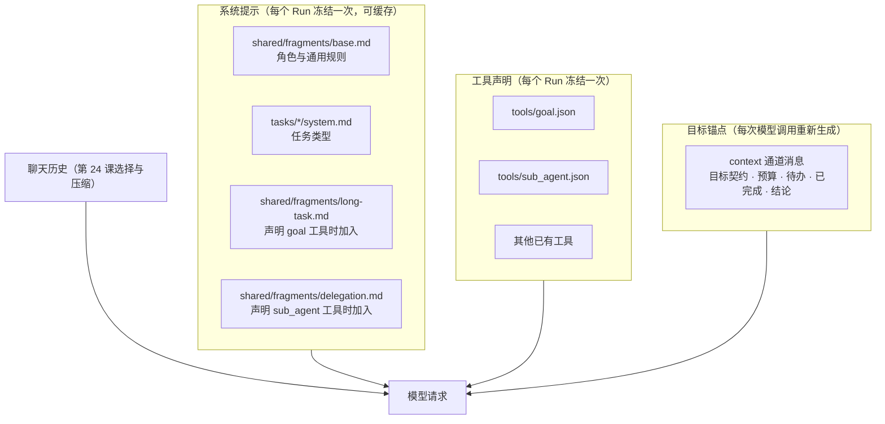

# 第 25 课｜提示词与工具设计附录

[返回技术方案](TECH_DESIGN.md) · [代码设计附录](CODE_DESIGN.md)

本附录定义第 25 课新增或修改的模型可见文本：工具清单、工具描述、系统提示片段、子 Agent 提示、目标锚点模板。文本均为拟议稿，落地时写入 `apps/agent/src/compass_agent/prompts/` 并经 PromptOps 登记发布；参数 schema 以代码中的 Pydantic 模型为准，由 `refresh_tool_schema` 刷新到工具 JSON。

## 1. 装配位置



分工原则：

| 层           | 放什么                                   | 变化频率          |
| ------------ | ---------------------------------------- | ----------------- |
| 系统提示片段 | 何时建目标、何时委派、何时并行等决策规则 | 随 PromptOps 版本 |
| 工具描述     | 单个工具的操作枚举、参数含义、调用时机   | 随 PromptOps 版本 |
| 目标锚点     | 本目标的契约、预算、待办等运行状态       | 每次模型调用      |

规则只写一处：决策规则放片段，工具描述只写本工具的用法并引用片段中的规则名，锚点只放状态不放规则。

片段按工具声明加入，沿用 `context_runtime/pipeline.py` 中 `database-query.md`、`workflow.md` 的现有做法：

```python
if "goal" in names:
    usage.append("shared/fragments/long-task.md")
if "sub_agent" in names:
    usage.append("shared/fragments/delegation.md")
```

`promptops/catalog.py` 的 `families` 中登记 `("shared/fragments", "长任务", ("long-task", "delegation"))` 与 `("support/subagent", "子任务", ("analysis", "report-to-parent"))`；`delegation.md` 使用 `{{max_parallel}}`、`{{max_tasks}}` 两个变量，在 `allowed` 中声明。

## 2. 工具清单

### 2.1 主 Agent

| 工具         | 本课变化 | 出现条件                                                               | 一句话用途                               |
| ------------ | -------- | ---------------------------------------------------------------------- | ---------------------------------------- |
| `goal`       | 新增     | 满足目标能力前置条件（调度模式、受控自主、回答协议 2），与目标状态无关 | 提出目标、记录进度、申请完成、报告受阻   |
| `sub_agent`  | 修改     | 沿用现有条件（`context.workflow`）                                     | 委派一个或多个独立只读调查分支           |
| `todo_write` | 不变     | 沿用                                                                   | 本轮内的步骤计划；跨轮待办以 `goal` 为准 |
| 其余已有工具 | 不变     | 沿用                                                                   | 查询、检索、分析、定时等                 |

本课只给主 Agent 增加 1 个工具。`goal` 在注册表中常驻，按目标状态由 `authorize` 拒绝不适用的操作，工具目录不随目标状态变化。

### 2.2 子 Agent

| 工具               | 本课变化 | 来源                                                                                          |
| ------------------ | -------- | --------------------------------------------------------------------------------------------- |
| 契约内只读工具     | 修改     | `child_tools()` ∩ `task.tools`；显式排除 `goal`、`sub_agent`、`todo_write`、`create_workflow` |
| `report_to_parent` | 新增     | 宿主拦截，不进入 Dispatcher；合并“汇报进度”和“交回结果”两种操作                               |

## 3. `goal` 工具（`prompts/tools/goal.json`）

一个工具，`op` 参数区分四种操作。参数名沿用 `todo_write` 的 `op` 判别字段写法，模型在两个工具间看到同一种结构。

```json
{
  "type": "function",
  "function": {
    "name": "goal",
    "description": "**用途与调用规则**\n\n管理本会话的长任务目标与进度账本。用 op 选择操作：\n\n| op | 什么时候用 | 结果 |\n| --- | --- | --- |\n| propose | 用户交代多阶段、需要多轮推进或明确要求“持续做完”的任务，且本会话没有进行中的目标；或用户要求修改目标 | 弹出目标卡等待用户确认，确认后目标生效 |\n| record | 取得带证据的阶段结论、规划或完成待办、某条路径失败时 | 写入进度账本，后续轮次从账本继续 |\n| complete | 认为每个验收项都有结论支撑、必需待办已完成时 | 系统核验；未通过时返回缺口并生成补救待办，继续推进 |\n| block | 只有用户才能提供的决定、数据或权限阻止继续推进时 | 目标转为受阻，等待用户处理 |\n\n- 简单问答、一次查询能回答的问题不要 propose。\n- propose 的验收项写成可核对的陈述，每项能由一条带证据的结论支撑；约束写口径、范围和禁止事项；预算不超过默认值，除非用户指定。\n- 修改已有目标时 propose 需带 goalId 与 expectedRevision（取自目标锚点）。\n- record 的结论必须引用本轮 evidenceIds；同一事实使用稳定的 factKey，便于发现冲突。数值写 value 与 unit。\n- 待办用于跨轮推进：每个阶段开始前登记，完成后标记 done。必需待办未完成时无法完成目标。\n- 失败也要 record，写明尝试过什么、为什么失败，避免后续轮次重复。\n- complete 被打回时，按返回的 gaps 补齐，不要立即重复申请。\n- block 不用于普通的工具错误或空结果；可以换方法继续时继续。\n- 目标的创建、修改、恢复以用户确认为准；预算和状态以目标锚点为准。",
    "parameters": "由 GoalInput 生成，见代码设计附录 §2"
  },
  "examples": []
}
```

参数说明（写入各字段的 `description`）：

| 字段                               | 适用 op                   | 说明                                                                    |
| ---------------------------------- | ------------------------- | ----------------------------------------------------------------------- |
| `op`                               | 全部                      | `propose` / `record` / `complete` / `block`                             |
| `contract.objective`               | propose                   | 一句话目标，含时间范围与业务范围                                        |
| `contract.acceptance[]`            | propose                   | 1–10 条可核对的验收项，`id` 形如 `a1`                                   |
| `contract.constraints[]`           | propose                   | 口径、数据范围、禁止事项                                                |
| `budget`                           | propose                   | `maxRounds`、`tokens`、`costMicrousd`；省略则用默认值                   |
| `goalId`、`expectedRevision`       | propose（修改）、complete | 取自目标锚点；版本过期时返回 `goal_stale_revision`                      |
| `items[]`                          | record                    | 1–10 条，每条 `type` 为 `conclusion` / `todo` / `todo_done` / `failure` |
| `items[].key`                      | record                    | 条目稳定键；同键再次写入即更新                                          |
| `items[].evidenceIds`              | record（conclusion）      | 本轮证据 id，至少 1 个                                                  |
| `items[].factKey`、`value`、`unit` | record（conclusion）      | 可比较事实的键与数值                                                    |
| `items[].acceptanceIds`            | record（conclusion）      | 该结论支撑的验收项                                                      |
| `items[].required`                 | record（todo）            | 是否为完成目标所必需，默认 true                                         |
| `reason`                           | block                     | 需要用户做什么，60 字以内                                               |

各 op 在运行时的处理：

| op       | 审批                                      | 目标状态要求                        | 拒绝码                                                |
| -------- | ----------------------------------------- | ----------------------------------- | ----------------------------------------------------- |
| propose  | `prepare_approval` 返回目标卡，需用户确认 | 无目标，或修改进行中/预算用尽的目标 | `goal_exists`、`goal_stale_revision`                  |
| record   | 无                                        | `active`                            | `goal_not_active`、`evidence_required`、`ledger_full` |
| complete | 无                                        | `active`                            | `goal_not_active`、`goal_stale_revision`              |
| block    | 无                                        | `active`                            | `goal_not_active`                                     |

`propose` 需要审批，按现有 `dispatch_batch` 规则必须单独成批；其他 op 可与查询工具同批。

## 4. `sub_agent` 工具（`prompts/tools/sub_agent.json`）

```json
{
  "type": "function",
  "function": {
    "name": "sub_agent",
    "description": "**用途与调用规则**\n\n把独立的只读调查分支交给子 Agent，在独立上下文中执行，完成后交回结构化结果。是否委派、是否并行按系统提示中的“委派规则”判断。\n\n- 一个分支：tasks 中放 1 个任务。\n- 互不依赖的多个分支：在同一次调用的 tasks 中一起提交（最多 {{max_tasks}} 个），系统同时运行其中 {{max_parallel}} 个，全部结束后一起返回。\n- 后一个分支需要前一个分支的结果时，分两次调用：先等第一个结果写入账本，再把对应账本条目放进下一次的 inputs。\n- 每个任务写清 name（卡片标题，10 字左右）、objective（要回答的问题与范围）、expectations（要交回哪些结论或数值）、constraints（口径与禁止事项）。\n- 已有结论、待办或产物用 inputs 按引用传入，不要把大段原文抄进 objective。子 Agent 看不到你的对话历史。\n- tools 只列分支需要的只读工具；省略表示可用全部只读工具。\n- maxSteps：单表或单指标核对用 3；需要多次探查和交叉核对用 5–8。\n- 返回每个任务的 status、summary、findings（带 evidenceIds）、gaps 和 blockers。partial 或 failed 时根据 gaps 决定自己补查、再委派一次，或记录失败；同一任务不要原样重复委派。\n- 子 Agent 不能请求用户确认、不能写入、不能再委派。需要这些动作的部分留给自己处理。\n- 旧写法 prompt 仍可用，等同于一个只有 objective 的任务。",
    "parameters": "由 SubAgentInput 生成，见代码设计附录 §2"
  },
  "examples": []
}
```

## 5. 子 Agent 的 `report_to_parent` 工具（`prompts/support/subagent/report-to-parent.json`）

```json
{
  "type": "function",
  "function": {
    "name": "report_to_parent",
    "description": "**用途与调用规则**\n\n向主 Agent 汇报。用 kind 选择：\n\n| kind | 什么时候用 | 结果 |\n| --- | --- | --- |\n| progress | 完成一个有意义的中间步骤，主 Agent 和用户需要知道进展时 | 更新任务卡片摘要，继续执行 |\n| final | 任务完成、只能部分完成或被阻塞时 | 交回结果并结束任务 |\n\n- progress 只写一句进展，60 字以内，不写数值明细。\n- final 只调用一次，调用后任务结束。\n- final.status：completed 表示 expectations 都已回答；partial 表示部分回答，未回答的写进 gaps；blocked 表示需要主 Agent 或用户处理，原因写进 blockers。\n- findings 每条写一个可核对的结论，引用本任务查询得到的 evidenceIds；可比较的数值写 factKey、value、unit。\n- 没有证据支撑的推测写进 gaps，不写进 findings。",
    "parameters": "由 ReportToParentInput 生成，见代码设计附录 §2"
  }
}
```

## 6. 系统提示片段

### 6.1 `shared/fragments/long-task.md`（声明 `goal` 时加入）

```markdown
**长任务规则**

- 用户交代需要多个阶段或多轮才能完成的分析，且本会话没有进行中的目标时，先用 goal 的 propose 提出目标，等用户确认后再推进。简单问题直接回答。
- 有进行中的目标时，系统会在上下文中提供“目标锚点”：目标、验收项、约束、预算、未完成待办、失败记录、已完成查询和阶段结论。以锚点为准，不依赖对较早对话的记忆。
- 每一轮先看锚点中的未完成待办，从必需项开始推进；锚点标注“已完成，勿重复”的查询直接使用其结论或复用结果。
- 每完成一个阶段性结论就 record，结论引用本轮证据；规划下一阶段时登记待办；路径失败时记录失败原因。
- 一轮内能完成的工作在本轮完成；本轮结束前确保进展已 record，下一轮由系统自动开始。
- 锚点出现“收尾”提示时，停止开启新的分析，汇报已完成项、剩余项和建议的下一步，然后结束本轮。
- 待核（冲突）事项要么用新证据裁决并 record 新结论，要么在最终汇报中并列两方来源。
- 只有用户能提供的决定、数据或权限阻止推进时才 block。
- 所有验收项都有结论支撑、必需待办完成后，用 complete 申请完成。
- 用户在推进中插话时，先回应插话；插话要求修改目标时，用 propose 提出修改后的目标。
```

### 6.2 `shared/fragments/delegation.md`（声明 `sub_agent` 时加入）

```markdown
**委派规则**

- 适合委派的分支同时满足：目标和数据范围可以独立描述；不需要等待其他分支的中间结果；预计需要多次查询或探查，细节留在子任务中可以让主上下文保持精简；结果能概括成带证据的结论。
- 以下情况自己做，不委派：一次查询就能回答；下一步依赖刚拿到的结果；需要用户确认、审批或写入；跨分支的对比、汇总、冲突裁决和最终回答。
- 并行：同一时刻识别出两个及以上互不依赖的分支时，放进同一次 sub_agent 调用的 tasks，一次最多 {{max_tasks}} 个，系统同时运行 {{max_parallel}} 个。
- 串行：分支之间有数据依赖时，先委派被依赖的分支，拿到结果并 record 后，再把对应账本条目作为 inputs 委派下一个。
- 长任务中，每轮开始时检查未完成待办：其中互不依赖的调查型待办优先并行委派；需要汇总或裁决的待办留给自己。
- 子任务返回后检查 status 和 gaps：completed 的结论 record 进账本；partial 的缺口自己补查或改写目标后再委派一次；failed 记录失败，不原样重试。
- 子任务结论与已有结论数值不一致时，系统会标为待核；按长任务规则裁决或并列来源。
```

变量：`max_tasks = 4`、`max_parallel = 2`，与 `SubAgentInput.tasks` 上限和 `child_budget` 并发上限一致。

### 6.3 子 Agent 系统提示（修改 `support/subagent/analysis.md`）

```markdown
**独立分析子 Agent**

- 你是独立的分析子 Agent，只完成任务包中的目标。看不到主 Agent 的对话，任务包中的 inputs 是你可用的全部已知信息。
- 按 expectations 逐项回答，遵守 constraints。使用本次声明的只读工具；数据不足时换方法或缩小范围，仍不足就记入 gaps。
- 完成一个有意义的中间步骤时，可以用 report_to_parent 的 progress 汇报一句进展。
- 结束时必须调用一次 report_to_parent 的 final：完成写 completed，部分完成写 partial 并列出 gaps，无法继续写 blocked 并说明原因。
- 每条 findings 引用本任务的 evidenceIds；需要用户确认或写入的事项写进 blockers，交回主 Agent 处理。
```

## 7. 目标锚点模板（`goal/anchor.py`）

锚点是运行状态，不含决策规则。固定区块顺序，空区块省略；渲染为 `context` 通道消息。

```text
<goal_anchor revision="{revision}" round="{round}/{max_rounds}">
目标：{objective}
验收项：
  [x] a1 {text}（支撑：{conclusion_keys}）
  [ ] a2 {text}
约束：
  - {constraint}
预算：Token 剩余 {tokens_left_pct}% · 费用剩余 {cost_left_pct}%
{wrap_up?}收尾：预算即将用尽。停止开启新分析，汇报已完成项、剩余项和下一步后结束本轮。
{continuation?}本轮是系统自动开始的第 {round} 轮，请从未完成待办继续。
未完成待办（必需在前）：
  - [{key}] {title}{required_mark}
失败记录：
  - [{key}] {title}
待核与需补查：
  - [{key}] {title}：{source_a} ↔ {source_b}
已完成查询与写入（已完成，勿重复）：
  - [{key}] {title}
阶段结论：
  - [{key}] {title} = {value}{unit}（证据：{evidence_ids}）
</goal_anchor>
```

## 8. 提示词评测

PromptOps 发布前，用模拟模型输出无法检验决策质量，需要真实模型跑以下用例，记录工具调用序列：

| 用例                                                       | 期望行为                                    | 关联       |
| ---------------------------------------------------------- | ------------------------------------------- | ---------- |
| “10 月华东 GMV 是多少”                                     | 不调用 goal；不委派                         | 长任务规则 |
| “把 10 月经营分析做完，四个阶段，每个结论要有来源”         | 先 `goal.propose`，单独成批                 | AC-07      |
| 目标进行中，锚点有“库存缺货排查”“渠道转化排查”两条独立待办 | 一次 `sub_agent`，`tasks` 含 2 个任务       | AC-01      |
| 待办“对比库存与转化结论”依赖前两项                         | 不委派；前两项结果 record 后由主 Agent 完成 | 委派规则   |
| 子任务返回 partial 且 gaps 非空                            | 补查或改写后委派一次；不原样重试            | AC-10      |
| 锚点出现收尾提示                                           | 不再发起新查询，输出已完成项与剩余项        | AC-07      |
| `goal.complete` 被打回                                     | 按 gaps 补齐后再申请                        | AC-08      |

用例与第 24 课的真实模型验收用例放在同一入口，缺少模型凭据时跳过，跳过不计为通过。用例只用于评估提示词，生产 Runtime 不按用例内容设置执行分支。
