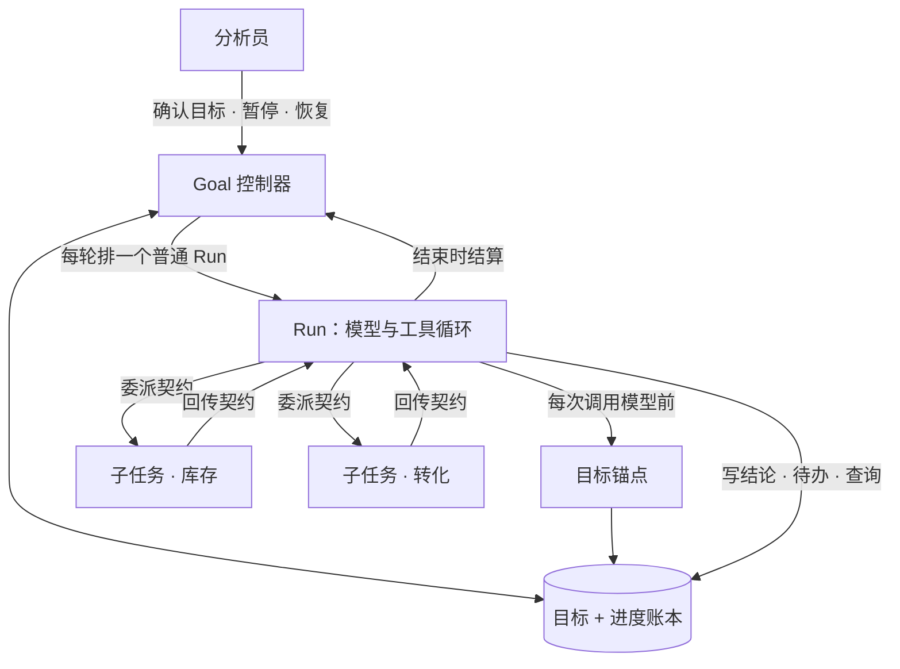
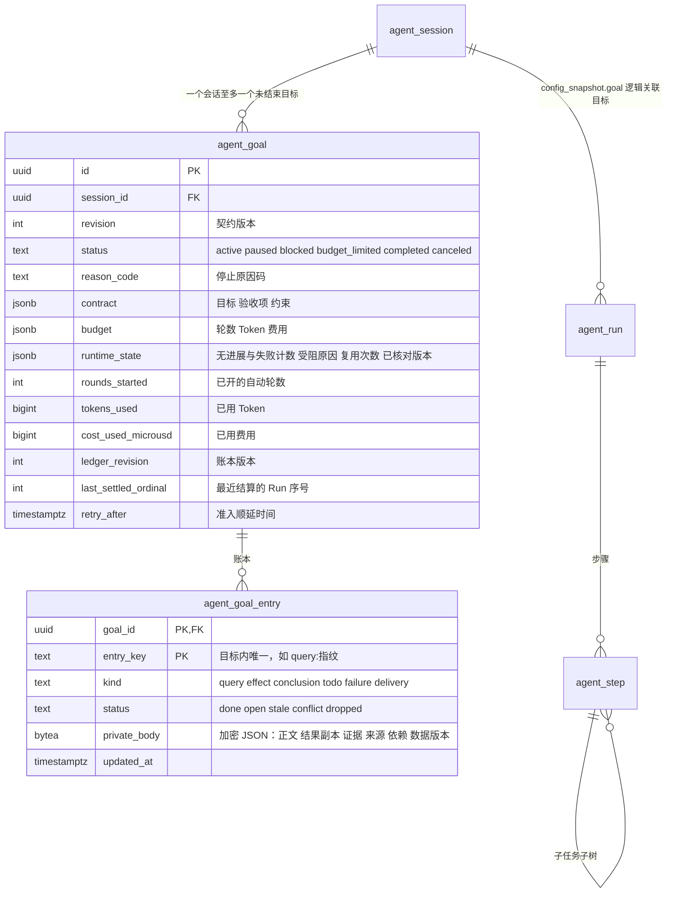
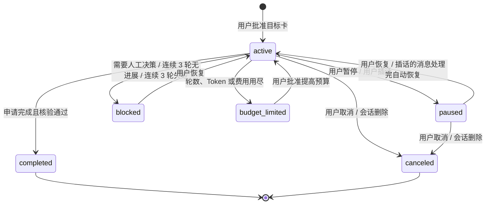
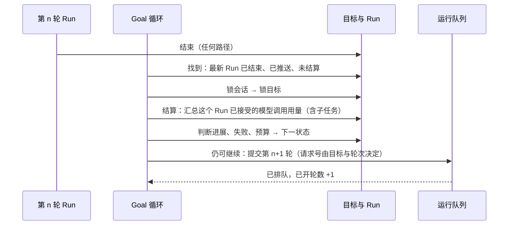
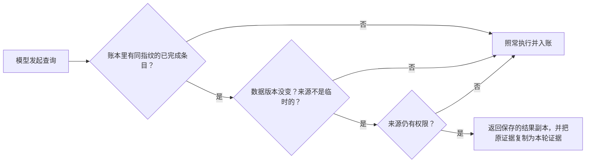
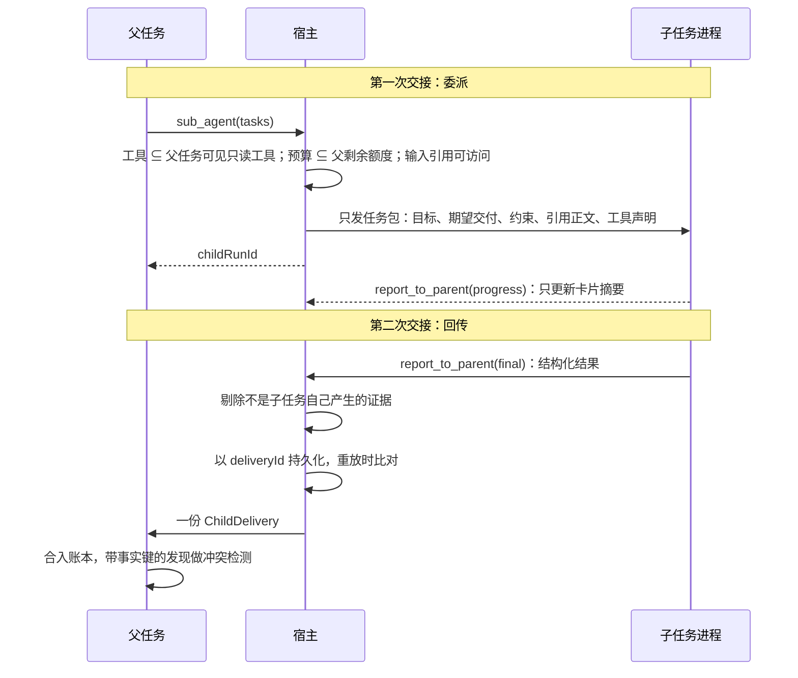
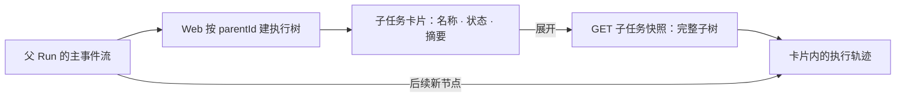
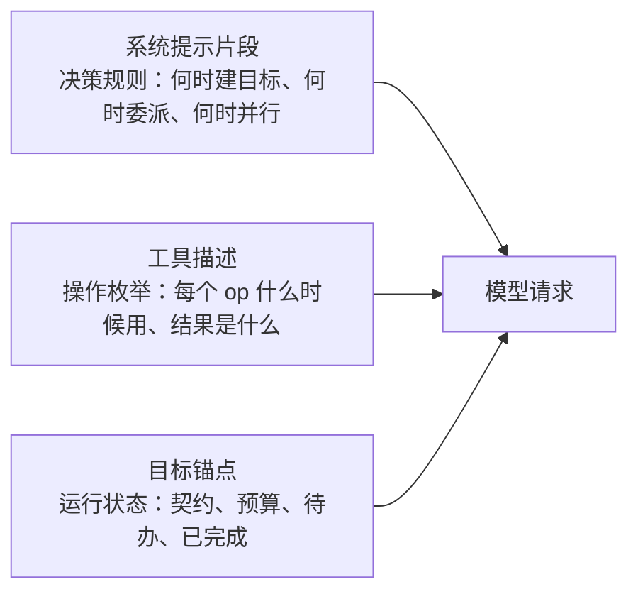

## 设计目标

本课给分析 Agent 加上**长任务能力**：用户确认一个目标后，Agent 跨多轮、跨暂停持续推进，直到目标通过核验；并把子 Agent 的派发与回收改成两份结构化契约。

建设范围分四块：

| 能力         | 一句话说明                                                               |
| ------------ | ------------------------------------------------------------------------ |
| Goal 控制器  | 保存用户确认的目标，每轮结束后决定继续、停止还是等用户                   |
| 进度账本     | 跨轮次保存做过的查询、得出的结论、剩下的待办，下一轮从这里接着做         |
| 双向 Handoff | 派发时只给子任务需要的东西；回收时要求结构化结果，只收一次，核验后再合入 |
| 子任务下钻   | 主对话只显示子任务卡片，展开后按权限读取这个子任务自己的执行轨迹         |

这套设计参考了 Codex 与 DeepSeek Harness 的 Goal 模式：两者都把“目标”做成 Agent Loop 外面的一层持久控制器。Compass 在此基础上补了它们共同缺少的三样东西：可核对的完成条件、业务进度账本、结构化的委派与回传契约。

## 总体方案

先看一个例子。分析员说：“把 10 月经营分析做完，销售、营销、库存、财务四个阶段，每个结论都要有数据来源。”

1. Agent 拟一张**目标卡**：目标、2 条验收项、口径约束、预算（最多 12 轮）。分析员点“确认并开始”。
2. 第 1 轮做销售阶段，结论和查询写进账本。这一轮结束时，系统发现目标还没完成，自动排上第 2 轮。
3. 第 2 轮开始前，系统把“目标 + 账本”拼成一段**目标锚点**放进模型输入，Agent 一看就知道销售已做完、该做营销了。
4. 第 3 轮，Agent 把库存和转化交给两个子任务并发分析，各自只拿到自己需要的输入。
5. Agent 认为做完了，申请完成。系统核对每条验收项都有证据，才把目标标为已完成。



图里有两个“循环”：外层是 Goal 控制器按轮推进，内层是每个 Run 自己的模型—工具循环。控制器不参与 Run 内部的决策，只负责“要不要开下一轮”。

关键设计取舍：

| 选择                             | 原因                                                                                       |
| -------------------------------- | ------------------------------------------------------------------------------------------ |
| 一轮就是一个普通 Run             | 续轮和用户发消息走同一条提交与排队链路，持久化、恢复、多副本接管全部复用第 19、20 课的能力 |
| 目标与账本放数据库，不放聊天历史 | 历史会被压缩；目标、约束、待办一旦被摘要漏掉就找不回来                                     |
| 子任务仍是父 Run 里的一组步骤    | 父 Run 暂停、取消、恢复时子任务自动跟着走，不用新建一套子 Run 生命周期                     |
| 完成由程序核验                   | 模型说“做完了”不算数，要每条验收项都有能打开的证据                                         |

## 数据模型与持久化

### 目标（agent_goal）

一个会话同时只有一个未结束的目标。它记三类信息：

- **契约**：目标描述、验收项、约束。用户每确认一次修改，`revision` 加一。
- **预算与用量**：最多几轮、多少 Token、多少费用，以及已经用了多少。子任务的用量也算在里面。
- **控制状态**：最近结算到第几个 Run（`last_settled_ordinal`）、准入失败后何时重试（`retry_after`），以及收拢在 `runtime_state` 里的连续无进展/失败轮数、受阻原因、复用次数和已核对版本。

### 进度账本（agent_goal_entry）

账本是一条条带唯一键的记录。按类型看：

| 类型         | 例子                                         | 用途                                   |
| ------------ | -------------------------------------------- | -------------------------------------- |
| `query`      | “10 月华东 GMV 按渠道”，带查询指纹和数据版本 | 下一轮遇到同样的查询直接复用结果       |
| `effect`     | “已生成月度报告 CSV”                         | 恢复后不重复写                         |
| `conclusion` | “10 月缺货 SKU 312 个”，带证据引用           | 支撑验收项；数值冲突时标记待核         |
| `todo`       | “营销阶段：核对投放 ROI”                     | 下一轮的起点；必需待办没完成就不能结项 |
| `failure`    | “财务表查询超时”                             | 让后面的轮次知道这条路走过             |
| `delivery`   | 库存子任务交回的结果                         | 每个子任务只记一次                     |

每条记录还有状态：`done`、`open`、`stale`（数据版本变了，要补查）、`conflict`（和别的结论数值冲突）、`dropped`（来源失去权限，不再使用）。



两张表都属于 Agent 的 `agent/main` 数据库，迁移版本 `0018 → 0019`，不修改 `agent_run` 等既有表。目标与 Run 的关联存在 `agent_run` 已有的 `config_snapshot["goal"]` 里；账本子表只有 6 列和联合主键 `(goal_id, entry_key)`，查询复用直接按 `query:<指纹>` 主键点查，无需额外二级索引。访问权限沿会话的所有者校验。

## 上层接口与模型工具

### 给用户的接口

| 接口                                      | 作用                                                            |
| ----------------------------------------- | --------------------------------------------------------------- |
| `GET /sessions/{id}/goal`                 | 读当前目标，供目标面板显示                                      |
| `POST /sessions/{id}/goal/actions`        | 暂停、恢复、取消、插话；必须带 `expectedRevision`，过期返回 409 |
| `GET /runs/{runId}/children/{childRunId}` | 子任务子树快照，供卡片展开时一次取全                            |

目标的创建和修改不走单独接口，而是复用已有的**审批卡**：模型调用 `goal` 工具的 `propose` 操作，界面弹出目标卡，用户点确认后才写入。

目标能力有三个前提：Runtime 运行在调度或分布式模式（续轮 Run 才有人执行）、Run 处于受控自主模式（预算才能计量）、Context Runtime 使用第 2 版回答协议（结论才有证据可引）。不满足时 `goal` 工具不出现在工具清单里。

### 给模型的工具

本课只给主 Agent 加 1 个工具、给子 Agent 加 1 个工具。和目标有关的所有操作都收进一个 `goal` 工具，用 `op` 参数区分；子 Agent 的“汇报进度”和“交回结果”也收进一个 `report_to_parent`，用 `kind` 区分。

| 工具               | 谁能用   | 操作                                                                                                                 |
| ------------------ | -------- | -------------------------------------------------------------------------------------------------------------------- |
| `goal`             | 主 Agent | `propose` 提出或修改目标（需用户确认）· `record` 写结论、待办、失败 · `complete` 申请完成 · `block` 报告需要用户决定 |
| `sub_agent`        | 主 Agent | `tasks` 里放 1–4 个委派契约；多个任务互不依赖时一起提交，系统同时跑 2 个                                             |
| `report_to_parent` | 子 Agent | `progress` 汇报一句进展 · `final` 交回结构化结果并结束                                                               |

合并成一个工具的代价是描述变长。所以 `goal` 的工具描述里放了一张操作表，逐个写清“什么时候用、结果是什么”，详见后面的“提示词与工具描述”一章。`propose` 需要审批而其他操作不需要，这由工具的 `prepare_approval` 按每次调用的 `op` 判断。

谁能改目标由来源决定：只有用户能创建、修改、恢复目标；主 Agent 只能写账本和申请完成；子任务完全碰不到目标，只能通过回传结果间接影响父任务。

## Goal 控制器：一轮接一轮

### 目标的状态



“连续 3 轮无进展”的判断很简单：一轮开始时记下账本版本，结束时再看一次，没变就算无进展。这对应 Codex 的空转熔断，只是把“进展”定义成了账本有实质写入。

### 谁来开下一轮：独立的 Goal 循环

一个会话同时只允许一个活动 Run，而且上一轮的事件必须先推送给前端，才能提交下一轮。Run 结束的路径也很多：正常完成、失败、用户取消、恢复时停止。如果在每个结束点挂钩子，既容易漏，又会和提交下一轮时的加锁顺序打架。

所以 Run 结束时什么都不用做。一个独立的后台 **Goal 循环**每秒看一眼：哪个目标所在会话的最新 Run 已经结束、事件已推送、还没结算？对每个这样的目标，开一个短事务完成结算和准入。



这是 DeepSeek Harness “预留—复查—准入”三步的数据库版本。几个关键点：

| 情况                    | 处理                                                                           |
| ----------------------- | ------------------------------------------------------------------------------ |
| 多个 Agent 实例同时扫描 | 行锁 `SKIP LOCKED` 让每个目标只被一个实例处理；固定请求号让重复提交无副作用    |
| 某个目标准入失败        | 只影响这一个目标：容量不足就 30 秒后再试，会话已删除就取消目标；不影响副本健康 |
| 排队中的续轮被取消      | 它没调用过模型，已开轮数回退 1                                                 |
| 加锁顺序                | 全局统一为 会话 → Run → 目标 → 账本条目，避免死锁                              |

### 用户插话

续轮在排队或执行时，用户也可以发消息。Web 先调用 `interrupt`：当前这一轮被取消（排队中立即结束，执行中在下一个边界停下），目标暂时置为“已暂停 · 插话”。这一轮结束后，Web 再提交用户的消息。

会话里有未结束的目标时，用户的 Run 同样绑定这个目标，同样被结算。用户 Run 结算时如果发现目标是因为插话暂停的，就自动恢复为进行中，Goal 循环接着开下一轮。用户点“暂停”则不会自动恢复。

修改目标也走这条路：点“修改目标”会在输入框里带入“修改目标：”，发出去就是一次插话，Agent 据此提出新的目标卡。

### 预算

预算不改动每个 Run 自己的预算策略，而是在目标锚点里管：每次调用模型前，用“目标预算 − 已结算用量 − 本轮实时用量”算出剩余额度。剩余不到 10% 时，锚点里附上收尾指令，让 Agent 汇报已完成项和剩余项；剩余归零时，沿用已有的预算停止机制结束本轮，目标转为“预算已用尽”。超出的部分如实记账。

## 进度账本与目标锚点：不丢目标、不重做

### 目标锚点

每次调用模型之前，系统从数据库读出目标和账本，拼成一段固定格式的**目标锚点**，放在系统提示之后。

| 锚点区块         | 内容                                   |
| ---------------- | -------------------------------------- |
| 目标契约         | 目标、验收项（标出哪些已有证据）、约束 |
| 预算             | 第几轮、Token 与费用还剩多少           |
| 未完成待办       | 全部列出，必需项在前                   |
| 失败与待核       | 最近的失败、冲突和需补查的条目         |
| 已完成查询与写入 | 标题和结果引用，提示“已完成，勿重复”   |
| 阶段结论         | 数值和证据引用                         |

锚点不属于聊天历史。第 24 课的压缩只处理历史，所以锚点在结构上就不会被摘要删掉。反过来，压缩产生的摘要也从不写回账本。这两条合起来，就是本课的**压缩不变量**：目标、约束、待办、失败记录、证据引用永远完整地出现在模型面前。

用户中途修改了目标？不需要通知正在运行的 Run，下一次模型调用读到的就是新版本。

锚点也要守权限。每个 Run 第一次拼锚点时，系统按当前权限检查一遍账本条目的来源，失权的条目和由它推出来的结论都不放进锚点，结果在这个 Run 内缓存。两轮之间隔了几个小时、权限被收回，下一轮的锚点里就不会再出现那些数字。

### 不重做：查询复用

`database_query`、`query_metric`、`python_analysis` 在工具目录里声明了一个**指纹适配器**，把参数规范化后算出哈希。执行前，派发器先查账本：



账本条目保存了一份有界的结果副本和当时的证据记录。复用时把证据复制到当前 Run，模型拿到的结果因此可以直接在最终回答里引用，不必为了引用再查一次。来源失去权限时不复用、照常执行，而执行本身会再次鉴权并拒绝，所以复用路径不会泄露数据。

“数据版本”目前取数据连接的修订号：连接配置一变，之前的查询就不再复用。感知表级数据更新需要另定版本来源，这一点还在等需求负责人确认。

跨 Run 复制证据是新路径，实施时先做一个最小验证：上一轮查询、本轮复用、最终回答引用成功。验证不通过时退回到“锚点提示已完成、照常执行”。

### 冲突与失效

结论可以带一个事实键，比如 `inventory.stockout_sku.2026-10`。同一个键出现两个不同的数值时，两条都标成 `conflict`，各自保留来源，系统不替用户选。

## 双向 Handoff：父子任务的两次交接



### 委派契约

以前子任务只收到一段自由文本 prompt。现在父任务写一份任务包：

{{code:delegation}}

宿主逐项把关：工具不能超出父任务当前能用的只读工具，`goal_*`、`sub_agent`、`todo_write` 一律不给子任务；数据连接不能超出父 Run 的绑定；预算不能超过父任务剩余额度能切出的部分，同时最多两个子任务；输入引用必须属于当前目标且仍可访问。任何一项不满足，委派被拒绝，父模型收到明确原因，父 Run 本身继续运行。子任务看不到父任务的聊天历史和锚点。

任务包在第一次委派时解析并保存。恢复重放时直接用保存的版本，不会因为引用的状态变了而对不上。

### 回传契约

子任务调用 `report_to_parent` 的 `final` 交回结构化结果，宿主收到后立即结束子进程：

{{code:child-return}}

无论子任务怎么结束，父任务都会得到一份可判定状态的交付：

| 子任务怎么结束的         | 父任务收到                                                |
| ------------------------ | --------------------------------------------------------- |
| 调用了 `final`           | 子任务给的状态和结果                                      |
| 没调用就输出了最终回答   | `partial`，缺口写明“未按契约返回结构化结果”，保留完整回答 |
| 步数用尽、预算用尽或出错 | `failed`，带原因                                          |
| 父 Run 被取消            | 不形成交付，按已有取消流程处理                            |

进度消息和最终结果可能前后脚到达，DeepSeek Harness 在这里会出现重复交付。Compass 的做法是：进度消息只改卡片摘要，不算交付；交付身份由子任务的 step id 决定，持久化时如果已有记录就比对内容，账本按 `delivery:<childRunId>` 幂等写入。恢复重放也只会有一份。

### 子任务真正并发

原实现里多个子任务共用一把模型调用锁，实际是轮流调用模型。已有的 `child_budget()` 本来就能从父预算切出独立的子预算，并在结束时自动把用量并回去，只是没有被调用。现在每个子任务都在自己的切片里运行，各自的结果暂存在每次调用独有的 `ChildSession` 里，锁就可以去掉了。切片步数按委派契约来，默认 3 步，最多 8 步。

并行由模型显式表达：互不依赖的分支放进同一次 `sub_agent` 调用的 `tasks`，宿主用信号量同时运行 2 个，其余排队，全部结束后按原顺序一起返回。这样不依赖全局的工具批次模式（默认串行，切到并行模式又会拒绝批内不支持并行的工具）。工作流脚本里的 `parallel` 照常可用。

{{code:child-budget}}

## 完成核验与恢复核对

### 完成核验

Agent 调用 `goal` 的 `complete` 时，系统在一个事务里检查：

1. 每条验收项至少有一条已完成、证据可访问的结论支撑；
2. 没有未完成的必需待办；
3. 没有冲突，也没有被结论依赖的失效条目。

全部满足才算完成。否则每个缺口变成一条“补齐：…”的必需待办，目标保持进行中，Agent 在同一轮里接着干。

### 次日恢复

用户恢复目标时版本加一，下一轮第一次调用模型前执行恢复核对：

| 检查                     | 处理                                             |
| ------------------------ | ------------------------------------------------ |
| 当前用户和能力权限       | 复用已有复核；失败则目标转为受阻                 |
| 账本条目的来源还能访问吗 | 不能的标 `dropped`，并顺着依赖把派生结论一起标掉 |
| 查询的数据版本变了吗     | 变了的标 `stale`，并新增一条必需的补查待办       |
| 已完成的写入             | 保持 `done`，复用机制让它不再执行                |

核对结果是幂等的，连续恢复两次结果一样。

## 子任务下钻

主事件流保持原样，子任务内部的模型和工具节点照常推送。分析过程怎么显示是前端的事：Web 按 `parentId` 把子任务的后代节点收进它的卡片，卡片默认收起，只露出名称、状态和摘要。



展开卡片时，前端调用快照端点一次性取回这个子任务的完整子树。这能覆盖页面刷新、从历史会话打开等主流还没加载完的情况。之后的新节点仍从主事件流来，按 `id + revision` 去重。

快照端点和主事件流走同一套来源投影与可见字段过滤。父子 ID 对不上、跨租户、子任务不存在，一律返回 404，不透露资源是否存在。主事件流本来就每 5 秒复查一次可见性，变化时断开；前端重连后如果快照返回 404 或可见范围收紧，就清空这张卡片已加载的内容。

> 为什么不给子任务单独开一条过滤后的事件流？事件流只在有可见事件时才推进游标。如果一整批事件都被过滤掉，游标就停在原地，连接会反复读同一批数据。前端分组加一次性快照没有这个问题，也少维护一条流。

卡片的几种状态：

| 状态       | 显示                                   |
| ---------- | -------------------------------------- |
| 加载中     | 正在加载执行过程…                      |
| 还没有事件 | 等待执行进度                           |
| 临时失败   | 暂时无法加载执行过程 · 重试            |
| 权限变化   | 清空已加载内容，显示此执行过程不可访问 |
| 部分完成   | 状态标签显示部分完成                   |

## 提示词与工具描述

工具做得再好，模型不知道什么时候用也没有意义。长任务里最容易出错的三个判断是：要不要建目标、要不要委派、要不要并行。本课把这些文本分三层放，规则只写一处。



| 层           | 文件                                   | 什么时候加入                 |
| ------------ | -------------------------------------- | ---------------------------- |
| 系统提示片段 | `long-task.md`                         | 本 Run 声明了 `goal` 工具    |
| 系统提示片段 | `delegation.md`                        | 本 Run 声明了 `sub_agent`    |
| 工具描述     | `goal.json`、`sub_agent.json`          | 随工具声明                   |
| 子 Agent     | `analysis.md`、`report-to-parent.json` | 子进程启动时                 |
| 运行状态     | 目标锚点                               | 绑定目标的 Run，每次模型调用 |

片段按工具声明加入，沿用现在 `database-query.md`、`workflow.md` 的做法：没有这个工具就不加这段提示，不占上下文。

### `goal` 的操作表

这张表就写在 `goal` 工具的描述里：

| op         | 什么时候用                                                                 | 结果                                     |
| ---------- | -------------------------------------------------------------------------- | ---------------------------------------- |
| `propose`  | 用户交代多阶段、需要多轮推进的任务，且没有进行中的目标；或用户要求修改目标 | 弹出目标卡，用户确认后生效               |
| `record`   | 取得带证据的阶段结论、规划或完成待办、某条路径失败                         | 写入账本，后续轮次从账本继续             |
| `complete` | 每个验收项都有结论支撑、必需待办已完成                                     | 系统核验；不通过就返回缺口并生成补救待办 |
| `block`    | 只有用户能提供的决定、数据或权限挡住了推进                                 | 目标转为受阻，等用户处理                 |

描述里还写了几条反例：简单问答不要 `propose`；普通的工具错误或空结果不算 `block`；`complete` 被打回后先补齐再申请。

### 什么时候委派，什么时候并行

这部分写在 `delegation.md` 里，是整个长任务最关键的一段规则：

| 情况                                                 | 做法                                                       |
| ---------------------------------------------------- | ---------------------------------------------------------- |
| 一次查询能回答；下一步依赖刚拿到的结果               | 自己做                                                     |
| 需要用户确认、审批、写入；跨分支对比、裁决、最终回答 | 自己做                                                     |
| 一个可独立描述、需要多次查询的调查分支               | 委派，`tasks` 里放 1 个                                    |
| 同时识别出多个互不依赖的调查分支                     | 一次委派，`tasks` 里放全部分支（最多 4 个，同时跑 2 个）   |
| 分支之间有数据依赖                                   | 先委派被依赖的分支，结果记账后作为 `inputs` 交给下一个     |
| 长任务的每轮开始                                     | 看锚点待办：互不依赖的调查型待办并行委派，汇总型待办自己做 |
| 子任务返回 partial 或 failed                         | 按缺口自己补查或改写后再委派一次；不原样重试               |

回到开头的例子：第 3 轮开始时，锚点里有“库存缺货排查”和“渠道转化排查”两条互不依赖的待办，还有一条“对比库存与转化结论”。按规则，前两条放进一次 `sub_agent` 调用并行跑，第三条等结果回来后主 Agent 自己做。

### 子 Agent 的提示

子 Agent 的系统提示只讲三件事：只完成任务包里的目标（它看不到主 Agent 的对话）；按 `expectations` 逐项回答，没证据的推测写进缺口；结束前必须调用一次 `report_to_parent` 的 `final`。

### 怎么验证这些提示有效

模拟模型只能验证代码路径，验证不了决策质量。发布前用真实模型跑几组用例，看工具调用序列对不对：简单问题不建目标、多阶段任务先 `propose`、两条独立待办用一次 `sub_agent` 并行、有依赖的待办不委派、收到收尾提示不再开新查询。缺少模型凭据时这些用例跳过，跳过不算通过。

## 实现参考

### 变更文件

```text 主要变更
apps/agent/src/compass_agent/
+ goal/contracts.py          目标、委派、回传契约与默认值
+ goal/controller.py         结算、准入、用户操作（含插话）
+ goal/loop.py               独立的 Goal 循环，异常不影响副本健康
+ goal/ledger.py             账本写入、复用判定与证据复制、冲突、失权级联
+ goal/anchor.py             目标锚点渲染与权限过滤
+ goal/gate.py               完成核验
+ goal/resume.py             恢复核对
+ goal/handoff.py            委派校验与任务包装配
+ tools/builtin/goal/         单个 goal 工具：op 判别、逐次审批
+ prompts/tools/goal.json · shared/fragments/long-task.md · delegation.md
! prompts/tools/sub_agent.json · support/subagent/analysis.md
+ prompts/support/subagent/report-to-parent.json
! tools/builtin/sub_agent/   入参增加 task，可并行
! runtime/subagent.py        去锁并发、ChildSession、宿主拦截工具、单次交付
! harness/autonomy.py        child_budget() 接受委派步数
! runtime/store.py           提交时绑定目标、goal_submit
! runtime/durable_service.py 启动 Goal 循环
! runtime/session_management.py  删除会话时取消目标
! api/sessions.py            子任务快照；+ api/goals.py
! context_runtime/model_step.py  锚点装配、恢复核对
! schemas.py                 GoalView、契约类型 → [生成] contracts/、web/src/generated/
+ migrations/versions/0019_goal_ledger.py → [生成] db/main/sql/
apps/web/src/
+ client/child-trace.ts      子树分组与快照合并
+ components/analysis-goal-panel.tsx
! components/ui/execution-timeline.tsx  子任务卡片可展开
! components/analysis-composer.tsx      续轮时可插话
! server/http/durable-analysis-handler.ts  新路由映射
```

### 准入判断

{{code:admit}}

### 完成核验

{{code:gate}}
