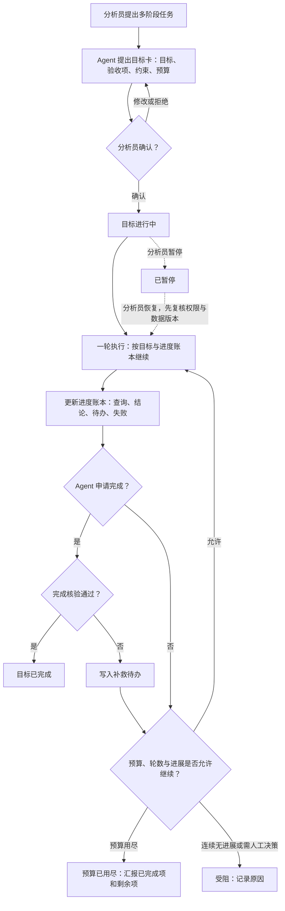
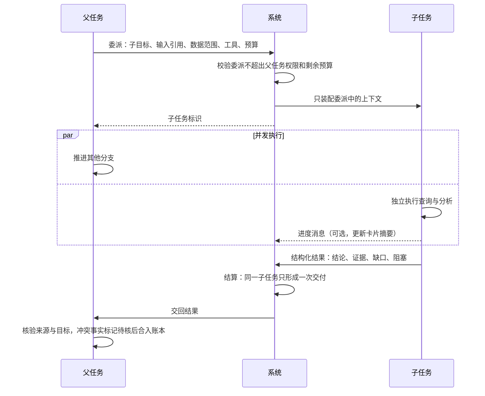

# PRD｜第 25 课｜长任务上下文治理：让数小时运行和多 Agent 协作不丢目标、不重做、不漂移

> Feature 983 · 状态 `draft` · Profile `standard` · 负责人 andy · 范围：长任务目标、进度账本、压缩与恢复、Parent→Child 委派与 Child→Parent 回传、子任务轨迹下钻。

返回需求简报 · 项目 PRD 模板 · 第 25 课大纲节选 · Codex Goal 机制 · DeepSeek Goal 机制

## 1. 背景与目标（Why）

- **背景/痛点**：月度经营分析要跨销售、营销、库存和财务多个阶段，往往持续数小时，还会经历暂停、次日恢复和多个子任务并发。现有分析 Chat 以单个 Run 为边界：模型自认为答完就结束，没有可核对的完成标准；跨 Run 的进度只存在聊天历史里，压缩后容易丢失约束和待办；`sub_agent` 只接收一段自由文本 prompt，返回一段自由文本答案，父任务无法核对子任务的口径、证据和缺口。
- **参考机制**：Codex 与 DeepSeek Harness 都把 Goal 实现为 Agent Loop 外层的持久控制器：保存目标、在空闲边界续轮、按预算或轮数停止，并用版本或锁处理“修改目标”与“自动续轮”的竞争。两者的 SubAgent 都有两次交接：派发时把任务交给独立上下文，结束时把结果交回父任务。两份材料同时指出缺口：完成判定只依赖执行模型自检，业务进度账本、结构化委派与回传契约、结果去重都需要应用层补齐。
- **目标**：
  1. 用户确认一份长任务目标后，系统持续推进，直到通过完成核验、用户暂停或取消、预算用尽或明确受阻。
  2. 每一轮执行都能从目标和进度账本接着做，已完成的查询和写入不重做，压缩不会删掉目标、约束、待办、失败记录和证据引用。
  3. 父任务只把完成子目标所需的上下文、权限和预算交给子任务；子任务按约定格式交回结果，父任务核验来源和目标后再合入。
  4. 分析员在 Chat 中区分各子任务进度，并按当前权限下钻单个子任务的执行轨迹。
- **成功指标**：以 AC-05 的同一月度任务对比实验为口径，记录完成率、关键事实保留、重复查询次数和 Token 用量。本 PRD 不设定数值目标。

## 2. 用户与场景（Who / When）

| 编号  | 用户       | 场景                                                                                 | 关联                |
| ----- | ---------- | ------------------------------------------------------------------------------------ | ------------------- |
| US-01 | 经营分析员 | 月度经营分析并发排查库存与转化时，我想分别看到两项任务的进度。                       | FR-01、FR-02        |
| US-02 | 经营分析员 | 我想从摘要展开库存子任务，查看它实际执行的步骤、查询及结果摘要。                     | FR-02、FR-03        |
| US-03 | 经营分析员 | 连接中断或子任务失败时，我想确认哪项任务受影响并继续查看原记录。                     | FR-03、FR-04        |
| US-04 | 经营分析员 | 我交代一个多阶段的月度分析，希望先确认完成标准和预算，之后它自己推进，不用每轮催促。 | FR-05、FR-06、FR-08 |
| US-05 | 经营分析员 | 我暂停分析，次日回来继续，希望它从待办接着做，不重复已完成的查询，也不用失效的数据。 | FR-07、FR-11        |
| US-06 | 经营分析员 | 子任务交回的结论要能追到证据；结论和已有事实冲突时，我想看到两方来源。               | FR-09、FR-10        |

## 3. 总体业务流程

### BF-01：长任务目标的确认与持续推进

**参与者与起止**：分析员在 Chat 提出多阶段分析任务，到目标完成、暂停、取消、受阻或预算用尽为止。



**流程说明**：目标确认后才进入自动推进（FR-05）。每一轮结束时，系统按 BR-05 判断能否继续（FR-06）。分析员的新消息优先于自动续轮。Agent 申请完成后由完成核验决定是否结束（FR-08）。暂停后恢复先复核权限、数据版本和已完成操作（FR-11）。

### BF-02：父子任务的双向交接

**参与者与起止**：父任务发现可以并行的分析分支，到父任务合入子任务结果或明确记录失败为止。



**流程说明**：第一次交接发生在委派（FR-09），系统按契约装配子任务上下文并限制权限与预算（BR-01）。第二次交接发生在回传（FR-10）：进度消息只更新卡片，最终结果只交付一次（BR-06）。分析过程中的卡片与轨迹下钻沿用 FR-01 至 FR-04。

## 4. 功能需求（What）

### 4.1 新增需求

| 编号  | 触发                                      | 输入                                               | 预期行为                                                                                                                                                                                                                                                                                                                    | 可观察结果                                                                                   | 关联                 |
| ----- | ----------------------------------------- | -------------------------------------------------- | --------------------------------------------------------------------------------------------------------------------------------------------------------------------------------------------------------------------------------------------------------------------------------------------------------------------------- | -------------------------------------------------------------------------------------------- | -------------------- |
| FR-01 | 父 Run 发现可以并行的分析分支             | 委派契约（FR-09）                                  | 为每项分析创建独立子任务（Child Run），记录父 Run、子任务目标、获准输入与引用、数据范围和分配预算。各子任务使用自己的执行上下文与工具调用。                                                                                                                                                                                 | 库存和转化任务可同时处于运行状态，按各自子任务标识关联 Step、Attempt 和结果。                | BR-01、BR-02         |
| FR-02 | 子任务状态或摘要变化                      | 子任务事件、进度消息                               | 将子任务名称、状态和获准摘要呈现在父 Run 的分析过程。同一子任务的更新落到原卡片。父 Run 按分支规则接收子任务结果或失败状态。                                                                                                                                                                                                | 用户能独立区分子任务进度、完成、失败和取消，乱序更新保持正确归属。                           | BR-02、BR-04         |
| FR-03 | 用户展开或重新打开子任务                  | 父 Run 标识、子任务标识、游标                      | 按父 Run 与子任务的关系校验资源和当前权限，按执行顺序展示该子任务所有获准查看的已提交事件。包括步骤、工具调用状态、获准的参数及结果摘要、错误和可访问的产物引用。运行中接收该子任务的后续进度。                                                                                                                             | 能从单张卡片追查一条完整的授权轨迹，展开内容与其他子任务分开。                               | BR-02、BR-03、NFR-01 |
| FR-04 | 子任务详情断线、恢复或父 Run 进入回答阶段 | 游标                                               | 详情随父 Run 的事件游标续接并去重，按子任务标识归入对应卡片。收到子任务的最终结果时更新该卡片；主对话仅在父 Run 进入明确的最终回答阶段时自动折叠。                                                                                                                                                                          | 重连后仍能查看所选子任务，父回答生成后，用户可重新展开过程查看已获准的子任务轨迹。           | BR-03、BR-04、NFR-01 |
| FR-05 | 分析员提出多阶段或长时间分析任务          | 分析员问题、Agent 拟定的目标草案                   | Agent 提出目标卡，包含目标描述、验收项、约束（口径、数据范围、禁止事项）和预算（Token、费用、自动轮数）。分析员确认后目标生效；拒绝或要求修改时目标不生效。同一会话同时只有一个未结束的目标。修改已生效的目标走同一确认流程，确认后版本加一。                                                                               | 目标卡显示待确认内容；确认后目标面板显示“进行中”、验收项清单和预算。                         | BR-05、BR-08         |
| FR-06 | 一轮执行结束，目标仍为进行中              | 目标、预算用量、进度账本                           | 按 BR-05 判断能否续轮。允许时自动发起下一轮，并在分析过程标明“继续推进目标 · 第 N 轮”。分析员在自动续轮排队或执行时发送新消息，视为插话：当前自动轮停止，尚未执行的轮次不计入轮数，新消息先执行，执行完后目标自动继续。分析员可随时暂停、恢复、取消或修改目标。预算用尽时让当前轮收尾，汇报已完成项、剩余项和建议的下一步。 | 无需分析员催促即可进入下一轮；目标面板实时显示状态、已用轮数与预算用量；预算用尽后不再续轮。 | BR-05、BR-08         |
| FR-07 | 执行中完成查询、形成结论、发现待办或失败  | 工具结果、模型提交的进度更新、子任务结果           | 将已完成查询、阶段结论（附证据引用）、待办、失败记录和子任务结果写入目标的进度账本。每一轮开始时，以目标与账本重新装配工作上下文。相同查询在数据版本未变且仍有权限时复用已有结果。                                                                                                                                          | 新一轮从未完成待办继续；重复查询被复用而非重新执行；阶段结论中的数值可追到原始结果。         | BR-07、BR-09         |
| FR-08 | Agent 申请完成目标                        | 完成申请、进度账本                                 | 系统核对完成条件：每个验收项都有可访问的证据引用，无未完成的必需待办，无未处理的冲突或失效事实。通过时目标完成；未通过时把缺口写成补救待办并继续推进。                                                                                                                                                                      | 未满足条件的完成申请被打回，补救待办出现在目标面板；通过后目标面板显示“已完成”。             | BR-05、BR-07         |
| FR-09 | 父任务委派子任务                          | 子任务名称、子目标、输入引用、数据范围、工具、预算 | 委派采用结构化契约。系统校验委派的工具和数据范围不超出父任务当前授权，预算不超过父任务剩余额度，再只按契约装配子任务上下文。子任务拿不到父任务的完整历史。                                                                                                                                                                  | 子任务卡片显示名称；子任务的输入、工具和预算可核对；越权委派被拒绝并告知父任务。             | BR-01                |
| FR-10 | 子任务交回结果                            | 结构化结果、进度消息、结束原因                     | 子任务按回传契约交回状态、结论（附证据引用）、产物引用、缺口、阻塞和建议下一步，过程中可发送进度消息。系统对每个子任务只形成一次最终交付。父任务合入前核验证据来源属于该子任务、结果对应委派目标；与账本已有事实冲突时标记待核并保留两方引用。                                                                              | 父任务收到一份结构化结果；进度消息与终态同时到达时只合入一次；冲突事实在目标面板标为待核。   | BR-06、BR-09         |
| FR-11 | 分析员恢复已暂停或中断的目标              | 目标、进度账本、当前权限与数据版本                 | 恢复前核对目标版本、当前权限、数据版本和已完成操作。已完成的写入跳过；失去权限的明细及由它派生的结论移出工作上下文；数据版本变化的查询转为待补查；随后继续推进。                                                                                                                                                            | 恢复后不重复已完成写入，不展示失权内容，变化的数据被重新查询。                               | BR-07、BR-09         |

### 4.2 变更需求

| 编号        | 触发             | 输入             | 预期行为                                                                                                                           | 输出/结果                                                    | 关联  |
| ----------- | ---------------- | ---------------- | ---------------------------------------------------------------------------------------------------------------------------------- | ------------------------------------------------------------ | ----- |
| FR-09（变） | 模型调用子 Agent | 原 `prompt` 入参 | 原行为：子 Agent 只接收自由文本 prompt。本次行为：结构化委派为主入口，仅有 prompt 的旧调用继续可用，按无输入引用、默认预算处理。   | 已保存的工作流资产和旧调用方式不受影响。                     | BR-01 |
| FR-10（变） | 子 Agent 结束    | 子 Agent 输出    | 原行为：返回一段自由文本答案和证据句柄。本次行为：返回结构化结果；子任务未按契约返回时，系统以“部分完成”交回并注明缺少结构化结果。 | 父任务总能拿到可判定状态的结果，旧工作流读取答案的字段保留。 | BR-06 |

## 5. UI 视觉与交互

沿用第 20 课分析 Chat 的过程与回答布局，以及现有执行时间线的“子任务”节点样式。

### UI-01：分析过程中的子任务卡片

**设计依据**：以下为拟议交互线框，未提供高保真设计稿。

```text
▾ 分析过程
  继续推进目标 · 第 2 轮
  ▾ 库存分析 · 运行中
    检查缺货商品与销量变化
    库存查询 · 已完成 · 查看详情
    核对缺货影响 · 运行中
  ▸ 转化分析 · 已完成
    已核对各渠道的流量与转化变化
```

| 状态                   | 行为                                                                                                                                      | 关联         |
| ---------------------- | ----------------------------------------------------------------------------------------------------------------------------------------- | ------------ |
| 默认                   | 卡片标题显示名称和状态，下方显示可见摘要。没有可见详情的卡片仅提供摘要和状态。                                                            | FR-02、FR-03 |
| 展开                   | 选择子任务标题后，在原卡片内加载轨迹，保留同级卡片的位置。标题可用键盘展开和收起，焦点留在当前按钮。正在读取时显示「正在加载执行过程…」。 | FR-03        |
| 暂无轨迹               | 新任务尚未提交可见事件时显示「等待执行进度」。收到事件后更新原卡片。                                                                      | FR-03        |
| 读取失败或访问范围变化 | 临时错误显示「暂时无法加载执行过程」及「重试」。权限校验失败时清除该卡片已加载的详情，显示「此执行过程不可访问」。                        | FR-03、FR-04 |
| 子任务结束             | 卡片保留授权范围内的已提交过程及终态。父任务回答后重新展开「分析过程」，仍可打开子任务卡片。部分完成时状态显示「部分完成」。              | FR-02、FR-04 |

### UI-02：目标卡与目标面板

**设计依据**：拟议线框。目标卡复用现有确认卡的位置与按钮样式；目标面板位于对话区顶部，可折叠。

```text
┌ 长任务目标 · 待确认 ─────────────────────────────┐
│ 完成 10 月经营分析：销售、营销、库存、财务四个阶段 │
│ 验收项  ☐ 各阶段结论均附数据来源                   │
│         ☐ 给出库存缺货对销售的影响估算             │
│ 约束    使用 GMV 口径；仅华东区域                  │
│ 预算    最多 12 轮 · 200 万 Token                  │
│                         [修改]   [确认并开始]      │
└──────────────────────────────────────────────────┘

▾ 长任务目标 · 进行中 · 第 3/12 轮 · 已用 41%     [暂停] [取消]
  ☑ 各阶段结论均附数据来源
  ☐ 给出库存缺货对销售的影响估算
  待办 2 · 待核 1
```

| 页面区域/控件 | 新增/变更 | 功能与交互说明                                                                                                                         | 关联         |
| ------------- | --------- | -------------------------------------------------------------------------------------------------------------------------------------- | ------------ |
| 目标卡        | 新增      | 显示目标、验收项、约束和预算。「确认并开始」使目标生效；「修改」在输入框中带入修改意见。卡片可用键盘操作，确认后按钮禁用防止重复提交。 | FR-05        |
| 目标面板标题  | 新增      | 显示状态、已用轮数/上限和预算用量百分比。标题可展开与收起。                                                                            | FR-06        |
| 验收项清单    | 新增      | 已有证据的验收项打勾；补救待办和待核事实计数显示在清单下方。                                                                           | FR-07、FR-08 |
| 暂停 / 恢复   | 新增      | 进行中显示「暂停」；已暂停显示「恢复」。恢复时显示「正在核对权限与数据…」。                                                            | FR-06、FR-11 |
| 修改目标      | 新增      | 在输入框带入「修改目标：」，发送后按插话处理；Agent 据此提出新的目标卡，确认后生效。                                                   | FR-05、FR-06 |
| 输入框        | 变更      | 自动续轮排队或执行时保持可输入，占位文字为 C-16；发送即插话。                                                                          | FR-06        |
| 取消          | 新增      | 二次确认后结束目标，已完成的结论和产物保留。                                                                                           | FR-06        |

**状态与反馈**：目标状态文案见 [§8 最终文案](#最终文案)。操作冲突（如他处已修改目标）提示刷新后重试。

## 6. 业务规则与约束（Rules）

| 编号  | 规则                                                                                                                                                                                                                                                                                                                                                                                                                          | 关联                |
| ----- | ----------------------------------------------------------------------------------------------------------------------------------------------------------------------------------------------------------------------------------------------------------------------------------------------------------------------------------------------------------------------------------------------------------------------------- | ------------------- |
| BR-01 | 子任务的交接内容只包含当前目标、必要输入和引用、可用工具、授权范围及预算。子任务权限和预算受父任务约束。恢复时按当前权限重新获取所需上下文。                                                                                                                                                                                                                                                                                  | FR-01、FR-09        |
| BR-02 | 父子关系由服务端登记。事件按所属 Run、子任务、Step 和工具调用标识关联，各子任务独立更新。子任务摘要来自该任务的获准执行事件或已提交结果。                                                                                                                                                                                                                                                                                     | FR-01、FR-02、FR-03 |
| BR-03 | 主对话摘要、详情查询、订阅和续接都校验父 Run 访问权、目标子任务的归属和访问权，并沿用第 20 课的可见字段策略。原始工具正文和模型内部推理只在服务端受控边界内处理。                                                                                                                                                                                                                                                             | FR-03、FR-04        |
| BR-04 | 子任务回答和终态只更新对应卡片。主对话的过程折叠由父 Run 的回答阶段触发。父 Run 依赖的分支失败时，保留失败状态和可见原因供父任务处理。                                                                                                                                                                                                                                                                                        | FR-02、FR-04        |
| BR-05 | 目标状态包括待确认、进行中、核验中、已暂停、受阻、预算已用尽、已完成、已取消。只有“进行中”允许自动续轮。以下任一情况停止续轮：完成核验通过；用户暂停或取消；Token、费用或轮数预算用尽；连续 3 轮账本无新进展；连续 3 轮执行失败；Agent 报告需要人工决策。预算检查在每轮开始和执行过程中进行，当前轮收尾可产生少量超额，超额如实记录。分析员插话使当前自动轮停止，插话执行完后目标自动恢复推进；分析员主动暂停后只能手动恢复。 | FR-05、FR-06、FR-08 |
| BR-06 | 每个子任务在一次执行中只形成一份最终交付，以子任务标识和执行次数确定交付身份。进度消息只更新卡片摘要，不作为交付。子任务未调用结构化回传就结束时，以“部分完成”交付。                                                                                                                                                                                                                                                          | FR-10               |
| BR-07 | 目标、验收项、约束、未完成待办、失败记录和证据引用属于受保护信息，由目标与账本单独保存，每轮装配，不进入可被压缩的历史。摘要只用于压缩聊天历史，不得替换目标或账本中的内容。                                                                                                                                                                                                                                                  | FR-07、FR-08、FR-11 |
| BR-08 | 目标创建、修改、恢复只能由分析员确认或操作；子任务、自动续轮和工具结果不能修改目标或预算。每次修改递增目标版本，基于旧版本发起的续轮和操作作废。                                                                                                                                                                                                                                                                              | FR-05、FR-06        |
| BR-09 | 账本中的事实保留来源（查询、产物、证据或子任务交付）和数据版本。失去访问权的来源及其派生结论不进入工作上下文和用户可见内容；数据版本变化的来源转为待补查；同一事项来源冲突时标记待核，保留两方引用，不自动取舍。                                                                                                                                                                                                              | FR-07、FR-10、FR-11 |

| 编号   | 非功能要求                                                     | 验证口径                                                         |
| ------ | -------------------------------------------------------------- | ---------------------------------------------------------------- |
| NFR-01 | 子任务的实时流、历史和续接结果在同一授权范围内一致。           | 使用两个子任务的交错和重复事件，检查游标、卡片归属与可见字段。   |
| NFR-02 | 目标修改、暂停与自动续轮并发时，执行使用的始终是最新目标版本。 | 在续轮发起前后修改目标或暂停，检查作废的续轮未执行、未计入轮数。 |
| NFR-03 | 预算记账不重复、不遗漏，包含子任务用量。                       | 两个子任务并发执行后，目标用量等于各轮各子任务模型调用用量之和。 |

## 7. 范围与边界（Scope）

- **包含**：FR-01 至 FR-11；目标卡与目标面板；子任务卡片与轨迹下钻；AC-05 的对比实验脚本与报告。
- **不包含**：
  - 独立的模型 Verifier。完成核验先采用程序化条件（FR-08）；需要语义级评判时另立需求。
  - 跨会话 Memory 的读写。Memory 应用目前只有健康检查，见待确认事项。
  - 子任务之间直接通信。兄弟任务协作经父任务转发。
  - 子任务派生孙任务。委派深度为 1。
  - 子任务长于父 Run 存活。子任务随父 Run 暂停、取消与恢复；更长的工作拆成多轮目标推进。
- **依赖**：
  - [第 19 课](PRD.md)提供持久 Run、Checkpoint、Artifact 引用、确认卡与恢复能力。
  - [第 20 课](PRD.md)提供异步 Run API、权限过滤后的事件和回答阶段契约。
  - [第 24 课](PRD.md)提供单轮内的历史选择、剪枝与摘要压缩；本课负责跨轮次的进度与恢复。
  - [Feature 977](PRD.md) 提供 `sub_agent` 工具、子进程隔离和工作流内的并发调用。
  - 运行数据归 Agent。新增持久对象按 数据库迁移规范在技术设计中登记 `agent/main` 的版本、SQL 交付及恢复要求。

## 9. 验收标准（Acceptance Criteria）

### AC-01｜两个 SubAgent 并发，轨迹独立

**关联**　FR-01、FR-02、FR-03、FR-09、BR-01、BR-02

- **Given**　月度经营分析可独立检查库存与转化，各子任务有可核对的输入范围和工具调用。
- **When**　同时启动两个子任务，让步骤交错完成并展开库存卡片。
- **Then**　两者的执行时间有重叠，卡片按各自子任务更新。库存详情从启动到当前状态按顺序展示获准事件，只包含库存任务的步骤、调用和可见结果。两个子任务的输入与预算可核对。
- **验证方式**　Agent 集成测试（模拟模型）+ 浏览器人工步骤。

### AC-02｜下钻和重连沿用当前权限

**关联**　FR-03、FR-04、BR-03、NFR-01

- **Given**　子任务的工具结果包含授权摘要和受限字段，另有不同租户或工作区的子任务。
- **When**　合法用户打开卡片并断线重连，再测试错配父子 ID、跨租户读取以及撤销详情访问权限后的续接。
- **Then**　合法用户续收原子任务的事件且无重复。错配和越权请求无可见轨迹，页面清除已失去权限的详情。响应载荷中无受限字段。
- **验证方式**　Agent API 测试 + Web BFF 测试 + 浏览器人工步骤。

### AC-03｜子任务结束与父回答独立

**关联**　FR-02、FR-04、BR-02、BR-04

- **Given**　父 Run 同时展示两个子任务。
- **When**　一个子任务输出自己的最终结果，另一个失败，随后由父 Run 输出最终回答。
- **Then**　两个卡片分别显示各自终态与可见摘要。父过程在父回答阶段自动折叠一次。用户重新展开后仍能查看授权轨迹及对应失败原因。
- **验证方式**　Web 组件测试 + 浏览器人工步骤。

### AC-04｜阶段进度与账本续做

**关联**　FR-07、BR-07、BR-09

- **Given**　进行中的月度分析目标已完成销售阶段，账本中有销售查询、阶段结论和营销阶段待办。
- **When**　暂停目标，再恢复。
- **Then**　账本中的阶段结论数值能通过证据引用回到原始查询结果；恢复后的第一轮从营销待办开始，销售查询以复用方式出现，未重新执行。
- **验证方式**　Agent 集成测试（模拟模型，断言查询执行次数与上下文装配内容）。

### AC-05｜压缩不丢受保护信息，三种保留策略可对比

**关联**　FR-07、BR-07

- **Given**　同一月度任务，人为调低窗口预算使每轮触发压缩。
- **When**　分别以滑动窗口、阶段摘要、目标与账本装配三种策略运行。
- **Then**　报告记录每种策略的完成率、关键事实保留、重复查询次数和 Token。目标与账本装配策略下，每次模型调用的上下文都含目标、全部约束、未完成待办和失败记录；压缩摘要未写入目标或账本。
- **验证方式**　离线对比脚本输出报告（课程实验）+ Agent 单元测试断言装配内容。

### AC-06｜恢复时剔除失权内容、跳过已完成写入、标记冲突

**关联**　FR-10、FR-11、BR-09

- **Given**　目标已生成一份报告产物，账本中有一条来自库存明细的结论。
- **When**　中断目标并撤销库存明细权限、使销售数据所在连接的数据版本变化（连接修订号递增）后，连续两次恢复；另模拟子任务交回与账本已有值冲突的数值。
- **Then**　两次恢复都不重新生成报告产物；库存明细结论及其派生摘要不出现在上下文与用户可见内容中；版本变化的销售查询被重新执行；冲突数值标为待核，两方引用均保留。
- **验证方式**　Agent 集成测试（真实 PostgreSQL）。

### AC-07｜目标确认、自动续轮与停止

**关联**　FR-05、FR-06、BR-05、BR-08、NFR-02、NFR-03

- **Given**　分析员提出多阶段任务，Agent 提出目标卡，预算为 3 轮。
- **When**　分析员确认；第 1 轮结束后自动续轮；第 2 轮执行中分析员发送「修改目标：只看华东」插话，Agent 提出新目标卡并获确认；之后第 3 轮执行中预算用尽。另测试续轮排队时分析员发送新消息、续轮发起前暂停。
- **Then**　未确认前不自动执行。插话使第 2 轮停止，插话执行完后目标自动继续，后续轮次读取新版本。排队中被插话取消的续轮不计入轮数。暂停后不再续轮。预算用尽时当前轮输出已完成项与剩余项，目标转为“预算已用尽”，超额用量如实记录；目标用量包含子任务用量且不重复。
- **验证方式**　Agent 集成测试（真实 PostgreSQL，模拟模型）+ 浏览器人工步骤。

### AC-08｜完成核验打回并补救

**关联**　FR-08、BR-05、BR-07

- **Given**　目标有两个验收项，账本中只有一项有证据，另有一条未完成的必需待办。
- **When**　Agent 申请完成。
- **Then**　完成申请被打回，目标回到“进行中”，账本新增针对缺失验收项的补救待办；补齐证据并完成待办后再次申请，目标转为“已完成”。连续 3 轮账本无新进展时目标转为“受阻”。
- **验证方式**　Agent 集成测试。

### AC-09｜委派契约限制上下文、权限与预算

**关联**　FR-09、BR-01

- **Given**　父任务有库存与销售两类授权，剩余预算有限。
- **When**　父任务委派库存子任务，契约只引用库存待办与一份销售结论；再分别尝试委派超出父任务授权的工具、超出剩余额度的预算。
- **Then**　子任务的模型输入只包含契约中的目标、引用内容和工具声明，不含父任务历史；越权和超额的委派被拒绝并以可判定原因返回父任务；仅有 prompt 的旧调用仍可执行。
- **验证方式**　Agent 单元与集成测试。

### AC-10｜回传契约单次交付与来源核验

**关联**　FR-10、BR-06、BR-09

- **Given**　库存子任务执行中发送了进度消息。
- **When**　子任务交回结构化结果，同时运行时完成终态结算；另测试子任务未调用结构化回传就结束、结果引用了不属于该子任务的证据、恢复后重放同一交付。
- **Then**　父任务只合入一份交付，进度消息仅更新卡片摘要。未结构化结束的子任务以“部分完成”交付并注明缺口。外来证据引用被剔除并在结果中标注。重放不产生第二份交付。
- **验证方式**　Agent 集成测试。
