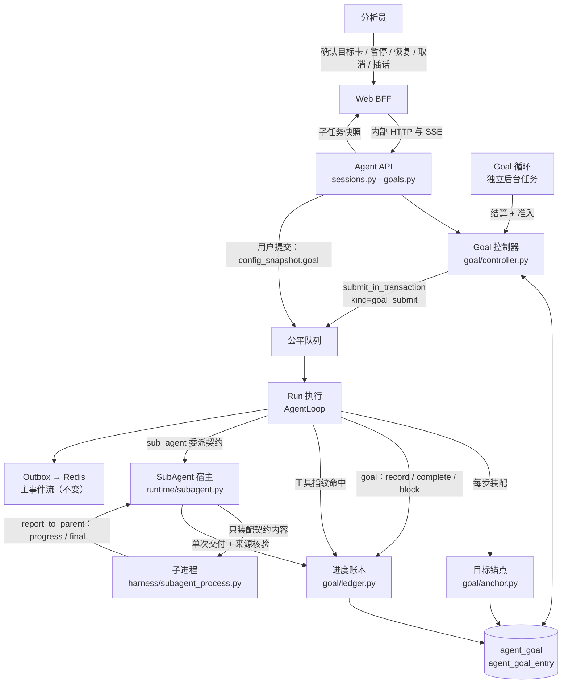
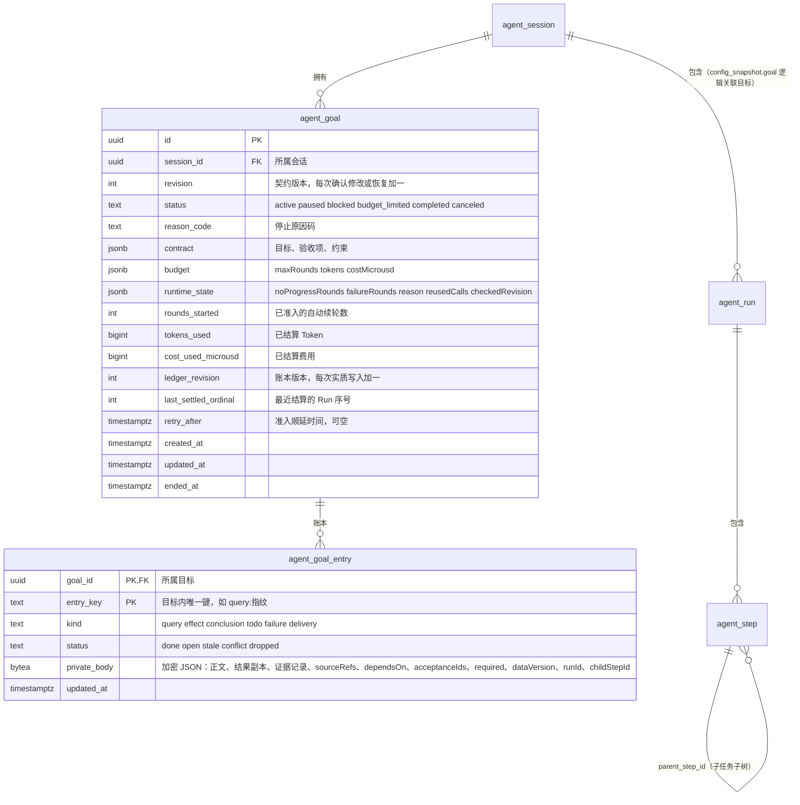
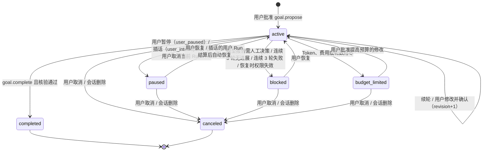
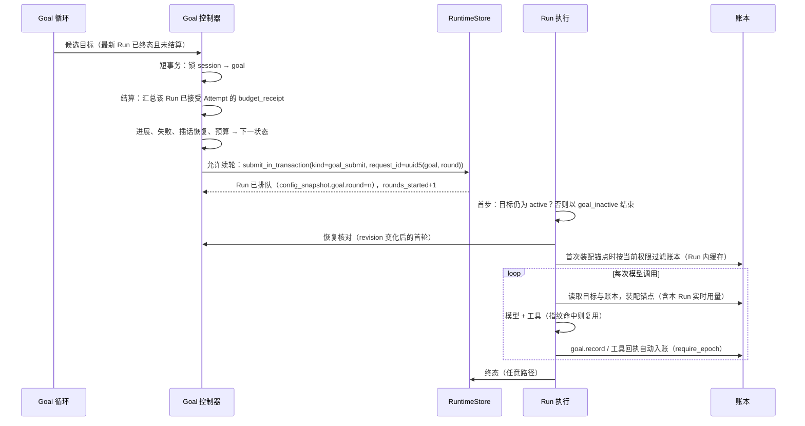

# 第 25 课｜长任务上下文治理 技术方案

> Feature：983 | 有效需求来源：[PRD](PRD.md)（2026-11-24 评审修订版，AC-01 至 AC-10） | Profile：standard | 模板：项目 TECH_DESIGN.tmpl.md | 代码基线：Compass 工作区快照 2026-11-24（子模块 git 元数据在本环境不可读，以文中引用的文件为准） | 状态：待复评（已按设计评审修订 P0、P1；2026-11-24 按用户意见合并 Goal 工具、补充提示词设计）

返回需求简报 · [代码设计附录](CODE_DESIGN.md) · [提示词与工具设计](PROMPT_DESIGN.md) · 设计评审 · Codex Goal 机制 · DeepSeek Goal 机制

> Compass 项目规则：数据所有权与 SQL 迁移管理规范。本方案新增 `agent/main` 迁移 `0018 → 0019`，交付要求见 §4。

## 需求依据与验收

需求与验收以 [PRD](PRD.md) 为唯一维护源。本方案覆盖 FR-01 至 FR-11、BR-01 至 BR-09、NFR-01 至 NFR-03、AC-01 至 AC-10。PRD 待确认事项中的跨会话 Memory 与独立模型 Verifier 不在本方案内；默认预算（§2.2）、数据版本口径（§2.3.2）和插话语义（§2.3.1）按 PRD 当前版本设计，等待负责人确认。

| AC    | 主要承载模块                               | 验证入口                      |
| ----- | ------------------------------------------ | ----------------------------- |
| AC-01 | 子任务并发、委派契约、Web 子任务卡片       | Agent 集成测试 + 浏览器       |
| AC-02 | 子任务快照端点、主流可见性、Web 卡片       | Agent API + BFF 测试 + 浏览器 |
| AC-03 | 子任务终态投影、Web 卡片                   | Web 组件测试 + 浏览器         |
| AC-04 | 进度账本、目标锚点、查询复用               | Agent 集成测试                |
| AC-05 | 目标锚点不可压缩、对比实验                 | Agent 单元测试 + 课程实验脚本 |
| AC-06 | 锚点权限过滤、恢复核对、账本复用、冲突标记 | Agent 集成测试（PostgreSQL）  |
| AC-07 | Goal 循环、插话、预算结算                  | Agent 集成测试（PostgreSQL）  |
| AC-08 | 完成核验、无进展计数                       | Agent 集成测试                |
| AC-09 | 委派契约校验与上下文装配                   | Agent 单元与集成测试          |
| AC-10 | 回传契约、单次交付、证据来源核验           | Agent 集成测试                |

## 1. 方案概述

### 1.1 设计目标和设计原则

本课在已有的持久 Run 之上补一层**目标控制**，并把 `sub_agent` 的两次交接改成结构化契约。建设内容：

1. **Goal 循环**：保存用户确认的目标契约；独立后台循环结算已结束的 Run，并按状态、预算和进展决定是否提交下一轮；完成申请时执行程序化核验。
2. **进度账本**：跨 Run 保存查询、结论、待办、失败、写入与子任务交付，每次模型调用前装配为不可压缩的**目标锚点**；带指纹的查询与写入在后续轮次直接复用。
3. **双向 Handoff**：委派契约决定子任务能看到什么、能用什么、能花多少；回传契约决定子任务交回什么、只交一次、父任务如何核验后合入。
4. **子任务下钻**：子任务在父 Run 内拥有稳定的 `childRunId`；Web 把子任务的后代节点归入卡片，展开时经快照端点按当前权限读取完整子树。

设计原则：

- **状态不放在聊天历史里。** 目标与账本是数据库中的结构化状态，历史压缩只作用于聊天历史，压缩结果永远不回写目标或账本（BR-07）。
- **控制权按来源划分。** 目标的创建、修改、恢复只经用户确认或用户操作；主 Agent 只能写账本、申请完成或报告受阻；子任务只能通过回传契约影响父任务（BR-08）。
- **每一步都读最新目标。** 目标锚点在每次模型调用前从数据库读取，目标修改不需要向活跃 Run 注入 Steering（NFR-02）。
- **控制循环与 Run 生命周期解耦。** 结算和续轮放在独立后台循环里按“最新 Run 已终态且已投递”判断，不在 Run 的终态写入点挂钩，失败也不影响副本健康（评审 P0-2、P1-1）。
- **最大化复用。** 续轮复用 `RuntimeStore.submit_in_transaction` 与公平队列；插话复用已有取消命令；目标确认复用工具审批等待；子任务复用 977 的子进程与 `agent_step.kind='subagent'`；子预算复用 `AutonomyBudget.child_budget()`；恢复复用 `revalidate()` 与 `source_access.allows`；主事件流保持不变。

前置条件：目标能力只在同时满足以下条件的 Run 中开放（`goal` 工具的 `available` 判断），否则该工具不进入清单：

- Runtime 处于调度或分布式模式（`store.scheduler` 或 `store.distributed`），续轮 Run 才有消费者执行（评审 P1-10）；
- Run 为受控自主模式（`bindings.controlled`，存在 `AutonomyBudget`），预算才可计量（评审 P1-2）；
- `contextRuntime.answerProtocol == 2`，结论才有可引用的证据（评审 P2-8）。

不做：独立模型 Verifier、跨会话 Memory、子任务直接通信、孙任务、子任务长于父 Run 存活、主事件流折叠（PRD §7；评审建议删除原 D9、D10）。

### 1.2 整体架构

| 部分                            | 新增 / 修改 / 复用 | 说明                                                                                                                                                                                        |
| ------------------------------- | ------------------ | ------------------------------------------------------------------------------------------------------------------------------------------------------------------------------------------- |
| `goal/` 包                      | 新增               | `contracts.py`、`controller.py`、`loop.py`、`ledger.py`、`anchor.py`、`gate.py`、`resume.py`、`handoff.py`                                                                                  |
| Goal 模型工具                   | 新增               | 单个 `goal` 工具，`op` 取 `propose`（逐次审批）/ `record` / `complete` / `block`，放在 `tools/builtin/goal/` 并登记 `catalog.py`；工具描述与系统提示见 [PROMPT_DESIGN.md](PROMPT_DESIGN.md) |
| 子任务工具                      | 修改               | `sub_agent` 入参增加 `tasks`（1–4 个委派契约，同一调用内并发 2 个）；子进程增加宿主拦截的单个 `report_to_parent` 工具（`kind`：`progress` / `final`）                                       |
| `runtime/`                      | 修改               | `store.submit_in_transaction` 绑定目标与 `goal_submit`；`durable_service` 启动 Goal 循环；`subagent.py` 并发与交付；`session_management` 删除会话时取消目标                                 |
| `harness/autonomy.py`           | 修改               | `child_budget()` 增加可选 `steps` 参数，按委派契约切片                                                                                                                                      |
| `context_runtime/model_step.py` | 修改               | 装配目标锚点为不可压缩上下文块；首步恢复核对                                                                                                                                                |
| `api/`                          | 新增 / 修改        | `api/goals.py`；`api/sessions.py` 增加子任务快照                                                                                                                                            |
| `schemas.py`                    | 修改               | Goal 视图、委派与回传契约、`ToolApprovalProposal.goal`、`ExecutionSubAgent` 补充字段；运行 `pnpm contracts`                                                                                 |
| Web                             | 新增 / 修改        | 目标面板、目标卡、插话、子任务卡片分组与快照、BFF 路由映射                                                                                                                                  |
| 数据库                          | 新增               | `agent/main` `0019_goal_ledger.py`                                                                                                                                                          |

### 1.3 关键决策与 Review 索引

| 决策                    | 推荐及理由                                                                                                                                                                                                                                                                                                                                                | 代价与备选                                                                                                                                                                                      | 待判断事项/确认状态                           | 详情                                          |
| ----------------------- | --------------------------------------------------------------------------------------------------------------------------------------------------------------------------------------------------------------------------------------------------------------------------------------------------------------------------------------------------------- | ----------------------------------------------------------------------------------------------------------------------------------------------------------------------------------------------- | --------------------------------------------- | --------------------------------------------- |
| D1 Child Run 的承载     | 子任务继续作为父 Run 内的 `agent_step.kind='subagent'` 子树，`childRunId` 取该 step 的 id 并写入已有的 `ExecutionSubAgent.childRunId`。父 Run 的租约、Checkpoint、取消与恢复天然覆盖子任务，无需新表。                                                                                                                                                    | 备选为独立 `agent_run` 行加 `parent_run_id`：要放开 `uq_agent_run_active`、为子 Run 单独排队、租约与级联取消。代价是子任务不能长于父 Run，PRD §7 已排除。                                       | 评审已认可                                    | §2.3.4                                        |
| D2 Goal 与 Run 的关系   | Goal 是会话级对象，一轮 = 一个普通 Run。会话存在未结束目标时，**所有**新 Run（续轮与用户提交）都在已有 `config_snapshot["goal"]` 中绑定目标，用户 Run 同样被结算，不改动 `agent_run` 表结构。                                                                                                                                                             | 备选为一个超长 Run：步数上限 100，跨天暂停与多副本接管会拉长租约。                                                                                                                              | —                                             | §2.1.2                                        |
| D3 结算与续轮的触发     | 独立的 Goal 循环每秒扫描：对“会话最新 Run 已终态、outbox 已投递、序号大于 `last_settled_ordinal`”的目标逐个开短事务，结算后再判断准入。不在 `store.finish` 等终态写入点挂钩，任何终态路径（取消、恢复停止、未执行即取消）都会被统一结算。异常按目标隔离，只记日志与指标。                                                                                 | 续轮延迟最多一个扫描周期。备选为终态钩子：终态写入点多，且与准入锁顺序相反（评审 P0-2、P1-1）。                                                                                                 | —                                             | §2.3.1、附录 §1                               |
| D4 插话                 | 用户在续轮排队或执行时发送消息：Web 先调用 `goal/actions {action:"interrupt"}`，Agent 复用已有取消命令停止当前续轮（排队中立即取消，执行中在边界停止），目标置 `paused / user_interrupted`；Run 终态后 Web 提交用户消息。绑定该目标的用户 Run 结算时，若原因是 `user_interrupted` 则自动恢复为 `active`。                                                 | 不改 `submit_in_transaction` 的单活动 Run 规则。用户消息要等当前轮停止，通常为数秒。备选为把插话排到当前轮之后（PRD 待确认）。                                                                  | PRD 待确认（按本方案设计）                    | §2.3.1                                        |
| D5 修改目标的生效方式   | 每次模型调用前从数据库读取目标与账本装配锚点；不向活跃 Run 注入 Steering。修改目标的入口是插话 + `goal.propose` 审批。                                                                                                                                                                                                                                    | 每步多一次带索引的读取；账本条目数有上限。                                                                                                                                                      | —                                             | §2.3.3                                        |
| D6 完成核验             | 程序化门禁：验收项都有可访问证据、无必需待办、无冲突或被依赖的失效事实。在 `goal.complete` 的工具调用内同步执行，不通过就写补救待办并让模型在本轮继续。                                                                                                                                                                                                   | 无法判断结论语义是否正确。独立模型 Verifier 留作后续需求。                                                                                                                                      | PRD 待确认                                    | §2.3.5                                        |
| D7 查询与写入复用       | 工具在 `ToolSpec` 上声明可选 `fingerprint` 适配器（`database_query`、`query_metric`、`python_analysis`）。命中同指纹、同数据版本、来源仍可访问且非 `transient` 的已完成条目时，派发器返回原结果并把原证据复制为本 Run 证据，不再执行。                                                                                                                    | 适配器需按工具维护规范化规则；跨 Run 证据复制是新路径，T4 先做最小验证。                                                                                                                        | 数据版本口径 PRD 待确认                       | §2.3.2、附录 §3                               |
| D8 子任务并发           | 并行意图由模型在一次 `sub_agent` 调用的 `tasks` 中显式表达，宿主以 `asyncio` 信号量同时运行 2 个，每个任务运行在 `with parent.child_budget(steps=…) as budget` 内，去掉跨子任务的 `model_lock`，回传状态保存在每个任务的局部 `ChildSession`。不依赖全局 `COMPASS_TOOL_BATCH_MODE`（默认 `serial`，且 `parallel` 模式会拒绝批内非 `parallel_safe` 工具）。 | 一次调用要等全部任务结束才返回；分支间有依赖时分两次调用。模型网关同时多 1 路调用，仍受 `ExecutionGate` 约束。                                                                                  | 实现时核对 `_invoke_model` 无其他共享可变字段 | §2.3.4、附录 §4                               |
| D9 回传的单次交付       | 交付身份 = `uuid5(childRunId, "delivery")`。结构化结果经 `journal.host_result` 持久化（重放比对摘要），账本以 `delivery:{childRunId}` 幂等写入；进度消息只更新节点摘要。                                                                                                                                                                                  | 子任务未调用 `report_to_parent(final)` 时以 `partial` 交付。                                                                                                                                    | —                                             | §2.3.4、附录 §5                               |
| D10 子任务下钻          | 主事件流不变，Web 按 `parentId` 把后代节点归入子任务卡片并默认收起。展开时调用 `GET /runs/{run_id}/children/{child_id}` 取完整子树快照（与主流同一可见性策略），之后的实时更新来自主事件流。                                                                                                                                                              | 主流仍携带全部子任务节点。原“主流折叠 + 下钻 SSE”会在整批被过滤时卡住游标（评审 P1-9），已删除。                                                                                                | —                                             | §2.3.6                                        |
| D11 Goal 工具合并为一个 | 一个 `goal` 工具，`op` 判别字段区分四种操作，写法与现有 `todo_write` 的 `op` 一致。主 Agent 只增加 1 个工具；子 Agent 的两种汇报合并为一个 `report_to_parent`。`propose` 的审批用 `prepare_approval` 逐次判定：只对 `op=propose` 返回目标卡，其余操作无审批。                                                                                             | 一个工具的描述更长，靠描述中的操作表说明何时用哪个 op；需要审批的 `propose` 必须单独成批（现有 `dispatch_batch` 规则）。备选为 3 个独立工具：工具清单膨胀，且审批与非审批操作分散在不同工具里。 | 用户已确认方向                                | §2.4、[PROMPT_DESIGN.md](PROMPT_DESIGN.md) §3 |
| D12 提示词分层          | 决策规则（何时建目标、何时委派、何时并行）写在按工具声明加入的系统提示片段 `long-task.md`、`delegation.md`；工具描述只写操作枚举与参数；目标锚点只放运行状态。沿用 `pipeline.py` 按工具声明追加片段的现有做法。                                                                                                                                           | 新增两个 PromptOps 资产与真实模型评测用例。                                                                                                                                                     | —                                             | §2.4、[PROMPT_DESIGN.md](PROMPT_DESIGN.md)    |

减法检查：已移除 `goal_get` 工具（锚点有上限且总是完整注入契约）、持久化的“核验中”状态、DeepSeek 的进程内 `armed/disarmed`、子任务间消息、主流折叠与下钻 SSE、隐藏 `todo_write` 与 plan 投影（评审 P1-8：保留 `todo_write`，账本待办只在目标面板显示）、`config_snapshot.goal.limits`（评审 P1-2：不改动 Run 的预算策略指纹）。

## 2. 详细设计方案

### 2.1 核心结构设计

#### 2.1.1 数据结构设计

Owner：Agent（`agent/main`）。迁移真源 `apps/agent/migrations/versions/0019_goal_ledger.py`，`down_revision = "0018"`。

约束与索引：

- `agent_goal`：部分唯一索引 `uq_agent_goal_open (session_id) WHERE status IN ('active','paused','blocked','budget_limited')`；`ix_agent_goal_open_status (status) WHERE status IN (...)` 支撑 Goal 循环扫描；CHECK 约束覆盖 `status` 枚举和非负计数。
- `agent_goal_entry`：联合主键 `(goal_id, entry_key)`，无额外二级索引。`query` / `effect` 的 `entry_key` 即 `query:<fp>` / `effect:<fp>`，复用判定走主键点查；单目标上限 400 条，其余读取均按 `goal_id` 加载到内存后解密过滤。
- `agent_run`：**0 改动**。目标归属以 `config_snapshot["goal"] = {goalId, round, ledgerRevision}` 保存；同轮次唯一性由既有 `uq_agent_run_request (session_id, request_id)` 与确定性 `request_id = uuid5(goal.id, f"round:{n}")` 保证。
- 访问控制不复制租户列：目标经 `session_id` join `agent_session` 套用已有 `owner_filter`。
- `private_body` 使用 `runtime/private_state.py` 已有的加密封装；`contract` 是用户确认过的目标文字，与用户消息的 `public_content` 同级，以 JSON 存储。
- 条目上限：每个目标最多 400 条，`conclusion` 正文 ≤ 2 KB，复用结果副本 ≤ 16 KB，单条 `source_refs` ≤ 256 项且序列化后 ≤ 512 KB（首页真实模型验收修订：默认术语及此前授权输入会保守保留，16 项会阻止正常结论入账）。超过上限时 `goal.record` 返回 `ledger_full`。上限是本方案的设计值。

旧数据：迁移只新增两张空表，不修改 `agent_run` 等既有表，旧会话与旧 Run 不受影响。

运行账号权限：`agent_goal`、`agent_goal_entry` 授予 SELECT、INSERT、UPDATE；不授予 DELETE。授权写法沿用 0014。

会话软删除：`runtime/session_management.py` 设置 `session.deleted_at` 的同一事务内，把该会话的未结束目标置为 `canceled / session_deleted`（评审 P0-2）。

#### 2.1.2 数据流设计

**锁顺序**（全局统一，评审 P0-2）：`agent_session → agent_run → agent_goal → agent_goal_entry`。Goal 循环、用户操作、`goal.propose` 写入、账本写入都按此顺序加锁；Goal 循环先无锁选出候选目标 id，再在每个目标的短事务里按序加锁复查。`store.finish` 不再接触目标表。

**目标生命周期**（BR-05）：

**一轮执行的主链路**：

失败路径：

- 准入时 `submit_in_transaction` 抛 `ModelError`：429（租户容量）→ 设置 `retry_after = now()+30s`；409 `session_busy` → 下个周期重判；404 → 目标置 `canceled / session_deleted`；503 → 下个周期重判。其他异常只记日志，不影响副本就绪。
- 续轮 Run 首步发现目标已非 `active`：以 `canceled / goal_inactive` 结束；结算时若该 Run 未执行过模型调用（`execution_epoch` 曾为空或无已接受 Attempt），回退 `rounds_started`。
- Run 失败：`failure_rounds+1`，达到 3 转 `blocked / runtime_failures`。Run 被用户取消（非插话）：目标转 `paused / run_canceled`。
- Run 因目标预算硬停（`AutonomyStopped("token_budget" | "cost_budget")`，见 §2.3.1）：结算时目标转 `budget_limited`。

#### 2.1.3 接口设计

所有新路由挂在 Agent 现有 `/v1/analysis` 前缀，经 Web BFF `durable-analysis-handler.ts` 的路由映射与 JSON Schema 校验，成功与失败均 `no-store`，上游失败统一 503。

| 接口                                                   | 说明                                                                                                                                                      | 权限与错误                                                                                                                                                                  |
| ------------------------------------------------------ | --------------------------------------------------------------------------------------------------------------------------------------------------------- | --------------------------------------------------------------------------------------------------------------------------------------------------------------------------- |
| `GET /v1/analysis/sessions/{session_id}/goal`          | 返回 `GoalView` 或 `{"goal": null}`。                                                                                                                     | `owner_filter`；会话不存在或无权 404。                                                                                                                                      |
| `POST /v1/analysis/sessions/{session_id}/goal/actions` | `{action: "pause" \| "resume" \| "cancel" \| "interrupt", expectedRevision, requestId}`，返回最新 `GoalView` 与受影响 Run 的 id。                         | `owner_filter`；`expectedRevision` 不符 409 `goal_stale_revision`；状态不允许 409 `goal_invalid_transition`；`requestId` 幂等复用 `agent_command`。                         |
| `GET /v1/analysis/runs/{run_id}/children/{child_id}`   | 子任务子树快照：从 `read_run` 的 `public_view` 取该子任务节点及其后代，经 `project_sources` 与 `visible_response(details=…)` 输出，附带快照对应的 `seq`。 | `read_run`（`owner_filter`）+ 节点存在、`kind='subagent'` 且 `subagent.childRunId == child_id`；父子错配、跨租户、不存在一律 404；可见性按当前 `access.visibility()` 计算。 |

主事件流 `GET /runs/{run_id}/events` 保持不变。目标状态不新增流事件类型：Web 在会话打开、actions 响应和每个 Run 终态事件后调用 `GET …/goal` 刷新面板；Run 内写账本时，`goal` 工具的回执带回最新的计数摘要，供 Web 即时更新。

`ExecutionSubAgent` 增补：`childRunId`（已有字段，开始赋值）、`taskName`、`deliveryStatus: completed | partial | blocked | failed | null`。`ToolApprovalProposal` 增补可选 `goal: GoalProposal`，目标卡复用审批卡的等待与决定接口（`/runs/{id}/decisions`）。

完整类型定义见 [代码设计附录 §2](CODE_DESIGN.md#2-契约类型)。修改后运行 `pnpm contracts` 更新 `contracts/*.json` 与 `apps/web/src/generated/`。

### 2.2 配置变更

不新增环境变量。默认值作为 `goal/contracts.py` 常量维护，`goal.propose` 可在默认值以内提出更小的预算，用户确认时以目标卡为准。

| 配置项                                | 当前用途与来源              | 默认值/缺失行为                                               | 生效时机 |
| ------------------------------------- | --------------------------- | ------------------------------------------------------------- | -------- |
| `DEFAULT_MAX_ROUNDS`                  | 自动续轮上限                | 12；目标卡上限 32                                             | 新目标   |
| `DEFAULT_TOKENS`                      | 目标 Token 预算             | 2,000,000；上限 10,000,000                                    | 新目标   |
| `DEFAULT_COST_MICROUSD`               | 目标费用预算                | 20,000,000（20 美元）；上限沿用 Run 默认                      | 新目标   |
| `NO_PROGRESS_LIMIT` / `FAILURE_LIMIT` | 熔断阈值                    | 3 / 3                                                         | 每轮结算 |
| `WRAP_UP_RESERVE_RATIO`               | 收尾保留额度                | 目标预算的 10%                                                | 每步装配 |
| `GOAL_LOOP_INTERVAL`                  | Goal 循环周期               | 1 秒，每次最多处理 16 个候选目标                              | 启动时   |
| 子任务步数                            | 原 `child_budget` 固定 3 步 | 委派契约 `maxSteps`，默认 3，上限 8（等于子进程 `MAX_STEPS`） | 每次委派 |

默认预算为待确认值（PRD 待确认事项）。

### 2.3 分模块详细设计

#### 2.3.1 Goal 控制器与 Goal 循环（`goal/controller.py`、`goal/loop.py`）

**Goal 循环**：`DurableRuntime.start` 额外启动一个独立 `asyncio` 任务，每 `GOAL_LOOP_INTERVAL` 执行一次 `controller.tick()`。`tick` 的异常在循环内捕获并记日志、计数，不修改 `store.ready` 或 `owner_healthy`（评审 P0-2）。循环只在本副本持有 owner 时运行，多副本同时运行时由行锁 `SKIP LOCKED` 保证每个目标只被一个实例处理。

`tick` 先无锁查询候选：未结束目标中，会话最新 Run 已终态、序号大于 `last_settled_ordinal`、且无未投递 outbox；或 `status='active'`、最新 Run 已结算、`retry_after` 已过。每个候选单独一个短事务：

1. 按 `session → goal` 加锁复查（`goal FOR UPDATE SKIP LOCKED`）。
2. **结算**：按序号依次结算所有未结算的终态 Run。用量 = 该 Run 下所有已接受 Attempt（`agent_attempt.accepted`）的 `budget_receipt` 中 Token 与费用之和；子任务模型步骤位于 subagent step 之下，天然计入，且每个 Attempt 只计一次（NFR-03，评审 P1-2）。更新 `tokens_used`、`cost_used_microusd`、`last_settled_ordinal`，并按附录 §1 更新进展、失败计数和状态。
3. **准入**：状态为 `active` 且 BR-05 允许时，调用 `submit_in_transaction(kind="goal_submit")`，`request_id = uuid5(goal.id, f"round:{n}")`。续轮的 `TrustedContext` 为会话所有者（`actor_user_id = session.owner_user_id`，scope 取会话的租户与工作区，`purpose="chat"`）；`promptEnvironment` 与 `constraints` 继承最近结算 Run 的 `config_snapshot`（评审 P1-10）。执行开始时已有的 `access.check` 复核当前权限，失效则 Run 失败并进入失败计数。
4. 续轮消息沿用 conversation 通道的 user 消息（满足 `ck_agent_message_channel` 与 `history_command` 的问答对结构），公开文本为 C-09 标记，完整续轮指令放在锚点中（评审 P2-2）。

**目标绑定**：`submit_in_transaction` 在锁住会话后查询未结束目标；存在时在新 Run 的 `config_snapshot["goal"]` 写入 `{goalId, round, ledgerRevision}`（用户 Run 的 `round` 为 `null`，评审 P0-1）。

**创建与修改**：`goal` 工具的 `op="propose"`。工具策略为 `ToolPolicy(effect="local_artifact", approval="none")`，审批由 `prepare_approval` 逐次判定：仅 `propose` 返回带 `goal` 字段的 `ToolApprovalProposal`，进入已有审批等待；其余 `op` 不审批。用户批准后执行：无目标时插入 `active` 目标（`last_settled_ordinal = current_run.ordinal - 1`），并把 `{goalId, round: null, ledgerRevision: 0}` 合并写入当前 Run 的 `config_snapshot["goal"]`；有目标时校验 `expectedRevision` 后更新 `contract/budget` 并 `revision+1`；`budget_limited` 的目标提高预算后回到 `active`。

**用户操作**（`act`，锁顺序 `session → run → goal`）：

| 动作        | 前置状态            | 行为                                                                                                                                                     |
| ----------- | ------------------- | -------------------------------------------------------------------------------------------------------------------------------------------------------- |
| `pause`     | `active`            | 置 `paused / user_paused`；最新 Run 运行中则复用 `commands.py` 的 `control_intent='pause'`；排队中则复用取消命令。                                       |
| `interrupt` | `active`            | 置 `paused / user_interrupted`；最新 Run 若是续轮且未终态，复用取消命令（排队中立即终态，执行中在边界停止）。返回该 Run id，Web 等其终态后提交用户消息。 |
| `resume`    | `paused`、`blocked` | `revision+1`、清零熔断计数、置 `active`；最新 Run 处于 `paused` 时复用已有 resume（锚点自动读取新版本，评审 P2-9），否则由下个周期准入。                 |
| `cancel`    | 未结束              | 置 `canceled / user_canceled`，请求取消活动 Run；账本与产物保留。                                                                                        |

**插话后自动恢复**：结算一个绑定目标的**用户 Run**时，若目标为 `paused / user_interrupted`，置回 `active` 并继续准入判断；`user_paused` 不自动恢复。

**预算执行**（评审 P1-2）：不修改 Run 的预算策略。锚点装配时读取本 Run 的实时用量（`journal` 上的 `AutonomyBudget`，已含已结束子任务），计算 `剩余 = 目标预算 − 已结算 − 本 Run 实时用量`：

- `剩余 < WRAP_UP_RESERVE_RATIO × 目标预算`：锚点附加收尾指令，要求汇报已完成项、剩余项和下一步并结束本轮；
- `剩余 ≤ 0`：模型调用前抛出已有 `AutonomyStopped("token_budget" | "cost_budget")`，沿用现有预算停止的终态处理；结算时目标转 `budget_limited`，超出部分记入 `GoalView.usage.overrun`。

#### 2.3.2 进度账本（`goal/ledger.py`）

账本是目标的唯一进度来源。所有写入在 `store.lock` + `require_epoch` 的事务中执行，接管后的旧执行者无法写入（评审 P2-1）。写入有三条路径，均以 `entry_key` 幂等 upsert，实质变化时 `ledger_revision+1`：

| 路径             | 写入内容                                                                                                                                                                                                                        |
| ---------------- | ------------------------------------------------------------------------------------------------------------------------------------------------------------------------------------------------------------------------------- |
| 工具回执自动入账 | 声明 `fingerprint` 的工具执行成功后，在 `context_runtime/evidence.after_tool_batch` 登记证据之后写 `query:<fp>` 或 `effect:<fp>`。`private_body` 加密保存有界结果副本（≤ 16 KB）、本次证据记录、`sourceRefs` 与 `dataVersion`。 |
| `goal.record`    | 模型写结论（必须带本 Run 的 `evidenceIds`，系统取对应证据记录的 `sourceRefs` 作为来源）、待办（增/完成）、失败记录、验收项支撑关系。                                                                                            |
| 子任务交付       | `delivery:<childRunId>` 与交付中的发现（§2.3.4）。                                                                                                                                                                              |

**来源格式**（评审 P1-5）：`private_body.sourceRefs` 与 `agent_message.source_refs` 同格式，因此 `source_access.allows` 可直接判定。含 `kind="transient"` 来源的条目只在当前 Run 有效：可以写入，但不参与跨 Run 复用，下一个 Run 的锚点权限过滤会排除它。

**复用判定**（D7）：派发器 `admission` 前调用 `ledger.reusable(spec, args, binding)`，以主键 `(goal.id, f"{kind}:{fp}")` 点查。命中条件：目标活跃；条目 `status='done'`；解密后的 `sourceRefs` 不含 `transient`；`query` 的 `dataVersion` 等于当前绑定的 `config_revision`；`allows(sourceRefs)` 通过。命中后：

1. 把条目中保存的证据记录按当前 Run 重新封装写入 `answer/v2/evidence/<新 id>`（与 `importEvidenceId` 同样要求 `sourceRefs` 全部在本 Run 可用来源内）；
2. 返回 `ToolExecutionResult(status="ok", payload={"reused": true, "result": <有界副本>, "evidenceIds": [<新 id>]})`；
3. `goal.runtime_state["reusedCalls"] += 1`，投影到 `GoalView.counts.reusedCalls`，作为 AC-05 的重复查询口径。

跨 Run 证据复制是新路径。T4 的第一步做最小验证：上一轮查询 → 本轮复用 → 最终回答引用该证据成功；不通过时退化为“锚点提示已完成查询 + 照常执行”，并回报 AC-04 风险。

**数据版本口径**（评审 P1-7，PRD 待确认）：`data_version` 取数据连接绑定的 `config_revision`。连接修订号变化即视为数据版本变化，AC-06 按此验收。表级数据更新的感知需另定版本来源。

**冲突检测**：结论可带 `factKey` 与数值。写入时若同 `factKey` 已有 `done` 结论且数值或单位不同（数值按 `Decimal` 精确比较），两条都置 `conflict` 并互相写入 `depends_on`，不自动取舍（BR-09）。冲突在模型以新结论显式裁决后解除。

#### 2.3.3 目标锚点与上下文装配（`goal/anchor.py`）

`model_step.py` 在构造每次模型请求时，若 Run 绑定的目标为 `active`，读取目标与账本生成锚点，作为系统提示之后的一条 `context` 通道消息插入。锚点不属于 `history.load_history` 返回的 `TurnGroup`，第 24 课的选择与压缩只处理 `TurnGroup`，因此锚点在结构上不可被压缩（BR-07）。`SummarySnapshot` 只存在模型步骤帧中，没有写回账本的代码路径。

**权限过滤**（评审 P1-6）：每个 Run 首次装配锚点时，对全部 `done`、`conflict`、`stale` 条目执行一次 `allows(source_refs)`，并沿 `depends_on` 排除派生条目；结果缓存在 `journal` 上供本 Run 后续步骤使用（`allows` 会建立数据库连接，不宜每步执行）。被排除的条目不进入锚点，也不计入 `GoalView` 计数。持久化的 `dropped` 只在恢复核对中写入（§2.3.6）。

锚点内容与上限：

| 区块             | 内容                                                                     | 上限                   |
| ---------------- | ------------------------------------------------------------------------ | ---------------------- |
| 目标契约         | 目标、验收项（附是否已支撑）、约束、版本                                 | 全量（契约本身有上限） |
| 预算             | 已用轮数/上限、剩余百分比（含本 Run 实时用量）；低于保留额度时附收尾指令 | —                      |
| 续轮指令         | 仅续轮 Run：本轮是第几轮、请从未完成待办继续                             | —                      |
| 未完成待办       | 全部 `open` 待办，必需项在前                                             | 30 条                  |
| 失败记录         | 最近失败                                                                 | 10 条                  |
| 待核与失效       | `conflict`、`stale` 条目的标题与两方引用                                 | 10 条                  |
| 已完成查询与写入 | 标题、指纹简写，提示“已完成，勿重复”                                     | 最近 30 条             |
| 阶段结论         | 标题、数值、证据引用                                                     | 最近 20 条             |

`dropped` 条目永不进入锚点。超出上限的已完成条目以计数代替。锚点渲染为固定模板，相同输入生成相同文本，便于提示缓存。`todo_write` 保持原行为，作为单轮内的计划工具；跨轮待办以账本为准，锚点中注明两者区别。

#### 2.3.4 双向 Handoff（`runtime/subagent.py`、`harness/subagent_process.py`、`tools/builtin/sub_agent/`、`goal/handoff.py`）

**Child Run 身份**（D1）：每个任务调用一次 `journal.subagent_begin`，键为 `subagent:{step_id}:{call_id}:{index}`，返回的 step id 即 `childRunId`，写入 `trace.start("subagent", …, subagent=ExecutionSubAgent(childRunId=…, taskName=…))`。子任务的模型与工具节点已以该节点为 `parentId`。旧 `prompt` 调用的键保持原格式 `subagent:{step_id}:{call_id}`。

**第一次 Handoff：委派**

1. `sub_agent` 入参二选一：旧 `prompt`（兼容，等同 `tasks=[{name:"子任务", objective:prompt, maxSteps:3}]`）或新 `tasks`（1–4 个 `DelegationTask`）。
2. 校验（`admit_delegation`，整批在启动任何子任务前执行）：每个任务 `task.tools ⊆ child_tools(...)`，`child_tools` 显式排除 `goal`、`sub_agent`、`todo_write`、`create_workflow`（评审 P2-5）；`task.connectionIds ⊆` 父 Run 的 `agent_tool_binding`；`inputs` 中每个引用属于当前目标或当前 Run，且 `allows` 通过；父预算按 `can_slice` 能为第一批（最多 2 个）任务切出 `maxSteps`。任一任务不满足时整次调用返回 `ToolRejected("delegation_out_of_scope" | "delegation_budget_exceeded" | "delegation_input_forbidden")`，不启动任何子任务。这里用 `ToolRejected` 而非 `AutonomyStopped`，父 Run 不会被停止，父模型收到可判定原因（评审 P1-3，AC-09）。
3. 装配：子进程初始化帧只含子 Agent 系统提示、渲染后的任务包（目标、期望交付、约束、解析后的输入引用正文）、契约内工具声明与 `report_to_parent`、`maxSteps`。父任务历史、父锚点均不传入。`stale` 或被权限过滤的输入以“已失效，需补查”替换正文。提示词全文见 [PROMPT_DESIGN.md](PROMPT_DESIGN.md) §5、§6.3。
4. 委派快照（含解析后的引用 id、版本与正文摘要）在首次 `subagent_begin` 时计算，作为 step 的 `inputs` 持久化；恢复重放直接使用已存快照，避免引用状态变化导致 `workflow_replay_mismatch`（评审 P2-4，AC-01“输入与预算可核对”）。

**第二次 Handoff：回传**

- 每个任务创建局部 `ChildSession`（`returned`、`budget`、`end`），并发任务互不共享（评审 P1-4）。
- 宿主拦截工具 `report_to_parent`（调用帧在 `_tools` 中处理，不进入 Dispatcher），`kind` 判别两种操作：
  - `progress({summary})`：更新子任务节点 `summary`（≤ 512 字）并经 `publish_execution` 推送，覆盖写，不作为交付。
  - `final(ChildReturn)`：Pydantic 校验后存入 `ChildSession.returned`，宿主随即结束子进程并进入结算，不再多跑一步。
- 结算：`_process` 重组为“done、error、预算停止、`final`”都汇入 `_settle`。有 `returned` 用之（`reason="returned"`）；无结果但有最终回答时 `status="partial"`、`gaps=["子任务未按契约返回结构化结果"]`、`answer` 保留完整最终回答；step_limit、预算或出错时 `status="failed"` 并带原因码。取消仍按现有 `PhaseCanceled` 路径抛出，不形成交付。
- 来源核验：在子任务的 `execution_scope` 内读取 `journal.answer_evidence[execution_path]`（评审 P2-6），`findings[].evidenceIds` 中集合外的引用剔除并写入 `rejectedEvidenceIds`（AC-10）。
- 单次交付（D9）：每个任务的 `ChildDelivery` 分别经 `journal.host_result` 持久化；重放时摘要比对一致即返回已存结果。父任务账本以 `delivery:<childRunId>` upsert，带 `factKey` 的发现写为结论，走 §2.3.2 的冲突检测。
- 父工具观察：`tasks` 调用返回 `{"deliveries": [ChildDelivery, …]}`，顺序与 `tasks` 一致；旧 `prompt` 调用返回单个 `ChildDelivery`，其 `answer` 与 `evidenceIds`（子任务路径下的全部合法证据）保持 977 的语义（评审 P2-3）。

**并发**（D8）：并行意图由模型在同一次调用的 `tasks` 中表达，宿主用 `asyncio.Semaphore(2)` 运行任务，第 3、4 个任务在前面任务结束、预算切片释放后启动。每个任务在 `with parent.child_budget(steps=task.max_steps) as budget:` 内执行，模型调用的 `require_step / generation / settle` 都作用于该子预算，退出时由 `child_budget` 现有的 `finally` 并回父预算（评审 P1-3）。`SubAgent` 不再持有 `model_lock`。`child_budget` 的唯一改动是接受可选 `steps`，切片步数 `min(steps, available.steps - 1)`，工具数 `min(steps + 1, available.tools - 1)`；未传时保持现有 3 步、4 次工具调用。后启动的任务若已切不出额度，以 `failed / budget` 交付，不影响已完成任务。

不依赖全局批次策略：`COMPASS_TOOL_BATCH_MODE` 默认 `serial`，切到 `parallel` 时 `dispatch_batch` 会拒绝批内非 `parallel_safe` 工具，不适合作为长任务的前提。`sub_agent` 保持 `parallel_safe=False`；977 工作流脚本的 `parallel([...])` 路径不变（AC-01）。

#### 2.3.5 完成核验（`goal/gate.py`）

`goal({op: "complete", expectedRevision})` 在单个事务中执行（锁 `run → goal → entry`）：

1. `expectedRevision` 与当前不符：返回 `goal_stale_revision`，模型按锚点中的新契约重新判断。
2. 逐项检查：每个验收项至少有一条 `done` 且 `allows` 通过的结论支撑；无 `required=true` 的 `open` 待办；无 `conflict`；无被 `done` 条目依赖的 `stale` 条目。
3. 通过：`status='completed'`、`ended_at=now()`，停止续轮。
4. 不通过：为每个缺口写入 `remedy:<key>` 必需待办，返回 `{accepted: false, gaps: [...]}`，目标保持 `active`，模型在本轮继续。

`goal({op: "block", reason})` 置 `blocked / needs_user_decision`，`reason` 截断至 60 字写入 `goal.runtime_state["reason"]` 作为 C-05 的可见原因。无进展判定在结算中进行：Run 的 `config_snapshot["goal"]["ledgerRevision"]` 与结算时目标的 `ledger_revision` 相同则 `runtime_state["noProgressRounds"] += 1`，插话中断的 Run 不计无进展。

`goal` 工具在注册表中常驻（只要满足 §1.1 前置条件），由 `authorize` 按 `op` 与目标状态拒绝（`goal_not_active`、`goal_exists`），工具目录不随目标状态变化，审批恢复不会触发 `tool_catalog_changed`（评审 P1-8）。

#### 2.3.6 恢复核对（`goal/resume.py`）与子任务下钻

**恢复核对**：当 `goal.revision != goal.runtime_state["checkedRevision"]` 时，本 Run 在第一次模型调用前执行 `resume_check(goal, trusted)`，完成后将 `checkedRevision` 更新为 `goal.revision`，结果幂等：

1. 复用 `CurrentAccess.authorize` 与 `model_step.revalidate` 的现有能力检查；失败则 Run 以已有错误结束，结算时目标转 `blocked / access_changed`。
2. 遍历 `done` 条目，`allows(source_refs)` 不通过的置 `dropped`，沿 `depends_on` 反向把派生结论一并置 `dropped`（AC-06 失权剔除）。
3. `query` 条目的 `data_version` 与当前绑定修订号不同则置 `stale` 并新增 `refresh:<fp>` 必需待办（AC-06 重查）。
4. `effect` 条目保持 `done`，复用判定使写入跳过（AC-06 跳过已完成写入）。

**子任务下钻**（D10，评审 P1-9）：主事件流不变。Web 用主流中的 `execution.node` 按 `parentId` 构建树，把 `subagent` 节点的后代归入该卡片，默认收起。展开卡片时调用快照端点取完整子树（覆盖页面刷新、从历史会话打开等主流尚未加载完的情况），以快照的 `seq` 为基线，之后主流中属于该子树的新节点按 `parentId` 归入卡片；节点以 `id + revision` 去重。主流在可见性变化时会断开（已有 5 s 复查），Web 重连后若快照端点返回 404 或可见性收紧，清除该卡片已加载的详情并显示“此执行过程不可访问”（AC-02）。

#### 2.3.7 Web（`apps/web`）

| 位置                                             | 变更                                                                                                                                                                    |
| ------------------------------------------------ | ----------------------------------------------------------------------------------------------------------------------------------------------------------------------- |
| `src/server/http/durable-analysis-handler.ts`    | 新增三条路由映射与生成契约校验。                                                                                                                                        |
| `src/client/child-trace.ts`（新增）              | 从 reducer 状态中按 `parentId` 选出子树；展开时请求快照并合并；403/404 清空详情进入“不可访问”。                                                                         |
| `src/components/ui/execution-timeline.tsx`       | `subagent` 条目改为可展开卡片：标题按钮（`aria-expanded`、`aria-controls`）、状态、摘要、`deliveryStatus` 映射“部分完成”；后代节点只在展开区渲染；四态文案用 PRD C-15。 |
| `src/components/analysis-goal-panel.tsx`（新增） | 目标面板：状态、轮数与用量（C-10）、验收项、待办与待核计数、暂停/恢复/取消/修改目标；操作带 `expectedRevision`，409 显示 C-13；取消二次确认 C-12。                      |
| `src/components/analysis-composer.tsx`           | 续轮排队或执行时输入框保持可用，占位 C-16；发送时先调用 `interrupt`，等待返回的 Run 终态事件后再提交消息。「修改目标」在输入框带入“修改目标：”。                        |
| 审批卡渲染                                       | `ToolApprovalProposal.goal` 存在时渲染目标卡（UI-02），「确认并开始」走已有决定接口。                                                                                   |
| `src/components/analysis-run-turn.tsx`           | 续轮 Run 的回合顶部显示 C-09 标记；Run 终态后刷新目标面板。                                                                                                             |

UI 遵循 Compass UI 样式规范，复用现有卡片、按钮与时间线组件；交付前检查桌面与 390 px 窄屏、键盘展开收起与焦点保持。

### 2.4 提示词、工具清单与工具描述

模型能否在长任务中正确地建目标、委派和并行，取决于三层文本，全文见 [PROMPT_DESIGN.md](PROMPT_DESIGN.md)：

| 层           | 资产（`prompts/` 下）                                                    | 内容                                                                        | 加入条件                     |
| ------------ | ------------------------------------------------------------------------ | --------------------------------------------------------------------------- | ---------------------------- |
| 系统提示片段 | `shared/fragments/long-task.md`                                          | 何时 propose、每轮如何从锚点继续、何时 record、收尾、何时 block 与 complete | 声明 `goal` 工具时           |
| 系统提示片段 | `shared/fragments/delegation.md`                                         | 何时委派、何时自己做、何时并行、何时串行、如何处理 partial 与 failed        | 声明 `sub_agent` 工具时      |
| 工具描述     | `tools/goal.json`                                                        | 四个 `op` 的枚举表：什么时候用、结果是什么；参数含义                        | 随工具声明                   |
| 工具描述     | `tools/sub_agent.json`                                                   | 单分支与多分支写法、任务字段、`maxSteps` 取值、返回值处理                   | 随工具声明                   |
| 子 Agent     | `support/subagent/analysis.md`、`support/subagent/report-to-parent.json` | 只完成任务包、必须调用一次 `final`、findings 必须带证据                     | 子进程初始化                 |
| 运行状态     | 目标锚点（`goal/anchor.py` 模板）                                        | 契约、预算、待办、失败、已完成、结论；收尾与续轮提示                        | 绑定目标的 Run，每次模型调用 |

工具清单变化：主 Agent 新增 1 个 `goal`，`sub_agent` 改参数；子 Agent 新增 1 个 `report_to_parent`。`goal` 与 `sub_agent` 都按已有条件常驻于工具清单，状态不适用时由 `authorize` 拒绝。

委派与并行的决策规则（`delegation.md` 摘要）：

| 情况                                                 | 做法                                                           |
| ---------------------------------------------------- | -------------------------------------------------------------- |
| 一次查询能回答；下一步依赖刚拿到的结果               | 自己做                                                         |
| 需要用户确认、审批、写入；跨分支对比、裁决、最终回答 | 自己做                                                         |
| 一个可独立描述、需要多次查询的调查分支               | `sub_agent`，`tasks` 含 1 个任务                               |
| 同时识别出多个互不依赖的调查分支                     | 一次 `sub_agent`，`tasks` 含全部分支（≤ 4），系统同时运行 2 个 |
| 分支之间有数据依赖                                   | 先委派被依赖分支，结果 record 后作为 `inputs` 委派下一个       |
| 长任务的每轮开始                                     | 检查锚点待办，互不依赖的调查型待办并行委派，汇总型待办自己做   |
| 子任务返回 partial / failed                          | 按 gaps 自己补查或改写后委派一次；failed 记录失败，不原样重试  |

片段装配沿用 `context_runtime/pipeline.py` 中按工具声明追加 `database-query.md`、`workflow.md` 的做法；新资产登记到 `promptops/catalog.py` 的 `families`，随 PromptOps 版本发布，每个 Run 冻结使用的版本。决策质量用真实模型评测用例验证（[PROMPT_DESIGN.md](PROMPT_DESIGN.md) §8），缺少模型凭据时跳过且不计为通过。

### 2.5 供评审的代码设计（for review check）

关键骨架集中在 [CODE_DESIGN.md](CODE_DESIGN.md)，按模块组织：

| 附录章节 | 内容                                                                                                                                                               | 需要 Review 的问题                                                             |
| -------- | ------------------------------------------------------------------------------------------------------------------------------------------------------------------ | ------------------------------------------------------------------------------ |
| §1       | Goal 循环：候选查询、结算、准入、错误隔离、用户操作                                                                                                                | 锁顺序是否处处一致；插话与暂停的分支；回退 `rounds_started` 的条件             |
| §2       | 契约类型：`GoalContract`、`GoalInput`（`op` 判别联合）、`DelegationTask`、`SubAgentInput.tasks`、`ChildReturn`、`ReportToParentInput`、`ChildDelivery`、`GoalView` | 字段上限与兼容；`prompt` 与 `tasks` 互斥；`op` / `kind` 判别是否清晰           |
| §3       | 账本：upsert、复用判定与证据复制、冲突检测、失权级联                                                                                                               | 复用是否可能返回失权、过期或 transient 结果                                    |
| §4       | 子任务并发预算：`child_budget(steps=…)`                                                                                                                            | 并发后预算是否仍不超支                                                         |
| §5       | 多任务并发、`ChildSession`、`report_to_parent` 拦截与回传结算；§5a `goal` 工具定义与逐次审批                                                                       | 重放一致性、外来证据剔除、各结束路径都进入结算；`propose` 之外的 op 不进入审批 |
| §6       | 完成核验门禁                                                                                                                                                       | 核验条件与 BR-05 一致                                                          |
| §7       | 子任务子树快照                                                                                                                                                     | 404 语义与可见性投影                                                           |

附录代码为设计示意，未运行、未测试。

## 3. 风险评估

| 风险与触发条件                        | 影响                            | 缓解措施                                                                                    | 验证方式                                             |
| ------------------------------------- | ------------------------------- | ------------------------------------------------------------------------------------------- | ---------------------------------------------------- |
| 模型过早报告 `blocked` 或反复申请完成 | 目标提前停止或空转              | `blocked` 可由用户恢复；完成申请被打回会写补救待办；连续无进展 3 轮熔断                     | AC-08                                                |
| Goal 循环与用户提交、暂停、插话竞态   | 多跑一轮或用旧契约执行          | 统一锁顺序 + 最新 Run 判定 + `uq_agent_run_request` + 固定 `request_id`；锚点每步读最新契约 | AC-07、NFR-02 并发集成测试（含 finish 与 tick 交错） |
| Goal 循环内单个目标反复失败           | 日志噪声、该目标停滞            | 按目标短事务与按错误码处置；404 取消目标，429 顺延；异常不影响副本就绪                      | 已删除会话、容量背压集成测试                         |
| 跨 Run 证据复制不可行                 | AC-04 复用与 AC-08 证据门禁冲突 | T4 先做最小验证，不通过时退化为锚点提示并回报                                               | 复用 → 引用的集成测试                                |
| 指纹规范化不充分导致误复用            | 返回与当前问题不符的结果        | 指纹包含工具名、连接、规范化参数；仅声明适配器的工具参与；结果带 `reused` 标记              | 适配器单元测试                                       |
| 去掉 `model_lock` 后续接状态竞态      | 续接错乱                        | 每个子任务独立预算对象与 `generation`；`ChildSession` 局部化                                | NFR-03 集成测试：两个子任务并发后用量求和            |
| 锚点随账本增长挤占窗口                | 留给历史的预算变少              | 区块条数上限；第 24 课压力估算把锚点计入固定部分                                            | AC-05 对比实验记录锚点 Token                         |

## 4. 兼容性考量

| 端与版本/协议组合                             | 是否兼容及依据                                                                                                   | breaking change / 旧端行为                 | 是否需配套发版与上线顺序                               |
| --------------------------------------------- | ---------------------------------------------------------------------------------------------------------------- | ------------------------------------------ | ------------------------------------------------------ |
| 新 Agent + 旧 Web                             | 兼容：主事件流不变；`ExecutionSubAgent` 新增可选字段；旧 Web 不显示目标面板，`goal.propose` 审批卡按普通审批展示 | 无                                         | 建议同批发布                                           |
| 旧工作流资产（`agent("sub_agent",{prompt})`） | 兼容：`prompt` 仍可用，返回值保留 `answer`、`evidenceIds` 语义                                                   | 无                                         | 否                                                     |
| 已持久化的进行中 Run（0018 时期创建）         | 无目标的 Run 不受影响；含 subagent step 的 Run 重放时交付格式不同，`host_result` 摘要比对会失败                  | 在途含 subagent step 的 Run 无法跨版本接管 | 是：发布前排空含 subagent step 的活动 Run（评审 P2-3） |

数据库交付（`agent/main`，`0018 → 0019`）：

- 真源：`apps/agent/migrations/versions/0019_goal_ledger.py`。派生：`pnpm db:sql -F agent` 生成 `apps/agent/db/main/sql/bootstrap.sql`、`apps/agent/db/main/sql/upgrades/0018__0019.sql` 与 `manifest.json`，不手改派生文件。
- 同步：`apps/agent/db/main/README.md` 新增 0019 章节（owner、from/to、源、SQL、恢复）；`runtime/deployment.py::require_database_revision` 的目标版本改为 `0019`；修正 数据库迁移规范 中过时的“版本 0017”描述。
- 发布顺序：备份 0018 数据库，排空含 subagent step 的活动 Run → 执行迁移 → 部署 Agent → 部署 Web。
- 恢复：迁移只新增两张表、不修改既有表，失败时保留升级库现场，从备份恢复独立 0018 数据库并回到对应镜像，与 977 的恢复方式一致。
- 验收：PostgreSQL 空库安装、0018 带数据的原生与 SQL 升级、错误版本拒绝、`pnpm db:sql -F agent` 生成一致性、Runtime 账号权限（含无 DELETE）、备份恢复演练；另执行 `pnpm db:migrate -F agent`、重复 `pnpm db:seed -F agent` 与 `pnpm smoke`。SQLite 不能替代。

## 5. 任务分解

| 任务                       | 关联模块/决策              | 变更文件（新增/修改/删除）                                                                                                                                                                                                                                                                                                                                                                                        | 前置依赖 | 交付物与验收条件                                                                                     |
| -------------------------- | -------------------------- | ----------------------------------------------------------------------------------------------------------------------------------------------------------------------------------------------------------------------------------------------------------------------------------------------------------------------------------------------------------------------------------------------------------------- | -------- | ---------------------------------------------------------------------------------------------------- |
| T1 数据库                  | §2.1.1、§4                 | 新增 `migrations/versions/0019_goal_ledger.py`；修改 `runtime/entities.py`（新增 `AgentGoal`、`AgentGoalEntry`，不改 `AgentRun`）、`runtime/deployment.py`、`runtime/session_management.py`；派生 `db/main/sql/*`；修改 `db/main/README.md`、`docs/database-migrations.md`                                                                                                                                        | —        | §4 数据库验收全部通过                                                                                |
| T2 契约                    | §2.1.3、附录 §2            | 修改 `schemas.py`；新增 `goal/contracts.py`；生成 `contracts/*.json`、`apps/web/src/generated/`                                                                                                                                                                                                                                                                                                                   | T1       | `pnpm contracts && pnpm contracts:check` 通过                                                        |
| T3 Goal 循环与控制器       | D2、D3、D4、§2.3.1         | 新增 `goal/controller.py`、`goal/loop.py`、`api/goals.py`；修改 `runtime/store.py`（`submit_in_transaction` 绑定目标、`goal_submit`）、`runtime/durable_service.py`（启动循环）、`main.py` 路由                                                                                                                                                                                                                   | T1、T2   | AC-07；锁顺序与竞态集成测试；已删除会话与容量背压测试                                                |
| T4 账本、锚点与复用        | D5、D7、§2.3.2、§2.3.3     | 先做跨 Run 证据复制的最小验证；新增 `goal/ledger.py`、`goal/anchor.py`；修改 `context_runtime/model_step.py`、`context_runtime/evidence.py` 调用点、`tools/dispatcher.py`（复用判定）、`tools/catalog_contracts.py`（`fingerprint`）、`database_query`、`query_metric`、`python_analysis` 适配器                                                                                                                  | T3       | AC-04、AC-05 单元部分；复用 → 引用集成测试                                                           |
| T5 Goal 工具、核验与提示词 | D6、D11、D12、§2.3.5、§2.4 | 新增 `tools/builtin/goal/`（`GoalInput` 判别联合、`prepare_approval`、`authorize`）、`goal/gate.py`；登记 `tools/catalog.py`；新增 `prompts/tools/goal.json`、`prompts/shared/fragments/long-task.md`、`prompts/shared/fragments/delegation.md`；修改 `context_runtime/pipeline.py`（按工具声明追加片段）、`promptops/catalog.py`（登记资产）；更新 `tools/README.md`                                             | T4       | AC-08；目录与注册一致性测试；审批恢复无 `tool_catalog_changed`；PromptOps 资产校验；真实模型评测用例 |
| T6 双向 Handoff 与并发     | D1、D8、D9、§2.3.4、§2.4   | 修改 `tools/builtin/sub_agent/__init__.py`（`tasks`）、`runtime/subagent.py`（信号量并发、`ChildSession`、`report_to_parent` 拦截、`child_tools` 排除）、`harness/subagent_process.py`、`harness/autonomy.py`（`child_budget(steps=…)`、`can_slice`）；新增 `goal/handoff.py`；修改 `prompts/tools/sub_agent.json`、`prompts/support/subagent/analysis.md`，新增 `prompts/support/subagent/report-to-parent.json` | T2、T4   | AC-01（Agent 部分）、AC-09、AC-10；977 工作流回归测试                                                |
| T7 恢复核对                | §2.3.6                     | 新增 `goal/resume.py`；修改 `context_runtime/model_step.py` 首步调用                                                                                                                                                                                                                                                                                                                                              | T4       | AC-06（PostgreSQL）                                                                                  |
| T8 子任务快照              | D10、§2.3.6                | 修改 `api/sessions.py`（快照端点）                                                                                                                                                                                                                                                                                                                                                                                | T6       | AC-02（Agent 部分）、NFR-01                                                                          |
| T9 Web                     | §2.3.7                     | 修改 `durable-analysis-handler.ts`、`execution-timeline.tsx`、`analysis-run-turn.tsx`、`analysis-composer.tsx`、审批卡；新增 `client/child-trace.ts`、`analysis-goal-panel.tsx`；Web 测试                                                                                                                                                                                                                         | T2、T8   | AC-01 至 AC-03、AC-07 浏览器步骤；`pnpm lint/typecheck/test -F web`                                  |
| T10 对比实验               | AC-05                      | 新增 `examples/showcases/lesson25_context_strategies/`（按临时演示规范登记目标、负责人、退出条件）。三种策略只映射到现有通用开关：滑动窗口 = 关闭第 24 课优化；阶段摘要 = 开启第 24 课优化；目标与账本 = 开启优化并启用目标。生产 Runtime 不新增策略分支，报告输出到 `work/`                                                                                                                                      | T4       | AC-05 报告；默认清单、导入与 wheel 隔离测试                                                          |
| T11 集成验证               | 全部                       | —                                                                                                                                                                                                                                                                                                                                                                                                                 | T1–T10   | `pnpm check`、`pnpm build`；Agent 与 Web 检查；PRD AC 逐项记录实际结果                               |

测试计划缺口：AC-07 的插话与并发、AC-06 的跨轮权限涉及多轮状态，建议编排者安排 `my-create-test-plan` 补充业务测试用例。

## 首页真实模型验收修订（2026-11-24）

- 长历史压缩同时受摘要输出预算约束：单批输入不超过原输入硬限与 `max(output_tokens × 12, 空请求字节数 + 1024)` 的较小值；输出上限保持不超过 2048 tokens，交接正文目标为 `min(768, output_tokens / 2)`。明细保留回读位置。输出截断时最多两次缩小原材料批次重试，只有完整成功摘要才覆盖历史；持续失败保持原历史及原硬限拒绝规则。各调用沿用 Journal、预算与截止时间，v2 主阶段受 Run 总期限约束，每次辅助摘要仍至多 25 秒。
- 来源账本的实时授权在一次读取/恢复操作内合并去重；全部通过时共用本次核验结果，存在拒绝时逐条过滤并传播依赖不可见状态。不引入跨请求授权缓存。
- 数据库读工具在连接已结算并关闭后返回，向内部 Journal 声明 `settled_on_return`。返回后在回执发布阶段取消可确认清理，返回前取消仍依据实际清理回执。来源登记和连接授权读取在取消时等待本地任务结算，最多 8 秒，未结算保持清理未知。该标记不进入公开请求，不改变历史回执格式，不推广到未知外部副作用。
